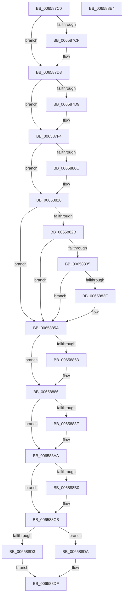

# ExReleaseDisownedFastResourceShared

- RVA: `0x006587C0`–`0x006588E5` (길이 `293` bytes)
- VA: `0x00000001406587C0`
- 실행 섹션: `.text`
- PDB 이름 있음: `예`; PDB Function 태그: `아니요`
- unwind 정보 RVA: `0x0005D2F4`
- 디코드: `80`개 명령, `293/293` bytes 표시
- 미해석 바이트: `0` (있으면 어셈블리에 `.byte`로 보존)

> 이 문서는 커널 이미지의 기계어와 PDB 기호를 분석해 생성했습니다. 4번과 5번은 함수 원형과 자료형을 바이너리 사용 방식에서 추정한 C 해석이며 원본 소스 복구 결과는 아닙니다.

## 1. Dependencies

- 직접 호출 지점: **8**; 고유 호출 대상: **3**
- 직접 호출자로 확인된 함수: **1**
- RIP 상대 이미지 참조: **0**

### Outgoing calls
- `0x006587EE` → [KeBugCheckEx](../4F/KeBugCheckEx_function_004FD660.md) (function, `0x004FD660`)
- `0x00658820` → [KeBugCheckEx](../4F/KeBugCheckEx_function_004FD660.md) (function, `0x004FD660`)
- `0x00658854` → [KeBugCheckEx](../4F/KeBugCheckEx_function_004FD660.md) (function, `0x004FD660`)
- `0x00658880` → [KeBugCheckEx](../4F/KeBugCheckEx_function_004FD660.md) (function, `0x004FD660`)
- `0x006588A4` → [KeBugCheckEx](../4F/KeBugCheckEx_function_004FD660.md) (function, `0x004FD660`)
- `0x006588C5` → [KeBugCheckEx](../4F/KeBugCheckEx_function_004FD660.md) (function, `0x004FD660`)
- `0x006588D3` → [ExpReleaseDisownedFastResourceExclusive](../41/ExpReleaseDisownedFastResourceExclusive_function_00416470.md) (function, `0x00416470`)
- `0x006588DA` → [ExpReleaseDisownedFastResourceShared](../41/ExpReleaseDisownedFastResourceShared_function_00416338.md) (function, `0x00416338`)

### Direct callers
- [DifExReleaseDisownedFastResourceSharedWrapper](../62/DifExReleaseDisownedFastResourceSharedWrapper_function_00622160.md) at `0x00622237`

### Static image references
- 디코드된 RIP-relative 메모리 참조가 없습니다.

## 2. Other-region calls and transfers

- 다른 실행 섹션으로 향하는 call: **0**
- 별도 외부 분기/꼬리 이동을 확인하지 못했습니다.

## 3. Assembly (complete function range)

```asm
006587C0  48 83 EC 38                     sub rsp, 0x38
006587C4  48 8B 01                        mov rax, qword ptr [rcx]
006587C7  41 B1 01                        mov r9b, 1
006587CA  41 84 C1                        test r9b, al
006587CD  74 04                           je 0x1406587d3
006587CF  48 8D 51 40                     lea rdx, [rcx + 0x40]
006587D3  44 84 49 1A                     test byte ptr [rcx + 0x1a], r9b
006587D7  75 1B                           jne 0x1406587f4
006587D9  48 83 64 24 20 00               and qword ptr [rsp + 0x20], 0
006587DF  45 33 C9                        xor r9d, r9d
006587E2  4C 8B C1                        mov r8, rcx
006587E5  B9 C6 01 00 00                  mov ecx, 0x1c6
006587EA  41 8D 51 03                     lea edx, [r9 + 3]
006587EE  E8 6D 4E EA FF                  call 0x1404fd660
006587F3  CC                              int3
006587F4  44 0F 20 C0                     mov rax, cr8
006587F8  65 4C 8B 04 25 88 01 00 00      mov r8, qword ptr gs:[0x188]
00658801  41 BA 02 00 00 00               mov r10d, 2
00658807  41 3A C2                        cmp al, r10b
0065880A  76 1A                           jbe 0x140658826
0065880C  48 83 64 24 20 00               and qword ptr [rsp + 0x20], 0
00658812  45 8B CA                        mov r9d, r10d
00658815  44 0F B6 C0                     movzx r8d, al
00658819  33 D2                           xor edx, edx
0065881B  B9 C6 01 00 00                  mov ecx, 0x1c6
00658820  E8 3B 4E EA FF                  call 0x1404fd660
00658825  CC                              int3
00658826  41 3A C1                        cmp al, r9b
00658829  73 2F                           jae 0x14065885a
0065882B  41 F7 40 74 00 04 00 00         test dword ptr [r8 + 0x74], 0x400
00658833  75 25                           jne 0x14065885a
00658835  41 83 B8 E4 01 00 00 00         cmp dword ptr [r8 + 0x1e4], 0
0065883D  75 1B                           jne 0x14065885a
0065883F  48 83 64 24 20 00               and qword ptr [rsp + 0x20], 0
00658845  45 33 C9                        xor r9d, r9d
00658848  45 33 C0                        xor r8d, r8d
0065884B  B9 C6 01 00 00                  mov ecx, 0x1c6
00658850  41 8D 51 07                     lea edx, [r9 + 7]
00658854  E8 07 4E EA FF                  call 0x1404fd660
00658859  CC                              int3
0065885A  0F B6 42 25                     movzx eax, byte ptr [rdx + 0x25]
0065885E  41 84 C2                        test r10b, al
00658861  74 23                           je 0x140658886
00658863  48 83 64 24 20 00               and qword ptr [rsp + 0x20], 0
00658869  44 8B C8                        mov r9d, eax
0065886C  4D 23 CA                        and r9, r10
0065886F  4C 8B C2                        mov r8, rdx
00658872  49 C1 E1 0F                     shl r9, 0xf
00658876  BA 0B 00 00 00                  mov edx, 0xb
0065887B  B9 C6 01 00 00                  mov ecx, 0x1c6
00658880  E8 DB 4D EA FF                  call 0x1404fd660
00658885  CC                              int3
00658886  48 8B 42 18                     mov rax, qword ptr [rdx + 0x18]
0065888A  48 3B C1                        cmp rax, rcx
0065888D  74 1B                           je 0x1406588aa
0065888F  4C 8B CA                        mov r9, rdx
00658892  48 89 44 24 20                  mov qword ptr [rsp + 0x20], rax
00658897  4C 8B C1                        mov r8, rcx
0065889A  BA 0C 00 00 00                  mov edx, 0xc
0065889F  B9 C6 01 00 00                  mov ecx, 0x1c6
006588A4  E8 B7 4D EA FF                  call 0x1404fd660
006588A9  CC                              int3
006588AA  44 84 4A 10                     test byte ptr [rdx + 0x10], r9b
006588AE  75 1B                           jne 0x1406588cb
006588B0  48 83 64 24 20 00               and qword ptr [rsp + 0x20], 0
006588B6  45 33 C9                        xor r9d, r9d
006588B9  4C 8B C2                        mov r8, rdx
006588BC  B9 C6 01 00 00                  mov ecx, 0x1c6
006588C1  41 8D 51 0D                     lea edx, [r9 + 0xd]
006588C5  E8 96 4D EA FF                  call 0x1404fd660
006588CA  CC                              int3
006588CB  48 8B 01                        mov rax, qword ptr [rcx]
006588CE  41 84 C1                        test r9b, al
006588D1  74 07                           je 0x1406588da
006588D3  E8 98 DB DB FF                  call 0x140416470
006588D8  EB 05                           jmp 0x1406588df
006588DA  E8 59 DA DB FF                  call 0x140416338
006588DF  48 83 C4 38                     add rsp, 0x38
006588E3  C3                              ret
006588E4  CC                              int3
```

## 4. C-style interpretation (structured pseudocode)

```c
__int64 __fastcall ExReleaseDisownedFastResourceShared(__int64 a1)
{
    __int64 result;
    __int64 v_rsp;
    unsigned __int64 v_stack_m18;

    v_rsp = (v_rsp) - (56);
    if (((1) & ((unsigned __int8)(*(unsigned __int64 *)(a1)))) != 0) {
        a2 = a1 + 64;
    }
    result = *(unsigned __int64 *)(a1);
    if (((*(unsigned __int8 *)(a1 + 26)) & (1)) == 0) {
        a4 = 0;
        a3 = a1;
        a1 = 454;
        a2 = a4 + 3;
        result = KeBugCheckEx(a1, a2, a3, a4);
    }
    result = v_cr8;
    if (((unsigned __int8)(v_cr8)) >= = 2) {
        a4 = 2;
        a3 = (unsigned __int8)(v_cr8);
        a2 = 0;
        a1 = 454;
        result = KeBugCheckEx(a1, a2, a3, a4);
    }
    if (((unsigned __int8)(result)) >= ((unsigned __int8)(a4))) goto loc_0065885A;
    if (((*(unsigned int *)(a3 + 116)) & (0x400ULL)) != 0) goto loc_0065885A;
    if ((*(unsigned int *)(a3 + 484)) == 0) {
        a4 = 0;
        a3 = 0;
        a1 = 454;
        a2 = a4 + 7;
        result = KeBugCheckEx(a1, a2, a3, a4);
    }
    result = *(unsigned __int8 *)(a2 + 37);
    if (((2) & ((unsigned __int8)(*(unsigned __int8 *)(a2 + 37)))) != 0) {
        a4 = (unsigned int)(*(unsigned __int8 *)(a2 + 37));
        a4 = (a4) & (2);
        a3 = a2;
        a4 = (a4) << (15);
        a2 = 11;
        a1 = 454;
        result = KeBugCheckEx(a1, a2, a3, a4);
    }
    result = *(unsigned __int64 *)(a2 + 24);
    if ((*(unsigned __int64 *)(a2 + 24)) != a1) {
        a4 = a2;
        v_stack_m18 = *(unsigned __int64 *)(a2 + 24);
        a3 = a1;
        a2 = 12;
        a1 = 454;
        result = KeBugCheckEx(a1, a2, a3, a4);
    }
    if (((*(unsigned __int8 *)(a2 + 16)) & ((unsigned __int8)(a4))) == 0) {
        a4 = 0;
        a3 = a2;
        a1 = 454;
        a2 = a4 + 13;
        result = KeBugCheckEx(a1, a2, a3, a4);
    }
    if (((0) & ((unsigned __int8)(*(unsigned __int64 *)(a1)))) == 0) goto loc_006588DA;
    result = ExpReleaseDisownedFastResourceExclusive(a1, a2, a3, a4);
    goto loc_006588DF;
loc_006588DA:
    result = ExpReleaseDisownedFastResourceShared(a1, a2, a3, a4);
loc_006588DF:
    v_rsp = (v_rsp) + (56);
    return result;
}
```

## 5. (Beta) C Style

```c
int64_t ExReleaseDisownedFastResourceShared(void *Arg1)
{
    uint8_t *arg1 = (uint8_t *)Arg1;

    int64_t result;
    int64_t local_rsp;
    uint64_t v_stack_m18;

    local_rsp = (local_rsp) - (56);
    if (((1) & ((uint8_t)(*(uint64_t *)(arg1)))) != 0) {
        a2 = Arg1 + 64;
    }
    result = *(uint64_t *)(arg1);
    if (((*(uint8_t *)(arg1 + 0x1A)) & (1)) == 0) {
        a4 = 0;
        a3 = Arg1;
        Arg1 = 454;
        a2 = a4 + 3;
        result = KeBugCheckEx(Arg1, a2, a3, a4);
    }
    result = v_cr8;
    if (((uint8_t)(v_cr8)) >= = 2) {
        a4 = 2;
        a3 = (uint8_t)(v_cr8);
        a2 = 0;
        Arg1 = 454;
        result = KeBugCheckEx(Arg1, a2, a3, a4);
    }
    if (((uint8_t)(result)) >= ((uint8_t)(a4))) goto loc_0065885A;
    if (((*(uint32_t *)(a3 + 0x74)) & (0x400ULL)) != 0) goto loc_0065885A;
    if ((*(uint32_t *)(a3 + 0x1E4)) == 0) {
        a4 = 0;
        a3 = 0;
        Arg1 = 454;
        a2 = a4 + 7;
        result = KeBugCheckEx(Arg1, a2, a3, a4);
    }
    result = *(uint8_t *)(a2 + 0x25);
    if (((2) & ((uint8_t)(*(uint8_t *)(a2 + 0x25)))) != 0) {
        a4 = (uint32_t)(*(uint8_t *)(a2 + 0x25));
        a4 = (a4) & (2);
        a3 = a2;
        a4 = (a4) << (15);
        a2 = 11;
        Arg1 = 454;
        result = KeBugCheckEx(Arg1, a2, a3, a4);
    }
    result = *(uint64_t *)(a2 + 0x18);
    if ((*(uint64_t *)(a2 + 0x18)) != Arg1) {
        a4 = a2;
        v_stack_m18 = *(uint64_t *)(a2 + 0x18);
        a3 = Arg1;
        a2 = 12;
        Arg1 = 454;
        result = KeBugCheckEx(Arg1, a2, a3, a4);
    }
    if (((*(uint8_t *)(a2 + 0x10)) & ((uint8_t)(a4))) == 0) {
        a4 = 0;
        a3 = a2;
        Arg1 = 454;
        a2 = a4 + 13;
        result = KeBugCheckEx(Arg1, a2, a3, a4);
    }
    if (((0) & ((uint8_t)(*(uint64_t *)(arg1)))) == 0) goto loc_006588DA;
    result = ExpReleaseDisownedFastResourceExclusive(Arg1, a2, a3, a4);
    goto loc_006588DF;
loc_006588DA:
    result = ExpReleaseDisownedFastResourceShared(Arg1, a2, a3, a4);
loc_006588DF:
    local_rsp = (local_rsp) + (56);
    return result;
}
```

### 관측된 메모리 오프셋

구조체 형식이 확인되지 않은 접근은 인자 기준의 오프셋으로만 기록했습니다.

| 기준 인자 | 오프셋 표현 | 폭 (bit) | 접근 |
|---|---:|---:|---|
| `Arg1` | `+ 0x0` | `64` | `R` |
| `Arg1` | `+ 0x1A` | `8` | `R` |
| `Arg1` | `+ 0x40` | `64` | `R` |

## 6. Execution-region graph

[열기: 2D/3D 그래프와 함수 탐색 컨트롤 패널](../../../control-panel.html?section=text&rva=0x006587C0&view=graph)

- 2D 그래프는 위에서 아래로 흐르고, 3D 그래프는 빈 공간을 드래그해 회전합니다. Shift+드래그는 이동, 휠은 확대·축소, 함수 노드 선택은 대상 보고서 이동입니다.

### Static fallback


