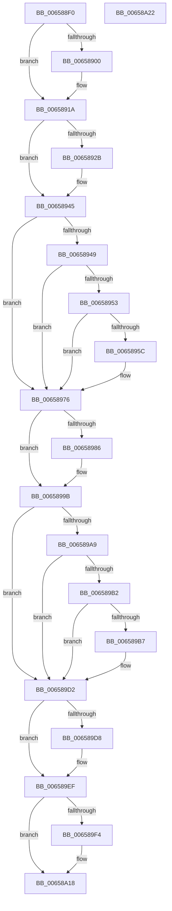

# ExReleaseFastResourceExclusive

- RVA: `0x006588F0`–`0x00658A23` (길이 `307` bytes)
- VA: `0x00000001406588F0`
- 실행 섹션: `.text`
- PDB 이름 있음: `예`; PDB Function 태그: `아니요`
- unwind 정보 RVA: `0x0005D2F4`
- 디코드: `84`개 명령, `307/307` bytes 표시
- 미해석 바이트: `0` (있으면 어셈블리에 `.byte`로 보존)

> 이 문서는 커널 이미지의 기계어와 PDB 기호를 분석해 생성했습니다. 4번과 5번은 함수 원형과 자료형을 바이너리 사용 방식에서 추정한 C 해석이며 원본 소스 복구 결과는 아닙니다.

## 1. Dependencies

- 직접 호출 지점: **8**; 고유 호출 대상: **2**
- 직접 호출자로 확인된 함수: **1**
- RIP 상대 이미지 참조: **0**

### Outgoing calls
- `0x00658914` → [KeBugCheckEx](../4F/KeBugCheckEx_function_004FD660.md) (function, `0x004FD660`)
- `0x0065893F` → [KeBugCheckEx](../4F/KeBugCheckEx_function_004FD660.md) (function, `0x004FD660`)
- `0x00658970` → [KeBugCheckEx](../4F/KeBugCheckEx_function_004FD660.md) (function, `0x004FD660`)
- `0x00658995` → [KeBugCheckEx](../4F/KeBugCheckEx_function_004FD660.md) (function, `0x004FD660`)
- `0x006589CC` → [KeBugCheckEx](../4F/KeBugCheckEx_function_004FD660.md) (function, `0x004FD660`)
- `0x006589E9` → [KeBugCheckEx](../4F/KeBugCheckEx_function_004FD660.md) (function, `0x004FD660`)
- `0x00658A12` → [KeBugCheckEx](../4F/KeBugCheckEx_function_004FD660.md) (function, `0x004FD660`)
- `0x00658A18` → [ExpReleaseFastResourceExclusive](../26/ExpReleaseFastResourceExclusive_function_00262C00.md) (function, `0x00262C00`)

### Direct callers
- [DifExReleaseFastResourceExclusiveWrapper](../62/DifExReleaseFastResourceExclusiveWrapper_function_00622700.md) at `0x006227D7`

### Static image references
- 디코드된 RIP-relative 메모리 참조가 없습니다.

## 2. Other-region calls and transfers

- 다른 실행 섹션으로 향하는 call: **0**
- 별도 외부 분기/꼬리 이동을 확인하지 못했습니다.

## 3. Assembly (complete function range)

```asm
006588F0  48 83 EC 38                     sub rsp, 0x38
006588F4  33 D2                           xor edx, edx
006588F6  4C 8D 41 40                     lea r8, [rcx + 0x40]
006588FA  F6 41 1A 01                     test byte ptr [rcx + 0x1a], 1
006588FE  75 1A                           jne 0x14065891a
00658900  45 33 C9                        xor r9d, r9d
00658903  48 89 54 24 20                  mov qword ptr [rsp + 0x20], rdx
00658908  4C 8B C1                        mov r8, rcx
0065890B  B9 C6 01 00 00                  mov ecx, 0x1c6
00658910  41 8D 51 03                     lea edx, [r9 + 3]
00658914  E8 47 4D EA FF                  call 0x1404fd660
00658919  CC                              int3
0065891A  44 0F 20 C0                     mov rax, cr8
0065891E  65 4C 8B 14 25 88 01 00 00      mov r10, qword ptr gs:[0x188]
00658927  3C 02                           cmp al, 2
00658929  76 1A                           jbe 0x140658945
0065892B  44 0F B6 C0                     movzx r8d, al
0065892F  B9 C6 01 00 00                  mov ecx, 0x1c6
00658934  41 B9 02 00 00 00               mov r9d, 2
0065893A  48 89 54 24 20                  mov qword ptr [rsp + 0x20], rdx
0065893F  E8 1C 4D EA FF                  call 0x1404fd660
00658944  CC                              int3
00658945  3C 01                           cmp al, 1
00658947  73 2D                           jae 0x140658976
00658949  41 F7 42 74 00 04 00 00         test dword ptr [r10 + 0x74], 0x400
00658951  75 23                           jne 0x140658976
00658953  41 39 92 E4 01 00 00            cmp dword ptr [r10 + 0x1e4], edx
0065895A  75 1A                           jne 0x140658976
0065895C  45 33 C9                        xor r9d, r9d
0065895F  48 89 54 24 20                  mov qword ptr [rsp + 0x20], rdx
00658964  45 33 C0                        xor r8d, r8d
00658967  B9 C6 01 00 00                  mov ecx, 0x1c6
0065896C  41 8D 51 07                     lea edx, [r9 + 7]
00658970  E8 EB 4C EA FF                  call 0x1404fd660
00658975  CC                              int3
00658976  4D 8B 58 10                     mov r11, qword ptr [r8 + 0x10]
0065897A  4D 8B CB                        mov r9, r11
0065897D  49 83 E1 FE                     and r9, 0xfffffffffffffffe
00658981  4D 3B CA                        cmp r9, r10
00658984  74 15                           je 0x14065899b
00658986  48 89 54 24 20                  mov qword ptr [rsp + 0x20], rdx
0065898B  B9 C6 01 00 00                  mov ecx, 0x1c6
00658990  BA 09 00 00 00                  mov edx, 9
00658995  E8 C6 4C EA FF                  call 0x1404fd660
0065899A  CC                              int3
0065899B  45 0F B6 50 25                  movzx r10d, byte ptr [r8 + 0x25]
006589A0  45 8A CA                        mov r9b, r10b
006589A3  41 80 E1 02                     and r9b, 2
006589A7  75 29                           jne 0x1406589d2
006589A9  49 8B 40 18                     mov rax, qword ptr [r8 + 0x18]
006589AD  48 3B C1                        cmp rax, rcx
006589B0  74 20                           je 0x1406589d2
006589B2  48 85 C0                        test rax, rax
006589B5  74 1B                           je 0x1406589d2
006589B7  4D 8B C8                        mov r9, r8
006589BA  48 89 44 24 20                  mov qword ptr [rsp + 0x20], rax
006589BF  4C 8B C1                        mov r8, rcx
006589C2  BA 08 00 00 00                  mov edx, 8
006589C7  B9 C6 01 00 00                  mov ecx, 0x1c6
006589CC  E8 8F 4C EA FF                  call 0x1404fd660
006589D1  CC                              int3
006589D2  41 F6 C3 01                     test r11b, 1
006589D6  74 17                           je 0x1406589ef
006589D8  45 33 C9                        xor r9d, r9d
006589DB  48 89 54 24 20                  mov qword ptr [rsp + 0x20], rdx
006589E0  B9 C6 01 00 00                  mov ecx, 0x1c6
006589E5  41 8D 51 0A                     lea edx, [r9 + 0xa]
006589E9  E8 72 4C EA FF                  call 0x1404fd660
006589EE  CC                              int3
006589EF  45 84 C9                        test r9b, r9b
006589F2  75 24                           jne 0x140658a18
006589F4  4D 8B CA                        mov r9, r10
006589F7  48 89 54 24 20                  mov qword ptr [rsp + 0x20], rdx
006589FC  41 83 E1 02                     and r9d, 2
00658A00  BA 0B 00 00 00                  mov edx, 0xb
00658A05  49 C1 E1 0F                     shl r9, 0xf
00658A09  B9 C6 01 00 00                  mov ecx, 0x1c6
00658A0E  49 83 C9 01                     or r9, 1
00658A12  E8 49 4C EA FF                  call 0x1404fd660
00658A17  CC                              int3
00658A18  E8 E3 A1 C0 FF                  call 0x140262c00
00658A1D  48 83 C4 38                     add rsp, 0x38
00658A21  C3                              ret
00658A22  CC                              int3
```

## 4. C-style interpretation (structured pseudocode)

```c
__int64 __fastcall ExReleaseFastResourceExclusive(__int64 a1, int a2, __int64 a3, int a4)
{
    __int64 result;
    __int64 v_rsp;
    unsigned __int64 v_stack_m18;

    v_rsp = (v_rsp) - (56);
    a2 = 0;
    if (((*(unsigned __int8 *)(a1 + 26)) & (1)) == 0) {
        a4 = 0;
        v_stack_m18 = 0;
        a3 = a1;
        a1 = 454;
        a2 = a4 + 3;
        result = KeBugCheckEx(a1, a2, a3, a4);
    }
    result = v_cr8;
    if (((unsigned __int8)(v_cr8)) >= = 2) {
        a3 = (unsigned __int8)(v_cr8);
        a1 = 454;
        a4 = 2;
        v_stack_m18 = a2;
        result = KeBugCheckEx(a1, a2, a3, a4);
    }
    if (((unsigned __int8)(result)) >= 1) goto loc_00658976;
    if (((*(unsigned int *)(*(unsigned __int64 *)(gs_base + (0 + 392)) + 116)) & (0x400ULL)) != 0) goto loc_00658976;
    if ((*(unsigned int *)(*(unsigned __int64 *)(gs_base + (0 + 392)) + 484)) == a2) {
        a4 = 0;
        v_stack_m18 = a2;
        a3 = 0;
        a1 = 454;
        a2 = a4 + 7;
        result = KeBugCheckEx(a1, a2, a3, a4);
    }
    a4 = (*(unsigned __int64 *)(a3 + 16)) & (-2);
    if (a4 != (*(unsigned __int64 *)(gs_base + (0 + 392)))) {
        v_stack_m18 = a2;
        a1 = 454;
        a2 = 9;
        result = KeBugCheckEx(a1, a2, a3, a4);
    }
    a4 = (unsigned __int8)(((unsigned __int8)(*(unsigned __int8 *)(a3 + 37))) & (2));
    if (condition_is_not_equal) goto loc_006589D2;
    if ((*(unsigned __int64 *)(a3 + 24)) == a1) goto loc_006589D2;
    result = *(unsigned __int64 *)(a3 + 24);
    if (*(unsigned __int64 *)(a3 + 24) != 0) {
        a4 = 0;
        v_stack_m18 = *(unsigned __int64 *)(a3 + 24);
        a3 = a1;
        a2 = 8;
        a1 = 454;
        result = KeBugCheckEx(a1, a2, a3, a4);
    }
    if ((((unsigned __int8)(*(unsigned __int64 *)(a3 + 16))) & (1)) != 0) {
        a4 = 0;
        v_stack_m18 = a2;
        a1 = 454;
        a2 = a4 + 10;
        result = KeBugCheckEx(a1, a2, a3, a4);
    }
    if (0 == 0) {
        a4 = *(unsigned __int8 *)(a3 + 37);
        v_stack_m18 = a2;
        a4 = (unsigned int)((a4) & (2));
        a2 = 11;
        a4 = (a4) << (15);
        a1 = 454;
        a4 = (a4) | (1);
        result = KeBugCheckEx(a1, a2, a3, a4);
    }
    result = ExpReleaseFastResourceExclusive(a1, a2, a3, a4);
    v_rsp = (v_rsp) + (56);
    return result;
}
```

## 5. (Beta) C Style

```c
int64_t ExReleaseFastResourceExclusive(void *Arg1, int32_t Arg2, int64_t Arg3, int32_t Arg4)
{
    uint8_t *arg1 = (uint8_t *)Arg1;

    int64_t result;
    int64_t local_rsp;
    uint64_t v_stack_m18;

    local_rsp = (local_rsp) - (56);
    Arg2 = 0;
    if (((*(uint8_t *)(arg1 + 0x1A)) & (1)) == 0) {
        Arg4 = 0;
        v_stack_m18 = 0;
        Arg3 = Arg1;
        Arg1 = 454;
        Arg2 = Arg4 + 3;
        result = KeBugCheckEx(Arg1, Arg2, Arg3, Arg4);
    }
    result = v_cr8;
    if (((uint8_t)(v_cr8)) >= = 2) {
        Arg3 = (uint8_t)(v_cr8);
        Arg1 = 454;
        Arg4 = 2;
        v_stack_m18 = Arg2;
        result = KeBugCheckEx(Arg1, Arg2, Arg3, Arg4);
    }
    if (((uint8_t)(result)) >= 1) goto loc_00658976;
    if (((*(uint32_t *)(*(uint64_t *)(gs_base + (0 + 0x188)) + 0x74)) & (0x400ULL)) != 0) goto loc_00658976;
    if ((*(uint32_t *)(*(uint64_t *)(gs_base + (0 + 0x188)) + 0x1E4)) == Arg2) {
        Arg4 = 0;
        v_stack_m18 = Arg2;
        Arg3 = 0;
        Arg1 = 454;
        Arg2 = Arg4 + 7;
        result = KeBugCheckEx(Arg1, Arg2, Arg3, Arg4);
    }
    Arg4 = (*(uint64_t *)(Arg3 + 0x10)) & (-2);
    if (Arg4 != (*(uint64_t *)(gs_base + (0 + 0x188)))) {
        v_stack_m18 = Arg2;
        Arg1 = 454;
        Arg2 = 9;
        result = KeBugCheckEx(Arg1, Arg2, Arg3, Arg4);
    }
    Arg4 = (uint8_t)(((uint8_t)(*(uint8_t *)(Arg3 + 0x25))) & (2));
    if (condition_is_not_equal) goto loc_006589D2;
    if ((*(uint64_t *)(Arg3 + 0x18)) == Arg1) goto loc_006589D2;
    result = *(uint64_t *)(Arg3 + 0x18);
    if (*(uint64_t *)(Arg3 + 0x18) != 0) {
        Arg4 = 0;
        v_stack_m18 = *(uint64_t *)(Arg3 + 0x18);
        Arg3 = Arg1;
        Arg2 = 8;
        Arg1 = 454;
        result = KeBugCheckEx(Arg1, Arg2, Arg3, Arg4);
    }
    if ((((uint8_t)(*(uint64_t *)(Arg3 + 0x10))) & (1)) != 0) {
        Arg4 = 0;
        v_stack_m18 = Arg2;
        Arg1 = 454;
        Arg2 = Arg4 + 10;
        result = KeBugCheckEx(Arg1, Arg2, Arg3, Arg4);
    }
    if (0 == 0) {
        Arg4 = *(uint8_t *)(Arg3 + 0x25);
        v_stack_m18 = Arg2;
        Arg4 = (uint32_t)((Arg4) & (2));
        Arg2 = 11;
        Arg4 = (Arg4) << (15);
        Arg1 = 454;
        Arg4 = (Arg4) | (1);
        result = KeBugCheckEx(Arg1, Arg2, Arg3, Arg4);
    }
    result = ExpReleaseFastResourceExclusive(Arg1, Arg2, Arg3, Arg4);
    local_rsp = (local_rsp) + (56);
    return result;
}
```

### 관측된 메모리 오프셋

구조체 형식이 확인되지 않은 접근은 인자 기준의 오프셋으로만 기록했습니다.

| 기준 인자 | 오프셋 표현 | 폭 (bit) | 접근 |
|---|---:|---:|---|
| `Arg1` | `+ 0x1A` | `8` | `R` |
| `Arg1` | `+ 0x40` | `64` | `R` |

## 6. Execution-region graph

[열기: 2D/3D 그래프와 함수 탐색 컨트롤 패널](../../../control-panel.html?section=text&rva=0x006588F0&view=graph)

- 2D 그래프는 위에서 아래로 흐르고, 3D 그래프는 빈 공간을 드래그해 회전합니다. Shift+드래그는 이동, 휠은 확대·축소, 함수 노드 선택은 대상 보고서 이동입니다.

### Static fallback


