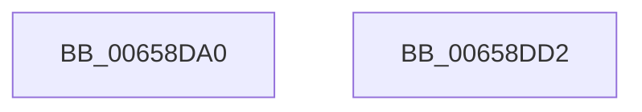

# ExReleaseResourceAndLeavePriorityRegion

- RVA: `0x00658DA0`–`0x00658DD3` (길이 `51` bytes)
- VA: `0x0000000140658DA0`
- 실행 섹션: `.text`
- PDB 이름 있음: `예`; PDB Function 태그: `아니요`
- unwind 정보 RVA: `0x0005CF00`
- 디코드: `15`개 명령, `51/51` bytes 표시
- 미해석 바이트: `0` (있으면 어셈블리에 `.byte`로 보존)

> 이 문서는 커널 이미지의 기계어와 PDB 기호를 분석해 생성했습니다. 4번과 5번은 함수 원형과 자료형을 바이너리 사용 방식에서 추정한 C 해석이며 원본 소스 복구 결과는 아닙니다.

## 1. Dependencies

- 직접 호출 지점: **3**; 고유 호출 대상: **3**
- 직접 호출자로 확인된 함수: **1**
- RIP 상대 이미지 참조: **0**

### Outgoing calls
- `0x00658DA6` → [ExReleaseResourceLite](../25/ExReleaseResourceLite_function_0025FA10.md) (function, `0x0025FA10`)
- `0x00658DBF` → [PsBoostThreadIoEx](../39/PsBoostThreadIoEx_function_00392C00.md) (function, `0x00392C00`)
- `0x00658DC7` → [KiLeaveCriticalRegionUnsafe](../25/KiLeaveCriticalRegionUnsafe_function_0025F010.md) (function, `0x0025F010`)

### Direct callers
- [DifExReleaseResourceAndLeavePriorityRegionWrapper](../62/DifExReleaseResourceAndLeavePriorityRegionWrapper_function_00622CB0.md) at `0x00622D76`

### Static image references
- 디코드된 RIP-relative 메모리 참조가 없습니다.

## 2. Other-region calls and transfers

- 다른 실행 섹션으로 향하는 call: **0**
- 별도 외부 분기/꼬리 이동을 확인하지 못했습니다.

## 3. Assembly (complete function range)

```asm
00658DA0  40 53                           push rbx
00658DA2  48 83 EC 20                     sub rsp, 0x20
00658DA6  E8 65 6C C0 FF                  call 0x14025fa10
00658DAB  65 48 8B 1C 25 88 01 00 00      mov rbx, qword ptr gs:[0x188]
00658DB4  45 33 C9                        xor r9d, r9d
00658DB7  48 8B CB                        mov rcx, rbx
00658DBA  45 33 C0                        xor r8d, r8d
00658DBD  B2 01                           mov dl, 1
00658DBF  E8 3C 9E D3 FF                  call 0x140392c00
00658DC4  48 8B CB                        mov rcx, rbx
00658DC7  E8 44 62 C0 FF                  call 0x14025f010
00658DCC  48 83 C4 20                     add rsp, 0x20
00658DD0  5B                              pop rbx
00658DD1  C3                              ret
00658DD2  CC                              int3
```

## 4. C-style interpretation (structured pseudocode)

```c
__int64 __fastcall ExReleaseResourceAndLeavePriorityRegion(__int64 a1, __int64 a2, int a3, int a4)
{
    __int64 result;
    __int64 v_rsp;

    v_rsp = (v_rsp) - (32);
    result = ExReleaseResourceLite(a1, a2, a3, a4);
    a4 = 0;
    a3 = 0;
    result = PsBoostThreadIoEx(*(unsigned __int64 *)(gs_base + (0 + 392)), 1, a3, a4);
    result = KiLeaveCriticalRegionUnsafe(*(unsigned __int64 *)(gs_base + (0 + 392)), 1, a3, a4);
    v_rsp = (v_rsp) + (32);
    return result;
}
```

## 5. (Beta) C Style

```c
int64_t ExReleaseResourceAndLeavePriorityRegion(int64_t Arg1, int64_t Arg2, int32_t Arg3, int32_t Arg4)
{
    int64_t result;
    int64_t local_rsp;

    local_rsp = (local_rsp) - (32);
    result = ExReleaseResourceLite(Arg1, Arg2, Arg3, Arg4);
    Arg4 = 0;
    Arg3 = 0;
    result = PsBoostThreadIoEx(*(uint64_t *)(gs_base + (0 + 0x188)), 1, Arg3, Arg4);
    result = KiLeaveCriticalRegionUnsafe(*(uint64_t *)(gs_base + (0 + 0x188)), 1, Arg3, Arg4);
    local_rsp = (local_rsp) + (32);
    return result;
}
```

## 6. Execution-region graph

[열기: 2D/3D 그래프와 함수 탐색 컨트롤 패널](../../../control-panel.html?section=text&rva=0x00658DA0&view=graph)

- 2D 그래프는 위에서 아래로 흐르고, 3D 그래프는 빈 공간을 드래그해 회전합니다. Shift+드래그는 이동, 휠은 확대·축소, 함수 노드 선택은 대상 보고서 이동입니다.

### Static fallback


