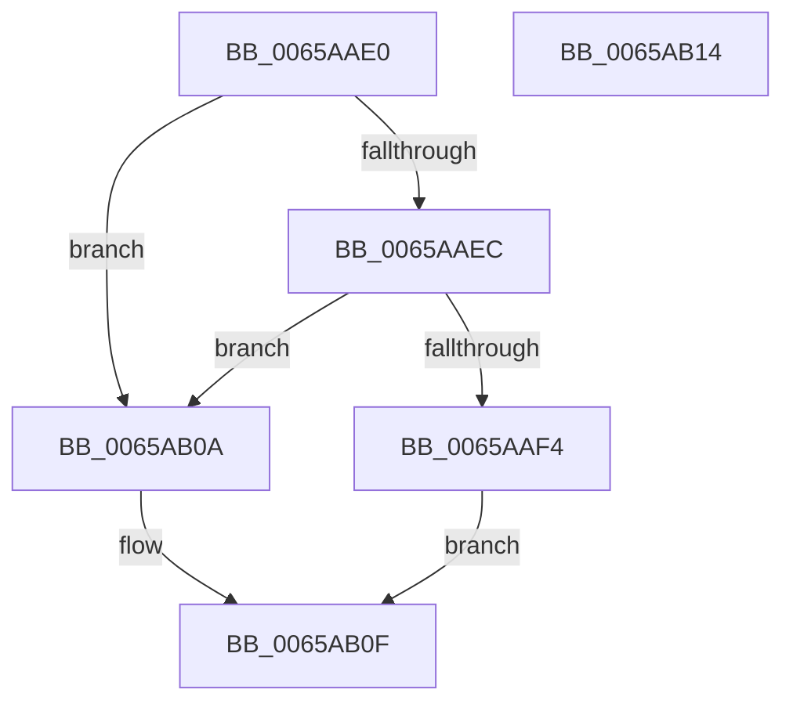

# ExSecurePoolUpdate

- RVA: `0x0065AAE0`–`0x0065AB15` (길이 `53` bytes)
- VA: `0x000000014065AAE0`
- 실행 섹션: `.text`
- PDB 이름 있음: `예`; PDB Function 태그: `아니요`
- unwind 정보 RVA: `0x0005C788`
- 디코드: `15`개 명령, `53/53` bytes 표시
- 미해석 바이트: `0` (있으면 어셈블리에 `.byte`로 보존)

> 이 문서는 커널 이미지의 기계어와 PDB 기호를 분석해 생성했습니다. 4번과 5번은 함수 원형과 자료형을 바이너리 사용 방식에서 추정한 C 해석이며 원본 소스 복구 결과는 아닙니다.

## 1. Dependencies

- 직접 호출 지점: **1**; 고유 호출 대상: **1**
- 직접 호출자로 확인된 함수: **0**
- RIP 상대 이미지 참조: **0**

### Outgoing calls
- `0x0065AAF4` → [ExpSecurePoolFromHandle](../4F/ExpSecurePoolFromHandle_function_004F6D48.md) (function, `0x004F6D48`)

### Direct callers
- 이 함수 시작 RVA로 연결되는 직접 call은 확인되지 않았습니다. 간접 호출은 완전히 역산할 수 없습니다.

### Static image references
- 디코드된 RIP-relative 메모리 참조가 없습니다.

## 2. Other-region calls and transfers

- 다른 실행 섹션으로 향하는 call: **0**
- 별도 외부 분기/꼬리 이동을 확인하지 못했습니다.

## 3. Assembly (complete function range)

```asm
0065AAE0  48 83 EC 28                     sub rsp, 0x28
0065AAE4  48 83 7C 24 58 00               cmp qword ptr [rsp + 0x58], 0
0065AAEA  74 1E                           je 0x14065ab0a
0065AAEC  48 83 7C 24 60 00               cmp qword ptr [rsp + 0x60], 0
0065AAF2  74 16                           je 0x14065ab0a
0065AAF4  E8 4F C2 E9 FF                  call 0x1404f6d48
0065AAF9  48 F7 D8                        neg rax
0065AAFC  1B C0                           sbb eax, eax
0065AAFE  25 AE 00 00 00                  and eax, 0xae
0065AB03  05 0D 00 00 C0                  add eax, 0xc000000d
0065AB08  EB 05                           jmp 0x14065ab0f
0065AB0A  B8 0D 00 00 C0                  mov eax, 0xc000000d
0065AB0F  48 83 C4 28                     add rsp, 0x28
0065AB13  C3                              ret
0065AB14  CC                              int3
```

## 4. C-style interpretation (structured pseudocode)

```c
__int64 __fastcall ExSecurePoolUpdate(__int64 a1, __int64 a2, __int64 a3, __int64 a4, __int64 a5, __int64 a6, __int64 a7)
{
    __int64 result;
    __int64 v_rsp;

    v_rsp = (v_rsp) - (40);
    if (a6 == 0) goto loc_0065AB0A;
    if (a7 == 0) goto loc_0065AB0A;
    result = ExpSecurePoolFromHandle(a1, a2, a3, a4);
    result = -(result);
    result = (unsigned int)((result) & (174));
    result = (unsigned int)((result) + (0xC000000DULL));
    goto loc_0065AB0F;
loc_0065AB0A:
loc_0065AB0F:
    v_rsp = (v_rsp) + (40);
    return (unsigned int)(0xC000000DULL);
}
```

## 5. (Beta) C Style

```c
int64_t ExSecurePoolUpdate(int64_t Arg1, int64_t Arg2, int64_t Arg3, int64_t Arg4, uint64_t Arg5, int64_t Arg6, int64_t Arg7)
{
    int64_t result;
    int64_t local_rsp;

    local_rsp = (local_rsp) - (40);
    if (Arg6 == 0) goto loc_0065AB0A;
    if (Arg7 == 0) goto loc_0065AB0A;
    result = ExpSecurePoolFromHandle(Arg1, Arg2, Arg3, Arg4);
    result = -(result);
    result = (uint32_t)((result) & (174));
    result = (uint32_t)((result) + (0xC000000DULL));
    goto loc_0065AB0F;
loc_0065AB0A:
loc_0065AB0F:
    local_rsp = (local_rsp) + (40);
    return (uint32_t)(0xC000000DULL);
}
```

## 6. Execution-region graph

[열기: 2D/3D 그래프와 함수 탐색 컨트롤 패널](../../../control-panel.html?section=text&rva=0x0065AAE0&view=graph)

- 2D 그래프는 위에서 아래로 흐르고, 3D 그래프는 빈 공간을 드래그해 회전합니다. Shift+드래그는 이동, 휠은 확대·축소, 함수 노드 선택은 대상 보고서 이동입니다.

### Static fallback


