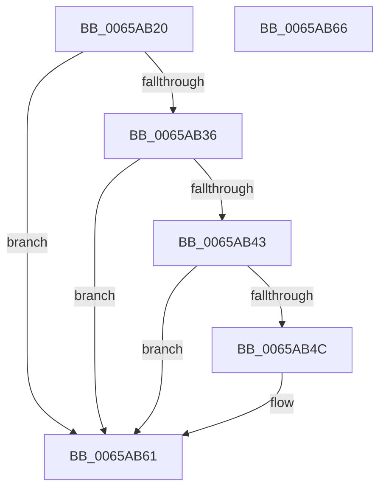

# ExSecurePoolValidate

- RVA: `0x0065AB20`–`0x0065AB67` (길이 `71` bytes)
- VA: `0x000000014065AB20`
- 실행 섹션: `.text`
- PDB 이름 있음: `예`; PDB Function 태그: `아니요`
- unwind 정보 RVA: `0x0005C788`
- 디코드: `21`개 명령, `71/71` bytes 표시
- 미해석 바이트: `0` (있으면 어셈블리에 `.byte`로 보존)

> 이 문서는 커널 이미지의 기계어와 PDB 기호를 분석해 생성했습니다. 4번과 5번은 함수 원형과 자료형을 바이너리 사용 방식에서 추정한 C 해석이며 원본 소스 복구 결과는 아닙니다.

## 1. Dependencies

- 직접 호출 지점: **1**; 고유 호출 대상: **1**
- 직접 호출자로 확인된 함수: **0**
- RIP 상대 이미지 참조: **2**

### Outgoing calls
- `0x0065AB27` → [ExpSecurePoolFromHandle](../4F/ExpSecurePoolFromHandle_function_004F6D48.md) (function, `0x004F6D48`)

### Direct callers
- 이 함수 시작 RVA로 연결되는 직접 call은 확인되지 않았습니다. 간접 호출은 완전히 역산할 수 없습니다.

### Static image references
- `0x0065AB3A` → RVA `0x00EFA900` (`.data`; read)
- `0x0065AB43` → RVA `0x00EFA908` (`.data`; read)

## 2. Other-region calls and transfers

- 다른 실행 섹션으로 향하는 call: **0**
- 별도 외부 분기/꼬리 이동을 확인하지 못했습니다.

## 3. Assembly (complete function range)

```asm
0065AB20  48 83 EC 28                     sub rsp, 0x28
0065AB24  44 8B DA                        mov r11d, edx
0065AB27  E8 1C C2 E9 FF                  call 0x1404f6d48
0065AB2C  4C 8B D0                        mov r10, rax
0065AB2F  33 C0                           xor eax, eax
0065AB31  4D 85 D2                        test r10, r10
0065AB34  74 2B                           je 0x14065ab61
0065AB36  49 8D 50 F0                     lea rdx, [r8 - 0x10]
0065AB3A  48 3B 15 BF FD 89 00            cmp rdx, qword ptr [rip + 0x89fdbf]
0065AB41  72 1E                           jb 0x14065ab61
0065AB43  48 3B 15 BE FD 89 00            cmp rdx, qword ptr [rip + 0x89fdbe]
0065AB4A  73 15                           jae 0x14065ab61
0065AB4C  41 8B CB                        mov ecx, r11d
0065AB4F  44 8D 40 01                     lea r8d, [rax + 1]
0065AB53  49 33 4A 08                     xor rcx, qword ptr [r10 + 8]
0065AB57  49 33 C9                        xor rcx, r9
0065AB5A  48 39 0A                        cmp qword ptr [rdx], rcx
0065AB5D  41 0F 44 C0                     cmove eax, r8d
0065AB61  48 83 C4 28                     add rsp, 0x28
0065AB65  C3                              ret
0065AB66  CC                              int3
```

## 4. C-style interpretation (structured pseudocode)

```c
__int64 __fastcall ExSecurePoolValidate(__int64 a1, int a2, __int64 a3, __int64 a4)
{
    __int64 result;
    __int64 v_rsp;

    v_rsp = (v_rsp) - (40);
    result = ExpSecurePoolFromHandle(a1, a2, a3, a4);
    result = 0;
    if (0 == 0) goto loc_0065AB61;
    if ((a3 - 16) < (*(unsigned __int64 *)(v_rip + 9043391))) goto loc_0065AB61;
    if ((a3 - 16) < (*(unsigned __int64 *)(v_rip + 9043390))) {
        a1 = (unsigned int)((unsigned int)(a2));
        a3 = result + 1;
        a1 = (a1) ^ (*(unsigned __int64 *)(result + 8));
        a1 = (a1) ^ (a4);
        if ((*(unsigned __int64 *)(a3 - 16)) == a1) { result = (unsigned int)(a3); }
    }
    v_rsp = (v_rsp) + (40);
    return result;
}
```

## 5. (Beta) C Style

```c
int64_t ExSecurePoolValidate(int64_t Arg1, int32_t Arg2, int64_t Arg3, int64_t Arg4)
{
    int64_t result;
    int64_t local_rsp;

    local_rsp = (local_rsp) - (40);
    result = ExpSecurePoolFromHandle(Arg1, Arg2, Arg3, Arg4);
    result = 0;
    if (0 == 0) goto loc_0065AB61;
    if ((Arg3 - 16) < (*(uint64_t *)(v_rip + 0x89FDBF))) goto loc_0065AB61;
    if ((Arg3 - 16) < (*(uint64_t *)(v_rip + 0x89FDBE))) {
        Arg1 = (uint32_t)((uint32_t)(Arg2));
        Arg3 = result + 1;
        Arg1 = (Arg1) ^ (*(uint64_t *)(result + 0x8));
        Arg1 = (Arg1) ^ (Arg4);
        if ((*(uint64_t *)(Arg3 - 0x10)) == Arg1) { result = (uint32_t)(Arg3); }
    }
    local_rsp = (local_rsp) + (40);
    return result;
}
```

## 6. Execution-region graph

[열기: 2D/3D 그래프와 함수 탐색 컨트롤 패널](../../../control-panel.html?section=text&rva=0x0065AB20&view=graph)

- 2D 그래프는 위에서 아래로 흐르고, 3D 그래프는 빈 공간을 드래그해 회전합니다. Shift+드래그는 이동, 휠은 확대·축소, 함수 노드 선택은 대상 보고서 이동입니다.

### Static fallback


