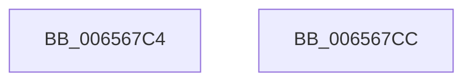

# ExSetPoolFlags

- RVA: `0x006567C4`–`0x006567CD` (길이 `9` bytes)
- VA: `0x00000001406567C4`
- 실행 섹션: `.text`
- PDB 이름 있음: `예`; PDB Function 태그: `아니요`
- unwind 정보 RVA: `0x000DB714`
- 디코드: `3`개 명령, `9/9` bytes 표시
- 미해석 바이트: `0` (있으면 어셈블리에 `.byte`로 보존)

> 이 문서는 커널 이미지의 기계어와 PDB 기호를 분석해 생성했습니다. 4번과 5번은 함수 원형과 자료형을 바이너리 사용 방식에서 추정한 C 해석이며 원본 소스 복구 결과는 아닙니다.

## 1. Dependencies

- 직접 호출 지점: **0**; 고유 호출 대상: **0**
- 직접 호출자로 확인된 함수: **6**
- RIP 상대 이미지 참조: **1**

### Outgoing calls
- 직접 디코드된 call 명령이 없습니다.

### Direct callers
- [VfInitSystemNoRebootNeeded](../../pagevrfy/B9/VfInitSystemNoRebootNeeded_function_00B93970.md) at `0x00B93A1C`
- [VfDriverApplyDifVerification](../../pagevrfy/B9/VfDriverApplyDifVerification_function_00B9A028.md) at `0x00B9A170`
- [ViPtInitCircularPoolTrace](../../pagevrfy/B9/ViPtInitCircularPoolTrace_function_00B9C964.md) at `0x00B9CA23`
- [VfDeadlockPluginEntry](../../pagevrfy/BA/VfDeadlockPluginEntry_function_00BA8230.md) at `0x00BA87FD`
- [VfSettingsApplyMiscellaneousChecks](../../pagevrfy/BA/VfSettingsApplyMiscellaneousChecks_function_00BAB210.md) at `0x00BAB237`
- [ViIovInitialization](../../pagevrfy/BB/ViIovInitialization_function_00BB4EC4.md) at `0x00BB4EDA`

### Static image references
- `0x006567C4` → RVA `0x00FC6BD0` (`ALMOSTRO`; read/write)

## 2. Other-region calls and transfers

- 다른 실행 섹션으로 향하는 call: **0**
- 별도 외부 분기/꼬리 이동을 확인하지 못했습니다.

## 3. Assembly (complete function range)

```asm
006567C4  F0 09 0D 05 04 97 00            lock or dword ptr [rip + 0x970405], ecx
006567CB  C3                              ret
006567CC  CC                              int3
```

## 4. C-style interpretation (structured pseudocode)

```c
void __fastcall ExSetPoolFlags(int a1)
{
    return;
}
```

## 5. (Beta) C Style

```c
void ExSetPoolFlags(int32_t Arg1)
{
    return;
}
```

## 6. Execution-region graph

[열기: 2D/3D 그래프와 함수 탐색 컨트롤 패널](../../../control-panel.html?section=text&rva=0x006567C4&view=graph)

- 2D 그래프는 위에서 아래로 흐르고, 3D 그래프는 빈 공간을 드래그해 회전합니다. Shift+드래그는 이동, 휠은 확대·축소, 함수 노드 선택은 대상 보고서 이동입니다.

### Static fallback


