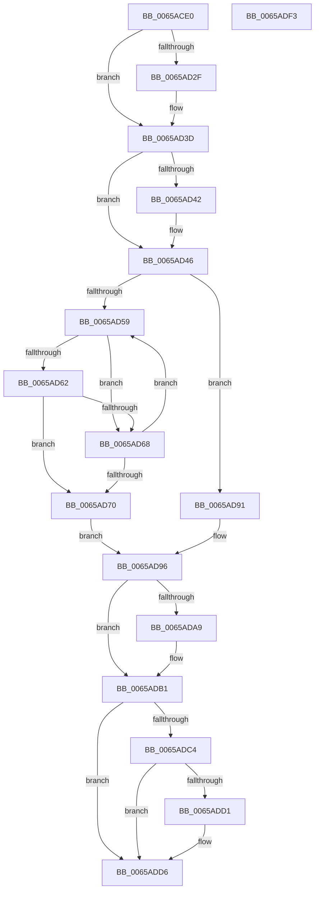

# ExSvmBeginDeviceReset

- RVA: `0x0065ACE0`–`0x0065ADF4` (길이 `276` bytes)
- VA: `0x000000014065ACE0`
- 실행 섹션: `.text`
- PDB 이름 있음: `예`; PDB Function 태그: `아니요`
- unwind 정보 RVA: `0x0005E6B4`
- 디코드: `73`개 명령, `276/276` bytes 표시
- 미해석 바이트: `0` (있으면 어셈블리에 `.byte`로 보존)

> 이 문서는 커널 이미지의 기계어와 PDB 기호를 분석해 생성했습니다. 4번과 5번은 함수 원형과 자료형을 바이너리 사용 방식에서 추정한 C 해석이며 원본 소스 복구 결과는 아닙니다.

## 1. Dependencies

- 직접 호출 지점: **6**; 고유 호출 대상: **6**
- 직접 호출자로 확인된 함수: **0**
- RIP 상대 이미지 참조: **4**

### Outgoing calls
- `0x0065AD1F` → [KeAbPreAcquire](../21/KeAbPreAcquire_function_00210230.md) (function, `0x00210230`)
- `0x0065AD38` → [ExfAcquirePushLockExclusiveEx](../20/ExfAcquirePushLockExclusiveEx_function_0020FC90.md) (function, `0x0020FC90`)
- `0x0065AD88` → [guard_dispatch_icall](../6B/guard_dispatch_icall_function_006BAAD0.md) (function, `0x006BAAD0`)
- `0x0065ADAC` → [ExfTryToWakePushLock](../26/ExfTryToWakePushLock_function_00265DD0.md) (function, `0x00265DD0`)
- `0x0065ADB4` → [KeAbPostRelease](../2E/KeAbPostRelease_function_002E1600.md) (function, `0x002E1600`)
- `0x0065ADD1` → [KiCheckForKernelApcDelivery](../2E/KiCheckForKernelApcDelivery_function_002E2C80.md) (function, `0x002E2C80`)

### Direct callers
- 이 함수 시작 RVA로 연결되는 직접 call은 확인되지 않았습니다. 간접 호출은 완전히 역산할 수 없습니다.

### Static image references
- `0x0065AD02` → RVA `0x00EFA8E8` (`.data`; read)
- `0x0065AD46` → RVA `0x00EFA8F0` (`.data`; read)
- `0x0065AD70` → RVA `0x00E06D28` (`.data`; read)
- `0x0065AD9A` → RVA `0x00EFA8E8` (`.data`; read/write)

## 2. Other-region calls and transfers

- 다른 실행 섹션으로 향하는 call: **0**
- 별도 외부 분기/꼬리 이동을 확인하지 못했습니다.

## 3. Assembly (complete function range)

```asm
0065ACE0  48 8B C4                        mov rax, rsp
0065ACE3  48 89 58 08                     mov qword ptr [rax + 8], rbx
0065ACE7  48 89 68 10                     mov qword ptr [rax + 0x10], rbp
0065ACEB  48 89 70 18                     mov qword ptr [rax + 0x18], rsi
0065ACEF  48 89 78 20                     mov qword ptr [rax + 0x20], rdi
0065ACF3  41 56                           push r14
0065ACF5  48 83 EC 20                     sub rsp, 0x20
0065ACF9  65 48 8B 1C 25 88 01 00 00      mov rbx, qword ptr gs:[0x188]
0065AD02  4C 8D 35 DF FB 89 00            lea r14, [rip + 0x89fbdf]
0065AD09  48 8B EA                        mov rbp, rdx
0065AD0C  48 8B F1                        mov rsi, rcx
0065AD0F  45 33 C0                        xor r8d, r8d
0065AD12  33 D2                           xor edx, edx
0065AD14  49 8B CE                        mov rcx, r14
0065AD17  66 FF 8B E6 01 00 00            dec word ptr [rbx + 0x1e6]
0065AD1E  90                              nop
0065AD1F  E8 0C 55 BB FF                  call 0x140210230
0065AD24  F0 49 0F BA 2E 00               lock bts qword ptr [r14], 0
0065AD2A  48 8B F8                        mov rdi, rax
0065AD2D  73 0E                           jae 0x14065ad3d
0065AD2F  4D 8B C6                        mov r8, r14
0065AD32  48 8B D0                        mov rdx, rax
0065AD35  49 8B CE                        mov rcx, r14
0065AD38  E8 53 4F BB FF                  call 0x14020fc90
0065AD3D  48 85 FF                        test rdi, rdi
0065AD40  74 04                           je 0x14065ad46
0065AD42  C6 47 0A 01                     mov byte ptr [rdi + 0xa], 1
0065AD46  48 8B 05 A3 FB 89 00            mov rax, qword ptr [rip + 0x89fba3]
0065AD4D  48 8D 15 9C FB 89 00            lea rdx, [rip + 0x89fb9c]
0065AD54  48 3B C2                        cmp rax, rdx
0065AD57  74 38                           je 0x14065ad91
0065AD59  80 78 10 00                     cmp byte ptr [rax + 0x10], 0
0065AD5D  48 8D 08                        lea rcx, [rax]
0065AD60  75 06                           jne 0x14065ad68
0065AD62  48 39 70 18                     cmp qword ptr [rax + 0x18], rsi
0065AD66  74 08                           je 0x14065ad70
0065AD68  48 8B 00                        mov rax, qword ptr [rax]
0065AD6B  48 3B C2                        cmp rax, rdx
0065AD6E  75 E9                           jne 0x14065ad59
0065AD70  48 8B 05 B1 BF 7A 00            mov rax, qword ptr [rip + 0x7abfb1]
0065AD77  48 8B D5                        mov rdx, rbp
0065AD7A  48 8B 89 B0 00 00 00            mov rcx, qword ptr [rcx + 0xb0]
0065AD81  48 8B 80 88 00 00 00            mov rax, qword ptr [rax + 0x88]
0065AD88  E8 43 FD 05 00                  call 0x1406baad0
0065AD8D  8B F8                           mov edi, eax
0065AD8F  EB 05                           jmp 0x14065ad96
0065AD91  BF 0E 00 00 C0                  mov edi, 0xc000000e
0065AD96  48 83 C8 FF                     or rax, 0xffffffffffffffff
0065AD9A  F0 48 0F C1 05 45 FB 89 00      lock xadd qword ptr [rip + 0x89fb45], rax
0065ADA3  24 06                           and al, 6
0065ADA5  3C 02                           cmp al, 2
0065ADA7  75 08                           jne 0x14065adb1
0065ADA9  49 8B CE                        mov rcx, r14
0065ADAC  E8 1F B0 C0 FF                  call 0x140265dd0
0065ADB1  49 8B CE                        mov rcx, r14
0065ADB4  E8 47 68 C8 FF                  call 0x1402e1600
0065ADB9  90                              nop
0065ADBA  66 83 83 E6 01 00 00 01         add word ptr [rbx + 0x1e6], 1
0065ADC2  75 12                           jne 0x14065add6
0065ADC4  48 8D 83 98 00 00 00            lea rax, [rbx + 0x98]
0065ADCB  90                              nop
0065ADCC  48 39 00                        cmp qword ptr [rax], rax
0065ADCF  74 05                           je 0x14065add6
0065ADD1  E8 AA 7E C8 FF                  call 0x1402e2c80
0065ADD6  48 8B 5C 24 30                  mov rbx, qword ptr [rsp + 0x30]
0065ADDB  8B C7                           mov eax, edi
0065ADDD  48 8B 7C 24 48                  mov rdi, qword ptr [rsp + 0x48]
0065ADE2  48 8B 6C 24 38                  mov rbp, qword ptr [rsp + 0x38]
0065ADE7  48 8B 74 24 40                  mov rsi, qword ptr [rsp + 0x40]
0065ADEC  48 83 C4 20                     add rsp, 0x20
0065ADF0  41 5E                           pop r14
0065ADF2  C3                              ret
0065ADF3  CC                              int3
```

## 4. C-style interpretation (structured pseudocode)

```c
__int64 __fastcall ExSvmBeginDeviceReset(__int64 a1, __int64 a2, int a3)
{
    __int64 result;
    __int64 v_rsp;
    unsigned __int64 v_stack_p10;
    unsigned __int64 v_stack_p18;
    unsigned __int64 v_stack_p20;
    unsigned __int64 v_stack_p8;

    *(unsigned __int64 *)(v_rsp + 8) = v_rbx;
    *(unsigned __int64 *)(v_rsp + 16) = v_rbp;
    *(unsigned __int64 *)(v_rsp + 24) = v_rsi;
    *(unsigned __int64 *)(v_rsp + 32) = v_rdi;
    v_rsp = (v_rsp) - (32);
    a3 = 0;
    a2 = 0;
    result = KeAbPreAcquire(v_rip + 9042911, a2, a3, a4);
    if (!(condition_is_above_or_equal)) {
        a3 = v_rip + 9042911;
        a2 = result;
        a1 = v_rip + 9042911;
        result = ExfAcquirePushLockExclusiveEx(a1, a2, a3, a4);
    }
    if (result != 0) {
        *(unsigned __int8 *)(result + 10) = 1;
    }
    if ((*(unsigned __int64 *)(v_rip + 9042851)) == (v_rip + 9042844)) goto loc_0065AD91;
loc_0065AD59:
    if ((*(unsigned __int8 *)(*(unsigned __int64 *)(v_rip + 9042851) + 16)) != 0) goto loc_0065AD68;
    if ((*(unsigned __int64 *)(*(unsigned __int64 *)(v_rip + 9042851) + 24)) == a1) goto loc_0065AD70;
loc_0065AD68:
    if ((*(unsigned __int64 *)(*(unsigned __int64 *)(v_rip + 9042851))) != (v_rip + 9042844)) goto loc_0065AD59;
loc_0065AD70:
    result = guard_dispatch_icall(*(unsigned __int64 *)(*(unsigned __int64 *)(v_rip + 9042851) + 176), a2, a3, a4);
    goto loc_0065AD96;
loc_0065AD91:
loc_0065AD96:
    result = (result) | (-1);
    result = (unsigned __int8)((result) & (6));
    if (((unsigned __int8)(result)) == 2) {
        a1 = v_rip + 9042911;
        result = ExfTryToWakePushLock(a1, a2, a3, a4);
    }
    result = KeAbPostRelease(v_rip + 9042911, a2, a3, a4);
    if (((unsigned __int8)(result)) != 2) goto loc_0065ADD6;
    result = *(unsigned __int64 *)(gs_base + (0 + 392)) + 152;
    if ((*(unsigned __int64 *)(*(unsigned __int64 *)(gs_base + (0 + 392)) + 152)) != (*(unsigned __int64 *)(gs_base + (0 + 392)) + 152)) {
        result = KiCheckForKernelApcDelivery(v_rip + 9042911, a2, a3, a4);
    }
    v_rsp = (v_rsp) + (32);
    return (unsigned int)((unsigned int)((unsigned int)(0xC000000EULL)));
}
```

## 5. (Beta) C Style

```c
int64_t ExSvmBeginDeviceReset(int64_t Arg1, int64_t Arg2, int32_t Arg3)
{
    int64_t result;
    int64_t local_rsp;
    uint64_t v_stack_p10;
    uint64_t v_stack_p18;
    uint64_t v_stack_p20;
    uint64_t v_stack_p8;

    *(uint64_t *)(local_rsp + 0x8) = local_rbx;
    *(uint64_t *)(local_rsp + 0x10) = local_rbp;
    *(uint64_t *)(local_rsp + 0x18) = local_rsi;
    *(uint64_t *)(local_rsp + 0x20) = local_rdi;
    local_rsp = (local_rsp) - (32);
    Arg3 = 0;
    Arg2 = 0;
    result = KeAbPreAcquire(v_rip + 9042911, Arg2, Arg3, a4);
    if (!(condition_is_above_or_equal)) {
        Arg3 = v_rip + 9042911;
        Arg2 = result;
        Arg1 = v_rip + 9042911;
        result = ExfAcquirePushLockExclusiveEx(Arg1, Arg2, Arg3, a4);
    }
    if (result != 0) {
        *(uint8_t *)(result + 0xA) = 1;
    }
    if ((*(uint64_t *)(v_rip + 0x89FBA3)) == (v_rip + 9042844)) goto loc_0065AD91;
loc_0065AD59:
    if ((*(uint8_t *)(*(uint64_t *)(v_rip + 0x89FBA3) + 0x10)) != 0) goto loc_0065AD68;
    if ((*(uint64_t *)(*(uint64_t *)(v_rip + 0x89FBA3) + 0x18)) == Arg1) goto loc_0065AD70;
loc_0065AD68:
    if ((*(uint64_t *)(*(uint64_t *)(v_rip + 0x89FBA3))) != (v_rip + 9042844)) goto loc_0065AD59;
loc_0065AD70:
    result = guard_dispatch_icall(*(uint64_t *)(*(uint64_t *)(v_rip + 0x89FBA3) + 0xB0), Arg2, Arg3, a4);
    goto loc_0065AD96;
loc_0065AD91:
loc_0065AD96:
    result = (result) | (-1);
    result = (uint8_t)((result) & (6));
    if (((uint8_t)(result)) == 2) {
        Arg1 = v_rip + 9042911;
        result = ExfTryToWakePushLock(Arg1, Arg2, Arg3, a4);
    }
    result = KeAbPostRelease(v_rip + 9042911, Arg2, Arg3, a4);
    if (((uint8_t)(result)) != 2) goto loc_0065ADD6;
    result = *(uint64_t *)(gs_base + (0 + 0x188)) + 152;
    if ((*(uint64_t *)(*(uint64_t *)(gs_base + (0 + 0x188)) + 0x98)) != (*(uint64_t *)(gs_base + (0 + 0x188)) + 152)) {
        result = KiCheckForKernelApcDelivery(v_rip + 9042911, Arg2, Arg3, a4);
    }
    local_rsp = (local_rsp) + (32);
    return (uint32_t)((uint32_t)((uint32_t)(0xC000000EULL)));
}
```

## 6. Execution-region graph

[열기: 2D/3D 그래프와 함수 탐색 컨트롤 패널](../../../control-panel.html?section=text&rva=0x0065ACE0&view=graph)

- 2D 그래프는 위에서 아래로 흐르고, 3D 그래프는 빈 공간을 드래그해 회전합니다. Shift+드래그는 이동, 휠은 확대·축소, 함수 노드 선택은 대상 보고서 이동입니다.

### Static fallback


