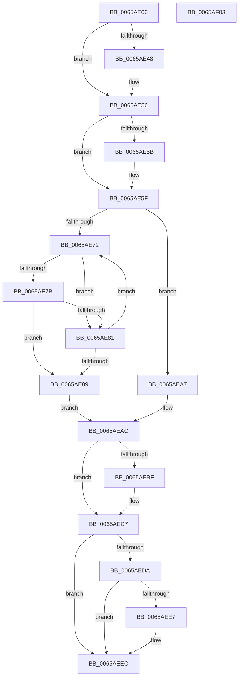

# ExSvmFinalizeDeviceReset

- RVA: `0x0065AE00`–`0x0065AF04` (길이 `260` bytes)
- VA: `0x000000014065AE00`
- 실행 섹션: `.text`
- PDB 이름 있음: `예`; PDB Function 태그: `아니요`
- unwind 정보 RVA: `0x0005C954`
- 디코드: `68`개 명령, `260/260` bytes 표시
- 미해석 바이트: `0` (있으면 어셈블리에 `.byte`로 보존)

> 이 문서는 커널 이미지의 기계어와 PDB 기호를 분석해 생성했습니다. 4번과 5번은 함수 원형과 자료형을 바이너리 사용 방식에서 추정한 C 해석이며 원본 소스 복구 결과는 아닙니다.

## 1. Dependencies

- 직접 호출 지점: **6**; 고유 호출 대상: **6**
- 직접 호출자로 확인된 함수: **0**
- RIP 상대 이미지 참조: **4**

### Outgoing calls
- `0x0065AE37` → [KeAbPreAcquire](../21/KeAbPreAcquire_function_00210230.md) (function, `0x00210230`)
- `0x0065AE51` → [ExfAcquirePushLockExclusiveEx](../20/ExfAcquirePushLockExclusiveEx_function_0020FC90.md) (function, `0x0020FC90`)
- `0x0065AE9E` → [guard_dispatch_icall](../6B/guard_dispatch_icall_function_006BAAD0.md) (function, `0x006BAAD0`)
- `0x0065AEC2` → [ExfTryToWakePushLock](../26/ExfTryToWakePushLock_function_00265DD0.md) (function, `0x00265DD0`)
- `0x0065AECA` → [KeAbPostRelease](../2E/KeAbPostRelease_function_002E1600.md) (function, `0x002E1600`)
- `0x0065AEE7` → [KiCheckForKernelApcDelivery](../2E/KiCheckForKernelApcDelivery_function_002E2C80.md) (function, `0x002E2C80`)

### Direct callers
- 이 함수 시작 RVA로 연결되는 직접 call은 확인되지 않았습니다. 간접 호출은 완전히 역산할 수 없습니다.

### Static image references
- `0x0065AE1D` → RVA `0x00EFA8E8` (`.data`; read)
- `0x0065AE5F` → RVA `0x00EFA8F0` (`.data`; read)
- `0x0065AE89` → RVA `0x00E06D28` (`.data`; read)
- `0x0065AEB0` → RVA `0x00EFA8E8` (`.data`; read/write)

## 2. Other-region calls and transfers

- 다른 실행 섹션으로 향하는 call: **0**
- 별도 외부 분기/꼬리 이동을 확인하지 못했습니다.

## 3. Assembly (complete function range)

```asm
0065AE00  48 89 5C 24 08                  mov qword ptr [rsp + 8], rbx
0065AE05  48 89 6C 24 10                  mov qword ptr [rsp + 0x10], rbp
0065AE0A  48 89 74 24 18                  mov qword ptr [rsp + 0x18], rsi
0065AE0F  57                              push rdi
0065AE10  48 83 EC 20                     sub rsp, 0x20
0065AE14  65 48 8B 3C 25 88 01 00 00      mov rdi, qword ptr gs:[0x188]
0065AE1D  48 8D 2D C4 FA 89 00            lea rbp, [rip + 0x89fac4]
0065AE24  48 8B F1                        mov rsi, rcx
0065AE27  45 33 C0                        xor r8d, r8d
0065AE2A  33 D2                           xor edx, edx
0065AE2C  48 8B CD                        mov rcx, rbp
0065AE2F  66 FF 8F E6 01 00 00            dec word ptr [rdi + 0x1e6]
0065AE36  90                              nop
0065AE37  E8 F4 53 BB FF                  call 0x140210230
0065AE3C  F0 48 0F BA 6D 00 00            lock bts qword ptr [rbp], 0
0065AE43  48 8B D8                        mov rbx, rax
0065AE46  73 0E                           jae 0x14065ae56
0065AE48  4C 8B C5                        mov r8, rbp
0065AE4B  48 8B D0                        mov rdx, rax
0065AE4E  48 8B CD                        mov rcx, rbp
0065AE51  E8 3A 4E BB FF                  call 0x14020fc90
0065AE56  48 85 DB                        test rbx, rbx
0065AE59  74 04                           je 0x14065ae5f
0065AE5B  C6 43 0A 01                     mov byte ptr [rbx + 0xa], 1
0065AE5F  48 8B 05 8A FA 89 00            mov rax, qword ptr [rip + 0x89fa8a]
0065AE66  48 8D 15 83 FA 89 00            lea rdx, [rip + 0x89fa83]
0065AE6D  48 3B C2                        cmp rax, rdx
0065AE70  74 35                           je 0x14065aea7
0065AE72  80 78 10 00                     cmp byte ptr [rax + 0x10], 0
0065AE76  48 8D 08                        lea rcx, [rax]
0065AE79  75 06                           jne 0x14065ae81
0065AE7B  48 39 70 18                     cmp qword ptr [rax + 0x18], rsi
0065AE7F  74 08                           je 0x14065ae89
0065AE81  48 8B 00                        mov rax, qword ptr [rax]
0065AE84  48 3B C2                        cmp rax, rdx
0065AE87  75 E9                           jne 0x14065ae72
0065AE89  48 8B 05 98 BE 7A 00            mov rax, qword ptr [rip + 0x7abe98]
0065AE90  48 8B 89 B0 00 00 00            mov rcx, qword ptr [rcx + 0xb0]
0065AE97  48 8B 80 90 00 00 00            mov rax, qword ptr [rax + 0x90]
0065AE9E  E8 2D FC 05 00                  call 0x1406baad0
0065AEA3  8B D8                           mov ebx, eax
0065AEA5  EB 05                           jmp 0x14065aeac
0065AEA7  BB 0E 00 00 C0                  mov ebx, 0xc000000e
0065AEAC  48 83 C8 FF                     or rax, 0xffffffffffffffff
0065AEB0  F0 48 0F C1 05 2F FA 89 00      lock xadd qword ptr [rip + 0x89fa2f], rax
0065AEB9  24 06                           and al, 6
0065AEBB  3C 02                           cmp al, 2
0065AEBD  75 08                           jne 0x14065aec7
0065AEBF  48 8B CD                        mov rcx, rbp
0065AEC2  E8 09 AF C0 FF                  call 0x140265dd0
0065AEC7  48 8B CD                        mov rcx, rbp
0065AECA  E8 31 67 C8 FF                  call 0x1402e1600
0065AECF  90                              nop
0065AED0  66 83 87 E6 01 00 00 01         add word ptr [rdi + 0x1e6], 1
0065AED8  75 12                           jne 0x14065aeec
0065AEDA  48 8D 87 98 00 00 00            lea rax, [rdi + 0x98]
0065AEE1  90                              nop
0065AEE2  48 39 00                        cmp qword ptr [rax], rax
0065AEE5  74 05                           je 0x14065aeec
0065AEE7  E8 94 7D C8 FF                  call 0x1402e2c80
0065AEEC  48 8B 6C 24 38                  mov rbp, qword ptr [rsp + 0x38]
0065AEF1  8B C3                           mov eax, ebx
0065AEF3  48 8B 5C 24 30                  mov rbx, qword ptr [rsp + 0x30]
0065AEF8  48 8B 74 24 40                  mov rsi, qword ptr [rsp + 0x40]
0065AEFD  48 83 C4 20                     add rsp, 0x20
0065AF01  5F                              pop rdi
0065AF02  C3                              ret
0065AF03  CC                              int3
```

## 4. C-style interpretation (structured pseudocode)

```c
__int64 __fastcall ExSvmFinalizeDeviceReset(__int64 a1, int a2, int a3)
{
    __int64 result;
    __int64 v_rsp;
    unsigned __int64 v_stack_p10;
    unsigned __int64 v_stack_p18;
    unsigned __int64 v_stack_p8;

    v_stack_p8 = v_rbx;
    v_stack_p10 = v_rbp;
    v_stack_p18 = v_rsi;
    v_rsp = (v_rsp) - (32);
    a3 = 0;
    a2 = 0;
    result = KeAbPreAcquire(v_rip + 9042628, a2, a3, a4);
    if (!(condition_is_above_or_equal)) {
        a3 = v_rip + 9042628;
        a2 = result;
        a1 = v_rip + 9042628;
        result = ExfAcquirePushLockExclusiveEx(a1, a2, a3, a4);
    }
    if (result != 0) {
        *(unsigned __int8 *)(result + 10) = 1;
    }
    if ((*(unsigned __int64 *)(v_rip + 9042570)) == (v_rip + 9042563)) goto loc_0065AEA7;
loc_0065AE72:
    if ((*(unsigned __int8 *)(*(unsigned __int64 *)(v_rip + 9042570) + 16)) != 0) goto loc_0065AE81;
    if ((*(unsigned __int64 *)(*(unsigned __int64 *)(v_rip + 9042570) + 24)) == a1) goto loc_0065AE89;
loc_0065AE81:
    if ((*(unsigned __int64 *)(*(unsigned __int64 *)(v_rip + 9042570))) != (v_rip + 9042563)) goto loc_0065AE72;
loc_0065AE89:
    result = guard_dispatch_icall(*(unsigned __int64 *)(*(unsigned __int64 *)(v_rip + 9042570) + 176), v_rip + 9042563, a3, a4);
    goto loc_0065AEAC;
loc_0065AEA7:
loc_0065AEAC:
    result = (result) | (-1);
    result = (unsigned __int8)((result) & (6));
    if (((unsigned __int8)(result)) == 2) {
        a1 = v_rip + 9042628;
        result = ExfTryToWakePushLock(a1, v_rip + 9042563, a3, a4);
    }
    result = KeAbPostRelease(v_rip + 9042628, v_rip + 9042563, a3, a4);
    if (((unsigned __int8)(result)) != 2) goto loc_0065AEEC;
    result = *(unsigned __int64 *)(gs_base + (0 + 392)) + 152;
    if ((*(unsigned __int64 *)(*(unsigned __int64 *)(gs_base + (0 + 392)) + 152)) != (*(unsigned __int64 *)(gs_base + (0 + 392)) + 152)) {
        result = KiCheckForKernelApcDelivery(v_rip + 9042628, v_rip + 9042563, a3, a4);
    }
    v_rsp = (v_rsp) + (32);
    return (unsigned int)((unsigned int)((unsigned int)(0xC000000EULL)));
}
```

## 5. (Beta) C Style

```c
int64_t ExSvmFinalizeDeviceReset(int64_t Arg1, int32_t Arg2, int32_t Arg3)
{
    int64_t result;
    int64_t local_rsp;
    uint64_t v_stack_p10;
    uint64_t v_stack_p18;
    uint64_t v_stack_p8;

    v_stack_p8 = local_rbx;
    v_stack_p10 = local_rbp;
    v_stack_p18 = local_rsi;
    local_rsp = (local_rsp) - (32);
    Arg3 = 0;
    Arg2 = 0;
    result = KeAbPreAcquire(v_rip + 9042628, Arg2, Arg3, a4);
    if (!(condition_is_above_or_equal)) {
        Arg3 = v_rip + 9042628;
        Arg2 = result;
        Arg1 = v_rip + 9042628;
        result = ExfAcquirePushLockExclusiveEx(Arg1, Arg2, Arg3, a4);
    }
    if (result != 0) {
        *(uint8_t *)(result + 0xA) = 1;
    }
    if ((*(uint64_t *)(v_rip + 0x89FA8A)) == (v_rip + 9042563)) goto loc_0065AEA7;
loc_0065AE72:
    if ((*(uint8_t *)(*(uint64_t *)(v_rip + 0x89FA8A) + 0x10)) != 0) goto loc_0065AE81;
    if ((*(uint64_t *)(*(uint64_t *)(v_rip + 0x89FA8A) + 0x18)) == Arg1) goto loc_0065AE89;
loc_0065AE81:
    if ((*(uint64_t *)(*(uint64_t *)(v_rip + 0x89FA8A))) != (v_rip + 9042563)) goto loc_0065AE72;
loc_0065AE89:
    result = guard_dispatch_icall(*(uint64_t *)(*(uint64_t *)(v_rip + 0x89FA8A) + 0xB0), v_rip + 9042563, Arg3, a4);
    goto loc_0065AEAC;
loc_0065AEA7:
loc_0065AEAC:
    result = (result) | (-1);
    result = (uint8_t)((result) & (6));
    if (((uint8_t)(result)) == 2) {
        Arg1 = v_rip + 9042628;
        result = ExfTryToWakePushLock(Arg1, v_rip + 9042563, Arg3, a4);
    }
    result = KeAbPostRelease(v_rip + 9042628, v_rip + 9042563, Arg3, a4);
    if (((uint8_t)(result)) != 2) goto loc_0065AEEC;
    result = *(uint64_t *)(gs_base + (0 + 0x188)) + 152;
    if ((*(uint64_t *)(*(uint64_t *)(gs_base + (0 + 0x188)) + 0x98)) != (*(uint64_t *)(gs_base + (0 + 0x188)) + 152)) {
        result = KiCheckForKernelApcDelivery(v_rip + 9042628, v_rip + 9042563, Arg3, a4);
    }
    local_rsp = (local_rsp) + (32);
    return (uint32_t)((uint32_t)((uint32_t)(0xC000000EULL)));
}
```

## 6. Execution-region graph

[열기: 2D/3D 그래프와 함수 탐색 컨트롤 패널](../../../control-panel.html?section=text&rva=0x0065AE00&view=graph)

- 2D 그래프는 위에서 아래로 흐르고, 3D 그래프는 빈 공간을 드래그해 회전합니다. Shift+드래그는 이동, 휠은 확대·축소, 함수 노드 선택은 대상 보고서 이동입니다.

### Static fallback


