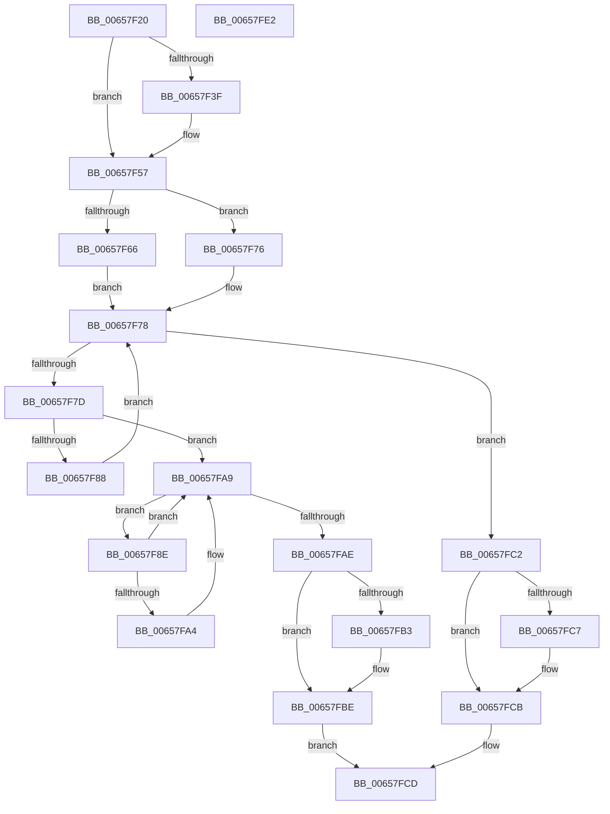

# ExTryAcquireCacheAwarePushLockExclusiveEx

- RVA: `0x00657F20`–`0x00657FE3` (길이 `195` bytes)
- VA: `0x0000000140657F20`
- 실행 섹션: `.text`
- PDB 이름 있음: `예`; PDB Function 태그: `아니요`
- unwind 정보 RVA: `0x00066400`
- 디코드: `61`개 명령, `195/195` bytes 표시
- 미해석 바이트: `0` (있으면 어셈블리에 `.byte`로 보존)

> 이 문서는 커널 이미지의 기계어와 PDB 기호를 분석해 생성했습니다. 4번과 5번은 함수 원형과 자료형을 바이너리 사용 방식에서 추정한 C 해석이며 원본 소스 복구 결과는 아닙니다.

## 1. Dependencies

- 직접 호출 지점: **4**; 고유 호출 대상: **4**
- 직접 호출자로 확인된 함수: **0**
- RIP 상대 이미지 참조: **0**

### Outgoing calls
- `0x00657F51` → [KeBugCheckEx](../4F/KeBugCheckEx_function_004FD660.md) (function, `0x004FD660`)
- `0x00657F6C` → [KeAbPreAcquire](../21/KeAbPreAcquire_function_00210230.md) (function, `0x00210230`)
- `0x00657FA4` → [ExfTryToWakePushLock](../26/ExfTryToWakePushLock_function_00265DD0.md) (function, `0x00265DD0`)
- `0x00657FB9` → [KeAbPostReleaseEx](../26/KeAbPostReleaseEx_function_00262210.md) (function, `0x00262210`)

### Direct callers
- 이 함수 시작 RVA로 연결되는 직접 call은 확인되지 않았습니다. 간접 호출은 완전히 역산할 수 없습니다.

### Static image references
- 디코드된 RIP-relative 메모리 참조가 없습니다.

## 2. Other-region calls and transfers

- 다른 실행 섹션으로 향하는 call: **0**
- 별도 외부 분기/꼬리 이동을 확인하지 못했습니다.

## 3. Assembly (complete function range)

```asm
00657F20  48 8B C4                        mov rax, rsp
00657F23  48 89 58 08                     mov qword ptr [rax + 8], rbx
00657F27  48 89 68 10                     mov qword ptr [rax + 0x10], rbp
00657F2B  48 89 70 18                     mov qword ptr [rax + 0x18], rsi
00657F2F  57                              push rdi
00657F30  48 83 EC 30                     sub rsp, 0x30
00657F34  48 8B F9                        mov rdi, rcx
00657F37  F7 C2 F8 FF FF FF               test edx, 0xfffffff8
00657F3D  74 18                           je 0x140657f57
00657F3F  48 83 60 E8 00                  and qword ptr [rax - 0x18], 0
00657F44  4C 8B C1                        mov r8, rcx
00657F47  B9 52 01 00 00                  mov ecx, 0x152
00657F4C  8B D2                           mov edx, edx
00657F4E  45 33 C9                        xor r9d, r9d
00657F51  E8 0A 57 EA FF                  call 0x1404fd660
00657F56  CC                              int3
00657F57  48 8D A9 00 01 00 00            lea rbp, [rcx + 0x100]
00657F5E  48 8B DF                        mov rbx, rdi
00657F61  F6 C2 02                        test dl, 2
00657F64  75 10                           jne 0x140657f76
00657F66  33 D2                           xor edx, edx
00657F68  44 8D 42 01                     lea r8d, [rdx + 1]
00657F6C  E8 BF 82 BB FF                  call 0x140210230
00657F71  48 8B F0                        mov rsi, rax
00657F74  EB 02                           jmp 0x140657f78
00657F76  33 F6                           xor esi, esi
00657F78  48 3B DD                        cmp rbx, rbp
00657F7B  73 45                           jae 0x140657fc2
00657F7D  48 8B 03                        mov rax, qword ptr [rbx]
00657F80  F0 48 0F BA 28 00               lock bts qword ptr [rax], 0
00657F86  72 21                           jb 0x140657fa9
00657F88  48 83 C3 08                     add rbx, 8
00657F8C  EB EA                           jmp 0x140657f78
00657F8E  48 83 EB 08                     sub rbx, 8
00657F92  48 83 C8 FF                     or rax, 0xffffffffffffffff
00657F96  48 8B 0B                        mov rcx, qword ptr [rbx]
00657F99  F0 48 0F C1 01                  lock xadd qword ptr [rcx], rax
00657F9E  24 06                           and al, 6
00657FA0  3C 02                           cmp al, 2
00657FA2  75 05                           jne 0x140657fa9
00657FA4  E8 27 DE C0 FF                  call 0x140265dd0
00657FA9  48 3B DF                        cmp rbx, rdi
00657FAC  75 E0                           jne 0x140657f8e
00657FAE  48 85 F6                        test rsi, rsi
00657FB1  74 0B                           je 0x140657fbe
00657FB3  48 8B D6                        mov rdx, rsi
00657FB6  48 8B CF                        mov rcx, rdi
00657FB9  E8 52 A2 C0 FF                  call 0x140262210
00657FBE  32 C0                           xor al, al
00657FC0  EB 0B                           jmp 0x140657fcd
00657FC2  48 85 F6                        test rsi, rsi
00657FC5  74 04                           je 0x140657fcb
00657FC7  C6 46 0A 01                     mov byte ptr [rsi + 0xa], 1
00657FCB  B0 01                           mov al, 1
00657FCD  48 8B 5C 24 40                  mov rbx, qword ptr [rsp + 0x40]
00657FD2  48 8B 6C 24 48                  mov rbp, qword ptr [rsp + 0x48]
00657FD7  48 8B 74 24 50                  mov rsi, qword ptr [rsp + 0x50]
00657FDC  48 83 C4 30                     add rsp, 0x30
00657FE0  5F                              pop rdi
00657FE1  C3                              ret
00657FE2  CC                              int3
```

## 4. C-style interpretation (structured pseudocode)

```c
__int64 __fastcall ExTryAcquireCacheAwarePushLockExclusiveEx(__int64 a1, int a2, __int64 a3, int a4)
{
    __int64 result;
    __int64 v_rbx;
    __int64 v_rsi;
    __int64 v_rsp;
    unsigned __int64 v_stack_p10;
    unsigned __int64 v_stack_p18;
    unsigned __int64 v_stack_p8;

    *(unsigned __int64 *)(v_rsp + 8) = v_rbx;
    *(unsigned __int64 *)(v_rsp + 16) = v_rbp;
    *(unsigned __int64 *)(v_rsp + 24) = v_rsi;
    v_rsp = (v_rsp) - (48);
    result = v_rsp;
    if (((a2) & (0xFFFFFFF8ULL)) != 0) {
        a3 = a1;
        a1 = 338;
        a2 = a2;
        a4 = 0;
        result = KeBugCheckEx(a1, a2, a3, a4);
    }
    if ((((unsigned __int8)(a2)) & (2)) != 0) goto loc_00657F76;
    a2 = 0;
    result = KeAbPreAcquire(a1, a2, a2 + 1, a4);
    goto loc_00657F78;
loc_00657F76:
    v_rsi = 0;
loc_00657F78:
    if (a1 >= (a1 + 256)) goto loc_00657FC2;
    if (a1 < (a1 + 256)) goto loc_00657FA9;
    v_rbx = (a1) + (8);
    goto loc_00657F78;
loc_00657F8E:
    v_rbx = (v_rbx) - (8);
    result = (*(unsigned __int64 *)(a1)) | (-1);
    result = (unsigned __int8)((result) & (6));
    if (((unsigned __int8)(result)) == 2) {
        result = ExfTryToWakePushLock(*(unsigned __int64 *)(v_rbx), a2, a2 + 1, a4);
    }
    if (v_rbx != a1) goto loc_00657F8E;
    if (0 != 0) {
        a2 = 0;
        a1 = a1;
        result = KeAbPostReleaseEx(a1, a2, a2 + 1, a4);
    }
    result = 0;
    goto loc_00657FCD;
loc_00657FC2:
    if (0 != 0) {
        *(unsigned __int8 *)(v_rsi + 10) = 1;
    }
loc_00657FCD:
    v_rsp = (v_rsp) + (48);
    return 1;
}
```

## 5. (Beta) C Style

```c
int64_t ExTryAcquireCacheAwarePushLockExclusiveEx(int64_t Arg1, int32_t Arg2, int64_t Arg3, int32_t Arg4)
{
    int64_t result;
    int64_t local_rbx;
    int64_t local_rsi;
    int64_t local_rsp;
    uint64_t v_stack_p10;
    uint64_t v_stack_p18;
    uint64_t v_stack_p8;

    *(uint64_t *)(local_rsp + 0x8) = local_rbx;
    *(uint64_t *)(local_rsp + 0x10) = local_rbp;
    *(uint64_t *)(local_rsp + 0x18) = local_rsi;
    local_rsp = (local_rsp) - (48);
    result = local_rsp;
    if (((Arg2) & (0xFFFFFFF8ULL)) != 0) {
        Arg3 = Arg1;
        Arg1 = 338;
        Arg2 = Arg2;
        Arg4 = 0;
        result = KeBugCheckEx(Arg1, Arg2, Arg3, Arg4);
    }
    if ((((uint8_t)(Arg2)) & (2)) != 0) goto loc_00657F76;
    Arg2 = 0;
    result = KeAbPreAcquire(Arg1, Arg2, Arg2 + 1, Arg4);
    goto loc_00657F78;
loc_00657F76:
    local_rsi = 0;
loc_00657F78:
    if (Arg1 >= (Arg1 + 256)) goto loc_00657FC2;
    if (Arg1 < (Arg1 + 256)) goto loc_00657FA9;
    local_rbx = (Arg1) + (8);
    goto loc_00657F78;
loc_00657F8E:
    local_rbx = (local_rbx) - (8);
    result = (*(uint64_t *)(Arg1)) | (-1);
    result = (uint8_t)((result) & (6));
    if (((uint8_t)(result)) == 2) {
        result = ExfTryToWakePushLock(*(uint64_t *)(local_rbx), Arg2, Arg2 + 1, Arg4);
    }
    if (local_rbx != Arg1) goto loc_00657F8E;
    if (0 != 0) {
        Arg2 = 0;
        Arg1 = Arg1;
        result = KeAbPostReleaseEx(Arg1, Arg2, Arg2 + 1, Arg4);
    }
    result = 0;
    goto loc_00657FCD;
loc_00657FC2:
    if (0 != 0) {
        *(uint8_t *)(local_rsi + 0xA) = 1;
    }
loc_00657FCD:
    local_rsp = (local_rsp) + (48);
    return 1;
}
```

## 6. Execution-region graph

[열기: 2D/3D 그래프와 함수 탐색 컨트롤 패널](../../../control-panel.html?section=text&rva=0x00657F20&view=graph)

- 2D 그래프는 위에서 아래로 흐르고, 3D 그래프는 빈 공간을 드래그해 회전합니다. Shift+드래그는 이동, 휠은 확대·축소, 함수 노드 선택은 대상 보고서 이동입니다.

### Static fallback


