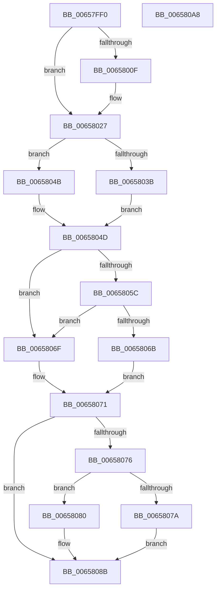

# ExTryAcquireCacheAwarePushLockSharedEx

- RVA: `0x00657FF0`–`0x006580A9` (길이 `185` bytes)
- VA: `0x0000000140657FF0`
- 실행 섹션: `.text`
- PDB 이름 있음: `예`; PDB Function 태그: `아니요`
- unwind 정보 RVA: `0x00066400`
- 디코드: `58`개 명령, `185/185` bytes 표시
- 미해석 바이트: `0` (있으면 어셈블리에 `.byte`로 보존)

> 이 문서는 커널 이미지의 기계어와 PDB 기호를 분석해 생성했습니다. 4번과 5번은 함수 원형과 자료형을 바이너리 사용 방식에서 추정한 C 해석이며 원본 소스 복구 결과는 아닙니다.

## 1. Dependencies

- 직접 호출 지점: **4**; 고유 호출 대상: **4**
- 직접 호출자로 확인된 함수: **0**
- RIP 상대 이미지 참조: **0**

### Outgoing calls
- `0x00658021` → [KeBugCheckEx](../4F/KeBugCheckEx_function_004FD660.md) (function, `0x004FD660`)
- `0x00658041` → [KeAbPreAcquire](../21/KeAbPreAcquire_function_00210230.md) (function, `0x00210230`)
- `0x00658062` → [ExfTryAcquirePushLockSharedEx](../3F/ExfTryAcquirePushLockSharedEx_function_003FC210.md) (function, `0x003FC210`)
- `0x00658086` → [KeAbPostReleaseEx](../26/KeAbPostReleaseEx_function_00262210.md) (function, `0x00262210`)

### Direct callers
- 이 함수 시작 RVA로 연결되는 직접 call은 확인되지 않았습니다. 간접 호출은 완전히 역산할 수 없습니다.

### Static image references
- 디코드된 RIP-relative 메모리 참조가 없습니다.

## 2. Other-region calls and transfers

- 다른 실행 섹션으로 향하는 call: **0**
- 별도 외부 분기/꼬리 이동을 확인하지 못했습니다.

## 3. Assembly (complete function range)

```asm
00657FF0  48 8B C4                        mov rax, rsp
00657FF3  48 89 58 08                     mov qword ptr [rax + 8], rbx
00657FF7  48 89 68 10                     mov qword ptr [rax + 0x10], rbp
00657FFB  48 89 70 18                     mov qword ptr [rax + 0x18], rsi
00657FFF  57                              push rdi
00658000  48 83 EC 30                     sub rsp, 0x30
00658004  48 8B F1                        mov rsi, rcx
00658007  F7 C2 F8 FF FF FF               test edx, 0xfffffff8
0065800D  74 18                           je 0x140658027
0065800F  48 83 60 E8 00                  and qword ptr [rax - 0x18], 0
00658014  4C 8B C1                        mov r8, rcx
00658017  B9 52 01 00 00                  mov ecx, 0x152
0065801C  8B D2                           mov edx, edx
0065801E  45 33 C9                        xor r9d, r9d
00658021  E8 3A 56 EA FF                  call 0x1404fd660
00658026  CC                              int3
00658027  65 8B 04 25 A4 01 00 00         mov eax, dword ptr gs:[0x1a4]
0065802F  83 E0 1F                        and eax, 0x1f
00658032  48 8B 2C C1                     mov rbp, qword ptr [rcx + rax*8]
00658036  F6 C2 02                        test dl, 2
00658039  75 10                           jne 0x14065804b
0065803B  33 D2                           xor edx, edx
0065803D  44 8D 42 01                     lea r8d, [rdx + 1]
00658041  E8 EA 81 BB FF                  call 0x140210230
00658046  48 8B F8                        mov rdi, rax
00658049  EB 02                           jmp 0x14065804d
0065804B  33 FF                           xor edi, edi
0065804D  B9 11 00 00 00                  mov ecx, 0x11
00658052  33 C0                           xor eax, eax
00658054  F0 48 0F B1 4D 00               lock cmpxchg qword ptr [rbp], rcx
0065805A  74 13                           je 0x14065806f
0065805C  8D 51 F1                        lea edx, [rcx - 0xf]
0065805F  48 8B CD                        mov rcx, rbp
00658062  E8 A9 41 DA FF                  call 0x1403fc210
00658067  84 C0                           test al, al
00658069  75 04                           jne 0x14065806f
0065806B  32 DB                           xor bl, bl
0065806D  EB 02                           jmp 0x140658071
0065806F  B3 01                           mov bl, 1
00658071  48 85 FF                        test rdi, rdi
00658074  74 15                           je 0x14065808b
00658076  84 DB                           test bl, bl
00658078  74 06                           je 0x140658080
0065807A  C6 47 0A 01                     mov byte ptr [rdi + 0xa], 1
0065807E  EB 0B                           jmp 0x14065808b
00658080  48 8B D7                        mov rdx, rdi
00658083  48 8B CE                        mov rcx, rsi
00658086  E8 85 A1 C0 FF                  call 0x140262210
0065808B  48 8B 74 24 50                  mov rsi, qword ptr [rsp + 0x50]
00658090  F6 DB                           neg bl
00658092  48 8B 5C 24 40                  mov rbx, qword ptr [rsp + 0x40]
00658097  48 1B C0                        sbb rax, rax
0065809A  48 23 C5                        and rax, rbp
0065809D  48 8B 6C 24 48                  mov rbp, qword ptr [rsp + 0x48]
006580A2  48 83 C4 30                     add rsp, 0x30
006580A6  5F                              pop rdi
006580A7  C3                              ret
006580A8  CC                              int3
```

## 4. C-style interpretation (structured pseudocode)

```c
__int64 __fastcall ExTryAcquireCacheAwarePushLockSharedEx(__int64 a1, int a2, __int64 a3, int a4)
{
    __int64 result;
    __int64 v_rbx;
    __int64 v_rdi;
    __int64 v_rsp;
    unsigned __int64 v_stack_p10;
    unsigned __int64 v_stack_p18;
    unsigned __int64 v_stack_p8;

    *(unsigned __int64 *)(v_rsp + 8) = v_rbx;
    *(unsigned __int64 *)(v_rsp + 16) = v_rbp;
    *(unsigned __int64 *)(v_rsp + 24) = v_rsi;
    v_rsp = (v_rsp) - (48);
    result = v_rsp;
    if (((a2) & (0xFFFFFFF8ULL)) != 0) {
        a3 = a1;
        a1 = 338;
        a2 = a2;
        a4 = 0;
        result = KeBugCheckEx(a1, a2, a3, a4);
    }
    result = (unsigned int)(((unsigned int)(*(unsigned int *)(gs_base + (0 + 420)))) & (31));
    if ((((unsigned __int8)(a2)) & (2)) != 0) goto loc_0065804B;
    a2 = 0;
    result = KeAbPreAcquire(a1, a2, a2 + 1, a4);
    goto loc_0065804D;
loc_0065804B:
    v_rdi = 0;
loc_0065804D:
    result = 0;
    if (condition_is_equal) goto loc_0065806F;
    result = ExfTryAcquirePushLockSharedEx(*(unsigned __int64 *)(a1 + result * 8), 17 - 15, a2 + 1, a4);
    if ((unsigned __int8)(result) != 0) goto loc_0065806F;
    v_rbx = 0;
    goto loc_00658071;
loc_0065806F:
loc_00658071:
    if (0 == 0) goto loc_0065808B;
    if (1 == 0) goto loc_00658080;
    *(unsigned __int8 *)(v_rdi + 10) = 1;
    goto loc_0065808B;
loc_00658080:
    result = KeAbPostReleaseEx(a1, 0, a2 + 1, a4);
loc_0065808B:
    v_rbx = (unsigned __int8)(-(1));
    result = (result) & (*(unsigned __int64 *)(a1 + result * 8));
    v_rsp = (v_rsp) + (48);
    return result;
}
```

## 5. (Beta) C Style

```c
int64_t ExTryAcquireCacheAwarePushLockSharedEx(int64_t Arg1, int32_t Arg2, int64_t Arg3, int32_t Arg4)
{
    int64_t result;
    int64_t local_rbx;
    int64_t local_rdi;
    int64_t local_rsp;
    uint64_t v_stack_p10;
    uint64_t v_stack_p18;
    uint64_t v_stack_p8;

    *(uint64_t *)(local_rsp + 0x8) = local_rbx;
    *(uint64_t *)(local_rsp + 0x10) = local_rbp;
    *(uint64_t *)(local_rsp + 0x18) = local_rsi;
    local_rsp = (local_rsp) - (48);
    result = local_rsp;
    if (((Arg2) & (0xFFFFFFF8ULL)) != 0) {
        Arg3 = Arg1;
        Arg1 = 338;
        Arg2 = Arg2;
        Arg4 = 0;
        result = KeBugCheckEx(Arg1, Arg2, Arg3, Arg4);
    }
    result = (uint32_t)(((uint32_t)(*(uint32_t *)(gs_base + (0 + 0x1A4)))) & (31));
    if ((((uint8_t)(Arg2)) & (2)) != 0) goto loc_0065804B;
    Arg2 = 0;
    result = KeAbPreAcquire(Arg1, Arg2, Arg2 + 1, Arg4);
    goto loc_0065804D;
loc_0065804B:
    local_rdi = 0;
loc_0065804D:
    result = 0;
    if (condition_is_equal) goto loc_0065806F;
    result = ExfTryAcquirePushLockSharedEx(*(uint64_t *)(Arg1 + result * 8), 17 - 15, Arg2 + 1, Arg4);
    if ((uint8_t)(result) != 0) goto loc_0065806F;
    local_rbx = 0;
    goto loc_00658071;
loc_0065806F:
loc_00658071:
    if (0 == 0) goto loc_0065808B;
    if (1 == 0) goto loc_00658080;
    *(uint8_t *)(local_rdi + 0xA) = 1;
    goto loc_0065808B;
loc_00658080:
    result = KeAbPostReleaseEx(Arg1, 0, Arg2 + 1, Arg4);
loc_0065808B:
    local_rbx = (uint8_t)(-(1));
    result = (result) & (*(uint64_t *)(Arg1 + result * 8));
    local_rsp = (local_rsp) + (48);
    return result;
}
```

## 6. Execution-region graph

[열기: 2D/3D 그래프와 함수 탐색 컨트롤 패널](../../../control-panel.html?section=text&rva=0x00657FF0&view=graph)

- 2D 그래프는 위에서 아래로 흐르고, 3D 그래프는 빈 공간을 드래그해 회전합니다. Shift+드래그는 이동, 휠은 확대·축소, 함수 노드 선택은 대상 보고서 이동입니다.

### Static fallback


