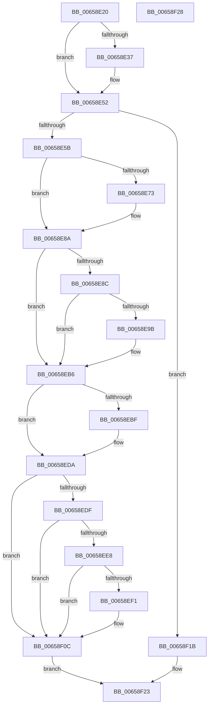

# ExTryToAcquireResourceExclusiveLite

- RVA: `0x00658E20`–`0x00658F29` (길이 `265` bytes)
- VA: `0x0000000140658E20`
- 실행 섹션: `.text`
- PDB 이름 있음: `예`; PDB Function 태그: `아니요`
- unwind 정보 RVA: `0x0005D2F4`
- 디코드: `71`개 명령, `265/265` bytes 표시
- 미해석 바이트: `0` (있으면 어셈블리에 `.byte`로 보존)

> 이 문서는 커널 이미지의 기계어와 PDB 기호를 분석해 생성했습니다. 4번과 5번은 함수 원형과 자료형을 바이너리 사용 방식에서 추정한 C 해석이며 원본 소스 복구 결과는 아닙니다.

## 1. Dependencies

- 직접 호출 지점: **7**; 고유 호출 대상: **3**
- 직접 호출자로 확인된 함수: **1**
- RIP 상대 이미지 참조: **0**

### Outgoing calls
- `0x00658E4C` → [KeBugCheckEx](../4F/KeBugCheckEx_function_004FD660.md) (function, `0x004FD660`)
- `0x00658E84` → [KeBugCheckEx](../4F/KeBugCheckEx_function_004FD660.md) (function, `0x004FD660`)
- `0x00658EB0` → [KeBugCheckEx](../4F/KeBugCheckEx_function_004FD660.md) (function, `0x004FD660`)
- `0x00658ED4` → [KeBugCheckEx](../4F/KeBugCheckEx_function_004FD660.md) (function, `0x004FD660`)
- `0x00658F06` → [KeBugCheckEx](../4F/KeBugCheckEx_function_004FD660.md) (function, `0x004FD660`)
- `0x00658F14` → [ExAcquireFastResourceExclusive](../3B/ExAcquireFastResourceExclusive_function_003BDFF0.md) (function, `0x003BDFF0`)
- `0x00658F1E` → [ExpTryToAcquireResourceExclusiveLite](ExpTryToAcquireResourceExclusiveLite_function_00658FEC.md) (function, `0x00658FEC`)

### Direct callers
- [DifExTryToAcquireResourceExclusiveLiteWrapper](../62/DifExTryToAcquireResourceExclusiveLiteWrapper_function_006233C0.md) at `0x0062348D`

### Static image references
- 디코드된 RIP-relative 메모리 참조가 없습니다.

## 2. Other-region calls and transfers

- 다른 실행 섹션으로 향하는 call: **0**
- 별도 외부 분기/꼬리 이동을 확인하지 못했습니다.

## 3. Assembly (complete function range)

```asm
00658E20  48 83 EC 38                     sub rsp, 0x38
00658E24  4C 8B D1                        mov r10, rcx
00658E27  41 B0 01                        mov r8b, 1
00658E2A  0F B7 49 1A                     movzx ecx, word ptr [rcx + 0x1a]
00658E2E  8A C1                           mov al, cl
00658E30  24 41                           and al, 0x41
00658E32  41 3A C0                        cmp al, r8b
00658E35  75 1B                           jne 0x140658e52
00658E37  48 83 64 24 20 00               and qword ptr [rsp + 0x20], 0
00658E3D  45 33 C9                        xor r9d, r9d
00658E40  4D 8B C2                        mov r8, r10
00658E43  B9 C6 01 00 00                  mov ecx, 0x1c6
00658E48  41 8D 51 0F                     lea edx, [r9 + 0xf]
00658E4C  E8 0F 48 EA FF                  call 0x1404fd660
00658E51  CC                              int3
00658E52  41 84 C8                        test r8b, cl
00658E55  0F 84 C0 00 00 00               je 0x140658f1b
00658E5B  44 0F 20 C1                     mov rcx, cr8
00658E5F  65 48 8B 14 25 88 01 00 00      mov rdx, qword ptr gs:[0x188]
00658E68  41 B9 02 00 00 00               mov r9d, 2
00658E6E  41 3A C9                        cmp cl, r9b
00658E71  76 17                           jbe 0x140658e8a
00658E73  48 83 64 24 20 00               and qword ptr [rsp + 0x20], 0
00658E79  33 D2                           xor edx, edx
00658E7B  44 0F B6 C1                     movzx r8d, cl
00658E7F  B9 C6 01 00 00                  mov ecx, 0x1c6
00658E84  E8 D7 47 EA FF                  call 0x1404fd660
00658E89  CC                              int3
00658E8A  72 2A                           jb 0x140658eb6
00658E8C  65 8B 04 25 3C 3A 00 00         mov eax, dword ptr gs:[0x3a3c]
00658E94  A9 01 00 01 00                  test eax, 0x10001
00658E99  74 1B                           je 0x140658eb6
00658E9B  48 83 64 24 20 00               and qword ptr [rsp + 0x20], 0
00658EA1  45 33 C9                        xor r9d, r9d
00658EA4  45 33 C0                        xor r8d, r8d
00658EA7  B9 C6 01 00 00                  mov ecx, 0x1c6
00658EAC  41 8D 51 05                     lea edx, [r9 + 5]
00658EB0  E8 AB 47 EA FF                  call 0x1404fd660
00658EB5  CC                              int3
00658EB6  44 84 8A C0 00 00 00            test byte ptr [rdx + 0xc0], r9b
00658EBD  74 1B                           je 0x140658eda
00658EBF  48 83 64 24 20 00               and qword ptr [rsp + 0x20], 0
00658EC5  45 33 C9                        xor r9d, r9d
00658EC8  45 33 C0                        xor r8d, r8d
00658ECB  B9 C6 01 00 00                  mov ecx, 0x1c6
00658ED0  41 8D 51 06                     lea edx, [r9 + 6]
00658ED4  E8 87 47 EA FF                  call 0x1404fd660
00658ED9  CC                              int3
00658EDA  41 3A C8                        cmp cl, r8b
00658EDD  73 2D                           jae 0x140658f0c
00658EDF  F7 42 74 00 04 00 00            test dword ptr [rdx + 0x74], 0x400
00658EE6  75 24                           jne 0x140658f0c
00658EE8  83 BA E4 01 00 00 00            cmp dword ptr [rdx + 0x1e4], 0
00658EEF  75 1B                           jne 0x140658f0c
00658EF1  48 83 64 24 20 00               and qword ptr [rsp + 0x20], 0
00658EF7  45 33 C9                        xor r9d, r9d
00658EFA  45 33 C0                        xor r8d, r8d
00658EFD  B9 C6 01 00 00                  mov ecx, 0x1c6
00658F02  41 8D 51 07                     lea edx, [r9 + 7]
00658F06  E8 55 47 EA FF                  call 0x1404fd660
00658F0B  CC                              int3
00658F0C  45 33 C0                        xor r8d, r8d
00658F0F  33 D2                           xor edx, edx
00658F11  49 8B CA                        mov rcx, r10
00658F14  E8 D7 50 D6 FF                  call 0x1403bdff0
00658F19  EB 08                           jmp 0x140658f23
00658F1B  49 8B CA                        mov rcx, r10
00658F1E  E8 C9 00 00 00                  call 0x140658fec
00658F23  48 83 C4 38                     add rsp, 0x38
00658F27  C3                              ret
00658F28  CC                              int3
```

## 4. C-style interpretation (structured pseudocode)

```c
__int64 __fastcall ExTryToAcquireResourceExclusiveLite(__int64 a1, __int64 a2, __int64 a3, int a4)
{
    __int64 result;
    __int64 v_rsp;
    unsigned __int64 v_stack_m18;

    v_rsp = (v_rsp) - (56);
    result = (unsigned __int8)(((unsigned __int8)(*(unsigned __int16 *)(a1 + 26))) & (65));
    if (((unsigned __int8)(result)) == 1) {
        a4 = 0;
        a3 = a1;
        a1 = 454;
        a2 = a4 + 15;
        result = KeBugCheckEx(a1, a2, a3, a4);
    }
    if ((((unsigned __int8)(a3)) & ((unsigned __int8)(a1))) == 0) goto loc_00658F1B;
    if (((unsigned __int8)(v_cr8)) >= = 2) {
        a2 = 0;
        a3 = (unsigned __int8)(v_cr8);
        a1 = 454;
        result = KeBugCheckEx(a1, a2, a3, 2);
    }
    if (condition_is_below) goto loc_00658EB6;
    result = (unsigned int)(*(unsigned int *)(gs_base + (0 + 14908)));
    if ((((unsigned int)((unsigned int)(*(unsigned int *)(gs_base + (0 + 14908))))) & (0x10001ULL)) != 0) {
        a4 = 0;
        a3 = 0;
        a1 = 454;
        a2 = a4 + 5;
        result = KeBugCheckEx(a1, a2, a3, a4);
    }
    if (((*(unsigned __int8 *)(a2 + 192)) & (0)) != 0) {
        a4 = 0;
        a3 = 0;
        a1 = 454;
        a2 = a4 + 6;
        result = KeBugCheckEx(a1, a2, a3, a4);
    }
    if (((unsigned __int8)(a1)) >= 0) goto loc_00658F0C;
    if (((*(unsigned int *)(a2 + 116)) & (0x400ULL)) != 0) goto loc_00658F0C;
    if ((*(unsigned int *)(a2 + 484)) == 0) {
        a4 = 0;
        a3 = 0;
        a1 = 454;
        a2 = a4 + 7;
        result = KeBugCheckEx(a1, a2, a3, a4);
    }
    a3 = 0;
    a2 = 0;
    result = ExAcquireFastResourceExclusive(a1, a2, a3, a4);
    goto loc_00658F23;
loc_00658F1B:
    result = ExpTryToAcquireResourceExclusiveLite(a1, a2, a3, a4);
loc_00658F23:
    v_rsp = (v_rsp) + (56);
    return result;
}
```

## 5. (Beta) C Style

```c
int64_t ExTryToAcquireResourceExclusiveLite(void *Arg1, int64_t Arg2, int64_t Arg3, int32_t Arg4)
{
    uint8_t *arg1 = (uint8_t *)Arg1;

    int64_t result;
    int64_t local_rsp;
    uint64_t v_stack_m18;

    local_rsp = (local_rsp) - (56);
    result = (uint8_t)(((uint8_t)(*(uint16_t *)(arg1 + 0x1A))) & (65));
    if (((uint8_t)(result)) == 1) {
        Arg4 = 0;
        Arg3 = Arg1;
        Arg1 = 454;
        Arg2 = Arg4 + 15;
        result = KeBugCheckEx(Arg1, Arg2, Arg3, Arg4);
    }
    if ((((uint8_t)(Arg3)) & ((uint8_t)(Arg1))) == 0) goto loc_00658F1B;
    if (((uint8_t)(v_cr8)) >= = 2) {
        Arg2 = 0;
        Arg3 = (uint8_t)(v_cr8);
        Arg1 = 454;
        result = KeBugCheckEx(Arg1, Arg2, Arg3, 2);
    }
    if (condition_is_below) goto loc_00658EB6;
    result = (uint32_t)(*(uint32_t *)(gs_base + (0 + 0x3A3C)));
    if ((((uint32_t)((uint32_t)(*(uint32_t *)(gs_base + (0 + 0x3A3C))))) & (0x10001ULL)) != 0) {
        Arg4 = 0;
        Arg3 = 0;
        Arg1 = 454;
        Arg2 = Arg4 + 5;
        result = KeBugCheckEx(Arg1, Arg2, Arg3, Arg4);
    }
    if (((*(uint8_t *)(Arg2 + 0xC0)) & (0)) != 0) {
        Arg4 = 0;
        Arg3 = 0;
        Arg1 = 454;
        Arg2 = Arg4 + 6;
        result = KeBugCheckEx(Arg1, Arg2, Arg3, Arg4);
    }
    if (((uint8_t)(Arg1)) >= 0) goto loc_00658F0C;
    if (((*(uint32_t *)(Arg2 + 0x74)) & (0x400ULL)) != 0) goto loc_00658F0C;
    if ((*(uint32_t *)(Arg2 + 0x1E4)) == 0) {
        Arg4 = 0;
        Arg3 = 0;
        Arg1 = 454;
        Arg2 = Arg4 + 7;
        result = KeBugCheckEx(Arg1, Arg2, Arg3, Arg4);
    }
    Arg3 = 0;
    Arg2 = 0;
    result = ExAcquireFastResourceExclusive(Arg1, Arg2, Arg3, Arg4);
    goto loc_00658F23;
loc_00658F1B:
    result = ExpTryToAcquireResourceExclusiveLite(Arg1, Arg2, Arg3, Arg4);
loc_00658F23:
    local_rsp = (local_rsp) + (56);
    return result;
}
```

### 관측된 메모리 오프셋

구조체 형식이 확인되지 않은 접근은 인자 기준의 오프셋으로만 기록했습니다.

| 기준 인자 | 오프셋 표현 | 폭 (bit) | 접근 |
|---|---:|---:|---|
| `Arg1` | `+ 0x1A` | `16` | `R` |

## 6. Execution-region graph

[열기: 2D/3D 그래프와 함수 탐색 컨트롤 패널](../../../control-panel.html?section=text&rva=0x00658E20&view=graph)

- 2D 그래프는 위에서 아래로 흐르고, 3D 그래프는 빈 공간을 드래그해 회전합니다. Shift+드래그는 이동, 휠은 확대·축소, 함수 노드 선택은 대상 보고서 이동입니다.

### Static fallback


