# ExTryToConvertFastResourceSharedToExclusive

- RVA: `0x00658A30`–`0x00658C7E` (길이 `590` bytes)
- VA: `0x0000000140658A30`
- 실행 섹션: `.text`
- PDB 이름 있음: `예`; PDB Function 태그: `아니요`
- unwind 정보 RVA: `0x000D50AC`
- 디코드: `163`개 명령, `590/590` bytes 표시
- 미해석 바이트: `0` (있으면 어셈블리에 `.byte`로 보존)

> 이 문서는 커널 이미지의 기계어와 PDB 기호를 분석해 생성했습니다. 4번과 5번은 함수 원형과 자료형을 바이너리 사용 방식에서 추정한 C 해석이며 원본 소스 복구 결과는 아닙니다.

## 1. Dependencies

- 직접 호출 지점: **12**; 고유 호출 대상: **5**
- 직접 호출자로 확인된 함수: **1**
- RIP 상대 이미지 참조: **0**

### Outgoing calls
- `0x00658A6B` → [KeBugCheckEx](../4F/KeBugCheckEx_function_004FD660.md) (function, `0x004FD660`)
- `0x00658A97` → [KeBugCheckEx](../4F/KeBugCheckEx_function_004FD660.md) (function, `0x004FD660`)
- `0x00658AC6` → [KeBugCheckEx](../4F/KeBugCheckEx_function_004FD660.md) (function, `0x004FD660`)
- `0x00658AEF` → [KeBugCheckEx](../4F/KeBugCheckEx_function_004FD660.md) (function, `0x004FD660`)
- `0x00658B21` → [KeBugCheckEx](../4F/KeBugCheckEx_function_004FD660.md) (function, `0x004FD660`)
- `0x00658B41` → [KeBugCheckEx](../4F/KeBugCheckEx_function_004FD660.md) (function, `0x004FD660`)
- `0x00658B6A` → [KeBugCheckEx](../4F/KeBugCheckEx_function_004FD660.md) (function, `0x004FD660`)
- `0x00658B8B` → [KeBugCheckEx](../4F/KeBugCheckEx_function_004FD660.md) (function, `0x004FD660`)
- `0x00658BF1` → [ExpRemoveFastOwnerEntryFromThreadList](../41/ExpRemoveFastOwnerEntryFromThreadList_function_00416760.md) (function, `0x00416760`)
- `0x00658BFC` → [ExpAddFastOwnerEntryToThreadList](../41/ExpAddFastOwnerEntryToThreadList_function_00411E50.md) (function, `0x00411E50`)
- `0x00658C30` → [KiRemoveSystemWorkPriorityKick](../26/KiRemoveSystemWorkPriorityKick_function_002631D0.md) (function, `0x002631D0`)
- `0x00658C5F` → [KeAbPostReleaseEx](../26/KeAbPostReleaseEx_function_00262210.md) (function, `0x00262210`)

### Direct callers
- [DifExTryToConvertFastResourceSharedToExclusiveWrapper](../62/DifExTryToConvertFastResourceSharedToExclusiveWrapper_function_00623530.md) at `0x00623604`

### Static image references
- 디코드된 RIP-relative 메모리 참조가 없습니다.

## 2. Other-region calls and transfers

- 다른 실행 섹션으로 향하는 call: **0**
- 별도 외부 분기/꼬리 이동을 확인하지 못했습니다.

## 3. Assembly (complete function range)

```asm
00658A30  48 8B C4                        mov rax, rsp
00658A33  48 89 68 10                     mov qword ptr [rax + 0x10], rbp
00658A37  48 89 70 18                     mov qword ptr [rax + 0x18], rsi
00658A3B  48 89 78 20                     mov qword ptr [rax + 0x20], rdi
00658A3F  41 56                           push r14
00658A41  48 83 EC 30                     sub rsp, 0x30
00658A45  41 BB 01 00 00 00               mov r11d, 1
00658A4B  48 8B F2                        mov rsi, rdx
00658A4E  48 8B F9                        mov rdi, rcx
00658A51  44 84 59 1A                     test byte ptr [rcx + 0x1a], r11b
00658A55  75 1A                           jne 0x140658a71
00658A57  48 83 60 E8 00                  and qword ptr [rax - 0x18], 0
00658A5C  41 8D 53 02                     lea edx, [r11 + 2]
00658A60  4C 8B C1                        mov r8, rcx
00658A63  45 33 C9                        xor r9d, r9d
00658A66  B9 C6 01 00 00                  mov ecx, 0x1c6
00658A6B  E8 F0 4B EA FF                  call 0x1404fd660
00658A70  CC                              int3
00658A71  44 0F 20 C0                     mov rax, cr8
00658A75  65 48 8B 0C 25 88 01 00 00      mov rcx, qword ptr gs:[0x188]
00658A7E  41 3A C3                        cmp al, r11b
00658A81  76 1A                           jbe 0x140658a9d
00658A83  48 83 64 24 20 00               and qword ptr [rsp + 0x20], 0
00658A89  4D 8B CB                        mov r9, r11
00658A8C  44 0F B6 C0                     movzx r8d, al
00658A90  33 D2                           xor edx, edx
00658A92  B9 C6 01 00 00                  mov ecx, 0x1c6
00658A97  E8 C4 4B EA FF                  call 0x1404fd660
00658A9C  CC                              int3
00658A9D  73 2D                           jae 0x140658acc
00658A9F  F7 41 74 00 04 00 00            test dword ptr [rcx + 0x74], 0x400
00658AA6  75 24                           jne 0x140658acc
00658AA8  83 B9 E4 01 00 00 00            cmp dword ptr [rcx + 0x1e4], 0
00658AAF  75 1B                           jne 0x140658acc
00658AB1  48 83 64 24 20 00               and qword ptr [rsp + 0x20], 0
00658AB7  45 33 C9                        xor r9d, r9d
00658ABA  45 33 C0                        xor r8d, r8d
00658ABD  B9 C6 01 00 00                  mov ecx, 0x1c6
00658AC2  41 8D 51 07                     lea edx, [r9 + 7]
00658AC6  E8 95 4B EA FF                  call 0x1404fd660
00658ACB  CC                              int3
00658ACC  48 8B 52 10                     mov rdx, qword ptr [rdx + 0x10]
00658AD0  4C 8B CA                        mov r9, rdx
00658AD3  49 83 E1 FE                     and r9, 0xfffffffffffffffe
00658AD7  4C 3B C9                        cmp r9, rcx
00658ADA  74 19                           je 0x140658af5
00658ADC  48 83 64 24 20 00               and qword ptr [rsp + 0x20], 0
00658AE2  4C 8B C6                        mov r8, rsi
00658AE5  BA 09 00 00 00                  mov edx, 9
00658AEA  B9 C6 01 00 00                  mov ecx, 0x1c6
00658AEF  E8 6C 4B EA FF                  call 0x1404fd660
00658AF4  CC                              int3
00658AF5  0F B6 4E 25                     movzx ecx, byte ptr [rsi + 0x25]
00658AF9  F6 C1 02                        test cl, 2
00658AFC  75 29                           jne 0x140658b27
00658AFE  48 8B 46 18                     mov rax, qword ptr [rsi + 0x18]
00658B02  48 3B C7                        cmp rax, rdi
00658B05  74 20                           je 0x140658b27
00658B07  48 85 C0                        test rax, rax
00658B0A  74 1B                           je 0x140658b27
00658B0C  4C 8B CE                        mov r9, rsi
00658B0F  48 89 44 24 20                  mov qword ptr [rsp + 0x20], rax
00658B14  4C 8B C7                        mov r8, rdi
00658B17  BA 08 00 00 00                  mov edx, 8
00658B1C  B9 C6 01 00 00                  mov ecx, 0x1c6
00658B21  E8 3A 4B EA FF                  call 0x1404fd660
00658B26  CC                              int3
00658B27  41 84 D3                        test r11b, dl
00658B2A  74 1B                           je 0x140658b47
00658B2C  48 83 64 24 20 00               and qword ptr [rsp + 0x20], 0
00658B32  45 33 C9                        xor r9d, r9d
00658B35  4C 8B C6                        mov r8, rsi
00658B38  B9 C6 01 00 00                  mov ecx, 0x1c6
00658B3D  41 8D 51 0A                     lea edx, [r9 + 0xa]
00658B41  E8 1A 4B EA FF                  call 0x1404fd660
00658B46  CC                              int3
00658B47  F6 C1 02                        test cl, 2
00658B4A  74 24                           je 0x140658b70
00658B4C  48 83 64 24 20 00               and qword ptr [rsp + 0x20], 0
00658B52  4C 8B C9                        mov r9, rcx
00658B55  41 83 E1 02                     and r9d, 2
00658B59  4C 8B C6                        mov r8, rsi
00658B5C  49 C1 E1 0F                     shl r9, 0xf
00658B60  BA 0B 00 00 00                  mov edx, 0xb
00658B65  B9 C6 01 00 00                  mov ecx, 0x1c6
00658B6A  E8 F1 4A EA FF                  call 0x1404fd660
00658B6F  CC                              int3
00658B70  44 39 5E 20                     cmp dword ptr [rsi + 0x20], r11d
00658B74  7E 1B                           jle 0x140658b91
00658B76  48 83 64 24 20 00               and qword ptr [rsp + 0x20], 0
00658B7C  45 33 C9                        xor r9d, r9d
00658B7F  4C 8B C7                        mov r8, rdi
00658B82  B9 C6 01 00 00                  mov ecx, 0x1c6
00658B87  41 8D 51 13                     lea edx, [r9 + 0x13]
00658B8B  E8 D0 4A EA FF                  call 0x1404fd660
00658B90  CC                              int3
00658B91  0F 0D 0F                        prefetchw byte ptr [rdi]
00658B94  48 8B 07                        mov rax, qword ptr [rdi]
00658B97  41 84 C3                        test r11b, al
00658B9A  75 2D                           jne 0x140658bc9
00658B9C  A8 02                           test al, 2
00658B9E  0F 85 AB 00 00 00               jne 0x140658c4f
00658BA4  48 8B C8                        mov rcx, rax
00658BA7  48 C1 F9 02                     sar rcx, 2
00658BAB  49 3B CB                        cmp rcx, r11
00658BAE  0F 85 9B 00 00 00               jne 0x140658c4f
00658BB4  48 8B C8                        mov rcx, rax
00658BB7  83 E1 02                        and ecx, 2
00658BBA  49 0B CB                        or rcx, r11
00658BBD  48 3B C8                        cmp rcx, rax
00658BC0  74 07                           je 0x140658bc9
00658BC2  F0 48 0F B1 0F                  lock cmpxchg qword ptr [rdi], rcx
00658BC7  75 CE                           jne 0x140658b97
00658BC9  65 4C 8B 14 25 88 01 00 00      mov r10, qword ptr gs:[0x188]
00658BD2  4C 8D 4F 40                     lea r9, [rdi + 0x40]
00658BD6  49 83 79 10 00                  cmp qword ptr [r9 + 0x10], 0
00658BDB  41 8A EB                        mov bpl, r11b
00658BDE  44 0F B6 76 24                  movzx r14d, byte ptr [rsi + 0x24]
00658BE3  75 51                           jne 0x140658c36
00658BE5  4D 89 51 10                     mov qword ptr [r9 + 0x10], r10
00658BE9  45 89 59 20                     mov dword ptr [r9 + 0x20], r11d
00658BED  FA                              cli
00658BEE  48 8B CE                        mov rcx, rsi
00658BF1  E8 6A DB DB FF                  call 0x140416760
00658BF6  49 8B CA                        mov rcx, r10
00658BF9  45 33 C0                        xor r8d, r8d
00658BFC  E8 4F 92 DB FF                  call 0x140411e50
00658C01  65 48 8B 0C 25 20 00 00 00      mov rcx, qword ptr gs:[0x20]
00658C0A  4C 8B 81 B8 8E 00 00            mov r8, qword ptr [rcx + 0x8eb8]
00658C11  4D 85 C0                        test r8, r8
00658C14  74 1F                           je 0x140658c35
00658C16  41 0F 0D 08                     prefetchw byte ptr [r8]
00658C1A  41 8B 00                        mov eax, dword ptr [r8]
00658C1D  8B D0                           mov edx, eax
00658C1F  0F BA F2 15                     btr edx, 0x15
00658C23  F0 41 0F B1 10                  lock cmpxchg dword ptr [r8], edx
00658C28  75 F3                           jne 0x140658c1d
00658C2A  0F BA E0 15                     bt eax, 0x15
00658C2E  73 05                           jae 0x140658c35
00658C30  E8 9B A5 C0 FF                  call 0x1402631d0
00658C35  FB                              sti
00658C36  83 66 20 00                     and dword ptr [rsi + 0x20], 0
00658C3A  48 83 66 18 00                  and qword ptr [rsi + 0x18], 0
00658C3F  C6 46 24 00                     mov byte ptr [rsi + 0x24], 0
00658C43  80 7F 64 00                     cmp byte ptr [rdi + 0x64], 0
00658C47  75 0B                           jne 0x140658c54
00658C49  44 88 77 64                     mov byte ptr [rdi + 0x64], r14b
00658C4D  EB 15                           jmp 0x140658c64
00658C4F  40 32 ED                        xor bpl, bpl
00658C52  EB 10                           jmp 0x140658c64
00658C54  45 84 F6                        test r14b, r14b
00658C57  74 0B                           je 0x140658c64
00658C59  49 8B D6                        mov rdx, r14
00658C5C  48 8B CF                        mov rcx, rdi
00658C5F  E8 AC 95 C0 FF                  call 0x140262210
00658C64  48 8B 74 24 50                  mov rsi, qword ptr [rsp + 0x50]
00658C69  40 8A C5                        mov al, bpl
00658C6C  48 8B 6C 24 48                  mov rbp, qword ptr [rsp + 0x48]
00658C71  48 8B 7C 24 58                  mov rdi, qword ptr [rsp + 0x58]
00658C76  48 83 C4 30                     add rsp, 0x30
00658C7A  41 5E                           pop r14
00658C7C  C3                              ret
00658C7D  CC                              int3
```

## 4. C-style interpretation (structured pseudocode)

```c
__int64 __fastcall ExTryToConvertFastResourceSharedToExclusive(__int64 a1, __int64 a2, __int64 a3, int a4)
{
    __int64 result;
    __int64 v_rbp;
    __int64 v_rsp;
    unsigned __int64 v_stack_m18;
    unsigned __int64 v_stack_p10;
    unsigned __int64 v_stack_p18;
    unsigned __int64 v_stack_p20;

    *(unsigned __int64 *)(v_rsp + 16) = v_rbp;
    *(unsigned __int64 *)(v_rsp + 24) = v_rsi;
    *(unsigned __int64 *)(v_rsp + 32) = v_rdi;
    v_rsp = (v_rsp) - (48);
    result = v_rsp;
    if (((*(unsigned __int8 *)(a1 + 26)) & (1)) == 0) {
        a2 = 1 + 2;
        a3 = a1;
        a4 = 0;
        a1 = 454;
        result = KeBugCheckEx(a1, a2, a3, a4);
    }
    result = v_cr8;
    if (((unsigned __int8)(v_cr8)) >= = 1) {
        a4 = 1;
        a3 = (unsigned __int8)(v_cr8);
        a2 = 0;
        a1 = 454;
        result = KeBugCheckEx(a1, a2, a3, a4);
    }
    if (condition_is_above_or_equal) goto loc_00658ACC;
    if (((*(unsigned int *)(a1 + 116)) & (0x400ULL)) != 0) goto loc_00658ACC;
    if ((*(unsigned int *)(a1 + 484)) == 0) {
        a4 = 0;
        a3 = 0;
        a1 = 454;
        a2 = a4 + 7;
        result = KeBugCheckEx(a1, a2, a3, a4);
    }
    a4 = (*(unsigned __int64 *)(a2 + 16)) & (-2);
    if (a4 != a1) {
        a3 = a2;
        a2 = 9;
        a1 = 454;
        result = KeBugCheckEx(a1, a2, a3, a4);
    }
    if ((((unsigned __int8)(*(unsigned __int8 *)(a2 + 37))) & (2)) != 0) goto loc_00658B27;
    if ((*(unsigned __int64 *)(a2 + 24)) == a1) goto loc_00658B27;
    result = *(unsigned __int64 *)(a2 + 24);
    if (*(unsigned __int64 *)(a2 + 24) != 0) {
        a4 = a2;
        v_stack_m18 = *(unsigned __int64 *)(a2 + 24);
        a3 = a1;
        a2 = 8;
        a1 = 454;
        result = KeBugCheckEx(a1, a2, a3, a4);
    }
    if (((1) & ((unsigned __int8)(a2))) != 0) {
        a4 = 0;
        a3 = a2;
        a1 = 454;
        a2 = a4 + 10;
        result = KeBugCheckEx(a1, a2, a3, a4);
    }
    if ((((unsigned __int8)(a1)) & (2)) != 0) {
        a4 = a1;
        a4 = (unsigned int)((a4) & (2));
        a3 = a2;
        a4 = (a4) << (15);
        a2 = 11;
        a1 = 454;
        result = KeBugCheckEx(a1, a2, a3, a4);
    }
    if ((*(unsigned int *)(a2 + 32)) >= = 1) {
        a4 = 0;
        a3 = a1;
        a1 = 454;
        a2 = a4 + 19;
        result = KeBugCheckEx(a1, a2, a3, a4);
    }
loc_00658B97:
    if (((1) & ((unsigned __int8)(*(unsigned __int64 *)(a1)))) != 0) goto loc_00658BC9;
    if ((((unsigned __int8)(*(unsigned __int64 *)(a1))) & (2)) != 0) goto loc_00658C4F;
    a1 = (*(unsigned __int64 *)(a1)) >> (2);
    if (a1 != 1) goto loc_00658C4F;
    a1 = (unsigned int)((*(unsigned __int64 *)(a1)) & (2));
    a1 = (a1) | (1);
    if (a1 == (*(unsigned __int64 *)(a1))) goto loc_00658BC9;
    if (a1 != (*(unsigned __int64 *)(a1))) goto loc_00658B97;
loc_00658BC9:
    if ((*(unsigned __int64 *)(a1 + 64 + 16)) != 0) goto loc_00658C36;
    *(unsigned __int64 *)(a1 + 64 + 16) = *(unsigned __int64 *)(gs_base + (0 + 392));
    *(unsigned int *)(a1 + 64 + 32) = 1;
    result = ExpRemoveFastOwnerEntryFromThreadList(a2, a2, a3, a1 + 64);
    a3 = 0;
    result = ExpAddFastOwnerEntryToThreadList(*(unsigned __int64 *)(gs_base + (0 + 392)), a2, a3, a1 + 64);
    if (*(unsigned __int64 *)(*(unsigned __int64 *)(gs_base + (0 + 32)) + 36536) == 0) goto loc_00658C35;
loc_00658C1D:
    if (*(unsigned __int64 *)(*(unsigned __int64 *)(gs_base + (0 + 32)) + 36536) != 0) goto loc_00658C1D;
    result = (unsigned int)(*(unsigned int *)(*(unsigned __int64 *)(*(unsigned __int64 *)(gs_base + (0 + 32)) + 36536)));
    if (!(condition_is_above_or_equal)) {
        result = KiRemoveSystemWorkPriorityKick(*(unsigned __int64 *)(gs_base + (0 + 32)), (unsigned int)((unsigned int)((unsigned int)(*(unsigned int *)(*(unsigned __int64 *)(*(unsigned __int64 *)(gs_base + (0 + 32)) + 36536))))), *(unsigned __int64 *)(*(unsigned __int64 *)(gs_base + (0 + 32)) + 36536), a1 + 64);
    }
loc_00658C36:
    *(unsigned __int8 *)(a2 + 36) = 0;
    if ((*(unsigned __int8 *)(a1 + 100)) != 0) goto loc_00658C54;
    *(unsigned __int8 *)(a1 + 100) = (unsigned __int8)(*(unsigned __int8 *)(a2 + 36));
    goto loc_00658C64;
loc_00658C4F:
    v_rbp = 0;
    goto loc_00658C64;
loc_00658C54:
    if ((unsigned __int8)(*(unsigned __int8 *)(a2 + 36)) != 0) {
        a2 = *(unsigned __int8 *)(a2 + 36);
        a1 = a1;
        result = KeAbPostReleaseEx(a1, a2, *(unsigned __int64 *)(*(unsigned __int64 *)(gs_base + (0 + 32)) + 36536), a1 + 64);
    }
    v_rsp = (v_rsp) + (48);
    return 0;
}
```

## 5. (Beta) C Style

```c
int64_t ExTryToConvertFastResourceSharedToExclusive(void *Arg1, void *Arg2, int64_t Arg3, int32_t Arg4)
{
    uint8_t *arg1 = (uint8_t *)Arg1;
    uint8_t *arg2 = (uint8_t *)Arg2;

    int64_t result;
    int64_t local_rbp;
    int64_t local_rsp;
    uint64_t v_stack_m18;
    uint64_t v_stack_p10;
    uint64_t v_stack_p18;
    uint64_t v_stack_p20;

    *(uint64_t *)(local_rsp + 0x10) = local_rbp;
    *(uint64_t *)(local_rsp + 0x18) = local_rsi;
    *(uint64_t *)(local_rsp + 0x20) = local_rdi;
    local_rsp = (local_rsp) - (48);
    result = local_rsp;
    if (((*(uint8_t *)(arg1 + 0x1A)) & (1)) == 0) {
        Arg2 = 1 + 2;
        Arg3 = Arg1;
        Arg4 = 0;
        Arg1 = 454;
        result = KeBugCheckEx(Arg1, Arg2, Arg3, Arg4);
    }
    result = v_cr8;
    if (((uint8_t)(v_cr8)) >= = 1) {
        Arg4 = 1;
        Arg3 = (uint8_t)(v_cr8);
        Arg2 = 0;
        Arg1 = 454;
        result = KeBugCheckEx(Arg1, Arg2, Arg3, Arg4);
    }
    if (condition_is_above_or_equal) goto loc_00658ACC;
    if (((*(uint32_t *)(arg1 + 0x74)) & (0x400ULL)) != 0) goto loc_00658ACC;
    if ((*(uint32_t *)(arg1 + 0x1E4)) == 0) {
        Arg4 = 0;
        Arg3 = 0;
        Arg1 = 454;
        Arg2 = Arg4 + 7;
        result = KeBugCheckEx(Arg1, Arg2, Arg3, Arg4);
    }
    Arg4 = (*(uint64_t *)(arg2 + 0x10)) & (-2);
    if (Arg4 != Arg1) {
        Arg3 = Arg2;
        Arg2 = 9;
        Arg1 = 454;
        result = KeBugCheckEx(Arg1, Arg2, Arg3, Arg4);
    }
    if ((((uint8_t)(*(uint8_t *)(arg2 + 0x25))) & (2)) != 0) goto loc_00658B27;
    if ((*(uint64_t *)(arg2 + 0x18)) == Arg1) goto loc_00658B27;
    result = *(uint64_t *)(arg2 + 0x18);
    if (*(uint64_t *)(arg2 + 0x18) != 0) {
        Arg4 = Arg2;
        v_stack_m18 = *(uint64_t *)(arg2 + 0x18);
        Arg3 = Arg1;
        Arg2 = 8;
        Arg1 = 454;
        result = KeBugCheckEx(Arg1, Arg2, Arg3, Arg4);
    }
    if (((1) & ((uint8_t)(Arg2))) != 0) {
        Arg4 = 0;
        Arg3 = Arg2;
        Arg1 = 454;
        Arg2 = Arg4 + 10;
        result = KeBugCheckEx(Arg1, Arg2, Arg3, Arg4);
    }
    if ((((uint8_t)(Arg1)) & (2)) != 0) {
        Arg4 = Arg1;
        Arg4 = (uint32_t)((Arg4) & (2));
        Arg3 = Arg2;
        Arg4 = (Arg4) << (15);
        Arg2 = 11;
        Arg1 = 454;
        result = KeBugCheckEx(Arg1, Arg2, Arg3, Arg4);
    }
    if ((*(uint32_t *)(arg2 + 0x20)) >= = 1) {
        Arg4 = 0;
        Arg3 = Arg1;
        Arg1 = 454;
        Arg2 = Arg4 + 19;
        result = KeBugCheckEx(Arg1, Arg2, Arg3, Arg4);
    }
loc_00658B97:
    if (((1) & ((uint8_t)(*(uint64_t *)(arg1)))) != 0) goto loc_00658BC9;
    if ((((uint8_t)(*(uint64_t *)(arg1))) & (2)) != 0) goto loc_00658C4F;
    Arg1 = (*(uint64_t *)(arg1)) >> (2);
    if (Arg1 != 1) goto loc_00658C4F;
    Arg1 = (uint32_t)((*(uint64_t *)(arg1)) & (2));
    Arg1 = (Arg1) | (1);
    if (Arg1 == (*(uint64_t *)(arg1))) goto loc_00658BC9;
    if (Arg1 != (*(uint64_t *)(arg1))) goto loc_00658B97;
loc_00658BC9:
    if ((*(uint64_t *)(arg1 + 0x40 + 0x10)) != 0) goto loc_00658C36;
    *(uint64_t *)(arg1 + 0x40 + 0x10) = *(uint64_t *)(gs_base + (0 + 0x188));
    *(uint32_t *)(arg1 + 0x40 + 0x20) = 1;
    result = ExpRemoveFastOwnerEntryFromThreadList(Arg2, Arg2, Arg3, Arg1 + 64);
    Arg3 = 0;
    result = ExpAddFastOwnerEntryToThreadList(*(uint64_t *)(gs_base + (0 + 0x188)), Arg2, Arg3, Arg1 + 64);
    if (*(uint64_t *)(*(uint64_t *)(gs_base + (0 + 0x20)) + 0x8EB8) == 0) goto loc_00658C35;
loc_00658C1D:
    if (*(uint64_t *)(*(uint64_t *)(gs_base + (0 + 0x20)) + 0x8EB8) != 0) goto loc_00658C1D;
    result = (uint32_t)(*(uint32_t *)(*(uint64_t *)(*(uint64_t *)(gs_base + (0 + 0x20)) + 0x8EB8)));
    if (!(condition_is_above_or_equal)) {
        result = KiRemoveSystemWorkPriorityKick(*(uint64_t *)(gs_base + (0 + 0x20)), (uint32_t)((uint32_t)((uint32_t)(*(uint32_t *)(*(uint64_t *)(*(uint64_t *)(gs_base + (0 + 0x20)) + 0x8EB8))))), *(uint64_t *)(*(uint64_t *)(gs_base + (0 + 0x20)) + 0x8EB8), Arg1 + 64);
    }
loc_00658C36:
    *(uint8_t *)(arg2 + 0x24) = 0;
    if ((*(uint8_t *)(arg1 + 0x64)) != 0) goto loc_00658C54;
    *(uint8_t *)(arg1 + 0x64) = (uint8_t)(*(uint8_t *)(arg2 + 0x24));
    goto loc_00658C64;
loc_00658C4F:
    local_rbp = 0;
    goto loc_00658C64;
loc_00658C54:
    if ((uint8_t)(*(uint8_t *)(arg2 + 0x24)) != 0) {
        Arg2 = *(uint8_t *)(arg2 + 0x24);
        Arg1 = Arg1;
        result = KeAbPostReleaseEx(Arg1, Arg2, *(uint64_t *)(*(uint64_t *)(gs_base + (0 + 0x20)) + 0x8EB8), Arg1 + 64);
    }
    local_rsp = (local_rsp) + (48);
    return 0;
}
```

### 관측된 메모리 오프셋

구조체 형식이 확인되지 않은 접근은 인자 기준의 오프셋으로만 기록했습니다.

| 기준 인자 | 오프셋 표현 | 폭 (bit) | 접근 |
|---|---:|---:|---|
| `Arg1` | `+ 0x0` | `8` | `R` |
| `Arg1` | `+ 0x0` | `64` | `R` |
| `Arg1` | `+ 0x10` | `64` | `R` |
| `Arg1` | `+ 0x10` | `64` | `W` |
| `Arg1` | `+ 0x1A` | `8` | `R` |
| `Arg1` | `+ 0x20` | `32` | `W` |
| `Arg1` | `+ 0x40` | `64` | `R` |
| `Arg1` | `+ 0x64` | `8` | `R` |
| `Arg1` | `+ 0x64` | `8` | `W` |
| `Arg2` | `+ 0x18` | `64` | `R` |
| `Arg2` | `+ 0x18` | `64` | `R/W` |
| `Arg2` | `+ 0x20` | `32` | `R` |
| `Arg2` | `+ 0x20` | `32` | `R/W` |
| `Arg2` | `+ 0x24` | `8` | `R` |
| `Arg2` | `+ 0x24` | `8` | `W` |
| `Arg2` | `+ 0x25` | `8` | `R` |

## 6. Execution-region graph

[열기: 2D/3D 그래프와 함수 탐색 컨트롤 패널](../../../control-panel.html?section=text&rva=0x00658A30&view=graph)

- 2D 그래프는 위에서 아래로 흐르고, 3D 그래프는 빈 공간을 드래그해 회전합니다. Shift+드래그는 이동, 휠은 확대·축소, 함수 노드 선택은 대상 보고서 이동입니다.

### Static fallback

```mermaid
flowchart TD
  bb_00658A30[BB_00658A30]
  bb_00658A57[BB_00658A57]
  bb_00658A71[BB_00658A71]
  bb_00658A83[BB_00658A83]
  bb_00658A9D[BB_00658A9D]
  bb_00658A9F[BB_00658A9F]
  bb_00658AA8[BB_00658AA8]
  bb_00658AB1[BB_00658AB1]
  bb_00658ACC[BB_00658ACC]
  bb_00658ADC[BB_00658ADC]
  bb_00658AF5[BB_00658AF5]
  bb_00658AFE[BB_00658AFE]
  bb_00658B07[BB_00658B07]
  bb_00658B0C[BB_00658B0C]
  bb_00658B27[BB_00658B27]
  bb_00658B2C[BB_00658B2C]
  bb_00658B47[BB_00658B47]
  bb_00658B4C[BB_00658B4C]
  bb_00658B70[BB_00658B70]
  bb_00658B76[BB_00658B76]
  bb_00658B91[BB_00658B91]
  bb_00658B97[BB_00658B97]
  bb_00658B9C[BB_00658B9C]
  bb_00658BA4[BB_00658BA4]
  bb_00658BB4[BB_00658BB4]
  bb_00658BC2[BB_00658BC2]
  bb_00658BC9[BB_00658BC9]
  bb_00658BE5[BB_00658BE5]
  bb_00658C16[BB_00658C16]
  bb_00658C1D[BB_00658C1D]
  bb_00658C2A[BB_00658C2A]
  bb_00658C30[BB_00658C30]
  bb_00658C35[BB_00658C35]
  bb_00658C36[BB_00658C36]
  bb_00658C49[BB_00658C49]
  bb_00658C4F[BB_00658C4F]
  bb_00658C54[BB_00658C54]
  bb_00658C59[BB_00658C59]
  bb_00658C64[BB_00658C64]
  bb_00658C7D[BB_00658C7D]
  bb_00658A30 -->|branch| bb_00658A71
  bb_00658A30 -->|fallthrough| bb_00658A57
  bb_00658A57 -->|flow| bb_00658A71
  bb_00658A71 -->|branch| bb_00658A9D
  bb_00658A71 -->|fallthrough| bb_00658A83
  bb_00658A83 -->|flow| bb_00658A9D
  bb_00658A9D -->|branch| bb_00658ACC
  bb_00658A9D -->|fallthrough| bb_00658A9F
  bb_00658A9F -->|branch| bb_00658ACC
  bb_00658A9F -->|fallthrough| bb_00658AA8
  bb_00658AA8 -->|branch| bb_00658ACC
  bb_00658AA8 -->|fallthrough| bb_00658AB1
  bb_00658AB1 -->|flow| bb_00658ACC
  bb_00658ACC -->|branch| bb_00658AF5
  bb_00658ACC -->|fallthrough| bb_00658ADC
  bb_00658ADC -->|flow| bb_00658AF5
  bb_00658AF5 -->|branch| bb_00658B27
  bb_00658AF5 -->|fallthrough| bb_00658AFE
  bb_00658AFE -->|branch| bb_00658B27
  bb_00658AFE -->|fallthrough| bb_00658B07
  bb_00658B07 -->|branch| bb_00658B27
  bb_00658B07 -->|fallthrough| bb_00658B0C
  bb_00658B0C -->|flow| bb_00658B27
  bb_00658B27 -->|branch| bb_00658B47
  bb_00658B27 -->|fallthrough| bb_00658B2C
  bb_00658B2C -->|flow| bb_00658B47
  bb_00658B47 -->|branch| bb_00658B70
  bb_00658B47 -->|fallthrough| bb_00658B4C
  bb_00658B4C -->|flow| bb_00658B70
  bb_00658B70 -->|branch| bb_00658B91
  bb_00658B70 -->|fallthrough| bb_00658B76
  bb_00658B76 -->|flow| bb_00658B91
  bb_00658B91 -->|flow| bb_00658B97
  bb_00658B97 -->|branch| bb_00658BC9
  bb_00658B97 -->|fallthrough| bb_00658B9C
  bb_00658B9C -->|branch| bb_00658C4F
  bb_00658B9C -->|fallthrough| bb_00658BA4
  bb_00658BA4 -->|branch| bb_00658C4F
  bb_00658BA4 -->|fallthrough| bb_00658BB4
  bb_00658BB4 -->|branch| bb_00658BC9
  bb_00658BB4 -->|fallthrough| bb_00658BC2
  bb_00658BC2 -->|branch| bb_00658B97
  bb_00658BC2 -->|fallthrough| bb_00658BC9
  bb_00658BC9 -->|branch| bb_00658C36
  bb_00658BC9 -->|fallthrough| bb_00658BE5
  bb_00658BE5 -->|branch| bb_00658C35
  bb_00658BE5 -->|fallthrough| bb_00658C16
  bb_00658C16 -->|flow| bb_00658C1D
  bb_00658C1D -->|branch| bb_00658C1D
  bb_00658C1D -->|fallthrough| bb_00658C2A
  bb_00658C2A -->|branch| bb_00658C35
  bb_00658C2A -->|fallthrough| bb_00658C30
  bb_00658C30 -->|flow| bb_00658C35
  bb_00658C35 -->|flow| bb_00658C36
  bb_00658C36 -->|branch| bb_00658C54
  bb_00658C36 -->|fallthrough| bb_00658C49
  bb_00658C49 -->|branch| bb_00658C64
  bb_00658C4F -->|branch| bb_00658C64
  bb_00658C54 -->|branch| bb_00658C64
  bb_00658C54 -->|fallthrough| bb_00658C59
  bb_00658C59 -->|flow| bb_00658C64
```


