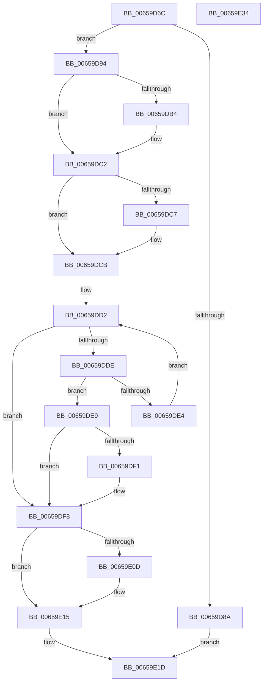

# ExUninitializeDeviceAts

- RVA: `0x00659D6C`–`0x00659E35` (길이 `201` bytes)
- VA: `0x0000000140659D6C`
- 실행 섹션: `.text`
- PDB 이름 있음: `예`; PDB Function 태그: `아니요`
- unwind 정보 RVA: `0x0005C954`
- 디코드: `56`개 명령, `201/201` bytes 표시
- 미해석 바이트: `0` (있으면 어셈블리에 `.byte`로 보존)

> 이 문서는 커널 이미지의 기계어와 PDB 기호를 분석해 생성했습니다. 4번과 5번은 함수 원형과 자료형을 바이너리 사용 방식에서 추정한 C 해석이며 원본 소스 복구 결과는 아닙니다.

## 1. Dependencies

- 직접 호출 지점: **5**; 고유 호출 대상: **5**
- 직접 호출자로 확인된 함수: **1**
- RIP 상대 이미지 참조: **3**

### Outgoing calls
- `0x00659DA3` → [KeAbPreAcquire](../21/KeAbPreAcquire_function_00210230.md) (function, `0x00210230`)
- `0x00659DBD` → [ExfAcquirePushLockExclusiveEx](../20/ExfAcquirePushLockExclusiveEx_function_0020FC90.md) (function, `0x0020FC90`)
- `0x00659DF1` → [ExpAtsDereferenceDevice](ExpAtsDereferenceDevice_function_00659EDC.md) (function, `0x00659EDC`)
- `0x00659E10` → [ExfTryToWakePushLock](../26/ExfTryToWakePushLock_function_00265DD0.md) (function, `0x00265DD0`)
- `0x00659E18` → [KeAbPostRelease](../2E/KeAbPostRelease_function_002E1600.md) (function, `0x002E1600`)

### Direct callers
- [PiIommuUninitializeDeviceAts](../4C/PiIommuUninitializeDeviceAts_function_004CCB18.md) at `0x004CCB34`

### Static image references
- `0x00659D94` → RVA `0x00EFA8E8` (`.data`; read)
- `0x00659DCB` → RVA `0x00EFA8F0` (`.data`; read)
- `0x00659DFC` → RVA `0x00EFA8E8` (`.data`; read/write)

## 2. Other-region calls and transfers

- 다른 실행 섹션으로 향하는 call: **0**
- 별도 외부 분기/꼬리 이동을 확인하지 못했습니다.

## 3. Assembly (complete function range)

```asm
00659D6C  48 89 5C 24 08                  mov qword ptr [rsp + 8], rbx
00659D71  48 89 6C 24 10                  mov qword ptr [rsp + 0x10], rbp
00659D76  48 89 74 24 18                  mov qword ptr [rsp + 0x18], rsi
00659D7B  57                              push rdi
00659D7C  48 83 EC 20                     sub rsp, 0x20
00659D80  33 DB                           xor ebx, ebx
00659D82  48 8B F1                        mov rsi, rcx
00659D85  48 85 C9                        test rcx, rcx
00659D88  75 0A                           jne 0x140659d94
00659D8A  BB 0D 00 00 C0                  mov ebx, 0xc000000d
00659D8F  E9 89 00 00 00                  jmp 0x140659e1d
00659D94  48 8D 2D 4D 0B 8A 00            lea rbp, [rip + 0x8a0b4d]
00659D9B  45 33 C0                        xor r8d, r8d
00659D9E  48 8B CD                        mov rcx, rbp
00659DA1  33 D2                           xor edx, edx
00659DA3  E8 88 64 BB FF                  call 0x140210230
00659DA8  F0 48 0F BA 6D 00 00            lock bts qword ptr [rbp], 0
00659DAF  48 8B F8                        mov rdi, rax
00659DB2  73 0E                           jae 0x140659dc2
00659DB4  4C 8B C5                        mov r8, rbp
00659DB7  48 8B D0                        mov rdx, rax
00659DBA  48 8B CD                        mov rcx, rbp
00659DBD  E8 CE 5E BB FF                  call 0x14020fc90
00659DC2  48 85 FF                        test rdi, rdi
00659DC5  74 04                           je 0x140659dcb
00659DC7  C6 47 0A 01                     mov byte ptr [rdi + 0xa], 1
00659DCB  48 8B 0D 1E 0B 8A 00            mov rcx, qword ptr [rip + 0x8a0b1e]
00659DD2  48 8D 05 17 0B 8A 00            lea rax, [rip + 0x8a0b17]
00659DD9  48 3B C8                        cmp rcx, rax
00659DDC  74 1A                           je 0x140659df8
00659DDE  48 39 71 18                     cmp qword ptr [rcx + 0x18], rsi
00659DE2  74 05                           je 0x140659de9
00659DE4  48 8B 09                        mov rcx, qword ptr [rcx]
00659DE7  EB E9                           jmp 0x140659dd2
00659DE9  8B 41 24                        mov eax, dword ptr [rcx + 0x24]
00659DEC  39 41 20                        cmp dword ptr [rcx + 0x20], eax
00659DEF  76 07                           jbe 0x140659df8
00659DF1  E8 E6 00 00 00                  call 0x140659edc
00659DF6  8B D8                           mov ebx, eax
00659DF8  48 83 CA FF                     or rdx, 0xffffffffffffffff
00659DFC  F0 48 0F C1 15 E3 0A 8A 00      lock xadd qword ptr [rip + 0x8a0ae3], rdx
00659E05  80 E2 06                        and dl, 6
00659E08  80 FA 02                        cmp dl, 2
00659E0B  75 08                           jne 0x140659e15
00659E0D  48 8B CD                        mov rcx, rbp
00659E10  E8 BB BF C0 FF                  call 0x140265dd0
00659E15  48 8B CD                        mov rcx, rbp
00659E18  E8 E3 77 C8 FF                  call 0x1402e1600
00659E1D  48 8B 6C 24 38                  mov rbp, qword ptr [rsp + 0x38]
00659E22  8B C3                           mov eax, ebx
00659E24  48 8B 5C 24 30                  mov rbx, qword ptr [rsp + 0x30]
00659E29  48 8B 74 24 40                  mov rsi, qword ptr [rsp + 0x40]
00659E2E  48 83 C4 20                     add rsp, 0x20
00659E32  5F                              pop rdi
00659E33  C3                              ret
00659E34  CC                              int3
```

## 4. C-style interpretation (structured pseudocode)

```c
__int64 __fastcall ExUninitializeDeviceAts(__int64 a1, int a2, int a3)
{
    __int64 result;
    __int64 v_rbx;
    __int64 v_rsp;
    unsigned __int64 v_stack_p10;
    unsigned __int64 v_stack_p18;
    unsigned __int64 v_stack_p8;

    v_stack_p8 = v_rbx;
    v_stack_p10 = v_rbp;
    v_stack_p18 = v_rsi;
    v_rsp = (v_rsp) - (32);
    v_rbx = 0;
    if (a1 != 0) goto loc_00659D94;
    goto loc_00659E1D;
loc_00659D94:
    a3 = 0;
    a2 = 0;
    result = KeAbPreAcquire(v_rip + 9046861, a2, a3, a4);
    if (!(condition_is_above_or_equal)) {
        a3 = v_rip + 9046861;
        a2 = result;
        a1 = v_rip + 9046861;
        result = ExfAcquirePushLockExclusiveEx(a1, a2, a3, a4);
    }
    if (result != 0) {
        *(unsigned __int8 *)(result + 10) = 1;
    }
loc_00659DD2:
    if ((*(unsigned __int64 *)(v_rip + 9046814)) == (v_rip + 9046807)) goto loc_00659DF8;
    if ((*(unsigned __int64 *)(*(unsigned __int64 *)(v_rip + 9046814) + 24)) == a1) goto loc_00659DE9;
    goto loc_00659DD2;
loc_00659DE9:
    result = (unsigned int)(*(unsigned int *)(*(unsigned __int64 *)(*(unsigned __int64 *)(v_rip + 9046814)) + 36));
    v_rbx = (unsigned int)(0xC000000DULL);
    if ((*(unsigned int *)(*(unsigned __int64 *)(*(unsigned __int64 *)(v_rip + 9046814)) + 32)) >= = ((unsigned int)((unsigned int)(*(unsigned int *)(*(unsigned __int64 *)(*(unsigned __int64 *)(v_rip + 9046814)) + 36))))) {
        result = ExpAtsDereferenceDevice(*(unsigned __int64 *)(*(unsigned __int64 *)(v_rip + 9046814)), a2, a3, a4);
        v_rbx = (unsigned int)(result);
    }
    a2 = (a2) | (-1);
    a2 = (unsigned __int8)((a2) & (6));
    if (((unsigned __int8)(a2)) == 2) {
        a1 = v_rip + 9046861;
        result = ExfTryToWakePushLock(a1, a2, a3, a4);
    }
    result = KeAbPostRelease(v_rip + 9046861, a2, a3, a4);
loc_00659E1D:
    v_rsp = (v_rsp) + (32);
    return (unsigned int)((unsigned int)(v_rbx));
}
```

## 5. (Beta) C Style

```c
int64_t ExUninitializeDeviceAts(int64_t Arg1, int32_t Arg2, int32_t Arg3)
{
    int64_t result;
    int64_t local_rbx;
    int64_t local_rsp;
    uint64_t v_stack_p10;
    uint64_t v_stack_p18;
    uint64_t v_stack_p8;

    v_stack_p8 = local_rbx;
    v_stack_p10 = local_rbp;
    v_stack_p18 = local_rsi;
    local_rsp = (local_rsp) - (32);
    local_rbx = 0;
    if (Arg1 != 0) goto loc_00659D94;
    goto loc_00659E1D;
loc_00659D94:
    Arg3 = 0;
    Arg2 = 0;
    result = KeAbPreAcquire(v_rip + 9046861, Arg2, Arg3, a4);
    if (!(condition_is_above_or_equal)) {
        Arg3 = v_rip + 9046861;
        Arg2 = result;
        Arg1 = v_rip + 9046861;
        result = ExfAcquirePushLockExclusiveEx(Arg1, Arg2, Arg3, a4);
    }
    if (result != 0) {
        *(uint8_t *)(result + 0xA) = 1;
    }
loc_00659DD2:
    if ((*(uint64_t *)(v_rip + 0x8A0B1E)) == (v_rip + 9046807)) goto loc_00659DF8;
    if ((*(uint64_t *)(*(uint64_t *)(v_rip + 0x8A0B1E) + 0x18)) == Arg1) goto loc_00659DE9;
    goto loc_00659DD2;
loc_00659DE9:
    result = (uint32_t)(*(uint32_t *)(*(uint64_t *)(*(uint64_t *)(v_rip + 0x8A0B1E)) + 0x24));
    local_rbx = (uint32_t)(0xC000000DULL);
    if ((*(uint32_t *)(*(uint64_t *)(*(uint64_t *)(v_rip + 0x8A0B1E)) + 0x20)) >= = ((uint32_t)((uint32_t)(*(uint32_t *)(*(uint64_t *)(*(uint64_t *)(v_rip + 0x8A0B1E)) + 0x24))))) {
        result = ExpAtsDereferenceDevice(*(uint64_t *)(*(uint64_t *)(v_rip + 0x8A0B1E)), Arg2, Arg3, a4);
        local_rbx = (uint32_t)(result);
    }
    Arg2 = (Arg2) | (-1);
    Arg2 = (uint8_t)((Arg2) & (6));
    if (((uint8_t)(Arg2)) == 2) {
        Arg1 = v_rip + 9046861;
        result = ExfTryToWakePushLock(Arg1, Arg2, Arg3, a4);
    }
    result = KeAbPostRelease(v_rip + 9046861, Arg2, Arg3, a4);
loc_00659E1D:
    local_rsp = (local_rsp) + (32);
    return (uint32_t)((uint32_t)(local_rbx));
}
```

## 6. Execution-region graph

[열기: 2D/3D 그래프와 함수 탐색 컨트롤 패널](../../../control-panel.html?section=text&rva=0x00659D6C&view=graph)

- 2D 그래프는 위에서 아래로 흐르고, 3D 그래프는 빈 공간을 드래그해 회전합니다. Shift+드래그는 이동, 휠은 확대·축소, 함수 노드 선택은 대상 보고서 이동입니다.

### Static fallback


