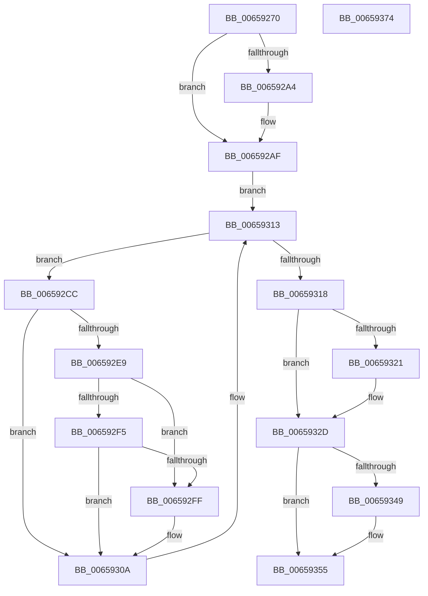

# ExWakeTimersResume

- RVA: `0x00659270`–`0x00659375` (길이 `261` bytes)
- VA: `0x0000000140659270`
- 실행 섹션: `.text`
- PDB 이름 있음: `예`; PDB Function 태그: `아니요`
- unwind 정보 RVA: `0x000C4D00`
- 디코드: `65`개 명령, `261/261` bytes 표시
- 미해석 바이트: `0` (있으면 어셈블리에 `.byte`로 보존)

> 이 문서는 커널 이미지의 기계어와 PDB 기호를 분석해 생성했습니다. 4번과 5번은 함수 원형과 자료형을 바이너리 사용 방식에서 추정한 C 해석이며 원본 소스 복구 결과는 아닙니다.

## 1. Dependencies

- 직접 호출 지점: **6**; 고유 호출 대상: **6**
- 직접 호출자로 확인된 함수: **1**
- RIP 상대 이미지 참조: **4**

### Outgoing calls
- `0x006592AA` → [KiRaiseIrqlProcessIrqlFlags](../4F/KiRaiseIrqlProcessIrqlFlags_function_004F56FC.md) (function, `0x004F56FC`)
- `0x006592DA` → [KeAcquireSpinLockAtDpcLevel](../20/KeAcquireSpinLockAtDpcLevel_function_00208430.md) (function, `0x00208430`)
- `0x00659305` → [ExpTimerResume](../22/ExpTimerResume_function_0022FD60.md) (function, `0x0022FD60`)
- `0x0065930E` → [KxReleaseSpinLock](../20/KxReleaseSpinLock_function_00206670.md) (function, `0x00206670`)
- `0x00659328` → [KiLowerIrqlProcessIrqlFlags](../4F/KiLowerIrqlProcessIrqlFlags_function_004F5698.md) (function, `0x004F5698`)
- `0x00659350` → [ExfTryToWakePushLock](../26/ExfTryToWakePushLock_function_00265DD0.md) (function, `0x00265DD0`)

### Direct callers
- [PopTransitionSystemPowerStateEx](../../pagelk/B7/PopTransitionSystemPowerStateEx_function_00B7E8C0.md) at `0x00B7FAF1`

### Static image references
- `0x0065929B` → RVA `0x00FC6D20` (`ALMOSTRO`; read)
- `0x006592B9` → RVA `0x00EFAB90` (`.data`; read)
- `0x00659339` → RVA `0x00EFABA8` (`.data`; read/write)
- `0x00659349` → RVA `0x00EFABA8` (`.data`; read)

## 2. Other-region calls and transfers

- 다른 실행 섹션으로 향하는 call: **0**
- 별도 외부 분기/꼬리 이동을 확인하지 못했습니다.

## 3. Assembly (complete function range)

```asm
00659270  48 8B C4                        mov rax, rsp
00659273  48 89 58 08                     mov qword ptr [rax + 8], rbx
00659277  48 89 68 10                     mov qword ptr [rax + 0x10], rbp
0065927B  48 89 70 18                     mov qword ptr [rax + 0x18], rsi
0065927F  48 89 78 20                     mov qword ptr [rax + 0x20], rdi
00659283  41 54                           push r12
00659285  41 55                           push r13
00659287  41 56                           push r14
00659289  48 83 EC 20                     sub rsp, 0x20
0065928D  44 0F 20 C7                     mov rdi, cr8
00659291  41 BC 02 00 00 00               mov r12d, 2
00659297  45 0F 22 C4                     mov cr8, r12
0065929B  83 3D 7E DA 96 00 00            cmp dword ptr [rip + 0x96da7e], 0
006592A2  74 0B                           je 0x1406592af
006592A4  41 8A D4                        mov dl, r12b
006592A7  40 8A CF                        mov cl, dil
006592AA  E8 4D C4 E9 FF                  call 0x1404f56fc
006592AF  49 BE 08 00 00 00 80 F7 FF FF   movabs r14, 0xfffff78000000008
006592B9  4C 8D 2D D0 18 8A 00            lea r13, [rip + 0x8a18d0]
006592C0  4D 8B 36                        mov r14, qword ptr [r14]
006592C3  48 8B 1D C6 18 8A 00            mov rbx, qword ptr [rip + 0x8a18c6]
006592CA  EB 47                           jmp 0x140659313
006592CC  48 8D B3 F8 FE FF FF            lea rsi, [rbx - 0x108]
006592D3  48 8B 1B                        mov rbx, qword ptr [rbx]
006592D6  48 8D 4E 40                     lea rcx, [rsi + 0x40]
006592DA  E8 51 F1 BA FF                  call 0x140208430
006592DF  48 83 BE 00 01 00 00 00         cmp qword ptr [rsi + 0x100], 0
006592E7  74 21                           je 0x14065930a
006592E9  48 8B 86 18 01 00 00            mov rax, qword ptr [rsi + 0x118]
006592F0  48 85 C0                        test rax, rax
006592F3  74 0A                           je 0x1406592ff
006592F5  8B 80 88 00 00 00               mov eax, dword ptr [rax + 0x88]
006592FB  A8 08                           test al, 8
006592FD  75 0B                           jne 0x14065930a
006592FF  49 8B D6                        mov rdx, r14
00659302  48 8B CE                        mov rcx, rsi
00659305  E8 56 6A BD FF                  call 0x14022fd60
0065930A  48 8D 4E 40                     lea rcx, [rsi + 0x40]
0065930E  E8 5D D3 BA FF                  call 0x140206670
00659313  49 3B DD                        cmp rbx, r13
00659316  75 B4                           jne 0x1406592cc
00659318  83 3D 01 DA 96 00 00            cmp dword ptr [rip + 0x96da01], 0
0065931F  74 0C                           je 0x14065932d
00659321  44 0F 20 C1                     mov rcx, cr8
00659325  40 8A D7                        mov dl, dil
00659328  E8 6B C3 E9 FF                  call 0x1404f5698
0065932D  40 0F B6 C7                     movzx eax, dil
00659331  44 0F 22 C0                     mov cr8, rax
00659335  48 83 C8 FF                     or rax, 0xffffffffffffffff
00659339  F0 48 0F C1 05 66 18 8A 00      lock xadd qword ptr [rip + 0x8a1866], rax
00659342  24 06                           and al, 6
00659344  41 3A C4                        cmp al, r12b
00659347  75 0C                           jne 0x140659355
00659349  48 8D 0D 58 18 8A 00            lea rcx, [rip + 0x8a1858]
00659350  E8 7B CA C0 FF                  call 0x140265dd0
00659355  48 8B 5C 24 40                  mov rbx, qword ptr [rsp + 0x40]
0065935A  48 8B 6C 24 48                  mov rbp, qword ptr [rsp + 0x48]
0065935F  48 8B 74 24 50                  mov rsi, qword ptr [rsp + 0x50]
00659364  48 8B 7C 24 58                  mov rdi, qword ptr [rsp + 0x58]
00659369  48 83 C4 20                     add rsp, 0x20
0065936D  41 5E                           pop r14
0065936F  41 5D                           pop r13
00659371  41 5C                           pop r12
00659373  C3                              ret
00659374  CC                              int3
```

## 4. C-style interpretation (structured pseudocode)

```c
__int64 __fastcall ExWakeTimersResume(void)
{
    __int64 result;
    __int64 v_rsp;
    unsigned __int64 v_stack_p10;
    unsigned __int64 v_stack_p18;
    unsigned __int64 v_stack_p20;
    unsigned __int64 v_stack_p8;

    *(unsigned __int64 *)(v_rsp + 8) = v_rbx;
    *(unsigned __int64 *)(v_rsp + 16) = v_rbp;
    *(unsigned __int64 *)(v_rsp + 24) = v_rsi;
    *(unsigned __int64 *)(v_rsp + 32) = v_rdi;
    v_rsp = (v_rsp) - (32);
    result = v_rsp;
    if ((*(unsigned int *)(v_rip + 9886334)) != 0) {
        a2 = 2;
        a1 = (unsigned __int8)(v_cr8);
        result = KiRaiseIrqlProcessIrqlFlags(a1, a2, a3, a4);
    }
    goto loc_00659313;
loc_006592CC:
    result = KeAcquireSpinLockAtDpcLevel(*(unsigned __int64 *)(v_rip + 9050310) - 264 + 64, a2, a3, a4);
    if ((*(unsigned __int64 *)(*(unsigned __int64 *)(v_rip + 9050310) - 264 + 256)) == 0) goto loc_0065930A;
    if (*(unsigned __int64 *)(*(unsigned __int64 *)(v_rip + 9050310) - 264 + 280) == 0) goto loc_006592FF;
    result = (unsigned int)(*(unsigned int *)(*(unsigned __int64 *)(*(unsigned __int64 *)(v_rip + 9050310) - 264 + 280) + 136));
    if ((((unsigned __int8)((unsigned int)(*(unsigned int *)(*(unsigned __int64 *)(*(unsigned __int64 *)(v_rip + 9050310) - 264 + 280) + 136)))) & (8)) == 0) {
        a2 = *(unsigned __int64 *)(v_r14);
        a1 = *(unsigned __int64 *)(v_rip + 9050310) - 264;
        result = ExpTimerResume(a1, a2, a3, a4);
    }
    result = KxReleaseSpinLock(*(unsigned __int64 *)(v_rip + 9050310) - 264 + 64, a2, a3, a4);
loc_00659313:
    if ((*(unsigned __int64 *)(*(unsigned __int64 *)(v_rip + 9050310))) != (v_rip + 9050320)) goto loc_006592CC;
    if ((*(unsigned int *)(v_rip + 9886209)) != 0) {
        a1 = 2;
        a2 = (unsigned __int8)(v_cr8);
        result = KiLowerIrqlProcessIrqlFlags(a1, a2, a3, a4);
    }
    result = ((unsigned __int8)(v_cr8)) | (-1);
    result = (unsigned __int8)((result) & (6));
    if (((unsigned __int8)(result)) == 2) {
        a1 = v_rip + 9050200;
        result = ExfTryToWakePushLock(a1, a2, a3, a4);
    }
    v_rsp = (v_rsp) + (32);
    return result;
}
```

## 5. (Beta) C Style

```c
void ExWakeTimersResume(void)
{
    int64_t result;
    int64_t local_rsp;
    uint64_t v_stack_p10;
    uint64_t v_stack_p18;
    uint64_t v_stack_p20;
    uint64_t v_stack_p8;

    *(uint64_t *)(local_rsp + 0x8) = local_rbx;
    *(uint64_t *)(local_rsp + 0x10) = local_rbp;
    *(uint64_t *)(local_rsp + 0x18) = local_rsi;
    *(uint64_t *)(local_rsp + 0x20) = local_rdi;
    local_rsp = (local_rsp) - (32);
    result = local_rsp;
    if ((*(uint32_t *)(v_rip + 0x96DA7E)) != 0) {
        a2 = 2;
        a1 = (uint8_t)(v_cr8);
        result = KiRaiseIrqlProcessIrqlFlags(a1, a2, a3, a4);
    }
    goto loc_00659313;
loc_006592CC:
    result = KeAcquireSpinLockAtDpcLevel(*(uint64_t *)(v_rip + 0x8A18C6) - 264 + 64, a2, a3, a4);
    if ((*(uint64_t *)(*(uint64_t *)(v_rip + 0x8A18C6) - 0x108 + 0x100)) == 0) goto loc_0065930A;
    if (*(uint64_t *)(*(uint64_t *)(v_rip + 0x8A18C6) - 0x108 + 0x118) == 0) goto loc_006592FF;
    result = (uint32_t)(*(uint32_t *)(*(uint64_t *)(*(uint64_t *)(v_rip + 0x8A18C6) - 0x108 + 0x118) + 0x88));
    if ((((uint8_t)((uint32_t)(*(uint32_t *)(*(uint64_t *)(*(uint64_t *)(v_rip + 0x8A18C6) - 0x108 + 0x118) + 0x88)))) & (8)) == 0) {
        a2 = *(uint64_t *)(local_r14);
        a1 = *(uint64_t *)(v_rip + 0x8A18C6) - 264;
        result = ExpTimerResume(a1, a2, a3, a4);
    }
    result = KxReleaseSpinLock(*(uint64_t *)(v_rip + 0x8A18C6) - 264 + 64, a2, a3, a4);
loc_00659313:
    if ((*(uint64_t *)(*(uint64_t *)(v_rip + 0x8A18C6))) != (v_rip + 9050320)) goto loc_006592CC;
    if ((*(uint32_t *)(v_rip + 0x96DA01)) != 0) {
        a1 = 2;
        a2 = (uint8_t)(v_cr8);
        result = KiLowerIrqlProcessIrqlFlags(a1, a2, a3, a4);
    }
    result = ((uint8_t)(v_cr8)) | (-1);
    result = (uint8_t)((result) & (6));
    if (((uint8_t)(result)) == 2) {
        a1 = v_rip + 9050200;
        result = ExfTryToWakePushLock(a1, a2, a3, a4);
    }
    local_rsp = (local_rsp) + (32);
    return result;
}
```

## 6. Execution-region graph

[열기: 2D/3D 그래프와 함수 탐색 컨트롤 패널](../../../control-panel.html?section=text&rva=0x00659270&view=graph)

- 2D 그래프는 위에서 아래로 흐르고, 3D 그래프는 빈 공간을 드래그해 회전합니다. Shift+드래그는 이동, 휠은 확대·축소, 함수 노드 선택은 대상 보고서 이동입니다.

### Static fallback


