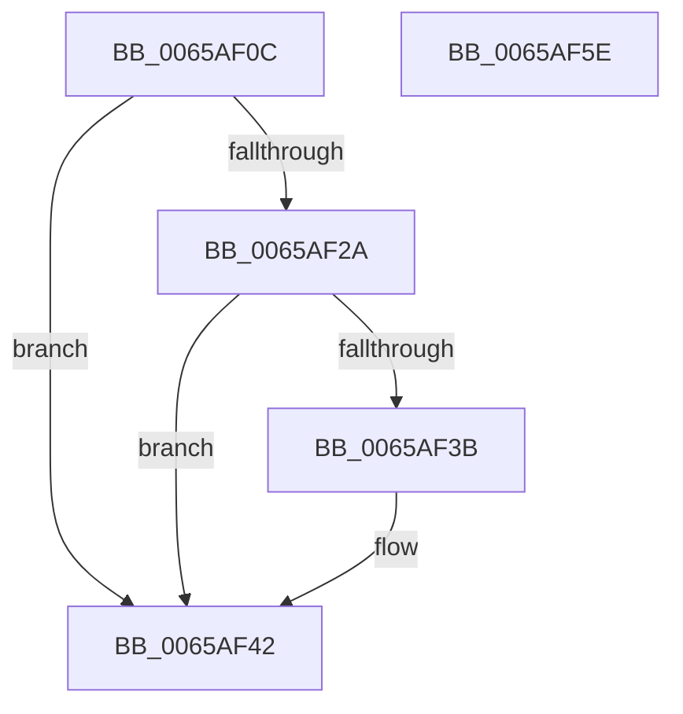

# ExpAcquireSvmAgentsLock

- RVA: `0x0065AF0C`–`0x0065AF5F` (길이 `83` bytes)
- VA: `0x000000014065AF0C`
- 실행 섹션: `.text`
- PDB 이름 있음: `예`; PDB Function 태그: `아니요`
- unwind 정보 RVA: `0x0005CAAC`
- 디코드: `24`개 명령, `83/83` bytes 표시
- 미해석 바이트: `0` (있으면 어셈블리에 `.byte`로 보존)

> 이 문서는 커널 이미지의 기계어와 PDB 기호를 분석해 생성했습니다. 4번과 5번은 함수 원형과 자료형을 바이너리 사용 방식에서 추정한 C 해석이며 원본 소스 복구 결과는 아닙니다.

## 1. Dependencies

- 직접 호출 지점: **2**; 고유 호출 대상: **2**
- 직접 호출자로 확인된 함수: **5**
- RIP 상대 이미지 참조: **2**

### Outgoing calls
- `0x0065AF3D` → [KiRaiseIrqlProcessIrqlFlags](../4F/KiRaiseIrqlProcessIrqlFlags_function_004F56FC.md) (function, `0x004F56FC`)
- `0x0065AF4C` → [KeAcquireInStackQueuedSpinLockAtDpcLevel](../27/KeAcquireInStackQueuedSpinLockAtDpcLevel_function_00275740.md) (function, `0x00275740`)

### Direct callers
- [ExpAllocateAsid](ExpAllocateAsid_function_0065AF68.md) at `0x0065AF96`
- [ExpAllocateAsid](ExpAllocateAsid_function_0065AF68.md) at `0x0065B010`
- [ExpFreeAsid](ExpFreeAsid_function_0065B1E8.md) at `0x0065B20B`
- [ExpSvmDereferenceAsid](ExpSvmDereferenceAsid_function_0065BB40.md) at `0x0065BB60`
- [ExpSvmReferenceAsid](ExpSvmReferenceAsid_function_0065BDF0.md) at `0x0065BE14`
- [ExpSvmServicePageFault](ExpSvmServicePageFault_function_0065BEC0.md) at `0x0065BF2C`

### Static image references
- `0x0065AF32` → RVA `0x00FC6D20` (`ALMOSTRO`; read)
- `0x0065AF45` → RVA `0x00EFA8D8` (`.data`; read)

## 2. Other-region calls and transfers

- 다른 실행 섹션으로 향하는 call: **0**
- 별도 외부 분기/꼬리 이동을 확인하지 못했습니다.

## 3. Assembly (complete function range)

```asm
0065AF0C  48 89 5C 24 08                  mov qword ptr [rsp + 8], rbx
0065AF11  57                              push rdi
0065AF12  48 83 EC 20                     sub rsp, 0x20
0065AF16  48 8B F9                        mov rdi, rcx
0065AF19  44 0F 20 C3                     mov rbx, cr8
0065AF1D  44 0F 20 C0                     mov rax, cr8
0065AF21  BA 0F 00 00 00                  mov edx, 0xf
0065AF26  3A C2                           cmp al, dl
0065AF28  73 18                           jae 0x14065af42
0065AF2A  44 0F 20 C3                     mov rbx, cr8
0065AF2E  44 0F 22 C2                     mov cr8, rdx
0065AF32  83 3D E7 BD 96 00 00            cmp dword ptr [rip + 0x96bde7], 0
0065AF39  74 07                           je 0x14065af42
0065AF3B  8A CB                           mov cl, bl
0065AF3D  E8 BA A7 E9 FF                  call 0x1404f56fc
0065AF42  48 8B D7                        mov rdx, rdi
0065AF45  48 8D 0D 8C F9 89 00            lea rcx, [rip + 0x89f98c]
0065AF4C  E8 EF A7 C1 FF                  call 0x140275740
0065AF51  8A C3                           mov al, bl
0065AF53  48 8B 5C 24 30                  mov rbx, qword ptr [rsp + 0x30]
0065AF58  48 83 C4 20                     add rsp, 0x20
0065AF5C  5F                              pop rdi
0065AF5D  C3                              ret
0065AF5E  CC                              int3
```

## 4. C-style interpretation (structured pseudocode)

```c
__int64 __fastcall ExpAcquireSvmAgentsLock(__int64 a1)
{
    __int64 result;
    __int64 v_rsp;
    unsigned __int64 v_stack_p8;

    v_stack_p8 = v_rbx;
    v_rsp = (v_rsp) - (32);
    if (((unsigned __int8)(v_cr8)) >= 15) goto loc_0065AF42;
    result = v_cr8;
    if ((*(unsigned int *)(v_rip + 9879015)) != 0) {
        a1 = (unsigned __int8)(v_cr8);
        result = KiRaiseIrqlProcessIrqlFlags(a1, 15, a3, a4);
    }
    result = KeAcquireInStackQueuedSpinLockAtDpcLevel(v_rip + 9042316, a1, a3, a4);
    v_rsp = (v_rsp) + (32);
    return (unsigned __int8)(v_cr8);
}
```

## 5. (Beta) C Style

```c
int64_t ExpAcquireSvmAgentsLock(int64_t Arg1)
{
    int64_t result;
    int64_t local_rsp;
    uint64_t v_stack_p8;

    v_stack_p8 = local_rbx;
    local_rsp = (local_rsp) - (32);
    if (((uint8_t)(v_cr8)) >= 15) goto loc_0065AF42;
    result = v_cr8;
    if ((*(uint32_t *)(v_rip + 0x96BDE7)) != 0) {
        Arg1 = (uint8_t)(v_cr8);
        result = KiRaiseIrqlProcessIrqlFlags(Arg1, 15, a3, a4);
    }
    result = KeAcquireInStackQueuedSpinLockAtDpcLevel(v_rip + 9042316, Arg1, a3, a4);
    local_rsp = (local_rsp) + (32);
    return (uint8_t)(v_cr8);
}
```

## 6. Execution-region graph

[열기: 2D/3D 그래프와 함수 탐색 컨트롤 패널](../../../control-panel.html?section=text&rva=0x0065AF0C&view=graph)

- 2D 그래프는 위에서 아래로 흐르고, 3D 그래프는 빈 공간을 드래그해 회전합니다. Shift+드래그는 이동, 휠은 확대·축소, 함수 노드 선택은 대상 보고서 이동입니다.

### Static fallback


