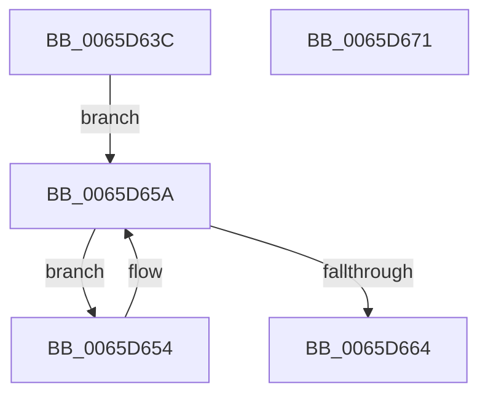

# ExpAeMeasureContention

- RVA: `0x0065D63C`–`0x0065D672` (길이 `54` bytes)
- VA: `0x000000014065D63C`
- 실행 섹션: `.text`
- PDB 이름 있음: `예`; PDB Function 태그: `아니요`
- unwind 정보 RVA: `0x000DB714`
- 디코드: `19`개 명령, `54/54` bytes 표시
- 미해석 바이트: `0` (있으면 어셈블리에 `.byte`로 보존)

> 이 문서는 커널 이미지의 기계어와 PDB 기호를 분석해 생성했습니다. 4번과 5번은 함수 원형과 자료형을 바이너리 사용 방식에서 추정한 C 해석이며 원본 소스 복구 결과는 아닙니다.

## 1. Dependencies

- 직접 호출 지점: **0**; 고유 호출 대상: **0**
- 직접 호출자로 확인된 함수: **2**
- RIP 상대 이미지 참조: **0**

### Outgoing calls
- 직접 디코드된 call 명령이 없습니다.

### Direct callers
- [ExpAeThresholdInitWorker](ExpAeThresholdInitWorker_function_0065D680.md) at `0x0065D7BB`
- [ExpAeThresholdInitialization](../../init/C5/ExpAeThresholdInitialization_function_00C54A0C.md) at `0x00C54A80`

### Static image references
- 디코드된 RIP-relative 메모리 참조가 없습니다.

## 2. Other-region calls and transfers

- 다른 실행 섹션으로 향하는 call: **0**
- 별도 외부 분기/꼬리 이동을 확인하지 못했습니다.

## 3. Assembly (complete function range)

```asm
0065D63C  0F 31                           rdtsc
0065D63E  48 C1 E2 20                     shl rdx, 0x20
0065D642  48 0B C2                        or rax, rdx
0065D645  4C 8B C0                        mov r8, rax
0065D648  0F 0D 09                        prefetchw byte ptr [rcx]
0065D64B  48 8B 01                        mov rax, qword ptr [rcx]
0065D64E  48 8D 50 01                     lea rdx, [rax + 1]
0065D652  EB 06                           jmp 0x14065d65a
0065D654  48 8B C2                        mov rax, rdx
0065D657  48 FF C2                        inc rdx
0065D65A  F0 48 0F B1 11                  lock cmpxchg qword ptr [rcx], rdx
0065D65F  48 8B D0                        mov rdx, rax
0065D662  75 F0                           jne 0x14065d654
0065D664  0F 31                           rdtsc
0065D666  48 C1 E2 20                     shl rdx, 0x20
0065D66A  48 0B C2                        or rax, rdx
0065D66D  49 2B C0                        sub rax, r8
0065D670  C3                              ret
0065D671  CC                              int3
```

## 4. C-style interpretation (structured pseudocode)

```c
__int64 __fastcall ExpAeMeasureContention(__int64 a1, __int64 a2)
{
    __int64 result;

    a2 = (a2) << (32);
    result = (result) | (a2);
    goto loc_0065D65A;
loc_0065D654:
    a2 = (*(unsigned __int64 *)(a1) + 1) + 1;
loc_0065D65A:
    if (condition_is_not_equal) goto loc_0065D654;
    a2 = (*(unsigned __int64 *)(a1) + 1) << (32);
    result = (*(unsigned __int64 *)(a1) + 1) | (a2);
    result = (result) - (result);
    return result;
}
```

## 5. (Beta) C Style

```c
int64_t ExpAeMeasureContention(void *Arg1, int64_t Arg2)
{
    uint8_t *arg1 = (uint8_t *)Arg1;

    int64_t result;

    Arg2 = (Arg2) << (32);
    result = (result) | (Arg2);
    goto loc_0065D65A;
loc_0065D654:
    Arg2 = (*(uint64_t *)(arg1) + 1) + 1;
loc_0065D65A:
    if (condition_is_not_equal) goto loc_0065D654;
    Arg2 = (*(uint64_t *)(arg1) + 1) << (32);
    result = (*(uint64_t *)(arg1) + 1) | (Arg2);
    result = (result) - (result);
    return result;
}
```

### 관측된 메모리 오프셋

구조체 형식이 확인되지 않은 접근은 인자 기준의 오프셋으로만 기록했습니다.

| 기준 인자 | 오프셋 표현 | 폭 (bit) | 접근 |
|---|---:|---:|---|
| `Arg1` | `+ 0x0` | `8` | `R` |
| `Arg1` | `+ 0x0` | `64` | `R` |

## 6. Execution-region graph

[열기: 2D/3D 그래프와 함수 탐색 컨트롤 패널](../../../control-panel.html?section=text&rva=0x0065D63C&view=graph)

- 2D 그래프는 위에서 아래로 흐르고, 3D 그래프는 빈 공간을 드래그해 회전합니다. Shift+드래그는 이동, 휠은 확대·축소, 함수 노드 선택은 대상 보고서 이동입니다.

### Static fallback


