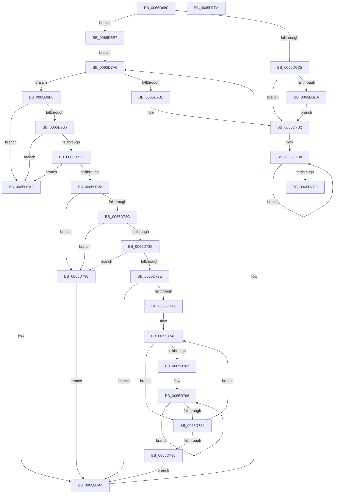

# ExpAeThresholdInitWorker

- RVA: `0x0065D680`–`0x0065D7FB` (길이 `379` bytes)
- VA: `0x000000014065D680`
- 실행 섹션: `.text`
- PDB 이름 있음: `예`; PDB Function 태그: `아니요`
- unwind 정보 RVA: `0x000B0E24`
- 디코드: `110`개 명령, `379/379` bytes 표시
- 미해석 바이트: `0` (있으면 어셈블리에 `.byte`로 보존)

> 이 문서는 커널 이미지의 기계어와 PDB 기호를 분석해 생성했습니다. 4번과 5번은 함수 원형과 자료형을 바이너리 사용 방식에서 추정한 C 해석이며 원본 소스 복구 결과는 아닙니다.

## 1. Dependencies

- 직접 호출 지점: **6**; 고유 호출 대상: **6**
- 직접 호출자로 확인된 함수: **0**
- RIP 상대 이미지 참조: **3**

### Outgoing calls
- `0x0065D6DD` → [KeWakeAddressAll](../21/KeWakeAddressAll_function_00217C20.md) (function, `0x00217C20`)
- `0x0065D713` → [KiCheckVpBackingLongSpinWaitHypercall](../30/KiCheckVpBackingLongSpinWaitHypercall_function_0030F490.md) (function, `0x0030F490`)
- `0x0065D723` → [KeCanUseHaltOnAddress](../4F/KeCanUseHaltOnAddress_function_004FC22C.md) (function, `0x004FC22C`)
- `0x0065D776` → [KiHaltOnAddress](../4F/KiHaltOnAddress_function_004FBA3C.md) (function, `0x004FBA3C`)
- `0x0065D79B` → [HvlNotifyLongSpinWait](../30/HvlNotifyLongSpinWait_function_0030F460.md) (function, `0x0030F460`)
- `0x0065D7BB` → [ExpAeMeasureContention](ExpAeMeasureContention_function_0065D63C.md) (function, `0x0065D63C`)

### Direct callers
- 이 함수 시작 RVA로 연결되는 직접 call은 확인되지 않았습니다. 간접 호출은 완전히 역산할 수 없습니다.

### Static image references
- `0x0065D6F8` → RVA `0x00FC52AC` (`ALMOSTRO`; reference)
- `0x0065D705` → RVA `0x00FC6AB8` (`ALMOSTRO`; read)
- `0x0065D72C` → RVA `0x00FC6B38` (`ALMOSTRO`; read)

## 2. Other-region calls and transfers

- 다른 실행 섹션으로 향하는 call: **0**
- 별도 외부 분기/꼬리 이동을 확인하지 못했습니다.

## 3. Assembly (complete function range)

```asm
0065D680  48 89 5C 24 08                  mov qword ptr [rsp + 8], rbx
0065D685  48 89 6C 24 18                  mov qword ptr [rsp + 0x18], rbp
0065D68A  48 89 74 24 20                  mov qword ptr [rsp + 0x20], rsi
0065D68F  57                              push rdi
0065D690  41 54                           push r12
0065D692  41 55                           push r13
0065D694  41 56                           push r14
0065D696  41 57                           push r15
0065D698  48 83 EC 20                     sub rsp, 0x20
0065D69C  33 F6                           xor esi, esi
0065D69E  49 8B F9                        mov rdi, r9
0065D6A1  83 C8 FF                        or eax, 0xffffffff
0065D6A4  4D 8B E8                        mov r13, r8
0065D6A7  48 8B EA                        mov rbp, rdx
0065D6AA  F0 41 0F C1 01                  lock xadd dword ptr [r9], eax
0065D6AF  FF C8                           dec eax
0065D6B1  41 BF 00 00 00 80               mov r15d, 0x80000000
0065D6B7  8B D8                           mov ebx, eax
0065D6B9  F7 D3                           not ebx
0065D6BB  41 23 DF                        and ebx, r15d
0065D6BE  A9 FF FF FF 3F                  test eax, 0x3fffffff
0065D6C3  75 22                           jne 0x14065d6e7
0065D6C5  41 0B 59 04                     or ebx, dword ptr [r9 + 4]
0065D6C9  41 87 19                        xchg dword ptr [r9], ebx
0065D6CC  89 5C 24 58                     mov dword ptr [rsp + 0x58], ebx
0065D6D0  0F BA E3 1E                     bt ebx, 0x1e
0065D6D4  0F 83 D8 00 00 00               jae 0x14065d7b2
0065D6DA  49 8B C9                        mov rcx, r9
0065D6DD  E8 3E A5 BB FF                  call 0x140217c20
0065D6E2  E9 CB 00 00 00                  jmp 0x14065d7b2
0065D6E7  41 8B 01                        mov eax, dword ptr [r9]
0065D6EA  44 8B F6                        mov r14d, esi
0065D6ED  44 8B E6                        mov r12d, esi
0065D6F0  E9 B1 00 00 00                  jmp 0x14065d7a6
0065D6F5  41 FF C6                        inc r14d
0065D6F8  44 85 35 AD 7B 96 00            test dword ptr [rip + 0x967bad], r14d
0065D6FF  0F 85 9D 00 00 00               jne 0x14065d7a2
0065D705  8B 05 AD 93 96 00               mov eax, dword ptr [rip + 0x9693ad]
0065D70B  A8 40                           test al, 0x40
0065D70D  0F 84 8F 00 00 00               je 0x14065d7a2
0065D713  E8 78 1D CB FF                  call 0x14030f490
0065D718  84 C0                           test al, al
0065D71A  0F 84 82 00 00 00               je 0x14065d7a2
0065D720  41 FF C4                        inc r12d
0065D723  E8 04 EB E9 FF                  call 0x1404fc22c
0065D728  84 C0                           test al, al
0065D72A  74 6C                           je 0x14065d798
0065D72C  F7 05 02 94 96 00 00 00 02 00   test dword ptr [rip + 0x969402], 0x20000
0065D736  74 60                           je 0x14065d798
0065D738  41 F6 C4 07                     test r12b, 7
0065D73C  75 5A                           jne 0x14065d798
0065D73E  8B 0F                           mov ecx, dword ptr [rdi]
0065D740  8B C1                           mov eax, ecx
0065D742  41 23 C7                        and eax, r15d
0065D745  3B C3                           cmp eax, ebx
0065D747  74 5B                           je 0x14065d7a4
0065D749  8B D1                           mov edx, ecx
0065D74B  44 8B C1                        mov r8d, ecx
0065D74E  0F BA E9 1E                     bts ecx, 0x1e
0065D752  8B C2                           mov eax, edx
0065D754  44 8B F9                        mov r15d, ecx
0065D757  F0 44 0F B1 3F                  lock cmpxchg dword ptr [rdi], r15d
0065D75C  8B C8                           mov ecx, eax
0065D75E  41 3B C0                        cmp eax, r8d
0065D761  75 1F                           jne 0x14065d782
0065D763  44 89 7C 24 58                  mov dword ptr [rsp + 0x58], r15d
0065D768  41 B8 04 00 00 00               mov r8d, 4
0065D76E  48 8D 54 24 58                  lea rdx, [rsp + 0x58]
0065D773  48 8B CF                        mov rcx, rdi
0065D776  E8 C1 E2 E9 FF                  call 0x1404fba3c
0065D77B  8B 0F                           mov ecx, dword ptr [rdi]
0065D77D  41 3B CF                        cmp ecx, r15d
0065D780  74 E6                           je 0x14065d768
0065D782  8B C1                           mov eax, ecx
0065D784  41 BF 00 00 00 80               mov r15d, 0x80000000
0065D78A  41 23 C7                        and eax, r15d
0065D78D  8B D1                           mov edx, ecx
0065D78F  44 8B C1                        mov r8d, ecx
0065D792  3B C3                           cmp eax, ebx
0065D794  75 B8                           jne 0x14065d74e
0065D796  EB 0C                           jmp 0x14065d7a4
0065D798  41 8B CE                        mov ecx, r14d
0065D79B  E8 C0 1C CB FF                  call 0x14030f460
0065D7A0  EB 02                           jmp 0x14065d7a4
0065D7A2  F3 90                           pause
0065D7A4  8B 07                           mov eax, dword ptr [rdi]
0065D7A6  41 23 C7                        and eax, r15d
0065D7A9  3B C3                           cmp eax, ebx
0065D7AB  0F 85 44 FF FF FF               jne 0x14065d6f5
0065D7B1  90                              nop
0065D7B2  41 B9 00 04 00 00               mov r9d, 0x400
0065D7B8  48 8B CD                        mov rcx, rbp
0065D7BB  E8 7C FE FF FF                  call 0x14065d63c
0065D7C0  48 03 F0                        add rsi, rax
0065D7C3  49 83 E9 01                     sub r9, 1
0065D7C7  75 EF                           jne 0x14065d7b8
0065D7C9  F0 FF 85 88 00 00 00            lock inc dword ptr [rbp + 0x88]
0065D7D0  F0 48 01 B5 80 00 00 00         lock add qword ptr [rbp + 0x80], rsi
0065D7D8  F0 41 FF 4D 00                  lock dec dword ptr [r13]
0065D7DD  48 8B 5C 24 50                  mov rbx, qword ptr [rsp + 0x50]
0065D7E2  48 8B 6C 24 60                  mov rbp, qword ptr [rsp + 0x60]
0065D7E7  48 8B 74 24 68                  mov rsi, qword ptr [rsp + 0x68]
0065D7EC  48 83 C4 20                     add rsp, 0x20
0065D7F0  41 5F                           pop r15
0065D7F2  41 5E                           pop r14
0065D7F4  41 5D                           pop r13
0065D7F6  41 5C                           pop r12
0065D7F8  5F                              pop rdi
0065D7F9  C3                              ret
0065D7FA  CC                              int3
```

## 4. C-style interpretation (structured pseudocode)

```c
__int64 __fastcall ExpAeThresholdInitWorker(__int64 a1, __int64 a2, __int64 a3, __int64 a4)
{
    __int64 result;
    __int64 v_r12;
    __int64 v_r14;
    __int64 v_rbx;
    __int64 v_rsi;
    __int64 v_rsp;
    unsigned int v_stack_p10;
    unsigned __int64 v_stack_p18;
    unsigned __int64 v_stack_p20;
    unsigned __int64 v_stack_p8;

    v_stack_p8 = v_rbx;
    v_stack_p18 = v_rbp;
    v_stack_p20 = v_rsi;
    v_rsp = (v_rsp) - (32);
    v_rsi = 0;
    result = (unsigned int)((result) | (0xFFFFFFFFULL));
    result = (unsigned int)((result) - 1);
    v_rbx = (unsigned int)(~((unsigned int)((unsigned int)(result))));
    v_rbx = (unsigned int)((v_rbx) & ((unsigned int)((unsigned int)(0x80000000ULL))));
    if ((((unsigned int)(result)) & (0x3FFFFFFFULL)) != 0) goto loc_0065D6E7;
    v_rbx = (unsigned int)((v_rbx) | (*(unsigned int *)(a4 + 4)));
    v_stack_p10 = (unsigned int)(v_rbx);
    if (condition_is_above_or_equal) goto loc_0065D7B2;
    result = KeWakeAddressAll(a4, a2, a3, a4);
    goto loc_0065D7B2;
loc_0065D6E7:
    goto loc_0065D7A6;
loc_0065D6F5:
    v_r14 = (unsigned int)((0) + 1);
    if (((*(unsigned int *)(v_rip + 9862061)) & ((unsigned int)(v_r14))) != 0) goto loc_0065D7A2;
    if ((((unsigned __int8)((unsigned int)(*(unsigned int *)(v_rip + 9868205)))) & (64)) == 0) goto loc_0065D7A2;
    result = KiCheckVpBackingLongSpinWaitHypercall(a4, a2, a3, a4);
    if ((unsigned __int8)(result) == 0) goto loc_0065D7A2;
    v_r12 = (unsigned int)((0) + 1);
    result = KeCanUseHaltOnAddress(a4, a2, a3, a4);
    if ((unsigned __int8)(result) == 0) goto loc_0065D798;
    if (((*(unsigned int *)(v_rip + 9868290)) & (0x20000ULL)) == 0) goto loc_0065D798;
    if ((((unsigned __int8)(v_r12)) & (7)) != 0) goto loc_0065D798;
    result = (unsigned int)(((unsigned int)((unsigned int)((unsigned int)(*(unsigned int *)(a4))))) & ((unsigned int)((unsigned int)(0x80000000ULL))));
    if (((unsigned int)(result)) == ((unsigned int)(v_rbx))) goto loc_0065D7A4;
loc_0065D74E:
    if (((unsigned int)((unsigned int)((unsigned int)((unsigned int)((unsigned int)((unsigned int)(*(unsigned int *)(a4)))))))) != ((unsigned int)((unsigned int)((unsigned int)((unsigned int)(*(unsigned int *)(a4))))))) goto loc_0065D782;
    v_stack_p10 = (unsigned int)((unsigned int)((unsigned int)((unsigned int)(*(unsigned int *)(a4)))));
loc_0065D768:
    result = KiHaltOnAddress(a4, v_stack_p10, 4, a4);
    if (((unsigned int)((unsigned int)(*(unsigned int *)(a4)))) == ((unsigned int)((unsigned int)((unsigned int)((unsigned int)(*(unsigned int *)(a4))))))) goto loc_0065D768;
loc_0065D782:
    result = (unsigned int)(((unsigned int)((unsigned int)((unsigned int)(*(unsigned int *)(a4))))) & ((unsigned int)((unsigned int)(0x80000000ULL))));
    if (((unsigned int)(result)) != ((unsigned int)(v_rbx))) goto loc_0065D74E;
    goto loc_0065D7A4;
loc_0065D798:
    result = HvlNotifyLongSpinWait((unsigned int)((unsigned int)(v_r14)), (unsigned int)((unsigned int)((unsigned int)(*(unsigned int *)(a4)))), (unsigned int)((unsigned int)((unsigned int)(*(unsigned int *)(a4)))), a4);
    goto loc_0065D7A4;
loc_0065D7A2:
loc_0065D7A4:
loc_0065D7A6:
    result = (unsigned int)(((unsigned int)(*(unsigned int *)(a4))) & ((unsigned int)((unsigned int)(0x80000000ULL))));
    if (((unsigned int)(result)) != ((unsigned int)(v_rbx))) goto loc_0065D6F5;
loc_0065D7B2:
loc_0065D7B8:
    result = ExpAeMeasureContention(a2, (unsigned int)((unsigned int)((unsigned int)(*(unsigned int *)(a4)))), (unsigned int)((unsigned int)((unsigned int)(*(unsigned int *)(a4)))), (unsigned int)(0x400ULL));
    v_rsi = (v_rsi) + (result);
    a4 = ((unsigned int)(0x400ULL)) - (1);
    if (condition_is_not_equal) goto loc_0065D7B8;
    v_rsp = (v_rsp) + (32);
    return result;
}
```

## 5. (Beta) C Style

```c
int64_t ExpAeThresholdInitWorker(int64_t Arg1, void *Arg2, void *Arg3, void *Arg4)
{
    uint8_t *arg2 = (uint8_t *)Arg2;
    uint8_t *arg3 = (uint8_t *)Arg3;
    uint8_t *arg4 = (uint8_t *)Arg4;

    int64_t result;
    int64_t local_r12;
    int64_t local_r14;
    int64_t local_rbx;
    int64_t local_rsi;
    int64_t local_rsp;
    uint32_t v_stack_p10;
    uint64_t v_stack_p18;
    uint64_t v_stack_p20;
    uint64_t v_stack_p8;

    v_stack_p8 = local_rbx;
    v_stack_p18 = local_rbp;
    v_stack_p20 = local_rsi;
    local_rsp = (local_rsp) - (32);
    local_rsi = 0;
    result = (uint32_t)((result) | (0xFFFFFFFFULL));
    result = (uint32_t)((result) - 1);
    local_rbx = (uint32_t)(~((uint32_t)((uint32_t)(result))));
    local_rbx = (uint32_t)((local_rbx) & ((uint32_t)((uint32_t)(0x80000000ULL))));
    if ((((uint32_t)(result)) & (0x3FFFFFFFULL)) != 0) goto loc_0065D6E7;
    local_rbx = (uint32_t)((local_rbx) | (*(uint32_t *)(arg4 + 0x4)));
    v_stack_p10 = (uint32_t)(local_rbx);
    if (condition_is_above_or_equal) goto loc_0065D7B2;
    result = KeWakeAddressAll(Arg4, Arg2, Arg3, Arg4);
    goto loc_0065D7B2;
loc_0065D6E7:
    goto loc_0065D7A6;
loc_0065D6F5:
    local_r14 = (uint32_t)((0) + 1);
    if (((*(uint32_t *)(v_rip + 0x967BAD)) & ((uint32_t)(local_r14))) != 0) goto loc_0065D7A2;
    if ((((uint8_t)((uint32_t)(*(uint32_t *)(v_rip + 0x9693AD)))) & (64)) == 0) goto loc_0065D7A2;
    result = KiCheckVpBackingLongSpinWaitHypercall(Arg4, Arg2, Arg3, Arg4);
    if ((uint8_t)(result) == 0) goto loc_0065D7A2;
    local_r12 = (uint32_t)((0) + 1);
    result = KeCanUseHaltOnAddress(Arg4, Arg2, Arg3, Arg4);
    if ((uint8_t)(result) == 0) goto loc_0065D798;
    if (((*(uint32_t *)(v_rip + 0x969402)) & (0x20000ULL)) == 0) goto loc_0065D798;
    if ((((uint8_t)(local_r12)) & (7)) != 0) goto loc_0065D798;
    result = (uint32_t)(((uint32_t)((uint32_t)((uint32_t)(*(uint32_t *)(arg4))))) & ((uint32_t)((uint32_t)(0x80000000ULL))));
    if (((uint32_t)(result)) == ((uint32_t)(local_rbx))) goto loc_0065D7A4;
loc_0065D74E:
    if (((uint32_t)((uint32_t)((uint32_t)((uint32_t)((uint32_t)((uint32_t)(*(uint32_t *)(arg4)))))))) != ((uint32_t)((uint32_t)((uint32_t)((uint32_t)(*(uint32_t *)(arg4))))))) goto loc_0065D782;
    v_stack_p10 = (uint32_t)((uint32_t)((uint32_t)((uint32_t)(*(uint32_t *)(arg4)))));
loc_0065D768:
    result = KiHaltOnAddress(Arg4, v_stack_p10, 4, Arg4);
    if (((uint32_t)((uint32_t)(*(uint32_t *)(arg4)))) == ((uint32_t)((uint32_t)((uint32_t)((uint32_t)(*(uint32_t *)(arg4))))))) goto loc_0065D768;
loc_0065D782:
    result = (uint32_t)(((uint32_t)((uint32_t)((uint32_t)(*(uint32_t *)(arg4))))) & ((uint32_t)((uint32_t)(0x80000000ULL))));
    if (((uint32_t)(result)) != ((uint32_t)(local_rbx))) goto loc_0065D74E;
    goto loc_0065D7A4;
loc_0065D798:
    result = HvlNotifyLongSpinWait((uint32_t)((uint32_t)(local_r14)), (uint32_t)((uint32_t)((uint32_t)(*(uint32_t *)(arg4)))), (uint32_t)((uint32_t)((uint32_t)(*(uint32_t *)(arg4)))), Arg4);
    goto loc_0065D7A4;
loc_0065D7A2:
loc_0065D7A4:
loc_0065D7A6:
    result = (uint32_t)(((uint32_t)(*(uint32_t *)(arg4))) & ((uint32_t)((uint32_t)(0x80000000ULL))));
    if (((uint32_t)(result)) != ((uint32_t)(local_rbx))) goto loc_0065D6F5;
loc_0065D7B2:
loc_0065D7B8:
    result = ExpAeMeasureContention(Arg2, (uint32_t)((uint32_t)((uint32_t)(*(uint32_t *)(arg4)))), (uint32_t)((uint32_t)((uint32_t)(*(uint32_t *)(arg4)))), (uint32_t)(0x400ULL));
    local_rsi = (local_rsi) + (result);
    Arg4 = ((uint32_t)(0x400ULL)) - (1);
    if (condition_is_not_equal) goto loc_0065D7B8;
    local_rsp = (local_rsp) + (32);
    return result;
}
```

### 관측된 메모리 오프셋

구조체 형식이 확인되지 않은 접근은 인자 기준의 오프셋으로만 기록했습니다.

| 기준 인자 | 오프셋 표현 | 폭 (bit) | 접근 |
|---|---:|---:|---|
| `Arg2` | `+ 0x80` | `64` | `R/W` |
| `Arg2` | `+ 0x88` | `32` | `R/W` |
| `Arg3` | `+ 0x0` | `32` | `R/W` |
| `Arg4` | `+ 0x0` | `32` | `R` |
| `Arg4` | `+ 0x0` | `32` | `R/W` |
| `Arg4` | `+ 0x4` | `32` | `R` |

## 6. Execution-region graph

[열기: 2D/3D 그래프와 함수 탐색 컨트롤 패널](../../../control-panel.html?section=text&rva=0x0065D680&view=graph)

- 2D 그래프는 위에서 아래로 흐르고, 3D 그래프는 빈 공간을 드래그해 회전합니다. Shift+드래그는 이동, 휠은 확대·축소, 함수 노드 선택은 대상 보고서 이동입니다.

### Static fallback


