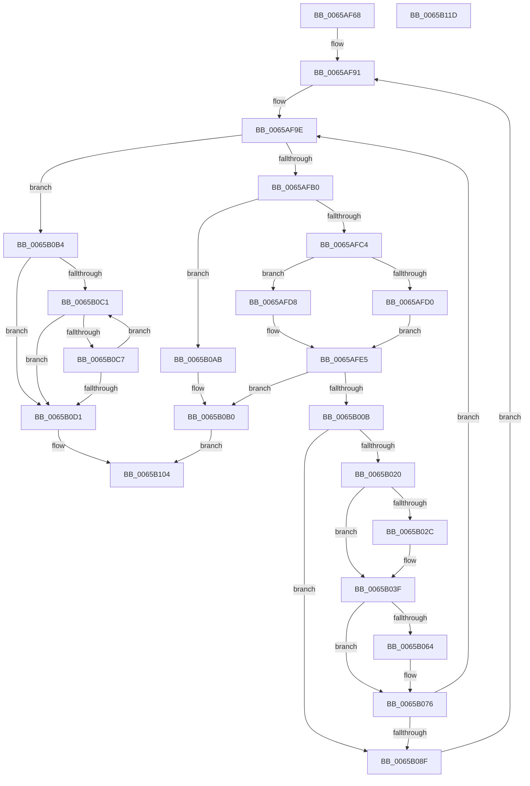

# ExpAllocateAsid

- RVA: `0x0065AF68`–`0x0065B11E` (길이 `438` bytes)
- VA: `0x000000014065AF68`
- 실행 섹션: `.text`
- PDB 이름 있음: `예`; PDB Function 태그: `아니요`
- unwind 정보 RVA: `0x00093E28`
- 디코드: `111`개 명령, `438/438` bytes 표시
- 미해석 바이트: `0` (있으면 어셈블리에 `.byte`로 보존)

> 이 문서는 커널 이미지의 기계어와 PDB 기호를 분석해 생성했습니다. 4번과 5번은 함수 원형과 자료형을 바이너리 사용 방식에서 추정한 C 해석이며 원본 소스 복구 결과는 아닙니다.

## 1. Dependencies

- 직접 호출 지점: **10**; 고유 호출 대상: **6**
- 직접 호출자로 확인된 함수: **2**
- RIP 상대 이미지 참조: **7**

### Outgoing calls
- `0x0065AF96` → [ExpAcquireSvmAgentsLock](ExpAcquireSvmAgentsLock_function_0065AF0C.md) (function, `0x0065AF0C`)
- `0x0065AFC4` → [ExpReleaseSvmAgentsLock](ExpReleaseSvmAgentsLock_function_0065B4F0.md) (function, `0x0065B4F0`)
- `0x0065AFFA` → [ExAllocatePool2](../../poolcode/B8/ExAllocatePool2_function_00B820F0.md) (function, `0x00B820F0`)
- `0x0065B010` → [ExpAcquireSvmAgentsLock](ExpAcquireSvmAgentsLock_function_0065AF0C.md) (function, `0x0065AF0C`)
- `0x0065B03A` → [memcpy](../6C/memcpy_function_006C6840.md) (function, `0x006C6840`)
- `0x0065B055` → [memset](../6C/memset_function_006C6C40.md) (function, `0x006C6C40`)
- `0x0065B097` → [ExpReleaseSvmAgentsLock](ExpReleaseSvmAgentsLock_function_0065B4F0.md) (function, `0x0065B4F0`)
- `0x0065B0A1` → [ExFreePoolWithTag](../../poolcode/B8/ExFreePoolWithTag_function_00B82870.md) (function, `0x00B82870`)
- `0x0065B0AB` → [ExpReleaseSvmAgentsLock](ExpReleaseSvmAgentsLock_function_0065B4F0.md) (function, `0x0065B4F0`)
- `0x0065B0FC` → [ExpReleaseSvmAgentsLock](ExpReleaseSvmAgentsLock_function_0065B4F0.md) (function, `0x0065B4F0`)

### Direct callers
- [ExpShareAddressSpaceWithDevice](ExpShareAddressSpaceWithDevice_function_0065B528.md) at `0x0065B668`
- [IommuPasidDeviceCreate](../../page/70/IommuPasidDeviceCreate_function_0070D450.md) at `0x0070D490`

### Static image references
- `0x0065AF9E` → RVA `0x00EFA8C4` (`.data`; read)
- `0x0065AFA4` → RVA `0x00EFA8C8` (`.data`; read)
- `0x0065AFB0` → RVA `0x00EFA8C0` (`.data`; read)
- `0x0065B020` → RVA `0x00EFA8D0` (`.data`; read)
- `0x0065B070` → RVA `0x00EFA8C8` (`.data`; read/write)
- `0x0065B076` → RVA `0x00EFA8D0` (`.data`; write)
- `0x0065B080` → RVA `0x00EFA8C4` (`.data`; write)

## 2. Other-region calls and transfers

- 다른 실행 섹션으로 향하는 call: **2**
  - `0x0065AFFA` → [ExAllocatePool2](../../poolcode/B8/ExAllocatePool2_function_00B820F0.md) (`.text` → `POOLCODE`)
  - `0x0065B0A1` → [ExFreePoolWithTag](../../poolcode/B8/ExFreePoolWithTag_function_00B82870.md) (`.text` → `POOLCODE`)
- 별도 외부 분기/꼬리 이동을 확인하지 못했습니다.

## 3. Assembly (complete function range)

```asm
0065AF68  4C 8B DC                        mov r11, rsp
0065AF6B  49 89 5B 08                     mov qword ptr [r11 + 8], rbx
0065AF6F  49 89 6B 10                     mov qword ptr [r11 + 0x10], rbp
0065AF73  49 89 73 18                     mov qword ptr [r11 + 0x18], rsi
0065AF77  57                              push rdi
0065AF78  41 56                           push r14
0065AF7A  41 57                           push r15
0065AF7C  48 83 EC 40                     sub rsp, 0x40
0065AF80  0F 57 C0                        xorps xmm0, xmm0
0065AF83  33 C0                           xor eax, eax
0065AF85  0F 11 44 24 20                  movups xmmword ptr [rsp + 0x20], xmm0
0065AF8A  49 89 43 D8                     mov qword ptr [r11 - 0x28], rax
0065AF8E  4C 8B FA                        mov r15, rdx
0065AF91  48 8D 4C 24 20                  lea rcx, [rsp + 0x20]
0065AF96  E8 71 FF FF FF                  call 0x14065af0c
0065AF9B  40 8A E8                        mov bpl, al
0065AF9E  8B 1D 20 F9 89 00               mov ebx, dword ptr [rip + 0x89f920]
0065AFA4  3B 1D 1E F9 89 00               cmp ebx, dword ptr [rip + 0x89f91e]
0065AFAA  0F 85 04 01 00 00               jne 0x14065b0b4
0065AFB0  3B 1D 0A F9 89 00               cmp ebx, dword ptr [rip + 0x89f90a]
0065AFB6  48 8D 4C 24 20                  lea rcx, [rsp + 0x20]
0065AFBB  40 8A D5                        mov dl, bpl
0065AFBE  0F 84 E7 00 00 00               je 0x14065b0ab
0065AFC4  E8 27 05 00 00                  call 0x14065b4f0
0065AFC9  8D 7B 40                        lea edi, [rbx + 0x40]
0065AFCC  3B FB                           cmp edi, ebx
0065AFCE  77 08                           ja 0x14065afd8
0065AFD0  8B 3D EA F8 89 00               mov edi, dword ptr [rip + 0x89f8ea]
0065AFD6  EB 0D                           jmp 0x14065afe5
0065AFD8  3B 3D E2 F8 89 00               cmp edi, dword ptr [rip + 0x89f8e2]
0065AFDE  0F 47 3D DB F8 89 00            cmova edi, dword ptr [rip + 0x89f8db]
0065AFE5  8B C7                           mov eax, edi
0065AFE7  B9 40 00 00 00                  mov ecx, 0x40
0065AFEC  41 B8 45 78 41 73               mov r8d, 0x73417845
0065AFF2  48 8D 14 40                     lea rdx, [rax + rax*2]
0065AFF6  48 C1 E2 03                     shl rdx, 3
0065AFFA  E8 F1 70 52 00                  call 0x140b820f0
0065AFFF  48 8B F0                        mov rsi, rax
0065B002  48 85 C0                        test rax, rax
0065B005  0F 84 A5 00 00 00               je 0x14065b0b0
0065B00B  48 8D 4C 24 20                  lea rcx, [rsp + 0x20]
0065B010  E8 F7 FE FF FF                  call 0x14065af0c
0065B015  3B 1D A9 F8 89 00               cmp ebx, dword ptr [rip + 0x89f8a9]
0065B01B  40 8A E8                        mov bpl, al
0065B01E  75 6F                           jne 0x14065b08f
0065B020  4C 8B 35 A9 F8 89 00            mov r14, qword ptr [rip + 0x89f8a9]
0065B027  4D 85 F6                        test r14, r14
0065B02A  74 13                           je 0x14065b03f
0065B02C  4C 8D 04 5B                     lea r8, [rbx + rbx*2]
0065B030  49 8B D6                        mov rdx, r14
0065B033  49 C1 E0 03                     shl r8, 3
0065B037  48 8B CE                        mov rcx, rsi
0065B03A  E8 01 B8 06 00                  call 0x1406c6840
0065B03F  8B C7                           mov eax, edi
0065B041  48 8D 0C 5B                     lea rcx, [rbx + rbx*2]
0065B045  2B C3                           sub eax, ebx
0065B047  48 8D 0C CE                     lea rcx, [rsi + rcx*8]
0065B04B  33 D2                           xor edx, edx
0065B04D  4C 8D 04 40                     lea r8, [rax + rax*2]
0065B051  49 C1 E0 03                     shl r8, 3
0065B055  E8 E6 BB 06 00                  call 0x1406c6c40
0065B05A  48 83 3D 6E F8 89 00 00         cmp qword ptr [rip + 0x89f86e], 0
0065B062  75 12                           jne 0x14065b076
0065B064  48 83 0E FF                     or qword ptr [rsi], 0xffffffffffffffff
0065B068  48 C7 46 08 01 00 00 00         mov qword ptr [rsi + 8], 1
0065B070  FF 05 52 F8 89 00               inc dword ptr [rip + 0x89f852]
0065B076  48 89 35 53 F8 89 00            mov qword ptr [rip + 0x89f853], rsi
0065B07D  49 8B F6                        mov rsi, r14
0065B080  89 3D 3E F8 89 00               mov dword ptr [rip + 0x89f83e], edi
0065B086  4D 85 F6                        test r14, r14
0065B089  0F 84 0F FF FF FF               je 0x14065af9e
0065B08F  40 8A D5                        mov dl, bpl
0065B092  48 8D 4C 24 20                  lea rcx, [rsp + 0x20]
0065B097  E8 54 04 00 00                  call 0x14065b4f0
0065B09C  33 D2                           xor edx, edx
0065B09E  48 8B CE                        mov rcx, rsi
0065B0A1  E8 CA 77 52 00                  call 0x140b82870
0065B0A6  E9 E6 FE FF FF                  jmp 0x14065af91
0065B0AB  E8 40 04 00 00                  call 0x14065b4f0
0065B0B0  33 C0                           xor eax, eax
0065B0B2  EB 50                           jmp 0x14065b104
0065B0B4  48 8B 05 15 F8 89 00            mov rax, qword ptr [rip + 0x89f815]
0065B0BB  33 FF                           xor edi, edi
0065B0BD  85 DB                           test ebx, ebx
0065B0BF  74 10                           je 0x14065b0d1
0065B0C1  48 83 38 00                     cmp qword ptr [rax], 0
0065B0C5  74 0A                           je 0x14065b0d1
0065B0C7  48 83 C0 18                     add rax, 0x18
0065B0CB  FF C7                           inc edi
0065B0CD  3B FB                           cmp edi, ebx
0065B0CF  72 F0                           jb 0x14065b0c1
0065B0D1  48 C7 40 08 01 00 00 00         mov qword ptr [rax + 8], 1
0065B0D9  4D 85 FF                        test r15, r15
0065B0DC  C6 40 10 00                     mov byte ptr [rax + 0x10], 0
0065B0E0  48 C7 C1 FE FF FF FF            mov rcx, 0xfffffffffffffffe
0065B0E7  4C 0F 44 F9                     cmove r15, rcx
0065B0EB  40 8A D5                        mov dl, bpl
0065B0EE  4C 89 38                        mov qword ptr [rax], r15
0065B0F1  48 8D 4C 24 20                  lea rcx, [rsp + 0x20]
0065B0F6  FF 05 CC F7 89 00               inc dword ptr [rip + 0x89f7cc]
0065B0FC  E8 EF 03 00 00                  call 0x14065b4f0
0065B101  8D 47 01                        lea eax, [rdi + 1]
0065B104  48 8B 5C 24 60                  mov rbx, qword ptr [rsp + 0x60]
0065B109  48 8B 6C 24 68                  mov rbp, qword ptr [rsp + 0x68]
0065B10E  48 8B 74 24 70                  mov rsi, qword ptr [rsp + 0x70]
0065B113  48 83 C4 40                     add rsp, 0x40
0065B117  41 5F                           pop r15
0065B119  41 5E                           pop r14
0065B11B  5F                              pop rdi
0065B11C  C3                              ret
0065B11D  CC                              int3
```

## 4. C-style interpretation (structured pseudocode)

```c
__int64 __fastcall ExpAllocateAsid(__int64 a1, __int64 a2)
{
    __int64 result;
    __int64 v_rdi;
    __int64 v_rsp;
    unsigned __int64 v_stack_m38;
    unsigned __int64 v_stack_p10;
    unsigned __int64 v_stack_p18;
    unsigned __int64 v_stack_p8;

    *(unsigned __int64 *)(v_rsp + 8) = v_rbx;
    *(unsigned __int64 *)(v_rsp + 16) = v_rbp;
    *(unsigned __int64 *)(v_rsp + 24) = v_rsi;
    v_rsp = (v_rsp) - (64);
    result = 0;
    v_stack_m38 = v_xmm0;
    *(unsigned __int64 *)(v_rsp - 40) = 0;
loc_0065AF91:
    result = ExpAcquireSvmAgentsLock(v_stack_m38, a2, a3, a4);
loc_0065AF9E:
    if (((unsigned int)((unsigned int)(*(unsigned int *)(v_rip + 9042208)))) != (*(unsigned int *)(v_rip + 9042206))) goto loc_0065B0B4;
    if (((unsigned int)((unsigned int)(*(unsigned int *)(v_rip + 9042208)))) == (*(unsigned int *)(v_rip + 9042186))) goto loc_0065B0AB;
    result = ExpReleaseSvmAgentsLock(v_stack_m38, (unsigned __int8)((unsigned __int8)(result)), a3, a4);
    if (((unsigned int)((unsigned int)(*(unsigned int *)(v_rip + 9042208)) + 64)) > ((unsigned int)((unsigned int)(*(unsigned int *)(v_rip + 9042208))))) goto loc_0065AFD8;
    goto loc_0065AFE5;
loc_0065AFD8:
    v_rdi = (unsigned int)(*(unsigned int *)(v_rip + 9042154));
    if (((unsigned int)((unsigned int)(*(unsigned int *)(v_rip + 9042154)))) > (*(unsigned int *)(v_rip + 9042146))) { v_rdi = *(unsigned int *)(v_rip + 9042139); }
loc_0065AFE5:
    a2 = ((unsigned int)((unsigned int)(v_rdi)) + (unsigned int)((unsigned int)(v_rdi)) * 2) << (3);
    result = ExAllocatePool2(64, a2, (unsigned int)(0x73417845ULL), a4);
    if (result == 0) goto loc_0065B0B0;
    result = ExpAcquireSvmAgentsLock(v_stack_m38, a2, (unsigned int)(0x73417845ULL), a4);
    if (((unsigned int)((unsigned int)(*(unsigned int *)(v_rip + 9042208)))) != (*(unsigned int *)(v_rip + 9042089))) goto loc_0065B08F;
    if (*(unsigned __int64 *)(v_rip + 9042089) != 0) {
        a3 = (unsigned int)(*(unsigned int *)(v_rip + 9042208)) + (unsigned int)(*(unsigned int *)(v_rip + 9042208)) * 2;
        a2 = *(unsigned __int64 *)(v_rip + 9042089);
        a3 = (a3) << (3);
        a1 = result;
        result = memcpy(a1, a2, a3, a4);
    }
    result = (unsigned int)(((unsigned int)((unsigned int)(v_rdi))) - ((unsigned int)((unsigned int)(*(unsigned int *)(v_rip + 9042208)))));
    a2 = 0;
    a3 = (result + result * 2) << (3);
    result = memset(result + (unsigned int)(*(unsigned int *)(v_rip + 9042208)) + (unsigned int)(*(unsigned int *)(v_rip + 9042208)) * 2 * 8, a2, a3, a4);
    if ((*(unsigned __int64 *)(v_rip + 9042030)) == 0) {
        *(unsigned __int64 *)(result + 8) = 1;
    }
    *(unsigned __int64 *)(v_rip + 9042003) = result;
    *(unsigned int *)(v_rip + 9041982) = (unsigned int)(v_rdi);
    if (*(unsigned __int64 *)(v_rip + 9042089) == 0) goto loc_0065AF9E;
loc_0065B08F:
    result = ExpReleaseSvmAgentsLock(v_stack_m38, (unsigned __int8)((unsigned __int8)(result)), a3, a4);
    a2 = 0;
    result = ExFreePoolWithTag(*(unsigned __int64 *)(v_rip + 9042089), a2, a3, a4);
    goto loc_0065AF91;
loc_0065B0AB:
    result = ExpReleaseSvmAgentsLock(*(unsigned __int64 *)(v_rip + 9042089), a2, a3, a4);
loc_0065B0B0:
    result = 0;
    goto loc_0065B104;
loc_0065B0B4:
    v_rdi = 0;
    if ((unsigned int)((unsigned int)(*(unsigned int *)(v_rip + 9042208))) == 0) goto loc_0065B0D1;
loc_0065B0C1:
    if ((*(unsigned __int64 *)(*(unsigned __int64 *)(v_rip + 9041941))) == 0) goto loc_0065B0D1;
    result = (*(unsigned __int64 *)(v_rip + 9041941)) + (24);
    v_rdi = (unsigned int)((v_rdi) + 1);
    if (((unsigned int)(v_rdi)) < ((unsigned int)((unsigned int)(*(unsigned int *)(v_rip + 9042208))))) goto loc_0065B0C1;
loc_0065B0D1:
    *(unsigned __int64 *)(result + 8) = 1;
    *(unsigned __int8 *)(result + 16) = 0;
    if (0 == 0) { a2 = -2; }
    *(unsigned __int64 *)(result) = a2;
    result = ExpReleaseSvmAgentsLock(v_stack_m38, (unsigned __int8)((unsigned __int8)(result)), a3, a4);
loc_0065B104:
    v_rsp = (v_rsp) + (64);
    return v_rdi + 1;
}
```

## 5. (Beta) C Style

```c
int64_t ExpAllocateAsid(int64_t Arg1, int64_t Arg2)
{
    int64_t result;
    int64_t local_rdi;
    int64_t local_rsp;
    uint64_t v_stack_m38;
    uint64_t v_stack_p10;
    uint64_t v_stack_p18;
    uint64_t v_stack_p8;

    *(uint64_t *)(local_rsp + 0x8) = local_rbx;
    *(uint64_t *)(local_rsp + 0x10) = local_rbp;
    *(uint64_t *)(local_rsp + 0x18) = local_rsi;
    local_rsp = (local_rsp) - (64);
    result = 0;
    v_stack_m38 = v_xmm0;
    *(uint64_t *)(local_rsp - 0x28) = 0;
loc_0065AF91:
    result = ExpAcquireSvmAgentsLock(v_stack_m38, Arg2, a3, a4);
loc_0065AF9E:
    if (((uint32_t)((uint32_t)(*(uint32_t *)(v_rip + 0x89F920)))) != (*(uint32_t *)(v_rip + 0x89F91E))) goto loc_0065B0B4;
    if (((uint32_t)((uint32_t)(*(uint32_t *)(v_rip + 0x89F920)))) == (*(uint32_t *)(v_rip + 0x89F90A))) goto loc_0065B0AB;
    result = ExpReleaseSvmAgentsLock(v_stack_m38, (uint8_t)((uint8_t)(result)), a3, a4);
    if (((uint32_t)((uint32_t)(*(uint32_t *)(v_rip + 0x89F920)) + 64)) > ((uint32_t)((uint32_t)(*(uint32_t *)(v_rip + 0x89F920))))) goto loc_0065AFD8;
    goto loc_0065AFE5;
loc_0065AFD8:
    local_rdi = (uint32_t)(*(uint32_t *)(v_rip + 0x89F8EA));
    if (((uint32_t)((uint32_t)(*(uint32_t *)(v_rip + 0x89F8EA)))) > (*(uint32_t *)(v_rip + 0x89F8E2))) { local_rdi = *(uint32_t *)(v_rip + 0x89F8DB); }
loc_0065AFE5:
    Arg2 = ((uint32_t)((uint32_t)(local_rdi)) + (uint32_t)((uint32_t)(local_rdi)) * 2) << (3);
    result = ExAllocatePool2(64, Arg2, (uint32_t)(0x73417845ULL), a4);
    if (result == 0) goto loc_0065B0B0;
    result = ExpAcquireSvmAgentsLock(v_stack_m38, Arg2, (uint32_t)(0x73417845ULL), a4);
    if (((uint32_t)((uint32_t)(*(uint32_t *)(v_rip + 0x89F920)))) != (*(uint32_t *)(v_rip + 0x89F8A9))) goto loc_0065B08F;
    if (*(uint64_t *)(v_rip + 0x89F8A9) != 0) {
        a3 = (uint32_t)(*(uint32_t *)(v_rip + 0x89F920)) + (uint32_t)(*(uint32_t *)(v_rip + 0x89F920)) * 2;
        Arg2 = *(uint64_t *)(v_rip + 0x89F8A9);
        a3 = (a3) << (3);
        Arg1 = result;
        result = memcpy(Arg1, Arg2, a3, a4);
    }
    result = (uint32_t)(((uint32_t)((uint32_t)(local_rdi))) - ((uint32_t)((uint32_t)(*(uint32_t *)(v_rip + 0x89F920)))));
    Arg2 = 0;
    a3 = (result + result * 2) << (3);
    result = memset(result + (uint32_t)(*(uint32_t *)(v_rip + 0x89F920)) + (uint32_t)(*(uint32_t *)(v_rip + 0x89F920)) * 2 * 8, Arg2, a3, a4);
    if ((*(uint64_t *)(v_rip + 0x89F86E)) == 0) {
        *(uint64_t *)(result + 0x8) = 1;
    }
    *(uint64_t *)(v_rip + 0x89F853) = result;
    *(uint32_t *)(v_rip + 0x89F83E) = (uint32_t)(local_rdi);
    if (*(uint64_t *)(v_rip + 0x89F8A9) == 0) goto loc_0065AF9E;
loc_0065B08F:
    result = ExpReleaseSvmAgentsLock(v_stack_m38, (uint8_t)((uint8_t)(result)), a3, a4);
    Arg2 = 0;
    result = ExFreePoolWithTag(*(uint64_t *)(v_rip + 0x89F8A9), Arg2, a3, a4);
    goto loc_0065AF91;
loc_0065B0AB:
    result = ExpReleaseSvmAgentsLock(*(uint64_t *)(v_rip + 0x89F8A9), Arg2, a3, a4);
loc_0065B0B0:
    result = 0;
    goto loc_0065B104;
loc_0065B0B4:
    local_rdi = 0;
    if ((uint32_t)((uint32_t)(*(uint32_t *)(v_rip + 0x89F920))) == 0) goto loc_0065B0D1;
loc_0065B0C1:
    if ((*(uint64_t *)(*(uint64_t *)(v_rip + 0x89F815))) == 0) goto loc_0065B0D1;
    result = (*(uint64_t *)(v_rip + 0x89F815)) + (24);
    local_rdi = (uint32_t)((local_rdi) + 1);
    if (((uint32_t)(local_rdi)) < ((uint32_t)((uint32_t)(*(uint32_t *)(v_rip + 0x89F920))))) goto loc_0065B0C1;
loc_0065B0D1:
    *(uint64_t *)(result + 0x8) = 1;
    *(uint8_t *)(result + 0x10) = 0;
    if (0 == 0) { Arg2 = -2; }
    *(uint64_t *)(result) = Arg2;
    result = ExpReleaseSvmAgentsLock(v_stack_m38, (uint8_t)((uint8_t)(result)), a3, a4);
loc_0065B104:
    local_rsp = (local_rsp) + (64);
    return local_rdi + 1;
}
```

## 6. Execution-region graph

[열기: 2D/3D 그래프와 함수 탐색 컨트롤 패널](../../../control-panel.html?section=text&rva=0x0065AF68&view=graph)

- 2D 그래프는 위에서 아래로 흐르고, 3D 그래프는 빈 공간을 드래그해 회전합니다. Shift+드래그는 이동, 휠은 확대·축소, 함수 노드 선택은 대상 보고서 이동입니다.

### Static fallback


