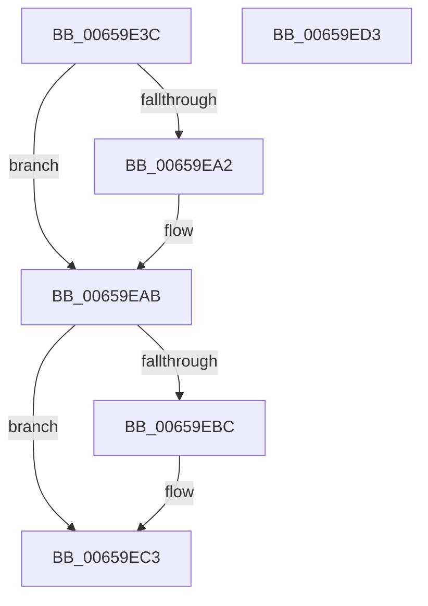

# ExpAtsConfigureSecureDevice

- RVA: `0x00659E3C`–`0x00659ED4` (길이 `152` bytes)
- VA: `0x0000000140659E3C`
- 실행 섹션: `.text`
- PDB 이름 있음: `예`; PDB Function 태그: `아니요`
- unwind 정보 RVA: `0x000D542C`
- 디코드: `43`개 명령, `152/152` bytes 표시
- 미해석 바이트: `0` (있으면 어셈블리에 `.byte`로 보존)

> 이 문서는 커널 이미지의 기계어와 PDB 기호를 분석해 생성했습니다. 4번과 5번은 함수 원형과 자료형을 바이너리 사용 방식에서 추정한 C 해석이며 원본 소스 복구 결과는 아닙니다.

## 1. Dependencies

- 직접 호출 지점: **1**; 고유 호출 대상: **1**
- 직접 호출자로 확인된 함수: **3**
- RIP 상대 이미지 참조: **0**

### Outgoing calls
- `0x00659EB3` → [VslConfigureSecureAtsDevice](../58/VslConfigureSecureAtsDevice_function_0058E044.md) (function, `0x0058E044`)

### Direct callers
- [ExpAtsDereferenceDevice](ExpAtsDereferenceDevice_function_00659EDC.md) at `0x00659F46`
- [ExpPrepareNewAtsDevice](ExpPrepareNewAtsDevice_function_00659FB0.md) at `0x0065A1D8`
- [ExAtsSvmSecureDevicePowerCallback](ExAtsSvmSecureDevicePowerCallback_function_0065AC50.md) at `0x0065AC71`

### Static image references
- 디코드된 RIP-relative 메모리 참조가 없습니다.

## 2. Other-region calls and transfers

- 다른 실행 섹션으로 향하는 call: **0**
- 별도 외부 분기/꼬리 이동을 확인하지 못했습니다.

## 3. Assembly (complete function range)

```asm
00659E3C  48 89 5C 24 10                  mov qword ptr [rsp + 0x10], rbx
00659E41  48 89 7C 24 18                  mov qword ptr [rsp + 0x18], rdi
00659E46  55                              push rbp
00659E47  48 8B EC                        mov rbp, rsp
00659E4A  48 83 EC 30                     sub rsp, 0x30
00659E4E  4C 8B 81 A8 00 00 00            mov r8, qword ptr [rcx + 0xa8]
00659E55  33 C0                           xor eax, eax
00659E57  66 89 45 11                     mov word ptr [rbp + 0x11], ax
00659E5B  48 8B D9                        mov rbx, rcx
00659E5E  88 45 13                        mov byte ptr [rbp + 0x13], al
00659E61  40 8A FA                        mov dil, dl
00659E64  21 45 11                        and dword ptr [rbp + 0x11], eax
00659E67  41 0F B7 40 08                  movzx eax, word ptr [r8 + 8]
00659E6C  41 0F B7 48 0C                  movzx ecx, word ptr [r8 + 0xc]
00659E71  89 45 F4                        mov dword ptr [rbp - 0xc], eax
00659E74  0F B7 C1                        movzx eax, cx
00659E77  66 C1 E8 08                     shr ax, 8
00659E7B  88 45 F8                        mov byte ptr [rbp - 8], al
00659E7E  41 8A 40 0C                     mov al, byte ptr [r8 + 0xc]
00659E82  C0 E9 03                        shr cl, 3
00659E85  24 07                           and al, 7
00659E87  80 E1 1F                        and cl, 0x1f
00659E8A  C6 45 FB 00                     mov byte ptr [rbp - 5], 0
00659E8E  88 55 10                        mov byte ptr [rbp + 0x10], dl
00659E91  C7 45 F0 02 00 00 00            mov dword ptr [rbp - 0x10], 2
00659E98  88 4D F9                        mov byte ptr [rbp - 7], cl
00659E9B  88 45 FA                        mov byte ptr [rbp - 6], al
00659E9E  84 D2                           test dl, dl
00659EA0  74 09                           je 0x140659eab
00659EA2  8B 83 B8 00 00 00               mov eax, dword ptr [rbx + 0xb8]
00659EA8  89 45 14                        mov dword ptr [rbp + 0x14], eax
00659EAB  48 8D 55 10                     lea rdx, [rbp + 0x10]
00659EAF  48 8D 4D F0                     lea rcx, [rbp - 0x10]
00659EB3  E8 8C 41 F3 FF                  call 0x14058e044
00659EB8  85 C0                           test eax, eax
00659EBA  78 07                           js 0x140659ec3
00659EBC  40 88 BB BC 00 00 00            mov byte ptr [rbx + 0xbc], dil
00659EC3  48 8B 5C 24 48                  mov rbx, qword ptr [rsp + 0x48]
00659EC8  48 8B 7C 24 50                  mov rdi, qword ptr [rsp + 0x50]
00659ECD  48 83 C4 30                     add rsp, 0x30
00659ED1  5D                              pop rbp
00659ED2  C3                              ret
00659ED3  CC                              int3
```

## 4. C-style interpretation (structured pseudocode)

```c
__int64 __fastcall ExpAtsConfigureSecureDevice(__int64 a1, unsigned __int8 a2)
{
    __int64 result;
    __int64 v_rsp;
    unsigned __int8 v_stack_m10;
    unsigned int v_stack_m14;
    unsigned int v_stack_m18;
    unsigned __int8 v_stack_mD;
    unsigned __int8 v_stack_mE;
    unsigned __int8 v_stack_mF;
    unsigned __int64 v_stack_p10;
    unsigned __int64 v_stack_p18;
    unsigned __int8 v_stack_p8;
    unsigned __int16 v_stack_p9;
    unsigned __int8 v_stack_pB;
    unsigned int v_stack_pC;

    v_stack_p10 = v_rbx;
    v_stack_p18 = v_rdi;
    v_rsp = (v_rsp) - (48);
    result = 0;
    v_stack_p9 = 0;
    v_stack_pB = 0;
    v_stack_m14 = (unsigned int)(*(unsigned __int16 *)(*(unsigned __int64 *)(a1 + 168) + 8));
    result = (unsigned __int16)(((unsigned __int16)(*(unsigned __int16 *)(*(unsigned __int64 *)(a1 + 168) + 12))) >> (8));
    v_stack_m10 = (unsigned __int8)(result);
    a1 = (unsigned __int8)((*(unsigned __int16 *)(*(unsigned __int64 *)(a1 + 168) + 12)) >> (3));
    result = (unsigned __int8)((*(unsigned __int8 *)(*(unsigned __int64 *)(a1 + 168) + 12)) & (7));
    a1 = (unsigned __int8)((a1) & (31));
    v_stack_mD = 0;
    v_stack_p8 = a2;
    v_stack_m18 = 2;
    v_stack_mF = (unsigned __int8)(a1);
    v_stack_mE = (unsigned __int8)(result);
    if (a2 != 0) {
        result = *(unsigned int *)(a1 + 184);
        v_stack_pC = (unsigned int)(result);
    }
    result = VslConfigureSecureAtsDevice(v_stack_m18, v_stack_p8, *(unsigned __int64 *)(a1 + 168), a4);
    if (!(sign_flag)) {
        *(unsigned __int8 *)(a1 + 188) = a2;
    }
    v_rsp = (v_rsp) + (48);
    return result;
}
```

## 5. (Beta) C Style

```c
int64_t ExpAtsConfigureSecureDevice(void *Arg1, uint8_t Arg2)
{
    uint8_t *arg1 = (uint8_t *)Arg1;

    int64_t result;
    int64_t local_rsp;
    uint8_t v_stack_m10;
    uint32_t v_stack_m14;
    uint32_t v_stack_m18;
    uint8_t v_stack_mD;
    uint8_t v_stack_mE;
    uint8_t v_stack_mF;
    uint64_t v_stack_p10;
    uint64_t v_stack_p18;
    uint8_t v_stack_p8;
    uint16_t v_stack_p9;
    uint8_t v_stack_pB;
    uint32_t v_stack_pC;

    v_stack_p10 = local_rbx;
    v_stack_p18 = local_rdi;
    local_rsp = (local_rsp) - (48);
    result = 0;
    v_stack_p9 = 0;
    v_stack_pB = 0;
    v_stack_m14 = (uint32_t)(*(uint16_t *)(*(uint64_t *)(arg1 + 0xA8) + 0x8));
    result = (uint16_t)(((uint16_t)(*(uint16_t *)(*(uint64_t *)(arg1 + 0xA8) + 0xC))) >> (8));
    v_stack_m10 = (uint8_t)(result);
    Arg1 = (uint8_t)((*(uint16_t *)(*(uint64_t *)(arg1 + 0xA8) + 0xC)) >> (3));
    result = (uint8_t)((*(uint8_t *)(*(uint64_t *)(arg1 + 0xA8) + 0xC)) & (7));
    Arg1 = (uint8_t)((Arg1) & (31));
    v_stack_mD = 0;
    v_stack_p8 = Arg2;
    v_stack_m18 = 2;
    v_stack_mF = (uint8_t)(Arg1);
    v_stack_mE = (uint8_t)(result);
    if (Arg2 != 0) {
        result = *(uint32_t *)(arg1 + 0xB8);
        v_stack_pC = (uint32_t)(result);
    }
    result = VslConfigureSecureAtsDevice(v_stack_m18, v_stack_p8, *(uint64_t *)(arg1 + 0xA8), a4);
    if (!(sign_flag)) {
        *(uint8_t *)(arg1 + 0xBC) = Arg2;
    }
    local_rsp = (local_rsp) + (48);
    return result;
}
```

### 관측된 메모리 오프셋

구조체 형식이 확인되지 않은 접근은 인자 기준의 오프셋으로만 기록했습니다.

| 기준 인자 | 오프셋 표현 | 폭 (bit) | 접근 |
|---|---:|---:|---|
| `Arg1` | `+ 0xA8` | `64` | `R` |
| `Arg1` | `+ 0xB8` | `32` | `R` |
| `Arg1` | `+ 0xBC` | `8` | `W` |

## 6. Execution-region graph

[열기: 2D/3D 그래프와 함수 탐색 컨트롤 패널](../../../control-panel.html?section=text&rva=0x00659E3C&view=graph)

- 2D 그래프는 위에서 아래로 흐르고, 3D 그래프는 빈 공간을 드래그해 회전합니다. Shift+드래그는 이동, 휠은 확대·축소, 함수 노드 선택은 대상 보고서 이동입니다.

### Static fallback


