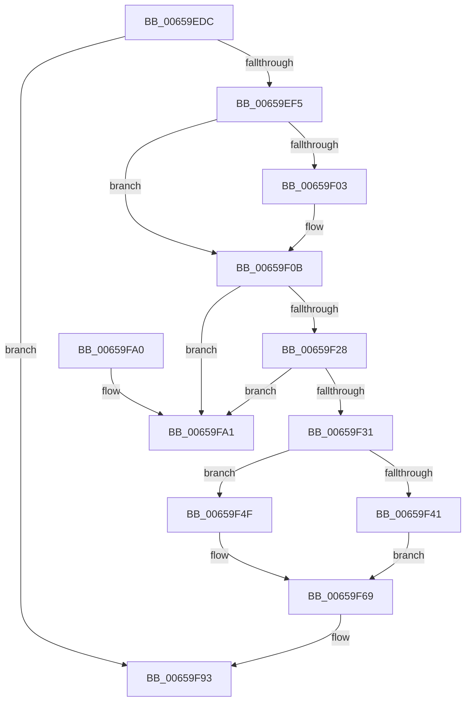

# ExpAtsDereferenceDevice

- RVA: `0x00659EDC`–`0x00659FA8` (길이 `204` bytes)
- VA: `0x0000000140659EDC`
- 실행 섹션: `.text`
- PDB 이름 있음: `예`; PDB Function 태그: `아니요`
- unwind 정보 RVA: `0x00095058`
- 디코드: `52`개 명령, `204/204` bytes 표시
- 미해석 바이트: `0` (있으면 어셈블리에 `.byte`로 보존)

> 이 문서는 커널 이미지의 기계어와 PDB 기호를 분석해 생성했습니다. 4번과 5번은 함수 원형과 자료형을 바이너리 사용 방식에서 추정한 C 해석이며 원본 소스 복구 결과는 아닙니다.

## 1. Dependencies

- 직접 호출 지점: **6**; 고유 호출 대상: **3**
- 직접 호출자로 확인된 함수: **1**
- RIP 상대 이미지 참조: **1**

### Outgoing calls
- `0x00659F18` → [guard_dispatch_icall](../6B/guard_dispatch_icall_function_006BAAD0.md) (function, `0x006BAAD0`)
- `0x00659F46` → [ExpAtsConfigureSecureDevice](ExpAtsConfigureSecureDevice_function_00659E3C.md) (function, `0x00659E3C`)
- `0x00659F64` → [guard_dispatch_icall](../6B/guard_dispatch_icall_function_006BAAD0.md) (function, `0x006BAAD0`)
- `0x00659F71` → [guard_dispatch_icall](../6B/guard_dispatch_icall_function_006BAAD0.md) (function, `0x006BAAD0`)
- `0x00659F84` → [guard_dispatch_icall](../6B/guard_dispatch_icall_function_006BAAD0.md) (function, `0x006BAAD0`)
- `0x00659F8E` → [ExFreePoolWithTag](../../poolcode/B8/ExFreePoolWithTag_function_00B82870.md) (function, `0x00B82870`)

### Direct callers
- [ExUninitializeDeviceAts](ExUninitializeDeviceAts_function_00659D6C.md) at `0x00659DF1`

### Static image references
- `0x00659F4F` → RVA `0x00E06D28` (`.data`; read)

## 2. Other-region calls and transfers

- 다른 실행 섹션으로 향하는 call: **1**
  - `0x00659F8E` → [ExFreePoolWithTag](../../poolcode/B8/ExFreePoolWithTag_function_00B82870.md) (`.text` → `POOLCODE`)
- 별도 외부 분기/꼬리 이동을 확인하지 못했습니다.

## 3. Assembly (complete function range)

```asm
00659EDC  48 89 5C 24 10                  mov qword ptr [rsp + 0x10], rbx
00659EE1  57                              push rdi
00659EE2  48 83 EC 20                     sub rsp, 0x20
00659EE6  33 FF                           xor edi, edi
00659EE8  48 8B D9                        mov rbx, rcx
00659EEB  83 41 20 FF                     add dword ptr [rcx + 0x20], -1
00659EEF  0F 85 9E 00 00 00               jne 0x140659f93
00659EF5  C7 44 24 30 01 00 00 00         mov dword ptr [rsp + 0x30], 1
00659EFD  40 38 79 12                     cmp byte ptr [rcx + 0x12], dil
00659F01  74 08                           je 0x140659f0b
00659F03  C7 44 24 30 07 00 00 00         mov dword ptr [rsp + 0x30], 7
00659F0B  48 8B 41 58                     mov rax, qword ptr [rcx + 0x58]
00659F0F  48 8D 54 24 30                  lea rdx, [rsp + 0x30]
00659F14  48 8B 49 30                     mov rcx, qword ptr [rcx + 0x30]
00659F18  E8 B3 0B 06 00                  call 0x1406baad0
00659F1D  8B F8                           mov edi, eax
00659F1F  48 8B 03                        mov rax, qword ptr [rbx]
00659F22  48 39 58 08                     cmp qword ptr [rax + 8], rbx
00659F26  75 79                           jne 0x140659fa1
00659F28  48 8B 4B 08                     mov rcx, qword ptr [rbx + 8]
00659F2C  48 39 19                        cmp qword ptr [rcx], rbx
00659F2F  75 70                           jne 0x140659fa1
00659F31  48 89 01                        mov qword ptr [rcx], rax
00659F34  48 89 48 08                     mov qword ptr [rax + 8], rcx
00659F38  80 BB BC 00 00 00 00            cmp byte ptr [rbx + 0xbc], 0
00659F3F  74 0E                           je 0x140659f4f
00659F41  33 D2                           xor edx, edx
00659F43  48 8B CB                        mov rcx, rbx
00659F46  E8 F1 FE FF FF                  call 0x140659e3c
00659F4B  8B F8                           mov edi, eax
00659F4D  EB 1A                           jmp 0x140659f69
00659F4F  48 8B 05 D2 CD 7A 00            mov rax, qword ptr [rip + 0x7acdd2]
00659F56  48 8B 8B B0 00 00 00            mov rcx, qword ptr [rbx + 0xb0]
00659F5D  48 8B 80 A8 00 00 00            mov rax, qword ptr [rax + 0xa8]
00659F64  E8 67 0B 06 00                  call 0x1406baad0
00659F69  48 8B 43 40                     mov rax, qword ptr [rbx + 0x40]
00659F6D  48 8B 4B 30                     mov rcx, qword ptr [rbx + 0x30]
00659F71  E8 5A 0B 06 00                  call 0x1406baad0
00659F76  48 8B 83 90 00 00 00            mov rax, qword ptr [rbx + 0x90]
00659F7D  48 8B 8B 80 00 00 00            mov rcx, qword ptr [rbx + 0x80]
00659F84  E8 47 0B 06 00                  call 0x1406baad0
00659F89  33 D2                           xor edx, edx
00659F8B  48 8B CB                        mov rcx, rbx
00659F8E  E8 DD 88 52 00                  call 0x140b82870
00659F93  48 8B 5C 24 38                  mov rbx, qword ptr [rsp + 0x38]
00659F98  8B C7                           mov eax, edi
00659F9A  48 83 C4 20                     add rsp, 0x20
00659F9E  5F                              pop rdi
00659F9F  C3                              ret
00659FA0  CC                              int3
00659FA1  B9 03 00 00 00                  mov ecx, 3
00659FA6  CD 29                           int 0x29
```

## 4. C-style interpretation (structured pseudocode)

```c
__int64 __fastcall ExpAtsDereferenceDevice(__int64 a1)
{
    __int64 result;
    __int64 v_rdi;
    __int64 v_rsp;
    unsigned __int64 v_stack_p10;
    unsigned int v_stack_p8;

    v_stack_p10 = v_rbx;
    v_rsp = (v_rsp) - (32);
    v_rdi = 0;
    if (condition_is_not_equal) goto loc_00659F93;
    v_stack_p8 = 1;
    if ((*(unsigned __int8 *)(a1 + 18)) != 0) {
        v_stack_p8 = 7;
    }
    result = guard_dispatch_icall(*(unsigned __int64 *)(a1 + 48), v_stack_p8, a3, a4);
    if ((*(unsigned __int64 *)(*(unsigned __int64 *)(a1) + 8)) != a1) goto loc_00659FA1;
    if ((*(unsigned __int64 *)(*(unsigned __int64 *)(a1 + 8))) != a1) goto loc_00659FA1;
    *(unsigned __int64 *)(*(unsigned __int64 *)(a1 + 8)) = *(unsigned __int64 *)(a1);
    *(unsigned __int64 *)(*(unsigned __int64 *)(a1) + 8) = *(unsigned __int64 *)(a1 + 8);
    if ((*(unsigned __int8 *)(a1 + 188)) == 0) goto loc_00659F4F;
    a2 = 0;
    result = ExpAtsConfigureSecureDevice(a1, a2, a3, a4);
    goto loc_00659F69;
loc_00659F4F:
    result = guard_dispatch_icall(*(unsigned __int64 *)(a1 + 176), a2, a3, a4);
loc_00659F69:
    result = guard_dispatch_icall(*(unsigned __int64 *)(a1 + 48), a2, a3, a4);
    result = guard_dispatch_icall(*(unsigned __int64 *)(a1 + 128), a2, a3, a4);
    a2 = 0;
    result = ExFreePoolWithTag(a1, a2, a3, a4);
loc_00659F93:
    v_rsp = (v_rsp) + (32);
    return (unsigned int)((unsigned int)((unsigned int)((unsigned int)(result))));
loc_00659FA1:
    return (unsigned int)((unsigned int)((unsigned int)((unsigned int)(result))));
}
```

## 5. (Beta) C Style

```c
int64_t ExpAtsDereferenceDevice(void *Arg1)
{
    uint8_t *arg1 = (uint8_t *)Arg1;

    int64_t result;
    int64_t local_rdi;
    int64_t local_rsp;
    uint64_t v_stack_p10;
    uint32_t v_stack_p8;

    v_stack_p10 = local_rbx;
    local_rsp = (local_rsp) - (32);
    local_rdi = 0;
    if (condition_is_not_equal) goto loc_00659F93;
    v_stack_p8 = 1;
    if ((*(uint8_t *)(arg1 + 0x12)) != 0) {
        v_stack_p8 = 7;
    }
    result = guard_dispatch_icall(*(uint64_t *)(arg1 + 0x30), v_stack_p8, a3, a4);
    if ((*(uint64_t *)(*(uint64_t *)(arg1) + 0x8)) != Arg1) goto loc_00659FA1;
    if ((*(uint64_t *)(*(uint64_t *)(arg1 + 0x8))) != Arg1) goto loc_00659FA1;
    *(uint64_t *)(*(uint64_t *)(arg1 + 0x8)) = *(uint64_t *)(arg1);
    *(uint64_t *)(*(uint64_t *)(arg1) + 0x8) = *(uint64_t *)(arg1 + 0x8);
    if ((*(uint8_t *)(arg1 + 0xBC)) == 0) goto loc_00659F4F;
    a2 = 0;
    result = ExpAtsConfigureSecureDevice(Arg1, a2, a3, a4);
    goto loc_00659F69;
loc_00659F4F:
    result = guard_dispatch_icall(*(uint64_t *)(arg1 + 0xB0), a2, a3, a4);
loc_00659F69:
    result = guard_dispatch_icall(*(uint64_t *)(arg1 + 0x30), a2, a3, a4);
    result = guard_dispatch_icall(*(uint64_t *)(arg1 + 0x80), a2, a3, a4);
    a2 = 0;
    result = ExFreePoolWithTag(Arg1, a2, a3, a4);
loc_00659F93:
    local_rsp = (local_rsp) + (32);
    return (uint32_t)((uint32_t)((uint32_t)((uint32_t)(result))));
loc_00659FA1:
    return (uint32_t)((uint32_t)((uint32_t)((uint32_t)(result))));
}
```

### 관측된 메모리 오프셋

구조체 형식이 확인되지 않은 접근은 인자 기준의 오프셋으로만 기록했습니다.

| 기준 인자 | 오프셋 표현 | 폭 (bit) | 접근 |
|---|---:|---:|---|
| `Arg1` | `+ 0x0` | `64` | `R` |
| `Arg1` | `+ 0x8` | `64` | `R` |
| `Arg1` | `+ 0x12` | `8` | `R` |
| `Arg1` | `+ 0x20` | `32` | `R/W` |
| `Arg1` | `+ 0x30` | `64` | `R` |
| `Arg1` | `+ 0x40` | `64` | `R` |
| `Arg1` | `+ 0x58` | `64` | `R` |
| `Arg1` | `+ 0x80` | `64` | `R` |
| `Arg1` | `+ 0x90` | `64` | `R` |
| `Arg1` | `+ 0xB0` | `64` | `R` |
| `Arg1` | `+ 0xBC` | `8` | `R` |

## 6. Execution-region graph

[열기: 2D/3D 그래프와 함수 탐색 컨트롤 패널](../../../control-panel.html?section=text&rva=0x00659EDC&view=graph)

- 2D 그래프는 위에서 아래로 흐르고, 3D 그래프는 빈 공간을 드래그해 회전합니다. Shift+드래그는 이동, 휠은 확대·축소, 함수 노드 선택은 대상 보고서 이동입니다.

### Static fallback


