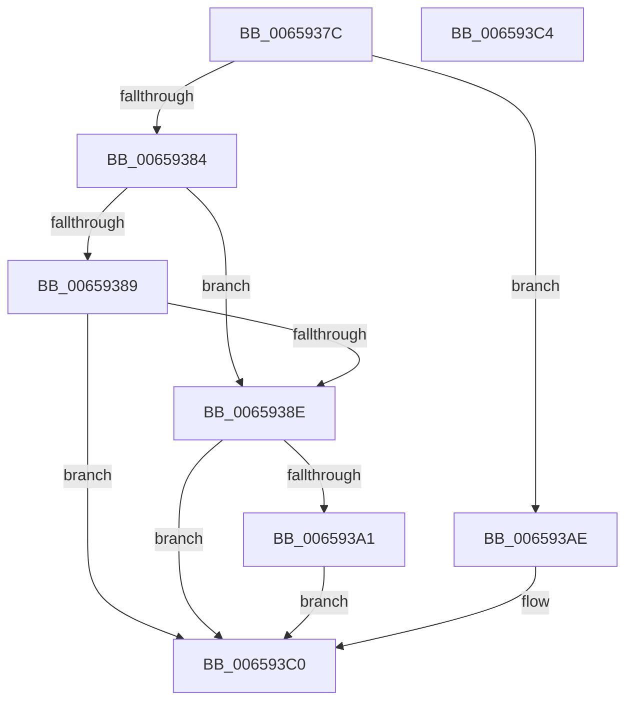

# ExpCalcAdjustedDueTime

- RVA: `0x0065937C`–`0x006593C5` (길이 `73` bytes)
- VA: `0x000000014065937C`
- 실행 섹션: `.text`
- PDB 이름 있음: `예`; PDB Function 태그: `아니요`
- unwind 정보 RVA: `0x000DB714`
- 디코드: `25`개 명령, `73/73` bytes 표시
- 미해석 바이트: `0` (있으면 어셈블리에 `.byte`로 보존)

> 이 문서는 커널 이미지의 기계어와 PDB 기호를 분석해 생성했습니다. 4번과 5번은 함수 원형과 자료형을 바이너리 사용 방식에서 추정한 C 해석이며 원본 소스 복구 결과는 아닙니다.

## 1. Dependencies

- 직접 호출 지점: **0**; 고유 호출 대상: **0**
- 직접 호출자로 확인된 함수: **1**
- RIP 상대 이미지 참조: **0**

### Outgoing calls
- 직접 디코드된 call 명령이 없습니다.

### Direct callers
- [ExpTimerAdjust](ExpTimerAdjust_function_006593CC.md) at `0x00659449`

### Static image references
- 디코드된 RIP-relative 메모리 참조가 없습니다.

## 2. Other-region calls and transfers

- 다른 실행 섹션으로 향하는 call: **0**
- 별도 외부 분기/꼬리 이동을 확인하지 못했습니다.

## 3. Assembly (complete function range)

```asm
0065937C  45 33 D2                        xor r10d, r10d
0065937F  83 EA 01                        sub edx, 1
00659382  74 2A                           je 0x1406593ae
00659384  83 EA 01                        sub edx, 1
00659387  74 05                           je 0x14065938e
00659389  83 FA 01                        cmp edx, 1
0065938C  75 32                           jne 0x1406593c0
0065938E  48 8B 44 24 28                  mov rax, qword ptr [rsp + 0x28]
00659393  48 2B C1                        sub rax, rcx
00659396  4C 8B D0                        mov r10, rax
00659399  4D 2B D0                        sub r10, r8
0065939C  4D 85 D2                        test r10, r10
0065939F  7E 1F                           jle 0x1406593c0
006593A1  49 83 CA FF                     or r10, 0xffffffffffffffff
006593A5  4D 85 C0                        test r8, r8
006593A8  4C 0F 4F D0                     cmovg r10, rax
006593AC  EB 12                           jmp 0x1406593c0
006593AE  4C 8B D1                        mov r10, rcx
006593B1  4C 2B 54 24 28                  sub r10, qword ptr [rsp + 0x28]
006593B6  4D 03 D0                        add r10, r8
006593B9  4D 03 D1                        add r10, r9
006593BC  4D 0F 48 D1                     cmovs r10, r9
006593C0  49 8B C2                        mov rax, r10
006593C3  C3                              ret
006593C4  CC                              int3
```

## 4. C-style interpretation (structured pseudocode)

```c
__int64 __fastcall ExpCalcAdjustedDueTime(__int64 a1, int a2, __int64 a3, __int64 a4, __int64 a5)
{
    __int64 result;
    __int64 v_r10;

    v_r10 = 0;
    a2 = (unsigned int)((a2) - (1));
    if (condition_is_equal) goto loc_006593AE;
    a2 = (unsigned int)((a2) - (1));
    if (condition_is_equal) goto loc_0065938E;
    if (a2 != 1) goto loc_006593C0;
loc_0065938E:
    result = (a5) - (a1);
    v_r10 = (result) - (a3);
    if (condition_is_less_or_equal) goto loc_006593C0;
    v_r10 = (v_r10) | (-1);
    if (condition_is_greater) { v_r10 = result; }
    goto loc_006593C0;
loc_006593AE:
    v_r10 = (a1) - (a5);
    v_r10 = (v_r10) + (a3);
    v_r10 = (v_r10) + (a4);
    if (sign_flag) { v_r10 = a4; }
loc_006593C0:
    return v_r10;
}
```

## 5. (Beta) C Style

```c
int64_t ExpCalcAdjustedDueTime(int64_t Arg1, int32_t Arg2, int64_t Arg3, int64_t Arg4, int64_t Arg5)
{
    int64_t result;
    int64_t local_r10;

    local_r10 = 0;
    Arg2 = (uint32_t)((Arg2) - (1));
    if (condition_is_equal) goto loc_006593AE;
    Arg2 = (uint32_t)((Arg2) - (1));
    if (condition_is_equal) goto loc_0065938E;
    if (Arg2 != 1) goto loc_006593C0;
loc_0065938E:
    result = (Arg5) - (Arg1);
    local_r10 = (result) - (Arg3);
    if (condition_is_less_or_equal) goto loc_006593C0;
    local_r10 = (local_r10) | (-1);
    if (condition_is_greater) { local_r10 = result; }
    goto loc_006593C0;
loc_006593AE:
    local_r10 = (Arg1) - (Arg5);
    local_r10 = (local_r10) + (Arg3);
    local_r10 = (local_r10) + (Arg4);
    if (sign_flag) { local_r10 = Arg4; }
loc_006593C0:
    return local_r10;
}
```

## 6. Execution-region graph

[열기: 2D/3D 그래프와 함수 탐색 컨트롤 패널](../../../control-panel.html?section=text&rva=0x0065937C&view=graph)

- 2D 그래프는 위에서 아래로 흐르고, 3D 그래프는 빈 공간을 드래그해 회전합니다. Shift+드래그는 이동, 휠은 확대·축소, 함수 노드 선택은 대상 보고서 이동입니다.

### Static fallback


