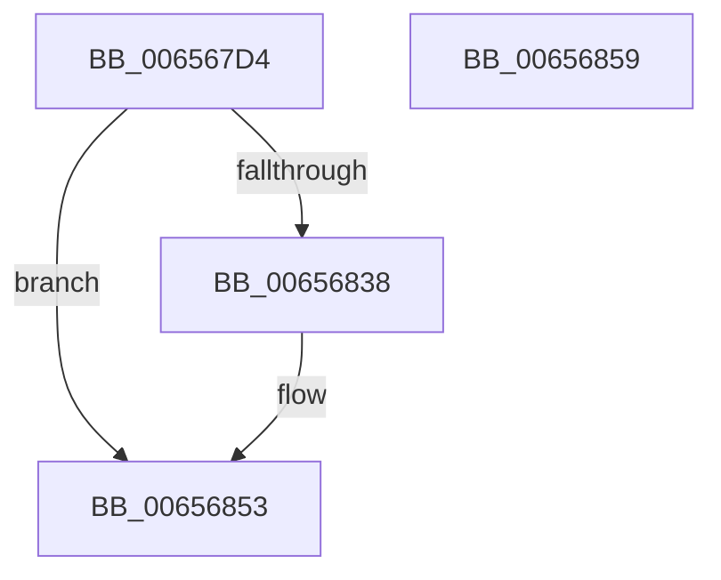

# ExpCleanupBigTag

- RVA: `0x006567D4`–`0x0065685A` (길이 `134` bytes)
- VA: `0x00000001406567D4`
- 실행 섹션: `.text`
- PDB 이름 있음: `예`; PDB Function 태그: `아니요`
- unwind 정보 RVA: `0x000D4CCC`
- 디코드: `37`개 명령, `134/134` bytes 표시
- 미해석 바이트: `0` (있으면 어셈블리에 `.byte`로 보존)

> 이 문서는 커널 이미지의 기계어와 PDB 기호를 분석해 생성했습니다. 4번과 5번은 함수 원형과 자료형을 바이너리 사용 방식에서 추정한 C 해석이며 원본 소스 복구 결과는 아닙니다.

## 1. Dependencies

- 직접 호출 지점: **2**; 고유 호출 대상: **2**
- 직접 호출자로 확인된 함수: **1**
- RIP 상대 이미지 참조: **0**

### Outgoing calls
- `0x00656824` → [ExpRemoveTagForBigPages](../41/ExpRemoveTagForBigPages_function_00411980.md) (function, `0x00411980`)
- `0x0065684D` → [KeBugCheckEx](../4F/KeBugCheckEx_function_004FD660.md) (function, `0x004FD660`)

### Direct callers
- [sub_006DED54](../6D/Unknown_function_006DED54.md) at `0x006DEE4B`

### Static image references
- 디코드된 RIP-relative 메모리 참조가 없습니다.

## 2. Other-region calls and transfers

- 다른 실행 섹션으로 향하는 call: **0**
- 별도 외부 분기/꼬리 이동을 확인하지 못했습니다.

## 3. Assembly (complete function range)

```asm
006567D4  4C 8B DC                        mov r11, rsp
006567D7  4D 89 4B 20                     mov qword ptr [r11 + 0x20], r9
006567DB  45 89 43 18                     mov dword ptr [r11 + 0x18], r8d
006567DF  49 89 53 10                     mov qword ptr [r11 + 0x10], rdx
006567E3  53                              push rbx
006567E4  48 83 EC 50                     sub rsp, 0x50
006567E8  33 C0                           xor eax, eax
006567EA  4D 8D 4B 18                     lea r9, [r11 + 0x18]
006567EE  89 44 24 70                     mov dword ptr [rsp + 0x70], eax
006567F2  BA 88 00 00 00                  mov edx, 0x88
006567F7  49 89 43 20                     mov qword ptr [r11 + 0x20], rax
006567FB  41 B8 01 00 00 00               mov r8d, 1
00656801  49 89 43 10                     mov qword ptr [r11 + 0x10], rax
00656805  48 8B D9                        mov rbx, rcx
00656808  49 89 43 E8                     mov qword ptr [r11 - 0x18], rax
0065680C  49 8D 43 20                     lea rax, [r11 + 0x20]
00656810  49 89 43 D8                     mov qword ptr [r11 - 0x28], rax
00656814  49 8D 43 10                     lea rax, [r11 + 0x10]
00656818  49 89 43 D0                     mov qword ptr [r11 - 0x30], rax
0065681C  49 8D 43 E8                     lea rax, [r11 - 0x18]
00656820  49 89 43 C8                     mov qword ptr [r11 - 0x38], rax
00656824  E8 57 B1 DB FF                  call 0x140411980
00656829  48 8B 4C 24 78                  mov rcx, qword ptr [rsp + 0x78]
0065682E  48 8D 41 FF                     lea rax, [rcx - 1]
00656832  48 83 F8 FD                     cmp rax, -3
00656836  77 1B                           ja 0x140656853
00656838  41 B9 88 00 00 00               mov r9d, 0x88
0065683E  48 89 4C 24 20                  mov qword ptr [rsp + 0x20], rcx
00656843  4C 8B C3                        mov r8, rbx
00656846  41 8D 51 9C                     lea edx, [r9 - 0x64]
0065684A  8D 4A F5                        lea ecx, [rdx - 0xb]
0065684D  E8 0E 6E EA FF                  call 0x1404fd660
00656852  CC                              int3
00656853  48 83 C4 50                     add rsp, 0x50
00656857  5B                              pop rbx
00656858  C3                              ret
00656859  CC                              int3
```

## 4. C-style interpretation (structured pseudocode)

```c
__int64 __fastcall ExpCleanupBigTag(__int64 a1, __int64 a2, int a3, __int64 a4)
{
    __int64 result;
    __int64 v_rsp;
    unsigned __int64 v_stack_m38;
    unsigned int v_stack_p18;
    unsigned __int64 v_stack_p20;

    *(unsigned __int64 *)(v_rsp + 32) = a4;
    *(unsigned int *)(v_rsp + 24) = a3;
    *(unsigned __int64 *)(v_rsp + 16) = a2;
    v_rsp = (v_rsp) - (80);
    result = 0;
    v_stack_p18 = 0;
    *(unsigned __int64 *)(v_rsp + 32) = 0;
    *(unsigned __int64 *)(v_rsp + 16) = 0;
    *(unsigned __int64 *)(v_rsp - 24) = 0;
    *(unsigned __int64 *)(v_rsp - 40) = v_rsp + 32;
    *(unsigned __int64 *)(v_rsp - 48) = v_rsp + 16;
    *(unsigned __int64 *)(v_rsp - 56) = v_rsp - 24;
    result = ExpRemoveTagForBigPages(a1, 136, 1, v_rsp + 24);
    result = v_stack_p20 - 1;
    if ((v_stack_p20 - 1) <= -3) {
        a4 = 136;
        v_stack_m38 = v_stack_p20;
        a3 = a1;
        a2 = a4 - 100;
        a1 = a2 - 11;
        result = KeBugCheckEx(a1, a2, a3, a4);
    }
    v_rsp = (v_rsp) + (80);
    return result;
}
```

## 5. (Beta) C Style

```c
int64_t ExpCleanupBigTag(int64_t Arg1, int64_t Arg2, int32_t Arg3, int64_t Arg4)
{
    int64_t result;
    int64_t local_rsp;
    uint64_t v_stack_m38;
    uint32_t v_stack_p18;
    uint64_t v_stack_p20;

    *(uint64_t *)(local_rsp + 0x20) = Arg4;
    *(uint32_t *)(local_rsp + 0x18) = Arg3;
    *(uint64_t *)(local_rsp + 0x10) = Arg2;
    local_rsp = (local_rsp) - (80);
    result = 0;
    v_stack_p18 = 0;
    *(uint64_t *)(local_rsp + 0x20) = 0;
    *(uint64_t *)(local_rsp + 0x10) = 0;
    *(uint64_t *)(local_rsp - 0x18) = 0;
    *(uint64_t *)(local_rsp - 0x28) = local_rsp + 32;
    *(uint64_t *)(local_rsp - 0x30) = local_rsp + 16;
    *(uint64_t *)(local_rsp - 0x38) = local_rsp - 24;
    result = ExpRemoveTagForBigPages(Arg1, 136, 1, local_rsp + 24);
    result = v_stack_p20 - 1;
    if ((v_stack_p20 - 1) <= -3) {
        Arg4 = 136;
        v_stack_m38 = v_stack_p20;
        Arg3 = Arg1;
        Arg2 = Arg4 - 100;
        Arg1 = Arg2 - 11;
        result = KeBugCheckEx(Arg1, Arg2, Arg3, Arg4);
    }
    local_rsp = (local_rsp) + (80);
    return result;
}
```

## 6. Execution-region graph

[열기: 2D/3D 그래프와 함수 탐색 컨트롤 패널](../../../control-panel.html?section=text&rva=0x006567D4&view=graph)

- 2D 그래프는 위에서 아래로 흐르고, 3D 그래프는 빈 공간을 드래그해 회전합니다. Shift+드래그는 이동, 휠은 확대·축소, 함수 노드 선택은 대상 보고서 이동입니다.

### Static fallback


