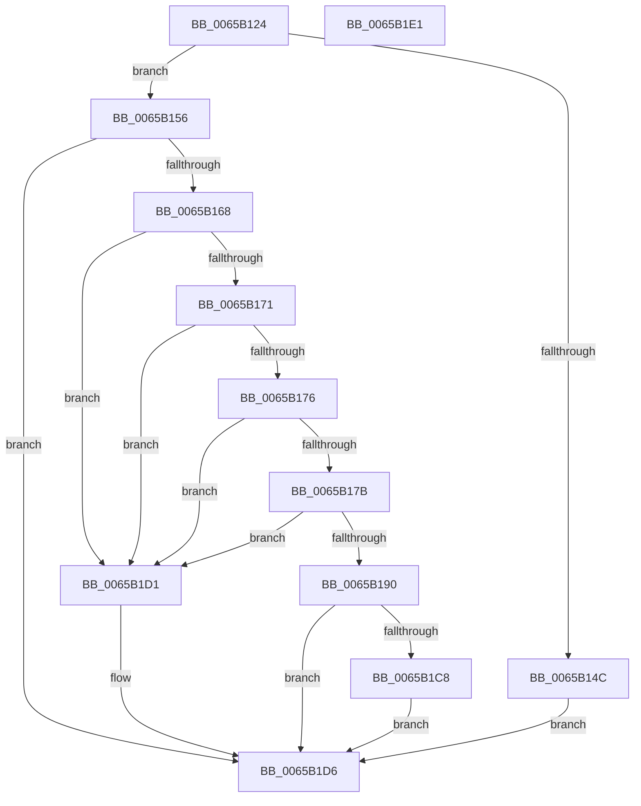

# ExpConvertSvmDevice

- RVA: `0x0065B124`–`0x0065B1E2` (길이 `190` bytes)
- VA: `0x000000014065B124`
- 실행 섹션: `.text`
- PDB 이름 있음: `예`; PDB Function 태그: `아니요`
- unwind 정보 RVA: `0x000C6370`
- 디코드: `52`개 명령, `190/190` bytes 표시
- 미해석 바이트: `0` (있으면 어셈블리에 `.byte`로 보존)

> 이 문서는 커널 이미지의 기계어와 PDB 기호를 분석해 생성했습니다. 4번과 5번은 함수 원형과 자료형을 바이너리 사용 방식에서 추정한 C 해석이며 원본 소스 복구 결과는 아닙니다.

## 1. Dependencies

- 직접 호출 지점: **2**; 고유 호출 대상: **1**
- 직접 호출자로 확인된 함수: **1**
- RIP 상대 이미지 참조: **3**

### Outgoing calls
- `0x0065B15F` → [guard_dispatch_icall](../6B/guard_dispatch_icall_function_006BAAD0.md) (function, `0x006BAAD0`)
- `0x0065B1BF` → [guard_dispatch_icall](../6B/guard_dispatch_icall_function_006BAAD0.md) (function, `0x006BAAD0`)

### Direct callers
- [ExpShareAddressSpaceWithDevice](ExpShareAddressSpaceWithDevice_function_0065B528.md) at `0x0065B89C`

### Static image references
- `0x0065B188` → RVA `0x00EFA8C0` (`.data`; read)
- `0x0065B190` → RVA `0x00E685D4` (`.data`; read/write)
- `0x0065B197` → RVA `0x00E06D28` (`.data`; read)

## 2. Other-region calls and transfers

- 다른 실행 섹션으로 향하는 call: **0**
- 별도 외부 분기/꼬리 이동을 확인하지 못했습니다.

## 3. Assembly (complete function range)

```asm
0065B124  48 8B C4                        mov rax, rsp
0065B127  48 89 58 08                     mov qword ptr [rax + 8], rbx
0065B12B  44 88 40 18                     mov byte ptr [rax + 0x18], r8b
0065B12F  57                              push rdi
0065B130  48 83 EC 30                     sub rsp, 0x30
0065B134  48 83 60 10 00                  and qword ptr [rax + 0x10], 0
0065B139  48 8B DA                        mov rbx, rdx
0065B13C  83 60 18 00                     and dword ptr [rax + 0x18], 0
0065B140  48 8B F9                        mov rdi, rcx
0065B143  48 8B 42 48                     mov rax, qword ptr [rdx + 0x48]
0065B147  48 85 C0                        test rax, rax
0065B14A  75 0A                           jne 0x14065b156
0065B14C  B8 BB 00 00 C0                  mov eax, 0xc00000bb
0065B151  E9 80 00 00 00                  jmp 0x14065b1d6
0065B156  48 8B 4B 30                     mov rcx, qword ptr [rbx + 0x30]
0065B15A  48 8D 54 24 50                  lea rdx, [rsp + 0x50]
0065B15F  E8 6C F9 05 00                  call 0x1406baad0
0065B164  85 C0                           test eax, eax
0065B166  78 6E                           js 0x14065b1d6
0065B168  8B 4C 24 50                     mov ecx, dword ptr [rsp + 0x50]
0065B16C  F6 C1 01                        test cl, 1
0065B16F  74 60                           je 0x14065b1d1
0065B171  F6 C1 02                        test cl, 2
0065B174  74 5B                           je 0x14065b1d1
0065B176  F6 C1 04                        test cl, 4
0065B179  74 56                           je 0x14065b1d1
0065B17B  C1 E9 03                        shr ecx, 3
0065B17E  B8 01 00 00 00                  mov eax, 1
0065B183  83 E1 1F                        and ecx, 0x1f
0065B186  D3 E0                           shl eax, cl
0065B188  3B 05 32 F7 89 00               cmp eax, dword ptr [rip + 0x89f732]
0065B18E  72 41                           jb 0x14065b1d1
0065B190  F0 FF 05 3D D4 80 00            lock inc dword ptr [rip + 0x80d43d]
0065B197  48 8B 05 8A BB 7A 00            mov rax, qword ptr [rip + 0x7abb8a]
0065B19E  48 8D 4C 24 48                  lea rcx, [rsp + 0x48]
0065B1A3  4C 8B 43 18                     mov r8, qword ptr [rbx + 0x18]
0065B1A7  4C 8D 4C 24 50                  lea r9, [rsp + 0x50]
0065B1AC  48 8B 93 A8 00 00 00            mov rdx, qword ptr [rbx + 0xa8]
0065B1B3  48 89 4C 24 20                  mov qword ptr [rsp + 0x20], rcx
0065B1B8  48 8B CF                        mov rcx, rdi
0065B1BB  48 8B 40 18                     mov rax, qword ptr [rax + 0x18]
0065B1BF  E8 0C F9 05 00                  call 0x1406baad0
0065B1C4  85 C0                           test eax, eax
0065B1C6  79 0E                           jns 0x14065b1d6
0065B1C8  F0 FF 0D 05 D4 80 00            lock dec dword ptr [rip + 0x80d405]
0065B1CF  EB 05                           jmp 0x14065b1d6
0065B1D1  B8 EF 00 00 C0                  mov eax, 0xc00000ef
0065B1D6  48 8B 5C 24 40                  mov rbx, qword ptr [rsp + 0x40]
0065B1DB  48 83 C4 30                     add rsp, 0x30
0065B1DF  5F                              pop rdi
0065B1E0  C3                              ret
0065B1E1  CC                              int3
```

## 4. C-style interpretation (structured pseudocode)

```c
__int64 __fastcall ExpConvertSvmDevice(__int64 a1, __int64 a2, unsigned __int8 a3)
{
    __int64 result;
    __int64 v_rsp;
    unsigned __int64 v_stack_m18;
    unsigned __int64 v_stack_p10;
    unsigned __int64 v_stack_p18;
    unsigned __int64 v_stack_p8;

    *(unsigned __int64 *)(v_rsp + 8) = v_rbx;
    *(unsigned __int8 *)(v_rsp + 24) = a3;
    v_rsp = (v_rsp) - (48);
    if (*(unsigned __int64 *)(a2 + 72) != 0) goto loc_0065B156;
    goto loc_0065B1D6;
loc_0065B156:
    result = guard_dispatch_icall(*(unsigned __int64 *)(a2 + 48), v_stack_p18, a3, a4);
    if (sign_flag) goto loc_0065B1D6;
    if ((((unsigned __int8)((unsigned int)(v_stack_p18))) & (1)) == 0) goto loc_0065B1D1;
    if ((((unsigned __int8)((unsigned int)(v_stack_p18))) & (2)) == 0) goto loc_0065B1D1;
    if ((((unsigned __int8)((unsigned int)(v_stack_p18))) & (4)) == 0) goto loc_0065B1D1;
    a1 = (unsigned int)(((unsigned int)(v_stack_p18)) >> (3));
    a1 = (unsigned int)((a1) & (31));
    result = (unsigned int)((1) << ((unsigned __int8)(a1)));
    if (((unsigned int)(result)) < (*(unsigned int *)(v_rip + 9041714))) goto loc_0065B1D1;
    v_stack_m18 = v_stack_p10;
    result = guard_dispatch_icall(a1, *(unsigned __int64 *)(a2 + 168), *(unsigned __int64 *)(a2 + 24), v_stack_p18);
    if (!sign_flag) goto loc_0065B1D6;
    goto loc_0065B1D6;
loc_0065B1D1:
loc_0065B1D6:
    v_rsp = (v_rsp) + (48);
    return (unsigned int)(0xC00000EFULL);
}
```

## 5. (Beta) C Style

```c
int64_t ExpConvertSvmDevice(int64_t Arg1, void *Arg2, uint8_t Arg3)
{
    uint8_t *arg2 = (uint8_t *)Arg2;

    int64_t result;
    int64_t local_rsp;
    uint64_t v_stack_m18;
    uint64_t v_stack_p10;
    uint64_t v_stack_p18;
    uint64_t v_stack_p8;

    *(uint64_t *)(local_rsp + 0x8) = local_rbx;
    *(uint8_t *)(local_rsp + 0x18) = Arg3;
    local_rsp = (local_rsp) - (48);
    if (*(uint64_t *)(arg2 + 0x48) != 0) goto loc_0065B156;
    goto loc_0065B1D6;
loc_0065B156:
    result = guard_dispatch_icall(*(uint64_t *)(arg2 + 0x30), v_stack_p18, Arg3, a4);
    if (sign_flag) goto loc_0065B1D6;
    if ((((uint8_t)((uint32_t)(v_stack_p18))) & (1)) == 0) goto loc_0065B1D1;
    if ((((uint8_t)((uint32_t)(v_stack_p18))) & (2)) == 0) goto loc_0065B1D1;
    if ((((uint8_t)((uint32_t)(v_stack_p18))) & (4)) == 0) goto loc_0065B1D1;
    Arg1 = (uint32_t)(((uint32_t)(v_stack_p18)) >> (3));
    Arg1 = (uint32_t)((Arg1) & (31));
    result = (uint32_t)((1) << ((uint8_t)(Arg1)));
    if (((uint32_t)(result)) < (*(uint32_t *)(v_rip + 0x89F732))) goto loc_0065B1D1;
    v_stack_m18 = v_stack_p10;
    result = guard_dispatch_icall(Arg1, *(uint64_t *)(arg2 + 0xA8), *(uint64_t *)(arg2 + 0x18), v_stack_p18);
    if (!sign_flag) goto loc_0065B1D6;
    goto loc_0065B1D6;
loc_0065B1D1:
loc_0065B1D6:
    local_rsp = (local_rsp) + (48);
    return (uint32_t)(0xC00000EFULL);
}
```

### 관측된 메모리 오프셋

구조체 형식이 확인되지 않은 접근은 인자 기준의 오프셋으로만 기록했습니다.

| 기준 인자 | 오프셋 표현 | 폭 (bit) | 접근 |
|---|---:|---:|---|
| `Arg2` | `+ 0x18` | `64` | `R` |
| `Arg2` | `+ 0x30` | `64` | `R` |
| `Arg2` | `+ 0x48` | `64` | `R` |
| `Arg2` | `+ 0xA8` | `64` | `R` |

## 6. Execution-region graph

[열기: 2D/3D 그래프와 함수 탐색 컨트롤 패널](../../../control-panel.html?section=text&rva=0x0065B124&view=graph)

- 2D 그래프는 위에서 아래로 흐르고, 3D 그래프는 빈 공간을 드래그해 회전합니다. Shift+드래그는 이동, 휠은 확대·축소, 함수 노드 선택은 대상 보고서 이동입니다.

### Static fallback


