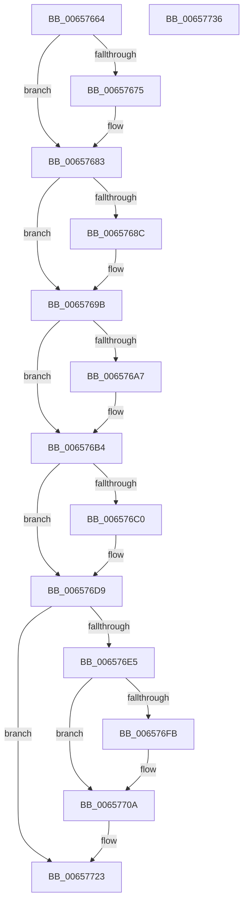

# ExpDeleteSiloState

- RVA: `0x00657664`–`0x00657737` (길이 `211` bytes)
- VA: `0x0000000140657664`
- 실행 섹션: `.text`
- PDB 이름 있음: `예`; PDB Function 태그: `아니요`
- unwind 정보 RVA: `0x0005CF00`
- 디코드: `50`개 명령, `211/211` bytes 표시
- 미해석 바이트: `0` (있으면 어셈블리에 `.byte`로 보존)

> 이 문서는 커널 이미지의 기계어와 PDB 기호를 분석해 생성했습니다. 4번과 5번은 함수 원형과 자료형을 바이너리 사용 방식에서 추정한 C 해석이며 원본 소스 복구 결과는 아닙니다.

## 1. Dependencies

- 직접 호출 지점: **9**; 고유 호출 대상: **6**
- 직접 호출자로 확인된 함수: **1**
- RIP 상대 이미지 참조: **0**

### Outgoing calls
- `0x0065767A` → [ExFreePoolWithTag](../../poolcode/B8/ExFreePoolWithTag_function_00B82870.md) (function, `0x00B82870`)
- `0x00657691` → [ObfDereferenceObjectWithTag](../2F/ObfDereferenceObjectWithTag_function_002F78E0.md) (function, `0x002F78E0`)
- `0x006576A7` → [MmUnmapViewInSessionSpace](../../page/A5/MmUnmapViewInSessionSpace_function_00A5FE60.md) (function, `0x00A5FE60`)
- `0x006576C0` → [ExWaitForCallBacks](../../page/AC/ExWaitForCallBacks_function_00ACFA04.md) (function, `0x00ACFA04`)
- `0x006576CC` → [AlpcpFreeBuffer](../../page/90/AlpcpFreeBuffer_function_009071C0.md) (function, `0x009071C0`)
- `0x006576F2` → [sub_0096700C](../../page/96/Unknown_function_0096700C.md) (function, `0x0096700C`)
- `0x00657705` → [ExFreePoolWithTag](../../poolcode/B8/ExFreePoolWithTag_function_00B82870.md) (function, `0x00B82870`)
- `0x00657716` → [ExFreePoolWithTag](../../poolcode/B8/ExFreePoolWithTag_function_00B82870.md) (function, `0x00B82870`)
- `0x0065772B` → [ExFreePoolWithTag](../../poolcode/B8/ExFreePoolWithTag_function_00B82870.md) (function, `0x00B82870`)

### Direct callers
- [PspDeleteServerSiloGlobals](../../page/77/PspDeleteServerSiloGlobals_function_0077FC54.md) at `0x0077FDF1`

### Static image references
- 디코드된 RIP-relative 메모리 참조가 없습니다.

## 2. Other-region calls and transfers

- 다른 실행 섹션으로 향하는 call: **8**
  - `0x0065767A` → [ExFreePoolWithTag](../../poolcode/B8/ExFreePoolWithTag_function_00B82870.md) (`.text` → `POOLCODE`)
  - `0x006576A7` → [MmUnmapViewInSessionSpace](../../page/A5/MmUnmapViewInSessionSpace_function_00A5FE60.md) (`.text` → `PAGE`)
  - `0x006576C0` → [ExWaitForCallBacks](../../page/AC/ExWaitForCallBacks_function_00ACFA04.md) (`.text` → `PAGE`)
  - `0x006576CC` → [AlpcpFreeBuffer](../../page/90/AlpcpFreeBuffer_function_009071C0.md) (`.text` → `PAGE`)
  - `0x006576F2` → [sub_0096700C](../../page/96/Unknown_function_0096700C.md) (`.text` → `PAGE`)
  - `0x00657705` → [ExFreePoolWithTag](../../poolcode/B8/ExFreePoolWithTag_function_00B82870.md) (`.text` → `POOLCODE`)
  - `0x00657716` → [ExFreePoolWithTag](../../poolcode/B8/ExFreePoolWithTag_function_00B82870.md) (`.text` → `POOLCODE`)
  - `0x0065772B` → [ExFreePoolWithTag](../../poolcode/B8/ExFreePoolWithTag_function_00B82870.md) (`.text` → `POOLCODE`)
- 별도 외부 분기/꼬리 이동을 확인하지 못했습니다.

## 3. Assembly (complete function range)

```asm
00657664  40 53                           push rbx
00657666  48 83 EC 20                     sub rsp, 0x20
0065766A  48 8B D9                        mov rbx, rcx
0065766D  48 8B 09                        mov rcx, qword ptr [rcx]
00657670  48 85 C9                        test rcx, rcx
00657673  74 0E                           je 0x140657683
00657675  BA 53 4C 53 69                  mov edx, 0x69534c53
0065767A  E8 F1 B1 52 00                  call 0x140b82870
0065767F  48 83 23 00                     and qword ptr [rbx], 0
00657683  48 8B 4B 10                     mov rcx, qword ptr [rbx + 0x10]
00657687  48 85 C9                        test rcx, rcx
0065768A  74 0F                           je 0x14065769b
0065768C  BA 44 66 6C 74                  mov edx, 0x746c6644
00657691  E8 4A 02 CA FF                  call 0x1402f78e0
00657696  48 83 63 10 00                  and qword ptr [rbx + 0x10], 0
0065769B  48 8B 8B F0 B6 00 00            mov rcx, qword ptr [rbx + 0xb6f0]
006576A2  48 85 C9                        test rcx, rcx
006576A5  74 0D                           je 0x1406576b4
006576A7  E8 B4 87 40 00                  call 0x140a5fe60
006576AC  48 83 A3 F0 B6 00 00 00         and qword ptr [rbx + 0xb6f0], 0
006576B4  48 8B 8B 00 B7 00 00            mov rcx, qword ptr [rbx + 0xb700]
006576BB  48 85 C9                        test rcx, rcx
006576BE  74 19                           je 0x1406576d9
006576C0  E8 3F 83 47 00                  call 0x140acfa04
006576C5  48 8B 8B 00 B7 00 00            mov rcx, qword ptr [rbx + 0xb700]
006576CC  E8 EF FA 2A 00                  call 0x1409071c0
006576D1  48 83 A3 00 B7 00 00 00         and qword ptr [rbx + 0xb700], 0
006576D9  48 8B 83 A8 B7 00 00            mov rax, qword ptr [rbx + 0xb7a8]
006576E0  48 85 C0                        test rax, rax
006576E3  74 3E                           je 0x140657723
006576E5  48 8B 00                        mov rax, qword ptr [rax]
006576E8  48 8D 4C 24 30                  lea rcx, [rsp + 0x30]
006576ED  48 89 44 24 30                  mov qword ptr [rsp + 0x30], rax
006576F2  E8 15 F9 30 00                  call 0x14096700c
006576F7  85 C0                           test eax, eax
006576F9  78 0F                           js 0x14065770a
006576FB  48 8B 4C 24 30                  mov rcx, qword ptr [rsp + 0x30]
00657700  BA 53 4C 53 20                  mov edx, 0x20534c53
00657705  E8 66 B1 52 00                  call 0x140b82870
0065770A  48 8B 8B A8 B7 00 00            mov rcx, qword ptr [rbx + 0xb7a8]
00657711  BA 53 4C 53 20                  mov edx, 0x20534c53
00657716  E8 55 B1 52 00                  call 0x140b82870
0065771B  48 83 A3 A8 B7 00 00 00         and qword ptr [rbx + 0xb7a8], 0
00657723  BA 53 4C 53 69                  mov edx, 0x69534c53
00657728  48 8B CB                        mov rcx, rbx
0065772B  E8 40 B1 52 00                  call 0x140b82870
00657730  48 83 C4 20                     add rsp, 0x20
00657734  5B                              pop rbx
00657735  C3                              ret
00657736  CC                              int3
```

## 4. C-style interpretation (structured pseudocode)

```c
__int64 __fastcall ExpDeleteSiloState(__int64 a1)
{
    __int64 result;
    __int64 v_rsp;
    unsigned __int64 v_stack_p8;

    v_rsp = (v_rsp) - (32);
    if (*(unsigned __int64 *)(a1) != 0) {
        a2 = 0x69534C53ULL;
        result = ExFreePoolWithTag(*(unsigned __int64 *)(a1), a2, a3, a4);
    }
    if (*(unsigned __int64 *)(a1 + 16) != 0) {
        a2 = 0x746C6644ULL;
        result = ObfDereferenceObjectWithTag(*(unsigned __int64 *)(a1 + 16), a2, a3, a4);
    }
    if (*(unsigned __int64 *)(a1 + 46832) != 0) {
        result = MmUnmapViewInSessionSpace(*(unsigned __int64 *)(a1 + 46832), a2, a3, a4);
    }
    if (*(unsigned __int64 *)(a1 + 46848) != 0) {
        result = ExWaitForCallBacks(*(unsigned __int64 *)(a1 + 46848), a2, a3, a4);
        a1 = *(unsigned __int64 *)(a1 + 46848);
        result = AlpcpFreeBuffer(a1, a2, a3, a4);
    }
    if (*(unsigned __int64 *)(a1 + 47016) == 0) goto loc_00657723;
    v_stack_p8 = *(unsigned __int64 *)(*(unsigned __int64 *)(a1 + 47016));
    result = sub_0096700C(v_stack_p8, a2, a3, a4);
    if (!(sign_flag)) {
        a1 = v_stack_p8;
        a2 = 0x20534C53ULL;
        result = ExFreePoolWithTag(a1, a2, a3, a4);
    }
    result = ExFreePoolWithTag(*(unsigned __int64 *)(a1 + 47016), (unsigned int)(0x20534C53ULL), a3, a4);
loc_00657723:
    result = ExFreePoolWithTag(a1, (unsigned int)(0x69534C53ULL), a3, a4);
    v_rsp = (v_rsp) + (32);
    return result;
}
```

## 5. (Beta) C Style

```c
int64_t ExpDeleteSiloState(void *Arg1)
{
    uint8_t *arg1 = (uint8_t *)Arg1;

    int64_t result;
    int64_t local_rsp;
    uint64_t v_stack_p8;

    local_rsp = (local_rsp) - (32);
    if (*(uint64_t *)(arg1) != 0) {
        a2 = 0x69534C53ULL;
        result = ExFreePoolWithTag(*(uint64_t *)(arg1), a2, a3, a4);
    }
    if (*(uint64_t *)(arg1 + 0x10) != 0) {
        a2 = 0x746C6644ULL;
        result = ObfDereferenceObjectWithTag(*(uint64_t *)(arg1 + 0x10), a2, a3, a4);
    }
    if (*(uint64_t *)(arg1 + 0xB6F0) != 0) {
        result = MmUnmapViewInSessionSpace(*(uint64_t *)(arg1 + 0xB6F0), a2, a3, a4);
    }
    if (*(uint64_t *)(arg1 + 0xB700) != 0) {
        result = ExWaitForCallBacks(*(uint64_t *)(arg1 + 0xB700), a2, a3, a4);
        Arg1 = *(uint64_t *)(arg1 + 0xB700);
        result = AlpcpFreeBuffer(Arg1, a2, a3, a4);
    }
    if (*(uint64_t *)(arg1 + 0xB7A8) == 0) goto loc_00657723;
    v_stack_p8 = *(uint64_t *)(*(uint64_t *)(arg1 + 0xB7A8));
    result = sub_0096700C(v_stack_p8, a2, a3, a4);
    if (!(sign_flag)) {
        Arg1 = v_stack_p8;
        a2 = 0x20534C53ULL;
        result = ExFreePoolWithTag(Arg1, a2, a3, a4);
    }
    result = ExFreePoolWithTag(*(uint64_t *)(arg1 + 0xB7A8), (uint32_t)(0x20534C53ULL), a3, a4);
loc_00657723:
    result = ExFreePoolWithTag(Arg1, (uint32_t)(0x69534C53ULL), a3, a4);
    local_rsp = (local_rsp) + (32);
    return result;
}
```

### 관측된 메모리 오프셋

구조체 형식이 확인되지 않은 접근은 인자 기준의 오프셋으로만 기록했습니다.

| 기준 인자 | 오프셋 표현 | 폭 (bit) | 접근 |
|---|---:|---:|---|
| `Arg1` | `+ 0x0` | `64` | `R` |
| `Arg1` | `+ 0x0` | `64` | `R/W` |
| `Arg1` | `+ 0x10` | `64` | `R` |
| `Arg1` | `+ 0x10` | `64` | `R/W` |
| `Arg1` | `+ 0xB6F0` | `64` | `R` |
| `Arg1` | `+ 0xB6F0` | `64` | `R/W` |
| `Arg1` | `+ 0xB700` | `64` | `R` |
| `Arg1` | `+ 0xB700` | `64` | `R/W` |
| `Arg1` | `+ 0xB7A8` | `64` | `R` |
| `Arg1` | `+ 0xB7A8` | `64` | `R/W` |

## 6. Execution-region graph

[열기: 2D/3D 그래프와 함수 탐색 컨트롤 패널](../../../control-panel.html?section=text&rva=0x00657664&view=graph)

- 2D 그래프는 위에서 아래로 흐르고, 3D 그래프는 빈 공간을 드래그해 회전합니다. Shift+드래그는 이동, 휠은 확대·축소, 함수 노드 선택은 대상 보고서 이동입니다.

### Static fallback


