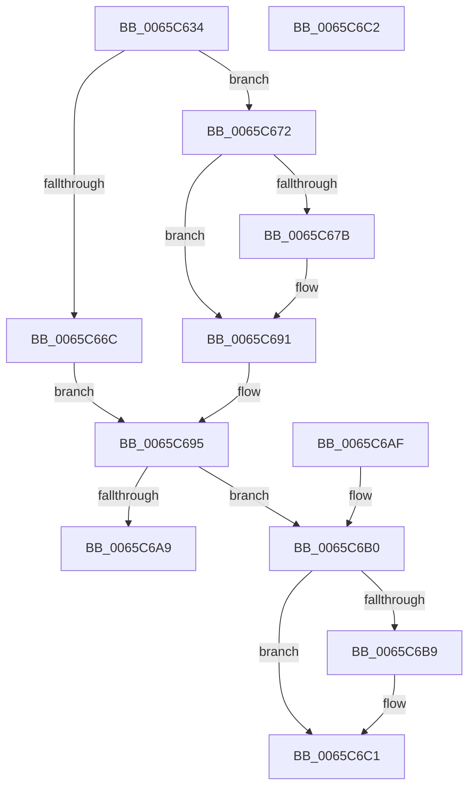

# ExpDetermineLargePagePolicy

- RVA: `0x0065C634`–`0x0065C6C3` (길이 `143` bytes)
- VA: `0x000000014065C634`
- 실행 섹션: `.text`
- PDB 이름 있음: `예`; PDB Function 태그: `아니요`
- unwind 정보 RVA: `0x000DB714`
- 디코드: `37`개 명령, `143/143` bytes 표시
- 미해석 바이트: `0` (있으면 어셈블리에 `.byte`로 보존)

> 이 문서는 커널 이미지의 기계어와 PDB 기호를 분석해 생성했습니다. 4번과 5번은 함수 원형과 자료형을 바이너리 사용 방식에서 추정한 C 해석이며 원본 소스 복구 결과는 아닙니다.

## 1. Dependencies

- 직접 호출 지점: **0**; 고유 호출 대상: **0**
- 직접 호출자로 확인된 함수: **1**
- RIP 상대 이미지 참조: **1**

### Outgoing calls
- 직접 디코드된 call 명령이 없습니다.

### Direct callers
- [ExInitializePoolHeapManagement](ExInitializePoolHeapManagement_function_0065C3D0.md) at `0x0065C427`

### Static image references
- `0x0065C640` → RVA `0x00E30088` (`.data`; read)

## 2. Other-region calls and transfers

- 다른 실행 섹션으로 향하는 call: **0**
- 별도 외부 분기/꼬리 이동을 확인하지 못했습니다.

## 3. Assembly (complete function range)

```asm
0065C634  33 C0                           xor eax, eax
0065C636  0F 57 C0                        xorps xmm0, xmm0
0065C639  0F 11 01                        movups xmmword ptr [rcx], xmm0
0065C63C  48 89 41 10                     mov qword ptr [rcx + 0x10], rax
0065C640  48 8B 05 41 3A 7D 00            mov rax, qword ptr [rip + 0x7d3a41]
0065C647  C6 41 10 50                     mov byte ptr [rcx + 0x10], 0x50
0065C64B  48 8B 10                        mov rdx, qword ptr [rax]
0065C64E  4C 8B 82 50 48 00 00            mov r8, qword ptr [rdx + 0x4850]
0065C655  4D 8B C8                        mov r9, r8
0065C658  49 C1 E8 09                     shr r8, 9
0065C65C  49 C1 E9 08                     shr r9, 8
0065C660  4C 89 01                        mov qword ptr [rcx], r8
0065C663  49 81 F9 00 10 00 00            cmp r9, 0x1000
0065C66A  73 06                           jae 0x14065c672
0065C66C  49 C1 E8 05                     shr r8, 5
0065C670  EB 23                           jmp 0x14065c695
0065C672  49 81 F9 00 40 00 00            cmp r9, 0x4000
0065C679  73 16                           jae 0x14065c691
0065C67B  48 B8 15 AE 47 E1 7A 14 AE 47   movabs rax, 0x47ae147ae147ae15
0065C685  49 F7 E0                        mul r8
0065C688  4C 2B C2                        sub r8, rdx
0065C68B  49 D1 E8                        shr r8, 1
0065C68E  4C 03 C2                        add r8, rdx
0065C691  49 C1 E8 04                     shr r8, 4
0065C695  4C 89 01                        mov qword ptr [rcx], r8
0065C698  48 8B C1                        mov rax, rcx
0065C69B  48 83 49 08 FF                  or qword ptr [rcx + 8], 0xffffffffffffffff
0065C6A0  49 81 F9 00 02 00 00            cmp r9, 0x200
0065C6A7  77 07                           ja 0x14065c6b0
0065C6A9  48 83 61 08 00                  and qword ptr [rcx + 8], 0
0065C6AE  C3                              ret
0065C6AF  CC                              int3
0065C6B0  49 81 F9 00 08 00 00            cmp r9, 0x800
0065C6B7  73 08                           jae 0x14065c6c1
0065C6B9  48 C7 41 08 02 00 00 00         mov qword ptr [rcx + 8], 2
0065C6C1  C3                              ret
0065C6C2  CC                              int3
```

## 4. C-style interpretation (structured pseudocode)

```c
__int64 __fastcall ExpDetermineLargePagePolicy(__int64 a1)
{
    __int64 result;

    result = 0;
    *(unsigned __int64 *)(a1) = v_xmm0;
    *(unsigned __int64 *)(a1 + 16) = 0;
    *(unsigned __int8 *)(a1 + 16) = 80;
    a3 = (*(unsigned __int64 *)(*(unsigned __int64 *)(*(unsigned __int64 *)(v_rip + 8206913)) + 18512)) >> (9);
    a4 = (*(unsigned __int64 *)(*(unsigned __int64 *)(*(unsigned __int64 *)(v_rip + 8206913)) + 18512)) >> (8);
    *(unsigned __int64 *)(a1) = a3;
    if (a4 >= 0x1000ULL) goto loc_0065C672;
    a3 = (a3) >> (5);
    goto loc_0065C695;
loc_0065C672:
    if (a4 < 0x4000ULL) {
        a3 = (a3) - (*(unsigned __int64 *)(*(unsigned __int64 *)(v_rip + 8206913)));
        a3 = (a3) >> (1);
        a3 = (a3) + (*(unsigned __int64 *)(*(unsigned __int64 *)(v_rip + 8206913)));
    }
    a3 = (a3) >> (4);
loc_0065C695:
    *(unsigned __int64 *)(a1) = a3;
    if (a4 > 512) goto loc_0065C6B0;
    return a1;
loc_0065C6B0:
    if (a4 < 0x800ULL) {
        *(unsigned __int64 *)(a1 + 8) = 2;
    }
    return a1;
}
```

## 5. (Beta) C Style

```c
void *ExpDetermineLargePagePolicy(void *Arg1)
{
    uint8_t *arg1 = (uint8_t *)Arg1;

    int64_t result;

    result = 0;
    *(uint64_t *)(arg1) = v_xmm0;
    *(uint64_t *)(arg1 + 0x10) = 0;
    *(uint8_t *)(arg1 + 0x10) = 80;
    a3 = (*(uint64_t *)(*(uint64_t *)(*(uint64_t *)(v_rip + 0x7D3A41)) + 0x4850)) >> (9);
    a4 = (*(uint64_t *)(*(uint64_t *)(*(uint64_t *)(v_rip + 0x7D3A41)) + 0x4850)) >> (8);
    *(uint64_t *)(arg1) = a3;
    if (a4 >= 0x1000ULL) goto loc_0065C672;
    a3 = (a3) >> (5);
    goto loc_0065C695;
loc_0065C672:
    if (a4 < 0x4000ULL) {
        a3 = (a3) - (*(uint64_t *)(*(uint64_t *)(v_rip + 0x7D3A41)));
        a3 = (a3) >> (1);
        a3 = (a3) + (*(uint64_t *)(*(uint64_t *)(v_rip + 0x7D3A41)));
    }
    a3 = (a3) >> (4);
loc_0065C695:
    *(uint64_t *)(arg1) = a3;
    if (a4 > 512) goto loc_0065C6B0;
    return Arg1;
loc_0065C6B0:
    if (a4 < 0x800ULL) {
        *(uint64_t *)(arg1 + 0x8) = 2;
    }
    return Arg1;
}
```

### 관측된 메모리 오프셋

구조체 형식이 확인되지 않은 접근은 인자 기준의 오프셋으로만 기록했습니다.

| 기준 인자 | 오프셋 표현 | 폭 (bit) | 접근 |
|---|---:|---:|---|
| `Arg1` | `+ 0x0` | `64` | `W` |
| `Arg1` | `+ 0x0` | `128` | `R` |
| `Arg1` | `+ 0x8` | `64` | `R/W` |
| `Arg1` | `+ 0x8` | `64` | `W` |
| `Arg1` | `+ 0x10` | `8` | `W` |
| `Arg1` | `+ 0x10` | `64` | `W` |

## 6. Execution-region graph

[열기: 2D/3D 그래프와 함수 탐색 컨트롤 패널](../../../control-panel.html?section=text&rva=0x0065C634&view=graph)

- 2D 그래프는 위에서 아래로 흐르고, 3D 그래프는 빈 공간을 드래그해 회전합니다. Shift+드래그는 이동, 휠은 확대·축소, 함수 노드 선택은 대상 보고서 이동입니다.

### Static fallback


