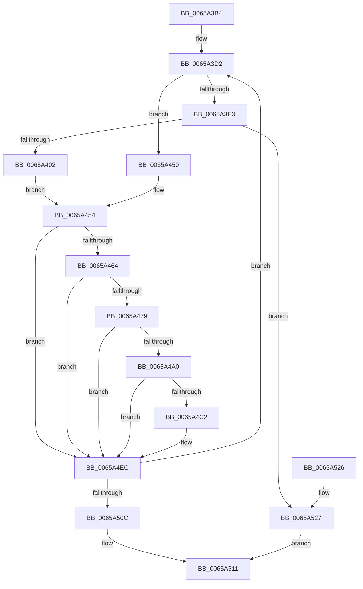

# ExpEnumerateNextActiveWorkSubQueue

- RVA: `0x0065A3B4`–`0x0065A52E` (길이 `378` bytes)
- VA: `0x000000014065A3B4`
- 실행 섹션: `.text`
- PDB 이름 있음: `예`; PDB Function 태그: `아니요`
- unwind 정보 RVA: `0x00069AD0`
- 디코드: `97`개 명령, `378/378` bytes 표시
- 미해석 바이트: `0` (있으면 어셈블리에 `.byte`로 보존)

> 이 문서는 커널 이미지의 기계어와 PDB 기호를 분석해 생성했습니다. 4번과 5번은 함수 원형과 자료형을 바이너리 사용 방식에서 추정한 C 해석이며 원본 소스 복구 결과는 아닙니다.

## 1. Dependencies

- 직접 호출 지점: **1**; 고유 호출 대상: **1**
- 직접 호출자로 확인된 함수: **4**
- RIP 상대 이미지 참조: **4**

### Outgoing calls
- `0x0065A3EE` → [MmGetNextNode](../43/MmGetNextNode_function_00436620.md) (function, `0x00436620`)

### Direct callers
- [sub_00358409](../35/Unknown_function_00358409.md) at `0x00358528`
- [ExpTryQueueWorkItem](../39/ExpTryQueueWorkItem_function_0039801C.md) at `0x00398110`
- [ExpTryQueueWorkItem](../39/ExpTryQueueWorkItem_function_0039801C.md) at `0x00398188`
- [ExpWorkQueueHealthMetricsMonitorCallback](ExpWorkQueueHealthMetricsMonitorCallback_function_0065A7F0.md) at `0x0065A893`
- [ExpWorkQueueHealthMetricsMonitorCallback](ExpWorkQueueHealthMetricsMonitorCallback_function_0065A7F0.md) at `0x0065A95F`
- [ExStartStopWorkQueueProvider](../../page/7C/ExStartStopWorkQueueProvider_function_007CF59C.md) at `0x007CF6F1`

### Static image references
- `0x0065A3F3` → RVA `0x00FC5000` (`ALMOSTRO`; read)
- `0x0065A405` → RVA `0x00FCF6C0` (`CACHEALI`; read)
- `0x0065A417` → RVA `0x00FDAEC0` (`PAGEDATA`; read)
- `0x0065A483` → RVA `0x00EFAA0C` (`.data`; read)

## 2. Other-region calls and transfers

- 다른 실행 섹션으로 향하는 call: **0**
- 별도 외부 분기/꼬리 이동을 확인하지 못했습니다.

## 3. Assembly (complete function range)

```asm
0065A3B4  48 89 5C 24 08                  mov qword ptr [rsp + 8], rbx
0065A3B9  48 89 6C 24 10                  mov qword ptr [rsp + 0x10], rbp
0065A3BE  48 89 74 24 18                  mov qword ptr [rsp + 0x18], rsi
0065A3C3  57                              push rdi
0065A3C4  48 83 EC 20                     sub rsp, 0x20
0065A3C8  33 ED                           xor ebp, ebp
0065A3CA  48 8B F2                        mov rsi, rdx
0065A3CD  8B FD                           mov edi, ebp
0065A3CF  48 8B D9                        mov rbx, rcx
0065A3D2  48 8B 43 18                     mov rax, qword ptr [rbx + 0x18]
0065A3D6  44 8B 80 58 03 00 00            mov r8d, dword ptr [rax + 0x358]
0065A3DD  44 39 43 28                     cmp dword ptr [rbx + 0x28], r8d
0065A3E1  72 6D                           jb 0x14065a450
0065A3E3  48 8B 43 10                     mov rax, qword ptr [rbx + 0x10]
0065A3E7  48 8D 53 20                     lea rdx, [rbx + 0x20]
0065A3EB  0F B7 08                        movzx ecx, word ptr [rax]
0065A3EE  E8 2D C2 DD FF                  call 0x140436620
0065A3F3  0F B7 0D 06 AC 96 00            movzx ecx, word ptr [rip + 0x96ac06]
0065A3FA  3B C1                           cmp eax, ecx
0065A3FC  0F 83 25 01 00 00               jae 0x14065a527
0065A402  0F B7 C0                        movzx eax, ax
0065A405  4C 8D 05 B4 52 97 00            lea r8, [rip + 0x9752b4]
0065A40C  48 69 C8 38 03 00 00            imul rcx, rax, 0x338
0065A413  4D 8B 04 C0                     mov r8, qword ptr [r8 + rax*8]
0065A417  48 8D 05 A2 0A 98 00            lea rax, [rip + 0x980aa2]
0065A41E  48 03 C8                        add rcx, rax
0065A421  4C 3B C1                        cmp r8, rcx
0065A424  4C 0F 44 C5                     cmove r8, rbp
0065A428  33 D2                           xor edx, edx
0065A42A  4C 89 43 18                     mov qword ptr [rbx + 0x18], r8
0065A42E  45 8B 88 5C 03 00 00            mov r9d, dword ptr [r8 + 0x35c]
0065A435  41 8D 41 01                     lea eax, [r9 + 1]
0065A439  41 F7 B0 58 03 00 00            div dword ptr [r8 + 0x358]
0065A440  41 89 90 5C 03 00 00            mov dword ptr [r8 + 0x35c], edx
0065A447  44 89 4B 24                     mov dword ptr [rbx + 0x24], r9d
0065A44B  89 6B 28                        mov dword ptr [rbx + 0x28], ebp
0065A44E  EB 04                           jmp 0x14065a454
0065A450  44 8B 4B 24                     mov r9d, dword ptr [rbx + 0x24]
0065A454  48 8B 43 18                     mov rax, qword ptr [rbx + 0x18]
0065A458  4C 8B 03                        mov r8, qword ptr [rbx]
0065A45B  48 85 C0                        test rax, rax
0065A45E  0F 84 88 00 00 00               je 0x14065a4ec
0065A464  0F B7 10                        movzx edx, word ptr [rax]
0065A467  49 8B 40 10                     mov rax, qword ptr [r8 + 0x10]
0065A46B  48 8B 0C D0                     mov rcx, qword ptr [rax + rdx*8]
0065A46F  48 83 B9 08 01 00 00 02         cmp qword ptr [rcx + 0x108], 2
0065A477  72 73                           jb 0x14065a4ec
0065A479  8B 43 08                        mov eax, dword ptr [rbx + 8]
0065A47C  8D 14 D0                        lea edx, [rax + rdx*8]
0065A47F  49 8B 40 08                     mov rax, qword ptr [r8 + 8]
0065A483  0F AF 15 82 05 8A 00            imul edx, dword ptr [rip + 0x8a0582]
0065A48A  4C 8B C5                        mov r8, rbp
0065A48D  41 03 D1                        add edx, r9d
0065A490  48 8B 14 D0                     mov rdx, qword ptr [rax + rdx*8]
0065A494  F6 C2 01                        test dl, 1
0065A497  4C 0F 44 C2                     cmove r8, rdx
0065A49B  4D 85 C0                        test r8, r8
0065A49E  74 4C                           je 0x14065a4ec
0065A4A0  41 8B 80 C8 02 00 00            mov eax, dword ptr [r8 + 0x2c8]
0065A4A7  8B C8                           mov ecx, eax
0065A4A9  81 E1 FF 3F 00 00               and ecx, 0x3fff
0065A4AF  0F BA E0 0E                     bt eax, 0xe
0065A4B3  8D 41 FF                        lea eax, [rcx - 1]
0065A4B6  0F 43 C1                        cmovae eax, ecx
0065A4B9  41 3B 80 CC 02 00 00            cmp eax, dword ptr [r8 + 0x2cc]
0065A4C0  7C 2A                           jl 0x14065a4ec
0065A4C2  48 8B 43 18                     mov rax, qword ptr [rbx + 0x18]
0065A4C6  0F B7 08                        movzx ecx, word ptr [rax]
0065A4C9  8B 43 08                        mov eax, dword ptr [rbx + 8]
0065A4CC  8D 14 C8                        lea edx, [rax + rcx*8]
0065A4CF  48 8B 03                        mov rax, qword ptr [rbx]
0065A4D2  0F AF 15 33 05 8A 00            imul edx, dword ptr [rip + 0x8a0533]
0065A4D9  48 8B 48 08                     mov rcx, qword ptr [rax + 8]
0065A4DD  03 53 24                        add edx, dword ptr [rbx + 0x24]
0065A4E0  48 8B 3C D1                     mov rdi, qword ptr [rcx + rdx*8]
0065A4E4  40 F6 C7 01                     test dil, 1
0065A4E8  48 0F 45 FD                     cmovne rdi, rbp
0065A4EC  8B 43 24                        mov eax, dword ptr [rbx + 0x24]
0065A4EF  33 D2                           xor edx, edx
0065A4F1  48 8B 4B 18                     mov rcx, qword ptr [rbx + 0x18]
0065A4F5  FF C0                           inc eax
0065A4F7  F7 B1 58 03 00 00               div dword ptr [rcx + 0x358]
0065A4FD  FF 43 28                        inc dword ptr [rbx + 0x28]
0065A500  89 53 24                        mov dword ptr [rbx + 0x24], edx
0065A503  48 85 FF                        test rdi, rdi
0065A506  0F 84 C6 FE FF FF               je 0x14065a3d2
0065A50C  48 89 3E                        mov qword ptr [rsi], rdi
0065A50F  33 C0                           xor eax, eax
0065A511  48 8B 5C 24 30                  mov rbx, qword ptr [rsp + 0x30]
0065A516  48 8B 6C 24 38                  mov rbp, qword ptr [rsp + 0x38]
0065A51B  48 8B 74 24 40                  mov rsi, qword ptr [rsp + 0x40]
0065A520  48 83 C4 20                     add rsp, 0x20
0065A524  5F                              pop rdi
0065A525  C3                              ret
0065A526  CC                              int3
0065A527  B8 1A 00 00 80                  mov eax, 0x8000001a
0065A52C  EB E3                           jmp 0x14065a511
```

## 4. C-style interpretation (structured pseudocode)

```c
__int64 __fastcall ExpEnumerateNextActiveWorkSubQueue(__int64 a1, __int64 a2)
{
    __int64 result;
    __int64 v_rbp;
    __int64 v_rdi;
    __int64 v_rsp;
    unsigned __int64 v_stack_p10;
    unsigned __int64 v_stack_p18;
    unsigned __int64 v_stack_p8;

    v_stack_p8 = v_rbx;
    v_stack_p10 = v_rbp;
    v_stack_p18 = v_rsi;
    v_rsp = (v_rsp) - (32);
    v_rbp = 0;
loc_0065A3D2:
    if ((*(unsigned int *)(a1 + 40)) < ((unsigned int)((unsigned int)(*(unsigned int *)(*(unsigned __int64 *)(a1 + 24) + 856))))) goto loc_0065A450;
    result = MmGetNextNode(*(unsigned __int16 *)(*(unsigned __int64 *)(a1 + 16)), a1 + 32, (unsigned int)(*(unsigned int *)(*(unsigned __int64 *)(a1 + 24) + 856)), a4);
    if (((unsigned int)(result)) >= ((unsigned int)(*(unsigned __int16 *)(v_rip + 9874438)))) goto loc_0065A527;
    a1 = (*(unsigned __int16 *)(v_rip + 9874438)) * ((unsigned __int16)(result));
    a1 = (a1) + (v_rip + 9964194);
    a3 = *(unsigned __int64 *)(v_rip + 9917108 + (unsigned __int16)(result) * 8);
    if ((*(unsigned __int64 *)(v_rip + 9917108 + (unsigned __int16)(result) * 8)) == a1) { a3 = 0; }
    a2 = 0;
    *(unsigned __int64 *)(a1 + 24) = a3;
    *(unsigned int *)(a3 + 860) = 0;
    *(unsigned int *)(a1 + 36) = (unsigned int)((unsigned int)(*(unsigned int *)(a3 + 860)));
    *(unsigned int *)(a1 + 40) = 0;
    goto loc_0065A454;
loc_0065A450:
loc_0065A454:
    if (*(unsigned __int64 *)(a1 + 24) == 0) goto loc_0065A4EC;
    if ((*(unsigned __int64 *)(*(unsigned __int64 *)(*(unsigned __int64 *)(*(unsigned __int64 *)(a1) + 16) + *(unsigned __int16 *)(*(unsigned __int64 *)(a1 + 24)) * 8) + 264)) < 2) goto loc_0065A4EC;
    a2 = (unsigned int)(((unsigned int)(*(unsigned int *)(a1 + 8)) + *(unsigned __int16 *)(*(unsigned __int64 *)(a1 + 24)) * 8) * (*(unsigned int *)(v_rip + 9045378)));
    a2 = (unsigned int)((a2) + ((unsigned int)((unsigned int)(*(unsigned int *)(a1 + 36)))));
    a3 = 0;
    if ((((unsigned __int8)(*(unsigned __int64 *)(*(unsigned __int64 *)(*(unsigned __int64 *)(a1) + 8) + a2 * 8))) & (1)) == 0) { a3 = *(unsigned __int64 *)(*(unsigned __int64 *)(*(unsigned __int64 *)(a1) + 8) + a2 * 8); }
    if (a3 == 0) goto loc_0065A4EC;
    a1 = (unsigned int)(((unsigned int)((unsigned int)((unsigned int)(*(unsigned int *)(a3 + 712))))) & (0x3FFFULL));
    result = a1 - 1;
    if (condition_is_above_or_equal) { result = (unsigned int)(a1); }
    v_rdi = 0;
    if (((unsigned int)(result)) >= (*(unsigned int *)(a3 + 716))) {
        result = *(unsigned __int64 *)(a1 + 24);
        a1 = *(unsigned __int16 *)(result);
        result = *(unsigned int *)(a1 + 8);
        a2 = result + a1 * 8;
        result = *(unsigned __int64 *)(a1);
        a2 = (unsigned int)((a2) * (*(unsigned int *)(v_rip + 9045299)));
        a1 = *(unsigned __int64 *)(result + 8);
        a2 = (unsigned int)((a2) + (*(unsigned int *)(a1 + 36)));
        v_rdi = *(unsigned __int64 *)(a1 + a2 * 8);
        if ((((unsigned __int8)(v_rdi)) & (1)) != 0) { v_rdi = 0; }
    }
    a2 = 0;
    result = (unsigned int)(((unsigned int)(*(unsigned int *)(a1 + 36))) + 1);
    *(unsigned int *)(a1 + 36) = 0;
    if (v_rdi == 0) goto loc_0065A3D2;
    *(unsigned __int64 *)(a2) = v_rdi;
    result = 0;
loc_0065A511:
    v_rsp = (v_rsp) + (32);
    return result;
loc_0065A527:
    goto loc_0065A511;
}
```

## 5. (Beta) C Style

```c
int64_t ExpEnumerateNextActiveWorkSubQueue(void *Arg1, void *Arg2)
{
    uint8_t *arg1 = (uint8_t *)Arg1;
    uint8_t *arg2 = (uint8_t *)Arg2;

    int64_t result;
    int64_t local_rbp;
    int64_t local_rdi;
    int64_t local_rsp;
    uint64_t v_stack_p10;
    uint64_t v_stack_p18;
    uint64_t v_stack_p8;

    v_stack_p8 = local_rbx;
    v_stack_p10 = local_rbp;
    v_stack_p18 = local_rsi;
    local_rsp = (local_rsp) - (32);
    local_rbp = 0;
loc_0065A3D2:
    if ((*(uint32_t *)(arg1 + 0x28)) < ((uint32_t)((uint32_t)(*(uint32_t *)(*(uint64_t *)(arg1 + 0x18) + 0x358))))) goto loc_0065A450;
    result = MmGetNextNode(*(uint16_t *)(*(uint64_t *)(arg1 + 0x10)), Arg1 + 32, (uint32_t)(*(uint32_t *)(*(uint64_t *)(arg1 + 0x18) + 0x358)), a4);
    if (((uint32_t)(result)) >= ((uint32_t)(*(uint16_t *)(v_rip + 0x96AC06)))) goto loc_0065A527;
    Arg1 = (*(uint16_t *)(v_rip + 0x96AC06)) * ((uint16_t)(result));
    Arg1 = (Arg1) + (v_rip + 9964194);
    a3 = *(uint64_t *)(v_rip + 0x9752B4 + (uint16_t)(result) * 8);
    if ((*(uint64_t *)(v_rip + 0x9752B4 + (uint16_t)(result) * 8)) == Arg1) { a3 = 0; }
    Arg2 = 0;
    *(uint64_t *)(arg1 + 0x18) = a3;
    *(uint32_t *)(a3 + 0x35C) = 0;
    *(uint32_t *)(arg1 + 0x24) = (uint32_t)((uint32_t)(*(uint32_t *)(a3 + 0x35C)));
    *(uint32_t *)(arg1 + 0x28) = 0;
    goto loc_0065A454;
loc_0065A450:
loc_0065A454:
    if (*(uint64_t *)(arg1 + 0x18) == 0) goto loc_0065A4EC;
    if ((*(uint64_t *)(*(uint64_t *)(*(uint64_t *)(*(uint64_t *)(arg1) + 0x10) + *(uint16_t *)(*(uint64_t *)(arg1 + 0x18)) * 8) + 0x108)) < 2) goto loc_0065A4EC;
    Arg2 = (uint32_t)(((uint32_t)(*(uint32_t *)(arg1 + 0x8)) + *(uint16_t *)(*(uint64_t *)(arg1 + 0x18)) * 8) * (*(uint32_t *)(v_rip + 0x8A0582)));
    Arg2 = (uint32_t)((Arg2) + ((uint32_t)((uint32_t)(*(uint32_t *)(arg1 + 0x24)))));
    a3 = 0;
    if ((((uint8_t)(*(uint64_t *)(*(uint64_t *)(*(uint64_t *)(arg1) + 0x8) + arg2 * 8))) & (1)) == 0) { a3 = *(uint64_t *)(*(uint64_t *)(*(uint64_t *)(arg1) + 0x8) + arg2 * 8); }
    if (a3 == 0) goto loc_0065A4EC;
    Arg1 = (uint32_t)(((uint32_t)((uint32_t)((uint32_t)(*(uint32_t *)(a3 + 0x2C8))))) & (0x3FFFULL));
    result = Arg1 - 1;
    if (condition_is_above_or_equal) { result = (uint32_t)(Arg1); }
    local_rdi = 0;
    if (((uint32_t)(result)) >= (*(uint32_t *)(a3 + 0x2CC))) {
        result = *(uint64_t *)(arg1 + 0x18);
        Arg1 = *(uint16_t *)(result);
        result = *(uint32_t *)(arg1 + 0x8);
        Arg2 = result + Arg1 * 8;
        result = *(uint64_t *)(arg1);
        Arg2 = (uint32_t)((Arg2) * (*(uint32_t *)(v_rip + 0x8A0533)));
        Arg1 = *(uint64_t *)(result + 0x8);
        Arg2 = (uint32_t)((Arg2) + (*(uint32_t *)(arg1 + 0x24)));
        local_rdi = *(uint64_t *)(arg1 + arg2 * 8);
        if ((((uint8_t)(local_rdi)) & (1)) != 0) { local_rdi = 0; }
    }
    Arg2 = 0;
    result = (uint32_t)(((uint32_t)(*(uint32_t *)(arg1 + 0x24))) + 1);
    *(uint32_t *)(arg1 + 0x24) = 0;
    if (local_rdi == 0) goto loc_0065A3D2;
    *(uint64_t *)(arg2) = local_rdi;
    result = 0;
loc_0065A511:
    local_rsp = (local_rsp) + (32);
    return result;
loc_0065A527:
    goto loc_0065A511;
}
```

### 관측된 메모리 오프셋

구조체 형식이 확인되지 않은 접근은 인자 기준의 오프셋으로만 기록했습니다.

| 기준 인자 | 오프셋 표현 | 폭 (bit) | 접근 |
|---|---:|---:|---|
| `Arg1` | `+ 0x0` | `64` | `R` |
| `Arg1` | `+ 0x8` | `32` | `R` |
| `Arg1` | `+ 0x10` | `64` | `R` |
| `Arg1` | `+ 0x18` | `64` | `R` |
| `Arg1` | `+ 0x18` | `64` | `W` |
| `Arg1` | `+ 0x20` | `64` | `R` |
| `Arg1` | `+ 0x24` | `32` | `R` |
| `Arg1` | `+ 0x24` | `32` | `W` |
| `Arg1` | `+ 0x28` | `32` | `R` |
| `Arg1` | `+ 0x28` | `32` | `R/W` |
| `Arg1` | `+ 0x28` | `32` | `W` |
| `Arg2` | `+ 0x0` | `64` | `W` |

## 6. Execution-region graph

[열기: 2D/3D 그래프와 함수 탐색 컨트롤 패널](../../../control-panel.html?section=text&rva=0x0065A3B4&view=graph)

- 2D 그래프는 위에서 아래로 흐르고, 3D 그래프는 빈 공간을 드래그해 회전합니다. Shift+드래그는 이동, 휠은 확대·축소, 함수 노드 선택은 대상 보고서 이동입니다.

### Static fallback


