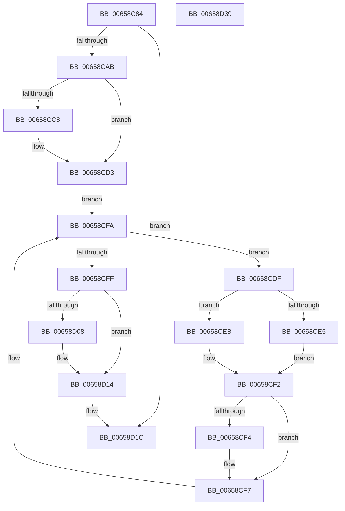

# ExpFastResourceLegacyIsAcquiredShared

- RVA: `0x00658C84`–`0x00658D3A` (길이 `182` bytes)
- VA: `0x0000000140658C84`
- 실행 섹션: `.text`
- PDB 이름 있음: `예`; PDB Function 태그: `아니요`
- unwind 정보 RVA: `0x0005E6B4`
- 디코드: `51`개 명령, `182/182` bytes 표시
- 미해석 바이트: `0` (있으면 어셈블리에 `.byte`로 보존)

> 이 문서는 커널 이미지의 기계어와 PDB 기호를 분석해 생성했습니다. 4번과 5번은 함수 원형과 자료형을 바이너리 사용 방식에서 추정한 C 해석이며 원본 소스 복구 결과는 아닙니다.

## 1. Dependencies

- 직접 호출 지점: **3**; 고유 호출 대상: **3**
- 직접 호출자로 확인된 함수: **1**
- RIP 상대 이미지 참조: **1**

### Outgoing calls
- `0x00658CA2` → [ExpIsFastResourceOwned](../3C/ExpIsFastResourceOwned_function_003CF550.md) (function, `0x003CF550`)
- `0x00658CCE` → [KiRaiseIrqlProcessIrqlFlags](../4F/KiRaiseIrqlProcessIrqlFlags_function_004F56FC.md) (function, `0x004F56FC`)
- `0x00658D0F` → [KiLowerIrqlProcessIrqlFlags](../4F/KiLowerIrqlProcessIrqlFlags_function_004F5698.md) (function, `0x004F5698`)

### Direct callers
- [sub_00341C85](../34/Unknown_function_00341C85.md) at `0x00341CC7`

### Static image references
- `0x00658CC0` → RVA `0x00FC6D20` (`ALMOSTRO`; read)

## 2. Other-region calls and transfers

- 다른 실행 섹션으로 향하는 call: **0**
- 별도 외부 분기/꼬리 이동을 확인하지 못했습니다.

## 3. Assembly (complete function range)

```asm
00658C84  48 8B C4                        mov rax, rsp
00658C87  48 89 58 08                     mov qword ptr [rax + 8], rbx
00658C8B  48 89 68 10                     mov qword ptr [rax + 0x10], rbp
00658C8F  48 89 70 18                     mov qword ptr [rax + 0x18], rsi
00658C93  48 89 78 20                     mov qword ptr [rax + 0x20], rdi
00658C97  41 56                           push r14
00658C99  48 83 EC 20                     sub rsp, 0x20
00658C9D  48 8B F1                        mov rsi, rcx
00658CA0  33 DB                           xor ebx, ebx
00658CA2  E8 A9 68 D7 FF                  call 0x1403cf550
00658CA7  84 C0                           test al, al
00658CA9  74 71                           je 0x140658d1c
00658CAB  65 48 8B 2C 25 88 01 00 00      mov rbp, qword ptr gs:[0x188]
00658CB4  44 0F 20 C7                     mov rdi, cr8
00658CB8  44 8D 73 02                     lea r14d, [rbx + 2]
00658CBC  45 0F 22 C6                     mov cr8, r14
00658CC0  39 1D 5A E0 96 00               cmp dword ptr [rip + 0x96e05a], ebx
00658CC6  74 0B                           je 0x140658cd3
00658CC8  41 8A D6                        mov dl, r14b
00658CCB  40 8A CF                        mov cl, dil
00658CCE  E8 29 CA E9 FF                  call 0x1404f56fc
00658CD3  48 8D 95 B8 06 00 00            lea rdx, [rbp + 0x6b8]
00658CDA  48 8B 0A                        mov rcx, qword ptr [rdx]
00658CDD  EB 1B                           jmp 0x140658cfa
00658CDF  44 84 71 25                     test byte ptr [rcx + 0x25], r14b
00658CE3  75 06                           jne 0x140658ceb
00658CE5  48 39 71 18                     cmp qword ptr [rcx + 0x18], rsi
00658CE9  EB 07                           jmp 0x140658cf2
00658CEB  48 8D 41 C0                     lea rax, [rcx - 0x40]
00658CEF  48 3B F0                        cmp rsi, rax
00658CF2  75 03                           jne 0x140658cf7
00658CF4  03 59 20                        add ebx, dword ptr [rcx + 0x20]
00658CF7  48 8B 09                        mov rcx, qword ptr [rcx]
00658CFA  48 3B CA                        cmp rcx, rdx
00658CFD  75 E0                           jne 0x140658cdf
00658CFF  83 3D 1A E0 96 00 00            cmp dword ptr [rip + 0x96e01a], 0
00658D06  74 0C                           je 0x140658d14
00658D08  44 0F 20 C1                     mov rcx, cr8
00658D0C  40 8A D7                        mov dl, dil
00658D0F  E8 84 C9 E9 FF                  call 0x1404f5698
00658D14  40 0F B6 CF                     movzx ecx, dil
00658D18  44 0F 22 C1                     mov cr8, rcx
00658D1C  48 8B 6C 24 38                  mov rbp, qword ptr [rsp + 0x38]
00658D21  8B C3                           mov eax, ebx
00658D23  48 8B 5C 24 30                  mov rbx, qword ptr [rsp + 0x30]
00658D28  48 8B 74 24 40                  mov rsi, qword ptr [rsp + 0x40]
00658D2D  48 8B 7C 24 48                  mov rdi, qword ptr [rsp + 0x48]
00658D32  48 83 C4 20                     add rsp, 0x20
00658D36  41 5E                           pop r14
00658D38  C3                              ret
00658D39  CC                              int3
```

## 4. C-style interpretation (structured pseudocode)

```c
__int64 __fastcall ExpFastResourceLegacyIsAcquiredShared(__int64 a1)
{
    __int64 result;
    __int64 v_rbx;
    __int64 v_rsp;
    unsigned __int64 v_stack_p10;
    unsigned __int64 v_stack_p18;
    unsigned __int64 v_stack_p20;
    unsigned __int64 v_stack_p8;

    *(unsigned __int64 *)(v_rsp + 8) = v_rbx;
    *(unsigned __int64 *)(v_rsp + 16) = v_rbp;
    *(unsigned __int64 *)(v_rsp + 24) = v_rsi;
    *(unsigned __int64 *)(v_rsp + 32) = v_rdi;
    v_rsp = (v_rsp) - (32);
    v_rbx = 0;
    result = ExpIsFastResourceOwned(a1, a2, a3, a4);
    if ((unsigned __int8)(result) == 0) goto loc_00658D1C;
    if ((*(unsigned int *)(v_rip + 9887834)) != 0) {
        a2 = (unsigned __int8)(v_rbx + 2);
        a1 = (unsigned __int8)(v_cr8);
        result = KiRaiseIrqlProcessIrqlFlags(a1, a2, a3, a4);
    }
    goto loc_00658CFA;
loc_00658CDF:
    if (((*(unsigned __int8 *)(*(unsigned __int64 *)(*(unsigned __int64 *)(gs_base + (0 + 392)) + 1720) + 37)) & ((unsigned __int8)(v_rbx + 2))) != 0) goto loc_00658CEB;
    goto loc_00658CF2;
loc_00658CEB:
loc_00658CF2:
    if (a1 == (*(unsigned __int64 *)(*(unsigned __int64 *)(gs_base + (0 + 392)) + 1720) - 64)) {
        v_rbx = (unsigned int)((v_rbx) + (*(unsigned int *)(*(unsigned __int64 *)(*(unsigned __int64 *)(gs_base + (0 + 392)) + 1720) + 32)));
    }
loc_00658CFA:
    if ((*(unsigned __int64 *)(*(unsigned __int64 *)(*(unsigned __int64 *)(gs_base + (0 + 392)) + 1720))) != (*(unsigned __int64 *)(gs_base + (0 + 392)) + 1720)) goto loc_00658CDF;
    result = *(unsigned __int64 *)(*(unsigned __int64 *)(gs_base + (0 + 392)) + 1720) - 64;
    if ((*(unsigned int *)(v_rip + 9887770)) != 0) {
        a1 = v_rbx + 2;
        a2 = (unsigned __int8)(v_cr8);
        result = KiLowerIrqlProcessIrqlFlags(a1, a2, a3, a4);
    }
loc_00658D1C:
    v_rsp = (v_rsp) + (32);
    return (unsigned int)((unsigned int)(v_rbx));
}
```

## 5. (Beta) C Style

```c
int64_t ExpFastResourceLegacyIsAcquiredShared(int64_t Arg1)
{
    int64_t result;
    int64_t local_rbx;
    int64_t local_rsp;
    uint64_t v_stack_p10;
    uint64_t v_stack_p18;
    uint64_t v_stack_p20;
    uint64_t v_stack_p8;

    *(uint64_t *)(local_rsp + 0x8) = local_rbx;
    *(uint64_t *)(local_rsp + 0x10) = local_rbp;
    *(uint64_t *)(local_rsp + 0x18) = local_rsi;
    *(uint64_t *)(local_rsp + 0x20) = local_rdi;
    local_rsp = (local_rsp) - (32);
    local_rbx = 0;
    result = ExpIsFastResourceOwned(Arg1, a2, a3, a4);
    if ((uint8_t)(result) == 0) goto loc_00658D1C;
    if ((*(uint32_t *)(v_rip + 0x96E05A)) != 0) {
        a2 = (uint8_t)(local_rbx + 2);
        Arg1 = (uint8_t)(v_cr8);
        result = KiRaiseIrqlProcessIrqlFlags(Arg1, a2, a3, a4);
    }
    goto loc_00658CFA;
loc_00658CDF:
    if (((*(uint8_t *)(*(uint64_t *)(*(uint64_t *)(gs_base + (0 + 0x188)) + 0x6B8) + 0x25)) & ((uint8_t)(local_rbx + 2))) != 0) goto loc_00658CEB;
    goto loc_00658CF2;
loc_00658CEB:
loc_00658CF2:
    if (Arg1 == (*(uint64_t *)(*(uint64_t *)(gs_base + (0 + 0x188)) + 0x6B8) - 64)) {
        local_rbx = (uint32_t)((local_rbx) + (*(uint32_t *)(*(uint64_t *)(*(uint64_t *)(gs_base + (0 + 0x188)) + 0x6B8) + 0x20)));
    }
loc_00658CFA:
    if ((*(uint64_t *)(*(uint64_t *)(*(uint64_t *)(gs_base + (0 + 0x188)) + 0x6B8))) != (*(uint64_t *)(gs_base + (0 + 0x188)) + 1720)) goto loc_00658CDF;
    result = *(uint64_t *)(*(uint64_t *)(gs_base + (0 + 0x188)) + 0x6B8) - 64;
    if ((*(uint32_t *)(v_rip + 0x96E01A)) != 0) {
        Arg1 = local_rbx + 2;
        a2 = (uint8_t)(v_cr8);
        result = KiLowerIrqlProcessIrqlFlags(Arg1, a2, a3, a4);
    }
loc_00658D1C:
    local_rsp = (local_rsp) + (32);
    return (uint32_t)((uint32_t)(local_rbx));
}
```

## 6. Execution-region graph

[열기: 2D/3D 그래프와 함수 탐색 컨트롤 패널](../../../control-panel.html?section=text&rva=0x00658C84&view=graph)

- 2D 그래프는 위에서 아래로 흐르고, 3D 그래프는 빈 공간을 드래그해 회전합니다. Shift+드래그는 이동, 휠은 확대·축소, 함수 노드 선택은 대상 보고서 이동입니다.

### Static fallback


