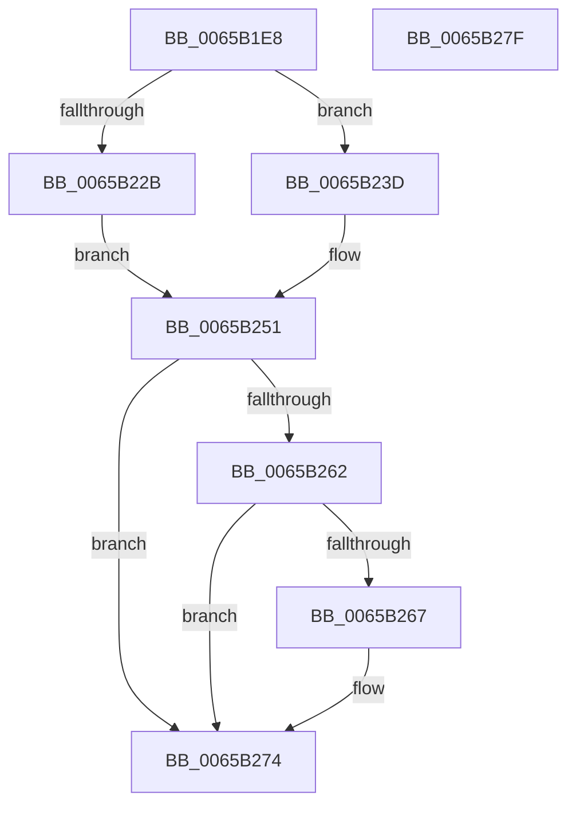

# ExpFreeAsid

- RVA: `0x0065B1E8`–`0x0065B280` (길이 `152` bytes)
- VA: `0x000000014065B1E8`
- 실행 섹션: `.text`
- PDB 이름 있음: `예`; PDB Function 태그: `아니요`
- unwind 정보 RVA: `0x00065960`
- 디코드: `40`개 명령, `152/152` bytes 표시
- 미해석 바이트: `0` (있으면 어셈블리에 `.byte`로 보존)

> 이 문서는 커널 이미지의 기계어와 PDB 기호를 분석해 생성했습니다. 4번과 5번은 함수 원형과 자료형을 바이너리 사용 방식에서 추정한 C 해석이며 원본 소스 복구 결과는 아닙니다.

## 1. Dependencies

- 직접 호출 지점: **3**; 고유 호출 대상: **3**
- 직접 호출자로 확인된 함수: **4**
- RIP 상대 이미지 참조: **2**

### Outgoing calls
- `0x0065B20B` → [ExpAcquireSvmAgentsLock](ExpAcquireSvmAgentsLock_function_0065AF0C.md) (function, `0x0065AF0C`)
- `0x0065B258` → [ExpReleaseSvmAgentsLock](ExpReleaseSvmAgentsLock_function_0065B4F0.md) (function, `0x0065B4F0`)
- `0x0065B26F` → [ObfDereferenceObjectWithTag](../2F/ObfDereferenceObjectWithTag_function_002F78E0.md) (function, `0x002F78E0`)

### Direct callers
- [IommupPasidDeviceDelete](../55/IommupPasidDeviceDelete_function_00550030.md) at `0x00550100`
- [ExFreeAsid](ExFreeAsid_function_0065ACB8.md) at `0x0065ACC0`
- [sub_006F7EE2](../6F/Unknown_function_006F7EE2.md) at `0x006F7FA4`
- [sub_006F7EE2](../6F/Unknown_function_006F7EE2.md) at `0x006F7FD1`
- [ExpAssignPasid](../../page/7D/ExpAssignPasid_function_007D0AB8.md) at `0x007D0ADE`

### Static image references
- `0x0065B210` → RVA `0x00EFA8D0` (`.data`; read)
- `0x0065B235` → RVA `0x00EFA8C8` (`.data`; read/write)

## 2. Other-region calls and transfers

- 다른 실행 섹션으로 향하는 call: **0**
- 별도 외부 분기/꼬리 이동을 확인하지 못했습니다.

## 3. Assembly (complete function range)

```asm
0065B1E8  48 89 5C 24 08                  mov qword ptr [rsp + 8], rbx
0065B1ED  57                              push rdi
0065B1EE  48 83 EC 40                     sub rsp, 0x40
0065B1F2  8B D9                           mov ebx, ecx
0065B1F4  0F 57 C0                        xorps xmm0, xmm0
0065B1F7  33 C0                           xor eax, eax
0065B1F9  48 8D 4C 24 20                  lea rcx, [rsp + 0x20]
0065B1FE  0F 11 44 24 20                  movups xmmword ptr [rsp + 0x20], xmm0
0065B203  48 89 44 24 30                  mov qword ptr [rsp + 0x30], rax
0065B208  48 8B FA                        mov rdi, rdx
0065B20B  E8 FC FC FF FF                  call 0x14065af0c
0065B210  4C 8B 0D B9 F6 89 00            mov r9, qword ptr [rip + 0x89f6b9]
0065B217  4C 8D 04 5B                     lea r8, [rbx + rbx*2]
0065B21B  4B 8B 4C C1 08                  mov rcx, qword ptr [r9 + r8*8 + 8]
0065B220  48 83 E9 01                     sub rcx, 1
0065B224  4B 89 4C C1 08                  mov qword ptr [r9 + r8*8 + 8], rcx
0065B229  75 12                           jne 0x14065b23d
0065B22B  4B 83 24 C1 00                  and qword ptr [r9 + r8*8], 0
0065B230  BB 01 00 00 00                  mov ebx, 1
0065B235  FF 0D 8D F6 89 00               dec dword ptr [rip + 0x89f68d]
0065B23B  EB 14                           jmp 0x14065b251
0065B23D  48 BA 00 00 00 00 00 00 00 80   movabs rdx, 0x8000000000000000
0065B247  48 0B CA                        or rcx, rdx
0065B24A  4B 89 4C C1 08                  mov qword ptr [r9 + r8*8 + 8], rcx
0065B24F  33 DB                           xor ebx, ebx
0065B251  8A D0                           mov dl, al
0065B253  48 8D 4C 24 20                  lea rcx, [rsp + 0x20]
0065B258  E8 93 02 00 00                  call 0x14065b4f0
0065B25D  83 FB 01                        cmp ebx, 1
0065B260  75 12                           jne 0x14065b274
0065B262  48 85 FF                        test rdi, rdi
0065B265  74 0D                           je 0x14065b274
0065B267  BA 44 66 6C 74                  mov edx, 0x746c6644
0065B26C  48 8B CF                        mov rcx, rdi
0065B26F  E8 6C C6 C9 FF                  call 0x1402f78e0
0065B274  48 8B 5C 24 50                  mov rbx, qword ptr [rsp + 0x50]
0065B279  48 83 C4 40                     add rsp, 0x40
0065B27D  5F                              pop rdi
0065B27E  C3                              ret
0065B27F  CC                              int3
```

## 4. C-style interpretation (structured pseudocode)

```c
__int64 __fastcall ExpFreeAsid(int a1, __int64 a2)
{
    __int64 result;
    __int64 v_rbx;
    __int64 v_rsp;
    unsigned __int64 v_stack_m18;
    unsigned __int64 v_stack_m28;
    unsigned __int64 v_stack_p8;

    v_stack_p8 = v_rbx;
    v_rsp = (v_rsp) - (64);
    result = 0;
    v_stack_m28 = v_xmm0;
    v_stack_m18 = 0;
    result = ExpAcquireSvmAgentsLock(v_stack_m28, a2, a3, a4);
    a1 = (*(unsigned __int64 *)(*(unsigned __int64 *)(v_rip + 9041593) + (unsigned int)(a1) + (unsigned int)(a1) * 2 * 8 + 8)) - (1);
    *(unsigned __int64 *)(*(unsigned __int64 *)(v_rip + 9041593) + (unsigned int)(a1) + (unsigned int)(a1) * 2 * 8 + 8) = a1;
    if (condition_is_not_equal) goto loc_0065B23D;
    goto loc_0065B251;
loc_0065B23D:
    a1 = (a1) | (a2);
    *(unsigned __int64 *)(*(unsigned __int64 *)(v_rip + 9041593) + (unsigned int)(a1) + (unsigned int)(a1) * 2 * 8 + 8) = a1;
    v_rbx = 0;
loc_0065B251:
    result = ExpReleaseSvmAgentsLock(v_stack_m28, (unsigned __int8)(result), (unsigned int)(a1) + (unsigned int)(a1) * 2, *(unsigned __int64 *)(v_rip + 9041593));
    if (0 != 1) goto loc_0065B274;
    if (a2 != 0) {
        a2 = 0x746C6644ULL;
        a1 = a2;
        result = ObfDereferenceObjectWithTag(a1, a2, (unsigned int)(a1) + (unsigned int)(a1) * 2, *(unsigned __int64 *)(v_rip + 9041593));
    }
    v_rsp = (v_rsp) + (64);
    return result;
}
```

## 5. (Beta) C Style

```c
int64_t ExpFreeAsid(void *Arg1, int64_t Arg2)
{
    uint8_t *arg1 = (uint8_t *)Arg1;

    int64_t result;
    int64_t local_rbx;
    int64_t local_rsp;
    uint64_t v_stack_m18;
    uint64_t v_stack_m28;
    uint64_t v_stack_p8;

    v_stack_p8 = local_rbx;
    local_rsp = (local_rsp) - (64);
    result = 0;
    v_stack_m28 = v_xmm0;
    v_stack_m18 = 0;
    result = ExpAcquireSvmAgentsLock(v_stack_m28, Arg2, a3, a4);
    Arg1 = (*(uint64_t *)(*(uint64_t *)(v_rip + 0x89F6B9) + (uint32_t)(arg1) + (uint32_t)(arg1) * 2 * 8 + 0x8)) - (1);
    *(void **)(*(uint64_t *)(v_rip + 0x89F6B9) + (uint32_t)(arg1) + (uint32_t)(arg1) * 2 * 8 + 0x8) = Arg1;
    if (condition_is_not_equal) goto loc_0065B23D;
    goto loc_0065B251;
loc_0065B23D:
    Arg1 = (Arg1) | (Arg2);
    *(void **)(*(uint64_t *)(v_rip + 0x89F6B9) + (uint32_t)(arg1) + (uint32_t)(arg1) * 2 * 8 + 0x8) = Arg1;
    local_rbx = 0;
loc_0065B251:
    result = ExpReleaseSvmAgentsLock(v_stack_m28, (uint8_t)(result), (uint32_t)(Arg1) + (uint32_t)(Arg1) * 2, *(uint64_t *)(v_rip + 0x89F6B9));
    if (0 != 1) goto loc_0065B274;
    if (Arg2 != 0) {
        Arg2 = 0x746C6644ULL;
        Arg1 = Arg2;
        result = ObfDereferenceObjectWithTag(Arg1, Arg2, (uint32_t)(Arg1) + (uint32_t)(Arg1) * 2, *(uint64_t *)(v_rip + 0x89F6B9));
    }
    local_rsp = (local_rsp) + (64);
    return result;
}
```

### 관측된 메모리 오프셋

구조체 형식이 확인되지 않은 접근은 인자 기준의 오프셋으로만 기록했습니다.

| 기준 인자 | 오프셋 표현 | 폭 (bit) | 접근 |
|---|---:|---:|---|
| `Arg1` | `+ 0x0 + rbx*2` | `64` | `R` |

## 6. Execution-region graph

[열기: 2D/3D 그래프와 함수 탐색 컨트롤 패널](../../../control-panel.html?section=text&rva=0x0065B1E8&view=graph)

- 2D 그래프는 위에서 아래로 흐르고, 3D 그래프는 빈 공간을 드래그해 회전합니다. Shift+드래그는 이동, 휠은 확대·축소, 함수 노드 선택은 대상 보고서 이동입니다.

### Static fallback


