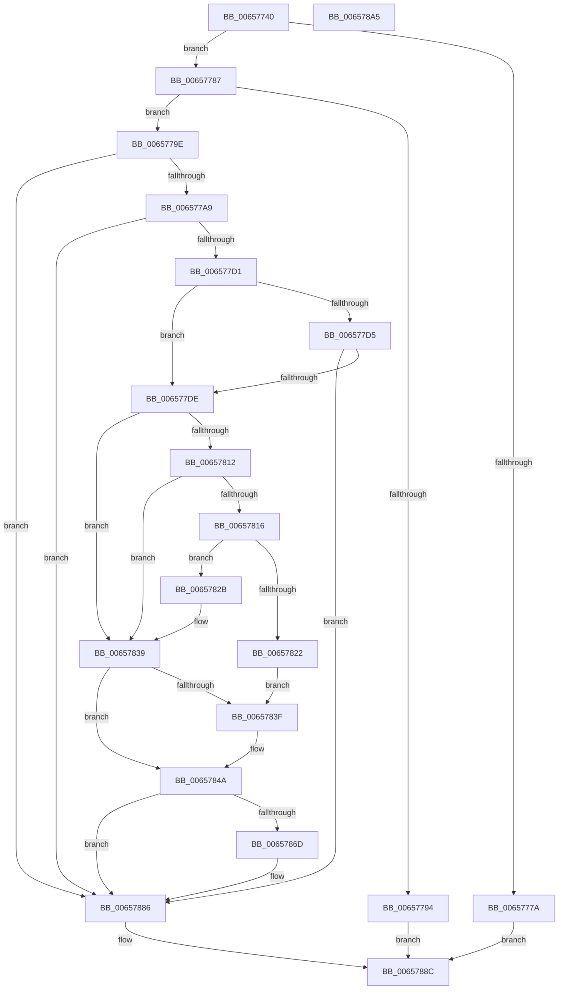

# ExpGetLicenseTamperState

- RVA: `0x00657740`–`0x006578A6` (길이 `358` bytes)
- VA: `0x0000000140657740`
- 실행 섹션: `.text`
- PDB 이름 있음: `예`; PDB Function 태그: `아니요`
- unwind 정보 RVA: `0x000AC428`
- 디코드: `97`개 명령, `358/358` bytes 표시
- 미해석 바이트: `0` (있으면 어셈블리에 `.byte`로 보존)

> 이 문서는 커널 이미지의 기계어와 PDB 기호를 분석해 생성했습니다. 4번과 5번은 함수 원형과 자료형을 바이너리 사용 방식에서 추정한 C 해석이며 원본 소스 복구 결과는 아닙니다.

## 1. Dependencies

- 직접 호출 지점: **4**; 고유 호출 대상: **3**
- 직접 호출자로 확인된 함수: **6**
- RIP 상대 이미지 참조: **0**

### Outgoing calls
- `0x0065778B` → [sub_00967060](../../page/96/Unknown_function_00967060.md) (function, `0x00967060`)
- `0x00657801` → [ExpLicUpdateChecksum](ExpLicUpdateChecksum_function_006578AC.md) (function, `0x006578AC`)
- `0x00657832` → [ExpLicUpdateChecksum](ExpLicUpdateChecksum_function_006578AC.md) (function, `0x006578AC`)
- `0x00657881` → [sub_00966DF0](../../page/96/Unknown_function_00966DF0.md) (function, `0x00966DF0`)

### Direct callers
- [ExGetLicenseTamperState](../../page/7C/ExGetLicenseTamperState_function_007C7A30.md) at `0x007C7AB9`
- [ExSetLicenseTamperState](../../page/7C/ExSetLicenseTamperState_function_007C7B60.md) at `0x007C7BF6`
- [sub_007C7FB0](../../page/7C/Unknown_function_007C7FB0.md) at `0x007C831E`
- [sub_007C8FB0](../../page/7C/Unknown_function_007C8FB0.md) at `0x007C8FD1`
- [sub_007C9030](../../page/7C/Unknown_function_007C9030.md) at `0x007C9051`
- [SLUpdateLicenseDataInternal](../../page/7C/SLUpdateLicenseDataInternal_function_007C9C04.md) at `0x007C9F24`
- [SLUpdateLicenseDataInternal](../../page/7C/SLUpdateLicenseDataInternal_function_007C9C04.md) at `0x007CA776`
- [SLUpdateLicenseDataInternal](../../page/7C/SLUpdateLicenseDataInternal_function_007C9C04.md) at `0x007CA7A7`
- [SLUpdateLicenseDataInternal](../../page/7C/SLUpdateLicenseDataInternal_function_007C9C04.md) at `0x007CAA37`

### Static image references
- 디코드된 RIP-relative 메모리 참조가 없습니다.

## 2. Other-region calls and transfers

- 다른 실행 섹션으로 향하는 call: **2**
  - `0x0065778B` → [sub_00967060](../../page/96/Unknown_function_00967060.md) (`.text` → `PAGE`)
  - `0x00657881` → [sub_00966DF0](../../page/96/Unknown_function_00966DF0.md) (`.text` → `PAGE`)
- 별도 외부 분기/꼬리 이동을 확인하지 못했습니다.

## 3. Assembly (complete function range)

```asm
00657740  48 89 5C 24 08                  mov qword ptr [rsp + 8], rbx
00657745  48 89 74 24 10                  mov qword ptr [rsp + 0x10], rsi
0065774A  48 89 7C 24 18                  mov qword ptr [rsp + 0x18], rdi
0065774F  55                              push rbp
00657750  48 8B EC                        mov rbp, rsp
00657753  48 81 EC 80 00 00 00            sub rsp, 0x80
0065775A  0F 57 C0                        xorps xmm0, xmm0
0065775D  33 F6                           xor esi, esi
0065775F  48 8B FA                        mov rdi, rdx
00657762  48 8B D9                        mov rbx, rcx
00657765  0F 11 45 D0                     movups xmmword ptr [rbp - 0x30], xmm0
00657769  0F 11 45 E0                     movups xmmword ptr [rbp - 0x20], xmm0
0065776D  0F 11 45 F0                     movups xmmword ptr [rbp - 0x10], xmm0
00657771  48 39 B1 F0 B6 00 00            cmp qword ptr [rcx + 0xb6f0], rsi
00657778  75 0D                           jne 0x140657787
0065777A  8B 81 8C B7 00 00               mov eax, dword ptr [rcx + 0xb78c]
00657780  89 02                           mov dword ptr [rdx], eax
00657782  E9 05 01 00 00                  jmp 0x14065788c
00657787  48 8D 55 D0                     lea rdx, [rbp - 0x30]
0065778B  E8 D0 F8 30 00                  call 0x140967060
00657790  85 C0                           test eax, eax
00657792  78 0A                           js 0x14065779e
00657794  8B 45 D8                        mov eax, dword ptr [rbp - 0x28]
00657797  89 07                           mov dword ptr [rdi], eax
00657799  E9 EE 00 00 00                  jmp 0x14065788c
0065779E  3D 25 02 00 C0                  cmp eax, 0xc0000225
006577A3  0F 85 DD 00 00 00               jne 0x140657886
006577A9  48 8B 8B F0 B6 00 00            mov rcx, qword ptr [rbx + 0xb6f0]
006577B0  4C 8D 4B 18                     lea r9, [rbx + 0x18]
006577B4  8B 93 E8 B6 00 00               mov edx, dword ptr [rbx + 0xb6e8]
006577BA  89 75 AC                        mov dword ptr [rbp - 0x54], esi
006577BD  89 75 C9                        mov dword ptr [rbp - 0x37], esi
006577C0  66 89 75 CD                     mov word ptr [rbp - 0x33], si
006577C4  40 88 75 CF                     mov byte ptr [rbp - 0x31], sil
006577C8  48 85 C9                        test rcx, rcx
006577CB  0F 84 B5 00 00 00               je 0x140657886
006577D1  85 D2                           test edx, edx
006577D3  74 09                           je 0x1406577de
006577D5  4D 85 C9                        test r9, r9
006577D8  0F 84 A8 00 00 00               je 0x140657886
006577DE  48 83 C1 14                     add rcx, 0x14
006577E2  48 89 75 A0                     mov qword ptr [rbp - 0x60], rsi
006577E6  4C 8D 45 A0                     lea r8, [rbp - 0x60]
006577EA  48 89 75 B0                     mov qword ptr [rbp - 0x50], rsi
006577EE  C7 45 A8 04 00 00 00            mov dword ptr [rbp - 0x58], 4
006577F5  48 89 75 B8                     mov qword ptr [rbp - 0x48], rsi
006577F9  48 89 75 C0                     mov qword ptr [rbp - 0x40], rsi
006577FD  C6 45 C8 01                     mov byte ptr [rbp - 0x38], 1
00657801  E8 A6 00 00 00                  call 0x1406578ac
00657806  8B C8                           mov ecx, eax
00657808  41 BA FF FF FF FF               mov r10d, 0xffffffff
0065780E  85 C0                           test eax, eax
00657810  75 27                           jne 0x140657839
00657812  85 D2                           test edx, edx
00657814  74 23                           je 0x140657839
00657816  48 8B C2                        mov rax, rdx
00657819  48 C1 E0 04                     shl rax, 4
0065781D  49 3B C2                        cmp rax, r10
00657820  76 09                           jbe 0x14065782b
00657822  B9 95 00 00 C0                  mov ecx, 0xc0000095
00657827  8B D1                           mov edx, ecx
00657829  EB 14                           jmp 0x14065783f
0065782B  4C 8D 45 A0                     lea r8, [rbp - 0x60]
0065782F  49 8B C9                        mov rcx, r9
00657832  E8 75 00 00 00                  call 0x1406578ac
00657837  8B C8                           mov ecx, eax
00657839  8B D1                           mov edx, ecx
0065783B  85 C9                           test ecx, ecx
0065783D  74 0B                           je 0x14065784a
0065783F  48 89 75 A0                     mov qword ptr [rbp - 0x60], rsi
00657843  C7 45 A8 04 00 00 00            mov dword ptr [rbp - 0x58], 4
0065784A  0F 10 45 A0                     movups xmm0, xmmword ptr [rbp - 0x60]
0065784E  85 C9                           test ecx, ecx
00657850  8B C6                           mov eax, esi
00657852  0F 10 4D B0                     movups xmm1, xmmword ptr [rbp - 0x50]
00657856  0F 44 C2                        cmove eax, edx
00657859  0F 11 45 D0                     movups xmmword ptr [rbp - 0x30], xmm0
0065785D  0F 10 45 C0                     movups xmm0, xmmword ptr [rbp - 0x40]
00657861  0F 11 4D E0                     movups xmmword ptr [rbp - 0x20], xmm1
00657865  0F 11 45 F0                     movups xmmword ptr [rbp - 0x10], xmm0
00657869  85 C0                           test eax, eax
0065786B  78 19                           js 0x140657886
0065786D  45 33 C9                        xor r9d, r9d
00657870  C7 45 D8 04 00 00 00            mov dword ptr [rbp - 0x28], 4
00657877  45 8B C2                        mov r8d, r10d
0065787A  48 8D 55 D0                     lea rdx, [rbp - 0x30]
0065787E  48 8B CB                        mov rcx, rbx
00657881  E8 6A F5 30 00                  call 0x140966df0
00657886  C7 07 04 00 00 00               mov dword ptr [rdi], 4
0065788C  4C 8D 9C 24 80 00 00 00         lea r11, [rsp + 0x80]
00657894  49 8B 5B 10                     mov rbx, qword ptr [r11 + 0x10]
00657898  49 8B 73 18                     mov rsi, qword ptr [r11 + 0x18]
0065789C  49 8B 7B 20                     mov rdi, qword ptr [r11 + 0x20]
006578A0  49 8B E3                        mov rsp, r11
006578A3  5D                              pop rbp
006578A4  C3                              ret
006578A5  CC                              int3
```

## 4. C-style interpretation (structured pseudocode)

```c
__int64 __fastcall ExpGetLicenseTamperState(__int64 a1, __int64 a2)
{
    __int64 result;
    __int64 v_rsi;
    __int64 v_rsp;
    unsigned __int64 v_stack_m18;
    unsigned __int64 v_stack_m28;
    unsigned int v_stack_m30;
    unsigned __int64 v_stack_m38;
    unsigned __int8 v_stack_m39;
    unsigned __int16 v_stack_m3B;
    unsigned int v_stack_m3F;
    unsigned __int8 v_stack_m40;
    unsigned __int64 v_stack_m48;
    unsigned __int64 v_stack_m50;
    unsigned __int64 v_stack_m58;
    unsigned int v_stack_m5C;
    unsigned int v_stack_m60;
    unsigned __int64 v_stack_m68;
    unsigned __int64 v_stack_m8;
    unsigned __int64 v_stack_p10;
    unsigned __int64 v_stack_p18;
    unsigned __int64 v_stack_p8;

    v_stack_p8 = v_rbx;
    v_stack_p10 = v_rsi;
    v_stack_p18 = v_rdi;
    v_rsp = (v_rsp) - (128);
    v_rsi = 0;
    v_stack_m38 = v_xmm0;
    v_stack_m28 = v_xmm0;
    v_stack_m18 = v_xmm0;
    if ((*(unsigned __int64 *)(a1 + 46832)) != 0) goto loc_00657787;
    *(unsigned int *)(a2) = (unsigned int)((unsigned int)(*(unsigned int *)(a1 + 46988)));
    goto loc_0065788C;
loc_00657787:
    result = sub_00967060(a1, v_stack_m38, a3, a4);
    if (sign_flag) goto loc_0065779E;
    *(unsigned int *)(a2) = (unsigned int)((unsigned int)(v_stack_m30));
    goto loc_0065788C;
loc_0065779E:
    if (((unsigned int)((unsigned int)(v_stack_m30))) != 0xC0000225ULL) goto loc_00657886;
    v_stack_m5C = 0;
    v_stack_m3F = 0;
    v_stack_m3B = 0;
    v_stack_m39 = 0;
    if (*(unsigned __int64 *)(a1 + 46832) == 0) goto loc_00657886;
    if ((unsigned int)((unsigned int)(*(unsigned int *)(a1 + 46824))) == 0) goto loc_006577DE;
    if (a1 + 24 == 0) goto loc_00657886;
loc_006577DE:
    a1 = (*(unsigned __int64 *)(a1 + 46832)) + (20);
    v_stack_m68 = 0;
    v_stack_m58 = 0;
    v_stack_m60 = 4;
    v_stack_m50 = 0;
    v_stack_m48 = 0;
    v_stack_m40 = 1;
    result = ExpLicUpdateChecksum(a1, (unsigned int)(*(unsigned int *)(a1 + 46824)), v_stack_m68, a1 + 24);
    if ((unsigned int)(result) != 0) goto loc_00657839;
    if ((unsigned int)((unsigned int)(*(unsigned int *)(a1 + 46824))) == 0) goto loc_00657839;
    result = ((unsigned int)(*(unsigned int *)(a1 + 46824))) << (4);
    if (result <= ((unsigned int)(0xFFFFFFFFULL))) goto loc_0065782B;
    goto loc_0065783F;
loc_0065782B:
    result = ExpLicUpdateChecksum(a1 + 24, (unsigned int)((unsigned int)((unsigned int)(0xC0000095ULL))), v_stack_m68, a1 + 24);
loc_00657839:
    if ((unsigned int)((unsigned int)((unsigned int)(result))) != 0) {
        v_stack_m68 = 0;
        v_stack_m60 = 4;
    }
    result = 0;
    if ((unsigned int)((unsigned int)((unsigned int)(result))) == 0) { result = (unsigned int)((unsigned int)((unsigned int)((unsigned int)((unsigned int)(result))))); }
    v_stack_m38 = v_xmm0;
    v_stack_m28 = v_xmm1;
    v_stack_m18 = v_xmm0;
    if (!(sign_flag)) {
        a4 = 0;
        v_stack_m30 = 4;
        a3 = (unsigned int)((unsigned int)(0xFFFFFFFFULL));
        a2 = v_stack_m38;
        a1 = a1;
        result = sub_00966DF0(a1, a2, a3, a4);
    }
    *(unsigned int *)(a2) = 4;
loc_0065788C:
    return result;
}
```

## 5. (Beta) C Style

```c
int64_t ExpGetLicenseTamperState(void *Arg1, void *Arg2)
{
    uint8_t *arg1 = (uint8_t *)Arg1;
    uint8_t *arg2 = (uint8_t *)Arg2;

    int64_t result;
    int64_t local_rsi;
    int64_t local_rsp;
    uint64_t v_stack_m18;
    uint64_t v_stack_m28;
    uint32_t v_stack_m30;
    uint64_t v_stack_m38;
    uint8_t v_stack_m39;
    uint16_t v_stack_m3B;
    uint32_t v_stack_m3F;
    uint8_t v_stack_m40;
    uint64_t v_stack_m48;
    uint64_t v_stack_m50;
    uint64_t v_stack_m58;
    uint32_t v_stack_m5C;
    uint32_t v_stack_m60;
    uint64_t v_stack_m68;
    uint64_t v_stack_m8;
    uint64_t v_stack_p10;
    uint64_t v_stack_p18;
    uint64_t v_stack_p8;

    v_stack_p8 = local_rbx;
    v_stack_p10 = local_rsi;
    v_stack_p18 = local_rdi;
    local_rsp = (local_rsp) - (128);
    local_rsi = 0;
    v_stack_m38 = v_xmm0;
    v_stack_m28 = v_xmm0;
    v_stack_m18 = v_xmm0;
    if ((*(uint64_t *)(arg1 + 0xB6F0)) != 0) goto loc_00657787;
    *(uint32_t *)(arg2) = (uint32_t)((uint32_t)(*(uint32_t *)(arg1 + 0xB78C)));
    goto loc_0065788C;
loc_00657787:
    result = sub_00967060(Arg1, v_stack_m38, a3, a4);
    if (sign_flag) goto loc_0065779E;
    *(uint32_t *)(arg2) = (uint32_t)((uint32_t)(v_stack_m30));
    goto loc_0065788C;
loc_0065779E:
    if (((uint32_t)((uint32_t)(v_stack_m30))) != 0xC0000225ULL) goto loc_00657886;
    v_stack_m5C = 0;
    v_stack_m3F = 0;
    v_stack_m3B = 0;
    v_stack_m39 = 0;
    if (*(uint64_t *)(arg1 + 0xB6F0) == 0) goto loc_00657886;
    if ((uint32_t)((uint32_t)(*(uint32_t *)(arg1 + 0xB6E8))) == 0) goto loc_006577DE;
    if (Arg1 + 24 == 0) goto loc_00657886;
loc_006577DE:
    Arg1 = (*(uint64_t *)(arg1 + 0xB6F0)) + (20);
    v_stack_m68 = 0;
    v_stack_m58 = 0;
    v_stack_m60 = 4;
    v_stack_m50 = 0;
    v_stack_m48 = 0;
    v_stack_m40 = 1;
    result = ExpLicUpdateChecksum(Arg1, (uint32_t)(*(uint32_t *)(arg1 + 0xB6E8)), v_stack_m68, Arg1 + 24);
    if ((uint32_t)(result) != 0) goto loc_00657839;
    if ((uint32_t)((uint32_t)(*(uint32_t *)(arg1 + 0xB6E8))) == 0) goto loc_00657839;
    result = ((uint32_t)(*(uint32_t *)(arg1 + 0xB6E8))) << (4);
    if (result <= ((uint32_t)(0xFFFFFFFFULL))) goto loc_0065782B;
    goto loc_0065783F;
loc_0065782B:
    result = ExpLicUpdateChecksum(Arg1 + 24, (uint32_t)((uint32_t)((uint32_t)(0xC0000095ULL))), v_stack_m68, Arg1 + 24);
loc_00657839:
    if ((uint32_t)((uint32_t)((uint32_t)(result))) != 0) {
        v_stack_m68 = 0;
        v_stack_m60 = 4;
    }
    result = 0;
    if ((uint32_t)((uint32_t)((uint32_t)(result))) == 0) { result = (uint32_t)((uint32_t)((uint32_t)((uint32_t)((uint32_t)(result))))); }
    v_stack_m38 = v_xmm0;
    v_stack_m28 = v_xmm1;
    v_stack_m18 = v_xmm0;
    if (!(sign_flag)) {
        a4 = 0;
        v_stack_m30 = 4;
        a3 = (uint32_t)((uint32_t)(0xFFFFFFFFULL));
        Arg2 = v_stack_m38;
        Arg1 = Arg1;
        result = sub_00966DF0(Arg1, Arg2, a3, a4);
    }
    *(uint32_t *)(arg2) = 4;
loc_0065788C:
    return result;
}
```

### 관측된 메모리 오프셋

구조체 형식이 확인되지 않은 접근은 인자 기준의 오프셋으로만 기록했습니다.

| 기준 인자 | 오프셋 표현 | 폭 (bit) | 접근 |
|---|---:|---:|---|
| `Arg1` | `+ 0x18` | `64` | `R` |
| `Arg1` | `+ 0xB6E8` | `32` | `R` |
| `Arg1` | `+ 0xB6F0` | `64` | `R` |
| `Arg1` | `+ 0xB78C` | `32` | `R` |
| `Arg2` | `+ 0x0` | `32` | `W` |

## 6. Execution-region graph

[열기: 2D/3D 그래프와 함수 탐색 컨트롤 패널](../../../control-panel.html?section=text&rva=0x00657740&view=graph)

- 2D 그래프는 위에서 아래로 흐르고, 3D 그래프는 빈 공간을 드래그해 회전합니다. Shift+드래그는 이동, 휠은 확대·축소, 함수 노드 선택은 대상 보고서 이동입니다.

### Static fallback


