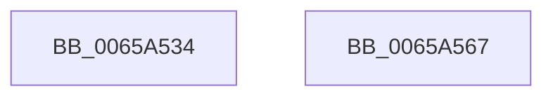

# ExpGetNodeSubQueueConcurrencyCount

- RVA: `0x0065A534`–`0x0065A568` (길이 `52` bytes)
- VA: `0x000000014065A534`
- 실행 섹션: `.text`
- PDB 이름 있음: `예`; PDB Function 태그: `아니요`
- unwind 정보 RVA: `0x0005CAAC`
- 디코드: `18`개 명령, `52/52` bytes 표시
- 미해석 바이트: `0` (있으면 어셈블리에 `.byte`로 보존)

> 이 문서는 커널 이미지의 기계어와 PDB 기호를 분석해 생성했습니다. 4번과 5번은 함수 원형과 자료형을 바이너리 사용 방식에서 추정한 C 해석이며 원본 소스 복구 결과는 아닙니다.

## 1. Dependencies

- 직접 호출 지점: **1**; 고유 호출 대상: **1**
- 직접 호출자로 확인된 함수: **2**
- RIP 상대 이미지 참조: **0**

### Outgoing calls
- `0x0065A546` → [KeQueryNodeActiveProcessorCount](../5B/KeQueryNodeActiveProcessorCount_function_005BBDF0.md) (function, `0x005BBDF0`)

### Direct callers
- [ExpWorkQueueInitialize](../../page/7D/ExpWorkQueueInitialize_function_007D004C.md) at `0x007D008A`
- [ExpWorkQueueManagerThread](../../page/AF/ExpWorkQueueManagerThread_function_00AF6D60.md) at `0x00AF7273`

### Static image references
- 디코드된 RIP-relative 메모리 참조가 없습니다.

## 2. Other-region calls and transfers

- 다른 실행 섹션으로 향하는 call: **0**
- 별도 외부 분기/꼬리 이동을 확인하지 못했습니다.

## 3. Assembly (complete function range)

```asm
0065A534  48 89 5C 24 08                  mov qword ptr [rsp + 8], rbx
0065A539  57                              push rdi
0065A53A  48 83 EC 20                     sub rsp, 0x20
0065A53E  48 8B D9                        mov rbx, rcx
0065A541  8B FA                           mov edi, edx
0065A543  0F B7 09                        movzx ecx, word ptr [rcx]
0065A546  E8 A5 18 F6 FF                  call 0x1405bbdf0
0065A54B  33 D2                           xor edx, edx
0065A54D  F7 B3 58 03 00 00               div dword ptr [rbx + 0x358]
0065A553  48 8B 5C 24 30                  mov rbx, qword ptr [rsp + 0x30]
0065A558  8B C8                           mov ecx, eax
0065A55A  FF C0                           inc eax
0065A55C  3B FA                           cmp edi, edx
0065A55E  0F 43 C1                        cmovae eax, ecx
0065A561  48 83 C4 20                     add rsp, 0x20
0065A565  5F                              pop rdi
0065A566  C3                              ret
0065A567  CC                              int3
```

## 4. C-style interpretation (structured pseudocode)

```c
__int64 __fastcall ExpGetNodeSubQueueConcurrencyCount(__int64 a1, int a2)
{
    __int64 result;
    __int64 v_rsp;
    unsigned __int64 v_stack_p8;

    v_stack_p8 = v_rbx;
    v_rsp = (v_rsp) - (32);
    result = KeQueryNodeActiveProcessorCount(*(unsigned __int16 *)(a1), a2, a3, a4);
    a2 = 0;
    result = (unsigned int)((result) + 1);
    if (((unsigned int)((unsigned int)(a2))) >= 0) { result = (unsigned int)((unsigned int)((unsigned int)(result))); }
    v_rsp = (v_rsp) + (32);
    return result;
}
```

## 5. (Beta) C Style

```c
int64_t ExpGetNodeSubQueueConcurrencyCount(void *Arg1, int32_t Arg2)
{
    uint8_t *arg1 = (uint8_t *)Arg1;

    int64_t result;
    int64_t local_rsp;
    uint64_t v_stack_p8;

    v_stack_p8 = local_rbx;
    local_rsp = (local_rsp) - (32);
    result = KeQueryNodeActiveProcessorCount(*(uint16_t *)(arg1), Arg2, a3, a4);
    Arg2 = 0;
    result = (uint32_t)((result) + 1);
    if (((uint32_t)((uint32_t)(Arg2))) >= 0) { result = (uint32_t)((uint32_t)((uint32_t)(result))); }
    local_rsp = (local_rsp) + (32);
    return result;
}
```

### 관측된 메모리 오프셋

구조체 형식이 확인되지 않은 접근은 인자 기준의 오프셋으로만 기록했습니다.

| 기준 인자 | 오프셋 표현 | 폭 (bit) | 접근 |
|---|---:|---:|---|
| `Arg1` | `+ 0x0` | `16` | `R` |
| `Arg1` | `+ 0x358` | `32` | `R` |

## 6. Execution-region graph

[열기: 2D/3D 그래프와 함수 탐색 컨트롤 패널](../../../control-panel.html?section=text&rva=0x0065A534&view=graph)

- 2D 그래프는 위에서 아래로 흐르고, 3D 그래프는 빈 공간을 드래그해 회전합니다. Shift+드래그는 이동, 휠은 확대·축소, 함수 노드 선택은 대상 보고서 이동입니다.

### Static fallback


