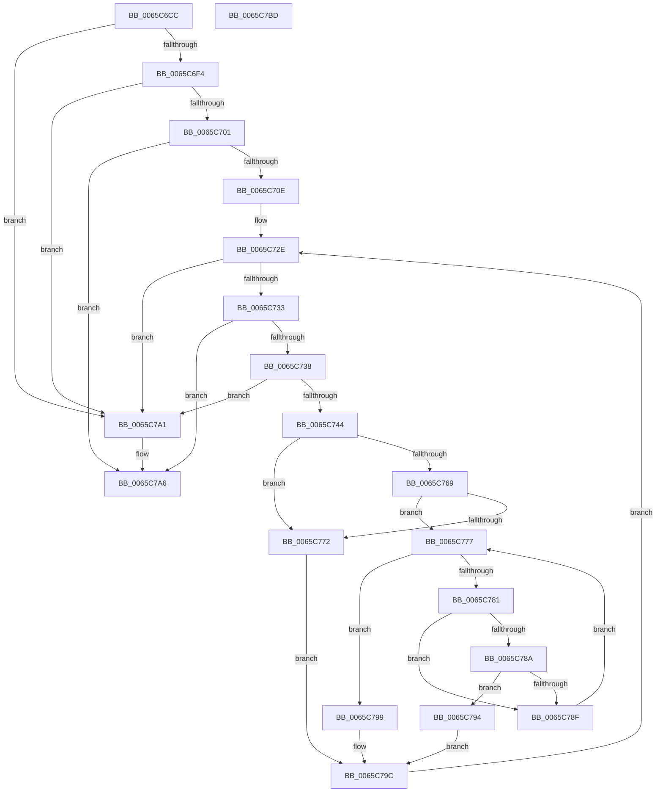

# ExpHeapDumpEnumLargeAllocs

- RVA: `0x0065C6CC`–`0x0065C7BE` (길이 `242` bytes)
- VA: `0x000000014065C6CC`
- 실행 섹션: `.text`
- PDB 이름 있음: `예`; PDB Function 태그: `아니요`
- unwind 정보 RVA: `0x0005C954`
- 디코드: `72`개 명령, `242/242` bytes 표시
- 미해석 바이트: `0` (있으면 어셈블리에 `.byte`로 보존)

> 이 문서는 커널 이미지의 기계어와 PDB 기호를 분석해 생성했습니다. 4번과 5번은 함수 원형과 자료형을 바이너리 사용 방식에서 추정한 C 해석이며 원본 소스 복구 결과는 아닙니다.

## 1. Dependencies

- 직접 호출 지점: **3**; 고유 호출 대상: **3**
- 직접 호출자로 확인된 함수: **1**
- RIP 상대 이미지 참조: **0**

### Outgoing calls
- `0x0065C6E5` → [MmIsAddressValidEx](../27/MmIsAddressValidEx_function_0027FDD0.md) (function, `0x0027FDD0`)
- `0x0065C73B` → [ExpHeapDumpNodeLinksValid](ExpHeapDumpNodeLinksValid_function_0065C7C4.md) (function, `0x0065C7C4`)
- `0x0065C75C` → [IopRemoveLargeAllocsFromPartialDump](../5A/IopRemoveLargeAllocsFromPartialDump_function_005A2480.md) (function, `0x005A2480`)

### Direct callers
- [IoAddPagesForPartialKernelDump](../5A/IoAddPagesForPartialKernelDump_function_005A0F3C.md) at `0x005A0FC7`

### Static image references
- 디코드된 RIP-relative 메모리 참조가 없습니다.

## 2. Other-region calls and transfers

- 다른 실행 섹션으로 향하는 call: **0**
- 별도 외부 분기/꼬리 이동을 확인하지 못했습니다.

## 3. Assembly (complete function range)

```asm
0065C6CC  48 89 5C 24 08                  mov qword ptr [rsp + 8], rbx
0065C6D1  48 89 6C 24 10                  mov qword ptr [rsp + 0x10], rbp
0065C6D6  48 89 74 24 18                  mov qword ptr [rsp + 0x18], rsi
0065C6DB  57                              push rdi
0065C6DC  48 83 EC 20                     sub rsp, 0x20
0065C6E0  33 D2                           xor edx, edx
0065C6E2  48 8B F9                        mov rdi, rcx
0065C6E5  E8 E6 36 C2 FF                  call 0x14027fdd0
0065C6EA  33 DB                           xor ebx, ebx
0065C6EC  84 C0                           test al, al
0065C6EE  0F 84 AD 00 00 00               je 0x14065c7a1
0065C6F4  81 7F 10 EE DD EE DD            cmp dword ptr [rdi + 0x10], 0xddeeddee
0065C6FB  0F 85 A0 00 00 00               jne 0x14065c7a1
0065C701  48 8B 47 60                     mov rax, qword ptr [rdi + 0x60]
0065C705  48 85 C0                        test rax, rax
0065C708  0F 84 98 00 00 00               je 0x14065c7a6
0065C70E  48 8B 47 60                     mov rax, qword ptr [rdi + 0x60]
0065C712  33 D2                           xor edx, edx
0065C714  44 8B 87 10 02 00 00            mov r8d, dword ptr [rdi + 0x210]
0065C71B  8B F3                           mov esi, ebx
0065C71D  48 8B 7F 48                     mov rdi, qword ptr [rdi + 0x48]
0065C721  41 FF C0                        inc r8d
0065C724  48 C1 E0 0C                     shl rax, 0xc
0065C728  49 F7 F0                        div r8
0065C72B  48 8B E8                        mov rbp, rax
0065C72E  48 3B F5                        cmp rsi, rbp
0065C731  77 6E                           ja 0x14065c7a1
0065C733  48 85 FF                        test rdi, rdi
0065C736  74 6E                           je 0x14065c7a6
0065C738  48 8B CF                        mov rcx, rdi
0065C73B  E8 84 00 00 00                  call 0x14065c7c4
0065C740  85 C0                           test eax, eax
0065C742  74 5D                           je 0x14065c7a1
0065C744  48 8B 4F 18                     mov rcx, qword ptr [rdi + 0x18]
0065C748  48 8B 57 20                     mov rdx, qword ptr [rdi + 0x20]
0065C74C  0F B7 C1                        movzx eax, cx
0065C74F  48 81 E2 00 F0 FF FF            and rdx, 0xfffffffffffff000
0065C756  48 2B D0                        sub rdx, rax
0065C759  48 2B C8                        sub rcx, rax
0065C75C  E8 1F 5D F4 FF                  call 0x1405a2480
0065C761  48 8B 07                        mov rax, qword ptr [rdi]
0065C764  48 85 C0                        test rax, rax
0065C767  75 09                           jne 0x14065c772
0065C769  48 8B 47 08                     mov rax, qword ptr [rdi + 8]
0065C76D  48 85 C0                        test rax, rax
0065C770  74 05                           je 0x14065c777
0065C772  48 8B F8                        mov rdi, rax
0065C775  EB 25                           jmp 0x14065c79c
0065C777  48 8B 47 10                     mov rax, qword ptr [rdi + 0x10]
0065C77B  48 83 E0 FC                     and rax, 0xfffffffffffffffc
0065C77F  74 18                           je 0x14065c799
0065C781  48 8B 48 08                     mov rcx, qword ptr [rax + 8]
0065C785  48 85 C9                        test rcx, rcx
0065C788  74 05                           je 0x14065c78f
0065C78A  48 3B F9                        cmp rdi, rcx
0065C78D  75 05                           jne 0x14065c794
0065C78F  48 8B F8                        mov rdi, rax
0065C792  EB E3                           jmp 0x14065c777
0065C794  48 8B F9                        mov rdi, rcx
0065C797  EB 03                           jmp 0x14065c79c
0065C799  48 8B FB                        mov rdi, rbx
0065C79C  48 FF C6                        inc rsi
0065C79F  EB 8D                           jmp 0x14065c72e
0065C7A1  BB 74 03 00 C0                  mov ebx, 0xc0000374
0065C7A6  48 8B 6C 24 38                  mov rbp, qword ptr [rsp + 0x38]
0065C7AB  8B C3                           mov eax, ebx
0065C7AD  48 8B 5C 24 30                  mov rbx, qword ptr [rsp + 0x30]
0065C7B2  48 8B 74 24 40                  mov rsi, qword ptr [rsp + 0x40]
0065C7B7  48 83 C4 20                     add rsp, 0x20
0065C7BB  5F                              pop rdi
0065C7BC  C3                              ret
0065C7BD  CC                              int3
```

## 4. C-style interpretation (structured pseudocode)

```c
__int64 __fastcall ExpHeapDumpEnumLargeAllocs(__int64 a1, int a2)
{
    __int64 result;
    __int64 v_rbx;
    __int64 v_rsi;
    __int64 v_rsp;
    unsigned __int64 v_stack_p10;
    unsigned __int64 v_stack_p18;
    unsigned __int64 v_stack_p8;

    v_stack_p8 = v_rbx;
    v_stack_p10 = v_rbp;
    v_stack_p18 = v_rsi;
    v_rsp = (v_rsp) - (32);
    a2 = 0;
    result = MmIsAddressValidEx(a1, a2, a3, a4);
    v_rbx = 0;
    if ((unsigned __int8)(result) == 0) goto loc_0065C7A1;
    if ((*(unsigned int *)(a1 + 16)) != 0xDDEEDDEEULL) goto loc_0065C7A1;
    if (*(unsigned __int64 *)(a1 + 96) == 0) goto loc_0065C7A6;
    a2 = 0;
    a3 = (unsigned int)(((unsigned int)(*(unsigned int *)(a1 + 528))) + 1);
    result = (*(unsigned __int64 *)(a1 + 96)) << (12);
loc_0065C72E:
    if (0 > result) goto loc_0065C7A1;
    if (*(unsigned __int64 *)(a1 + 72) == 0) goto loc_0065C7A6;
    result = ExpHeapDumpNodeLinksValid(*(unsigned __int64 *)(a1 + 72), a2, a3, a4);
    if ((unsigned int)(result) == 0) goto loc_0065C7A1;
    a2 = (*(unsigned __int64 *)(*(unsigned __int64 *)(a1 + 72) + 32)) & (0xFFFFFFFFFFFFF000ULL);
    a2 = (a2) - ((unsigned __int16)(*(unsigned __int64 *)(*(unsigned __int64 *)(a1 + 72) + 24)));
    a1 = (*(unsigned __int64 *)(*(unsigned __int64 *)(a1 + 72) + 24)) - ((unsigned __int16)(*(unsigned __int64 *)(*(unsigned __int64 *)(a1 + 72) + 24)));
    result = IopRemoveLargeAllocsFromPartialDump(a1, a2, a3, a4);
    if (*(unsigned __int64 *)(*(unsigned __int64 *)(a1 + 72)) != 0) goto loc_0065C772;
    if (*(unsigned __int64 *)(*(unsigned __int64 *)(a1 + 72) + 8) == 0) goto loc_0065C777;
loc_0065C772:
    goto loc_0065C79C;
loc_0065C777:
    result = (*(unsigned __int64 *)(*(unsigned __int64 *)(*(unsigned __int64 *)(a1 + 72) + 8) + 16)) & (-4);
    if (condition_is_equal) goto loc_0065C799;
    if (*(unsigned __int64 *)(result + 8) == 0) goto loc_0065C78F;
    if ((*(unsigned __int64 *)(*(unsigned __int64 *)(a1 + 72) + 8)) != (*(unsigned __int64 *)(result + 8))) goto loc_0065C794;
loc_0065C78F:
    goto loc_0065C777;
loc_0065C794:
    goto loc_0065C79C;
loc_0065C799:
loc_0065C79C:
    v_rsi = (0) + 1;
    goto loc_0065C72E;
loc_0065C7A1:
loc_0065C7A6:
    v_rsp = (v_rsp) + (32);
    return (unsigned int)((unsigned int)((unsigned int)(0xC0000374ULL)));
}
```

## 5. (Beta) C Style

```c
int64_t ExpHeapDumpEnumLargeAllocs(void *Arg1, int32_t Arg2)
{
    uint8_t *arg1 = (uint8_t *)Arg1;

    int64_t result;
    int64_t local_rbx;
    int64_t local_rsi;
    int64_t local_rsp;
    uint64_t v_stack_p10;
    uint64_t v_stack_p18;
    uint64_t v_stack_p8;

    v_stack_p8 = local_rbx;
    v_stack_p10 = local_rbp;
    v_stack_p18 = local_rsi;
    local_rsp = (local_rsp) - (32);
    Arg2 = 0;
    result = MmIsAddressValidEx(Arg1, Arg2, a3, a4);
    local_rbx = 0;
    if ((uint8_t)(result) == 0) goto loc_0065C7A1;
    if ((*(uint32_t *)(arg1 + 0x10)) != 0xDDEEDDEEULL) goto loc_0065C7A1;
    if (*(uint64_t *)(arg1 + 0x60) == 0) goto loc_0065C7A6;
    Arg2 = 0;
    a3 = (uint32_t)(((uint32_t)(*(uint32_t *)(arg1 + 0x210))) + 1);
    result = (*(uint64_t *)(arg1 + 0x60)) << (12);
loc_0065C72E:
    if (0 > result) goto loc_0065C7A1;
    if (*(uint64_t *)(arg1 + 0x48) == 0) goto loc_0065C7A6;
    result = ExpHeapDumpNodeLinksValid(*(uint64_t *)(arg1 + 0x48), Arg2, a3, a4);
    if ((uint32_t)(result) == 0) goto loc_0065C7A1;
    Arg2 = (*(uint64_t *)(*(uint64_t *)(arg1 + 0x48) + 0x20)) & (0xFFFFFFFFFFFFF000ULL);
    Arg2 = (Arg2) - ((uint16_t)(*(uint64_t *)(*(uint64_t *)(arg1 + 0x48) + 0x18)));
    Arg1 = (*(uint64_t *)(*(uint64_t *)(arg1 + 0x48) + 0x18)) - ((uint16_t)(*(uint64_t *)(*(uint64_t *)(arg1 + 0x48) + 0x18)));
    result = IopRemoveLargeAllocsFromPartialDump(Arg1, Arg2, a3, a4);
    if (*(uint64_t *)(*(uint64_t *)(arg1 + 0x48)) != 0) goto loc_0065C772;
    if (*(uint64_t *)(*(uint64_t *)(arg1 + 0x48) + 0x8) == 0) goto loc_0065C777;
loc_0065C772:
    goto loc_0065C79C;
loc_0065C777:
    result = (*(uint64_t *)(*(uint64_t *)(*(uint64_t *)(arg1 + 0x48) + 0x8) + 0x10)) & (-4);
    if (condition_is_equal) goto loc_0065C799;
    if (*(uint64_t *)(result + 0x8) == 0) goto loc_0065C78F;
    if ((*(uint64_t *)(*(uint64_t *)(arg1 + 0x48) + 0x8)) != (*(uint64_t *)(result + 0x8))) goto loc_0065C794;
loc_0065C78F:
    goto loc_0065C777;
loc_0065C794:
    goto loc_0065C79C;
loc_0065C799:
loc_0065C79C:
    local_rsi = (0) + 1;
    goto loc_0065C72E;
loc_0065C7A1:
loc_0065C7A6:
    local_rsp = (local_rsp) + (32);
    return (uint32_t)((uint32_t)((uint32_t)(0xC0000374ULL)));
}
```

### 관측된 메모리 오프셋

구조체 형식이 확인되지 않은 접근은 인자 기준의 오프셋으로만 기록했습니다.

| 기준 인자 | 오프셋 표현 | 폭 (bit) | 접근 |
|---|---:|---:|---|
| `Arg1` | `+ 0x10` | `32` | `R` |
| `Arg1` | `+ 0x48` | `64` | `R` |
| `Arg1` | `+ 0x60` | `64` | `R` |
| `Arg1` | `+ 0x210` | `32` | `R` |

## 6. Execution-region graph

[열기: 2D/3D 그래프와 함수 탐색 컨트롤 패널](../../../control-panel.html?section=text&rva=0x0065C6CC&view=graph)

- 2D 그래프는 위에서 아래로 흐르고, 3D 그래프는 빈 공간을 드래그해 회전합니다. Shift+드래그는 이동, 휠은 확대·축소, 함수 노드 선택은 대상 보고서 이동입니다.

### Static fallback


