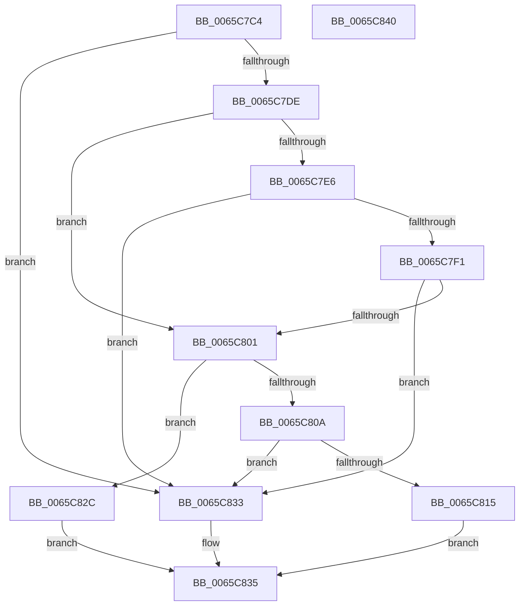

# ExpHeapDumpNodeLinksValid

- RVA: `0x0065C7C4`–`0x0065C841` (길이 `125` bytes)
- VA: `0x000000014065C7C4`
- 실행 섹션: `.text`
- PDB 이름 있음: `예`; PDB Function 태그: `아니요`
- unwind 정보 RVA: `0x0005CAAC`
- 디코드: `43`개 명령, `125/125` bytes 표시
- 미해석 바이트: `0` (있으면 어셈블리에 `.byte`로 보존)

> 이 문서는 커널 이미지의 기계어와 PDB 기호를 분석해 생성했습니다. 4번과 5번은 함수 원형과 자료형을 바이너리 사용 방식에서 추정한 C 해석이며 원본 소스 복구 결과는 아닙니다.

## 1. Dependencies

- 직접 호출 지점: **3**; 고유 호출 대상: **1**
- 직접 호출자로 확인된 함수: **1**
- RIP 상대 이미지 참조: **0**

### Outgoing calls
- `0x0065C7D3` → [MmIsAddressValidEx](../27/MmIsAddressValidEx_function_0027FDD0.md) (function, `0x0027FDD0`)
- `0x0065C7E8` → [MmIsAddressValidEx](../27/MmIsAddressValidEx_function_0027FDD0.md) (function, `0x0027FDD0`)
- `0x0065C80C` → [MmIsAddressValidEx](../27/MmIsAddressValidEx_function_0027FDD0.md) (function, `0x0027FDD0`)

### Direct callers
- [ExpHeapDumpEnumLargeAllocs](ExpHeapDumpEnumLargeAllocs_function_0065C6CC.md) at `0x0065C73B`

### Static image references
- 디코드된 RIP-relative 메모리 참조가 없습니다.

## 2. Other-region calls and transfers

- 다른 실행 섹션으로 향하는 call: **0**
- 별도 외부 분기/꼬리 이동을 확인하지 못했습니다.

## 3. Assembly (complete function range)

```asm
0065C7C4  48 89 5C 24 08                  mov qword ptr [rsp + 8], rbx
0065C7C9  57                              push rdi
0065C7CA  48 83 EC 20                     sub rsp, 0x20
0065C7CE  33 D2                           xor edx, edx
0065C7D0  48 8B D9                        mov rbx, rcx
0065C7D3  E8 F8 35 C2 FF                  call 0x14027fdd0
0065C7D8  33 FF                           xor edi, edi
0065C7DA  84 C0                           test al, al
0065C7DC  74 55                           je 0x14065c833
0065C7DE  48 8B 0B                        mov rcx, qword ptr [rbx]
0065C7E1  48 85 C9                        test rcx, rcx
0065C7E4  74 1B                           je 0x14065c801
0065C7E6  33 D2                           xor edx, edx
0065C7E8  E8 E3 35 C2 FF                  call 0x14027fdd0
0065C7ED  84 C0                           test al, al
0065C7EF  74 42                           je 0x14065c833
0065C7F1  48 8B 03                        mov rax, qword ptr [rbx]
0065C7F4  48 8B 48 10                     mov rcx, qword ptr [rax + 0x10]
0065C7F8  48 83 E1 FC                     and rcx, 0xfffffffffffffffc
0065C7FC  48 3B CB                        cmp rcx, rbx
0065C7FF  75 32                           jne 0x14065c833
0065C801  48 8B 4B 08                     mov rcx, qword ptr [rbx + 8]
0065C805  48 85 C9                        test rcx, rcx
0065C808  74 22                           je 0x14065c82c
0065C80A  33 D2                           xor edx, edx
0065C80C  E8 BF 35 C2 FF                  call 0x14027fdd0
0065C811  84 C0                           test al, al
0065C813  74 1E                           je 0x14065c833
0065C815  48 8B 4B 08                     mov rcx, qword ptr [rbx + 8]
0065C819  48 8B 51 10                     mov rdx, qword ptr [rcx + 0x10]
0065C81D  48 83 E2 FC                     and rdx, 0xfffffffffffffffc
0065C821  48 3B D3                        cmp rdx, rbx
0065C824  40 0F 94 C7                     sete dil
0065C828  8B C7                           mov eax, edi
0065C82A  EB 09                           jmp 0x14065c835
0065C82C  B8 01 00 00 00                  mov eax, 1
0065C831  EB 02                           jmp 0x14065c835
0065C833  33 C0                           xor eax, eax
0065C835  48 8B 5C 24 30                  mov rbx, qword ptr [rsp + 0x30]
0065C83A  48 83 C4 20                     add rsp, 0x20
0065C83E  5F                              pop rdi
0065C83F  C3                              ret
0065C840  CC                              int3
```

## 4. C-style interpretation (structured pseudocode)

```c
__int64 __fastcall ExpHeapDumpNodeLinksValid(__int64 a1, int a2)
{
    __int64 result;
    __int64 v_rdi;
    __int64 v_rsp;
    unsigned __int64 v_stack_p8;

    v_stack_p8 = v_rbx;
    v_rsp = (v_rsp) - (32);
    a2 = 0;
    result = MmIsAddressValidEx(a1, a2, a3, a4);
    v_rdi = 0;
    if ((unsigned __int8)(result) == 0) goto loc_0065C833;
    if (*(unsigned __int64 *)(a1) == 0) goto loc_0065C801;
    a2 = 0;
    result = MmIsAddressValidEx(*(unsigned __int64 *)(a1), a2, a3, a4);
    if ((unsigned __int8)(result) == 0) goto loc_0065C833;
    a1 = (*(unsigned __int64 *)(*(unsigned __int64 *)(a1) + 16)) & (-4);
    if (a1 != a1) goto loc_0065C833;
loc_0065C801:
    if (*(unsigned __int64 *)(a1 + 8) == 0) goto loc_0065C82C;
    a2 = 0;
    result = MmIsAddressValidEx(*(unsigned __int64 *)(a1 + 8), a2, a3, a4);
    if ((unsigned __int8)(result) == 0) goto loc_0065C833;
    a2 = (*(unsigned __int64 *)(*(unsigned __int64 *)(a1 + 8) + 16)) & (-4);
    v_rdi = (a2 == a1) ? 1 : 0;
    goto loc_0065C835;
loc_0065C82C:
    goto loc_0065C835;
loc_0065C833:
    result = 0;
loc_0065C835:
    v_rsp = (v_rsp) + (32);
    return result;
}
```

## 5. (Beta) C Style

```c
int64_t ExpHeapDumpNodeLinksValid(void *Arg1, int32_t Arg2)
{
    uint8_t *arg1 = (uint8_t *)Arg1;

    int64_t result;
    int64_t local_rdi;
    int64_t local_rsp;
    uint64_t v_stack_p8;

    v_stack_p8 = local_rbx;
    local_rsp = (local_rsp) - (32);
    Arg2 = 0;
    result = MmIsAddressValidEx(Arg1, Arg2, a3, a4);
    local_rdi = 0;
    if ((uint8_t)(result) == 0) goto loc_0065C833;
    if (*(uint64_t *)(arg1) == 0) goto loc_0065C801;
    Arg2 = 0;
    result = MmIsAddressValidEx(*(uint64_t *)(arg1), Arg2, a3, a4);
    if ((uint8_t)(result) == 0) goto loc_0065C833;
    Arg1 = (*(uint64_t *)(*(uint64_t *)(arg1) + 0x10)) & (-4);
    if (Arg1 != Arg1) goto loc_0065C833;
loc_0065C801:
    if (*(uint64_t *)(arg1 + 0x8) == 0) goto loc_0065C82C;
    Arg2 = 0;
    result = MmIsAddressValidEx(*(uint64_t *)(arg1 + 0x8), Arg2, a3, a4);
    if ((uint8_t)(result) == 0) goto loc_0065C833;
    Arg2 = (*(uint64_t *)(*(uint64_t *)(arg1 + 0x8) + 0x10)) & (-4);
    local_rdi = (Arg2 == Arg1) ? 1 : 0;
    goto loc_0065C835;
loc_0065C82C:
    goto loc_0065C835;
loc_0065C833:
    result = 0;
loc_0065C835:
    local_rsp = (local_rsp) + (32);
    return result;
}
```

### 관측된 메모리 오프셋

구조체 형식이 확인되지 않은 접근은 인자 기준의 오프셋으로만 기록했습니다.

| 기준 인자 | 오프셋 표현 | 폭 (bit) | 접근 |
|---|---:|---:|---|
| `Arg1` | `+ 0x0` | `64` | `R` |
| `Arg1` | `+ 0x8` | `64` | `R` |

## 6. Execution-region graph

[열기: 2D/3D 그래프와 함수 탐색 컨트롤 패널](../../../control-panel.html?section=text&rva=0x0065C7C4&view=graph)

- 2D 그래프는 위에서 아래로 흐르고, 3D 그래프는 빈 공간을 드래그해 회전합니다. Shift+드래그는 이동, 휠은 확대·축소, 함수 노드 선택은 대상 보고서 이동입니다.

### Static fallback


