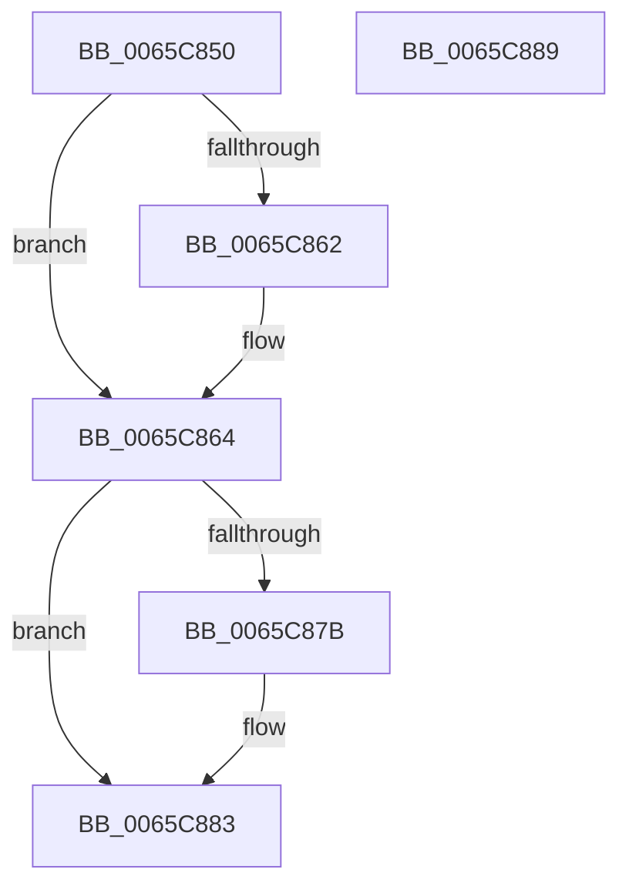

# ExpHeapInitLfhStartCallback

- RVA: `0x0065C850`–`0x0065C88A` (길이 `58` bytes)
- VA: `0x000000014065C850`
- 실행 섹션: `.text`
- PDB 이름 있음: `예`; PDB Function 태그: `아니요`
- unwind 정보 RVA: `0x0005CF00`
- 디코드: `16`개 명령, `58/58` bytes 표시
- 미해석 바이트: `0` (있으면 어셈블리에 `.byte`로 보존)

> 이 문서는 커널 이미지의 기계어와 PDB 기호를 분석해 생성했습니다. 4번과 5번은 함수 원형과 자료형을 바이너리 사용 방식에서 추정한 C 해석이며 원본 소스 복구 결과는 아닙니다.

## 1. Dependencies

- 직접 호출 지점: **1**; 고유 호출 대상: **1**
- 직접 호출자로 확인된 함수: **0**
- RIP 상대 이미지 참조: **1**

### Outgoing calls
- `0x0065C872` → [RtlpHpLfhContextEnable](../60/RtlpHpLfhContextEnable_function_0060484C.md) (function, `0x0060484C`)

### Direct callers
- 이 함수 시작 RVA로 연결되는 직접 call은 확인되지 않았습니다. 간접 호출은 완전히 역산할 수 없습니다.

### Static image references
- `0x0065C86B` → RVA `0x00E6BED8` (`.data`; read)

## 2. Other-region calls and transfers

- 다른 실행 섹션으로 향하는 call: **0**
- 별도 외부 분기/꼬리 이동을 확인하지 못했습니다.

## 3. Assembly (complete function range)

```asm
0065C850  40 53                           push rbx
0065C852  48 83 EC 20                     sub rsp, 0x20
0065C856  F7 41 14 00 00 40 00            test dword ptr [rcx + 0x14], 0x400000
0065C85D  48 8B D9                        mov rbx, rcx
0065C860  75 02                           jne 0x14065c864
0065C862  CD 2C                           int 0x2c
0065C864  48 81 C1 40 03 00 00            add rcx, 0x340
0065C86B  48 8D 15 66 F6 80 00            lea rdx, [rip + 0x80f666]
0065C872  E8 D5 7F FA FF                  call 0x14060484c
0065C877  85 C0                           test eax, eax
0065C879  78 08                           js 0x14065c883
0065C87B  F0 81 63 14 FF FF BF FF         lock and dword ptr [rbx + 0x14], 0xffbfffff
0065C883  48 83 C4 20                     add rsp, 0x20
0065C887  5B                              pop rbx
0065C888  C3                              ret
0065C889  CC                              int3
```

## 4. C-style interpretation (structured pseudocode)

```c
__int64 __fastcall ExpHeapInitLfhStartCallback(__int64 a1)
{
    __int64 result;
    __int64 v_rsp;

    v_rsp = (v_rsp) - (32);
    if (((*(unsigned int *)(a1 + 20)) & (0x400000ULL)) == 0) {
    }
    a1 = (a1) + (832);
    result = RtlpHpLfhContextEnable(a1, v_rip + 8451686, a3, a4);
    if (!(sign_flag)) {
    }
    v_rsp = (v_rsp) + (32);
    return result;
}
```

## 5. (Beta) C Style

```c
int64_t ExpHeapInitLfhStartCallback(void *Arg1)
{
    uint8_t *arg1 = (uint8_t *)Arg1;

    int64_t result;
    int64_t local_rsp;

    local_rsp = (local_rsp) - (32);
    if (((*(uint32_t *)(arg1 + 0x14)) & (0x400000ULL)) == 0) {
    }
    Arg1 = (Arg1) + (832);
    result = RtlpHpLfhContextEnable(Arg1, v_rip + 8451686, a3, a4);
    if (!(sign_flag)) {
    }
    local_rsp = (local_rsp) + (32);
    return result;
}
```

### 관측된 메모리 오프셋

구조체 형식이 확인되지 않은 접근은 인자 기준의 오프셋으로만 기록했습니다.

| 기준 인자 | 오프셋 표현 | 폭 (bit) | 접근 |
|---|---:|---:|---|
| `Arg1` | `+ 0x14` | `32` | `R` |
| `Arg1` | `+ 0x14` | `32` | `R/W` |

## 6. Execution-region graph

[열기: 2D/3D 그래프와 함수 탐색 컨트롤 패널](../../../control-panel.html?section=text&rva=0x0065C850&view=graph)

- 2D 그래프는 위에서 아래로 흐르고, 3D 그래프는 빈 공간을 드래그해 회전합니다. Shift+드래그는 이동, 휠은 확대·축소, 함수 노드 선택은 대상 보고서 이동입니다.

### Static fallback


