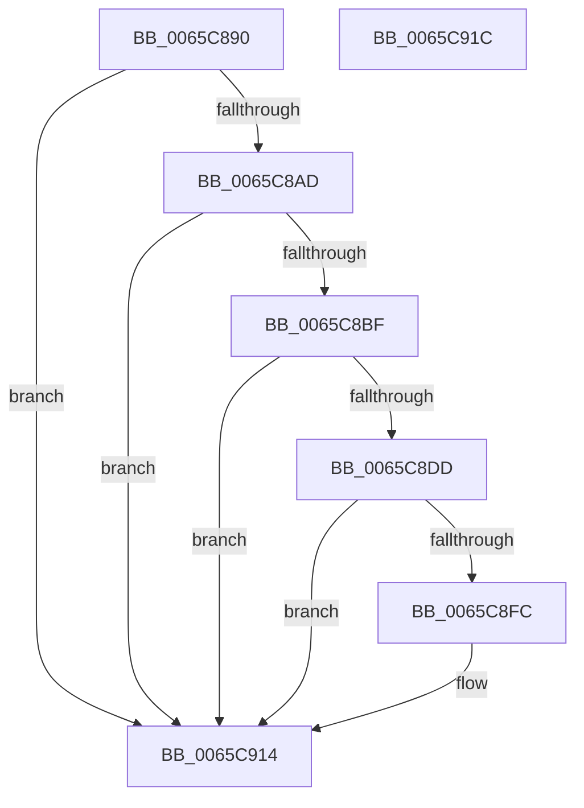

# ExpHeapInitPhase1

- RVA: `0x0065C890`–`0x0065C91D` (길이 `141` bytes)
- VA: `0x000000014065C890`
- 실행 섹션: `.text`
- PDB 이름 있음: `예`; PDB Function 태그: `아니요`
- unwind 정보 RVA: `0x0005CF00`
- 디코드: `36`개 명령, `141/141` bytes 표시
- 미해석 바이트: `0` (있으면 어셈블리에 `.byte`로 보존)

> 이 문서는 커널 이미지의 기계어와 PDB 기호를 분석해 생성했습니다. 4번과 5번은 함수 원형과 자료형을 바이너리 사용 방식에서 추정한 C 해석이며 원본 소스 복구 결과는 아닙니다.

## 1. Dependencies

- 직접 호출 지점: **4**; 고유 호출 대상: **2**
- 직접 호출자로 확인된 함수: **1**
- RIP 상대 이미지 참조: **7**

### Outgoing calls
- `0x0065C8A2` → [ExpHpEnumerateHeaps](../49/ExpHpEnumerateHeaps_function_00491194.md) (function, `0x00491194`)
- `0x0065C8B6` → [ExpHpEnumerateHeaps](../49/ExpHpEnumerateHeaps_function_00491194.md) (function, `0x00491194`)
- `0x0065C8CC` → [ExAllocateTimer](../3A/ExAllocateTimer_function_003A30D0.md) (function, `0x003A30D0`)
- `0x0065C8EB` → [ExAllocateTimer](../3A/ExAllocateTimer_function_003A30D0.md) (function, `0x003A30D0`)

### Direct callers
- [ExpInitSystemPhase1](../../init/C5/ExpInitSystemPhase1_function_00C51508.md) at `0x00C51601`

### Static image references
- `0x0065C896` → RVA `0x0065C850` (`ExpHeapInitLfhStartCallback`; read)
- `0x0065C8C5` → RVA `0x003A3040` (`ExpHpGCTimerCallback`; read)
- `0x0065C8D1` → RVA `0x00EFA828` (`.data`; write)
- `0x0065C8F0` → RVA `0x00EFA820` (`.data`; write)
- `0x0065C8FC` → RVA `0x00EFA7BC` (`.data`; write)
- `0x0065C902` → RVA `0x00EFA7C0` (`.data`; write)
- `0x0065C908` → RVA `0x00EFA830` (`.data`; write)

## 2. Other-region calls and transfers

- 다른 실행 섹션으로 향하는 call: **0**
- 별도 외부 분기/꼬리 이동을 확인하지 못했습니다.

## 3. Assembly (complete function range)

```asm
0065C890  40 53                           push rbx
0065C892  48 83 EC 20                     sub rsp, 0x20
0065C896  48 8D 15 B3 FF FF FF            lea rdx, [rip - 0x4d]
0065C89D  B9 01 00 00 00                  mov ecx, 1
0065C8A2  E8 ED 48 E3 FF                  call 0x140491194
0065C8A7  33 DB                           xor ebx, ebx
0065C8A9  85 C0                           test eax, eax
0065C8AB  78 67                           js 0x14065c914
0065C8AD  48 8D 15 9C FF FF FF            lea rdx, [rip - 0x64]
0065C8B4  33 C9                           xor ecx, ecx
0065C8B6  E8 D9 48 E3 FF                  call 0x140491194
0065C8BB  85 C0                           test eax, eax
0065C8BD  78 55                           js 0x14065c914
0065C8BF  33 D2                           xor edx, edx
0065C8C1  44 8D 43 08                     lea r8d, [rbx + 8]
0065C8C5  48 8D 0D 74 67 D4 FF            lea rcx, [rip - 0x2b988c]
0065C8CC  E8 FF 67 D4 FF                  call 0x1403a30d0
0065C8D1  48 89 05 50 DF 89 00            mov qword ptr [rip + 0x89df50], rax
0065C8D8  48 85 C0                        test rax, rax
0065C8DB  74 37                           je 0x14065c914
0065C8DD  8D 53 01                        lea edx, [rbx + 1]
0065C8E0  44 8D 43 08                     lea r8d, [rbx + 8]
0065C8E4  48 8D 0D 55 67 D4 FF            lea rcx, [rip - 0x2b98ab]
0065C8EB  E8 E0 67 D4 FF                  call 0x1403a30d0
0065C8F0  48 89 05 29 DF 89 00            mov qword ptr [rip + 0x89df29], rax
0065C8F7  48 85 C0                        test rax, rax
0065C8FA  74 18                           je 0x14065c914
0065C8FC  89 1D BA DE 89 00               mov dword ptr [rip + 0x89deba], ebx
0065C902  89 1D B8 DE 89 00               mov dword ptr [rip + 0x89deb8], ebx
0065C908  C7 05 1E DF 89 00 01 00 00 00   mov dword ptr [rip + 0x89df1e], 1
0065C912  B3 01                           mov bl, 1
0065C914  8A C3                           mov al, bl
0065C916  48 83 C4 20                     add rsp, 0x20
0065C91A  5B                              pop rbx
0065C91B  C3                              ret
0065C91C  CC                              int3
```

## 4. C-style interpretation (structured pseudocode)

```c
__int64 __fastcall ExpHeapInitPhase1(void)
{
    __int64 result;
    __int64 v_rbx;
    __int64 v_rsp;

    v_rsp = (v_rsp) - (32);
    result = ExpHpEnumerateHeaps(1, v_rip - 77, a3, a4);
    v_rbx = 0;
    if (sign_flag) goto loc_0065C914;
    a1 = 0;
    result = ExpHpEnumerateHeaps(a1, v_rip - 100, a3, a4);
    if (sign_flag) goto loc_0065C914;
    a2 = 0;
    result = ExAllocateTimer(v_rip - 2857100, a2, v_rbx + 8, a4);
    *(unsigned __int64 *)(v_rip + 9035600) = result;
    if (result == 0) goto loc_0065C914;
    result = ExAllocateTimer(v_rip - 2857131, v_rbx + 1, v_rbx + 8, a4);
    *(unsigned __int64 *)(v_rip + 9035561) = result;
    if (result != 0) {
        *(unsigned int *)(v_rip + 9035450) = 0;
        *(unsigned int *)(v_rip + 9035448) = 0;
        *(unsigned int *)(v_rip + 9035550) = 1;
        v_rbx = 1;
    }
    v_rsp = (v_rsp) + (32);
    return (unsigned __int8)(v_rbx);
}
```

## 5. (Beta) C Style

```c
void ExpHeapInitPhase1(void)
{
    int64_t result;
    int64_t local_rbx;
    int64_t local_rsp;

    local_rsp = (local_rsp) - (32);
    result = ExpHpEnumerateHeaps(1, v_rip - 77, a3, a4);
    local_rbx = 0;
    if (sign_flag) goto loc_0065C914;
    a1 = 0;
    result = ExpHpEnumerateHeaps(a1, v_rip - 100, a3, a4);
    if (sign_flag) goto loc_0065C914;
    a2 = 0;
    result = ExAllocateTimer(v_rip - 2857100, a2, local_rbx + 8, a4);
    *(uint64_t *)(v_rip + 0x89DF50) = result;
    if (result == 0) goto loc_0065C914;
    result = ExAllocateTimer(v_rip - 2857131, local_rbx + 1, local_rbx + 8, a4);
    *(uint64_t *)(v_rip + 0x89DF29) = result;
    if (result != 0) {
        *(uint32_t *)(v_rip + 0x89DEBA) = 0;
        *(uint32_t *)(v_rip + 0x89DEB8) = 0;
        *(uint32_t *)(v_rip + 0x89DF1E) = 1;
        local_rbx = 1;
    }
    local_rsp = (local_rsp) + (32);
    return (uint8_t)(local_rbx);
}
```

## 6. Execution-region graph

[열기: 2D/3D 그래프와 함수 탐색 컨트롤 패널](../../../control-panel.html?section=text&rva=0x0065C890&view=graph)

- 2D 그래프는 위에서 아래로 흐르고, 3D 그래프는 빈 공간을 드래그해 회전합니다. Shift+드래그는 이동, 휠은 확대·축소, 함수 노드 선택은 대상 보고서 이동입니다.

### Static fallback


