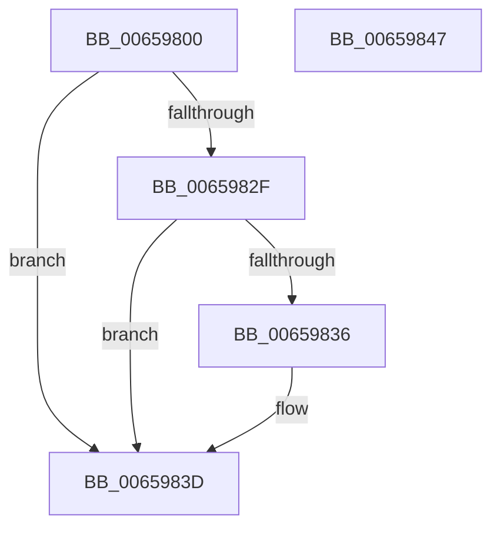

# ExpInitExpCheckTestSigningInfo

- RVA: `0x00659800`–`0x00659848` (길이 `72` bytes)
- VA: `0x0000000140659800`
- 실행 섹션: `.text`
- PDB 이름 있음: `예`; PDB Function 태그: `아니요`
- unwind 정보 RVA: `0x00097934`
- 디코드: `20`개 명령, `72/72` bytes 표시
- 미해석 바이트: `0` (있으면 어셈블리에 `.byte`로 보존)

> 이 문서는 커널 이미지의 기계어와 PDB 기호를 분석해 생성했습니다. 4번과 5번은 함수 원형과 자료형을 바이너리 사용 방식에서 추정한 C 해석이며 원본 소스 복구 결과는 아닙니다.

## 1. Dependencies

- 직접 호출 지점: **1**; 고유 호출 대상: **1**
- 직접 호출자로 확인된 함수: **0**
- RIP 상대 이미지 참조: **1**

### Outgoing calls
- `0x00659826` → [ZwQuerySystemInformation](../6A/ZwQuerySystemInformation_function_006AD790.md) (function, `0x006AD790`)

### Direct callers
- 이 함수 시작 RVA로 연결되는 직접 call은 확인되지 않았습니다. 간접 호출은 완전히 역산할 수 없습니다.

### Static image references
- `0x00659836` → RVA `0x00EFAB78` (`.data`; write)

## 2. Other-region calls and transfers

- 다른 실행 섹션으로 향하는 call: **0**
- 별도 외부 분기/꼬리 이동을 확인하지 못했습니다.

## 3. Assembly (complete function range)

```asm
00659800  48 8B C4                        mov rax, rsp
00659803  48 83 EC 38                     sub rsp, 0x38
00659807  48 83 60 E8 00                  and qword ptr [rax - 0x18], 0
0065980C  4C 8D 48 20                     lea r9, [rax + 0x20]
00659810  83 60 20 00                     and dword ptr [rax + 0x20], 0
00659814  48 8D 50 E8                     lea rdx, [rax - 0x18]
00659818  41 B8 08 00 00 00               mov r8d, 8
0065981E  44 89 40 E8                     mov dword ptr [rax - 0x18], r8d
00659822  41 8D 48 5F                     lea ecx, [r8 + 0x5f]
00659826  E8 65 3F 05 00                  call 0x1406ad790
0065982B  85 C0                           test eax, eax
0065982D  78 0E                           js 0x14065983d
0065982F  F6 44 24 24 02                  test byte ptr [rsp + 0x24], 2
00659834  74 07                           je 0x14065983d
00659836  C6 05 3B 13 8A 00 01            mov byte ptr [rip + 0x8a133b], 1
0065983D  F7 D0                           not eax
0065983F  C1 E8 1F                        shr eax, 0x1f
00659842  48 83 C4 38                     add rsp, 0x38
00659846  C3                              ret
00659847  CC                              int3
```

## 4. C-style interpretation (structured pseudocode)

```c
__int64 __fastcall ExpInitExpCheckTestSigningInfo(void)
{
    __int64 result;
    __int64 v_rsp;
    unsigned __int8 v_stack_m14;

    v_rsp = (v_rsp) - (56);
    *(unsigned int *)(v_rsp - 24) = 8;
    result = ZwQuerySystemInformation(8 + 95, v_rsp - 24, 8, v_rsp + 32);
    if (sign_flag) goto loc_0065983D;
    if (((v_stack_m14) & (2)) != 0) {
        *(unsigned __int8 *)(v_rip + 9048891) = 1;
    }
    result = (unsigned int)(~(result));
    result = (unsigned int)((result) >> (31));
    v_rsp = (v_rsp) + (56);
    return result;
}
```

## 5. (Beta) C Style

```c
void ExpInitExpCheckTestSigningInfo(void)
{
    int64_t result;
    int64_t local_rsp;
    uint8_t v_stack_m14;

    local_rsp = (local_rsp) - (56);
    *(uint32_t *)(local_rsp - 0x18) = 8;
    result = ZwQuerySystemInformation(8 + 95, local_rsp - 24, 8, local_rsp + 32);
    if (sign_flag) goto loc_0065983D;
    if (((v_stack_m14) & (2)) != 0) {
        *(uint8_t *)(v_rip + 0x8A133B) = 1;
    }
    result = (uint32_t)(~(result));
    result = (uint32_t)((result) >> (31));
    local_rsp = (local_rsp) + (56);
    return result;
}
```

## 6. Execution-region graph

[열기: 2D/3D 그래프와 함수 탐색 컨트롤 패널](../../../control-panel.html?section=text&rva=0x00659800&view=graph)

- 2D 그래프는 위에서 아래로 흐르고, 3D 그래프는 빈 공간을 드래그해 회전합니다. Shift+드래그는 이동, 휠은 확대·축소, 함수 노드 선택은 대상 보고서 이동입니다.

### Static fallback


