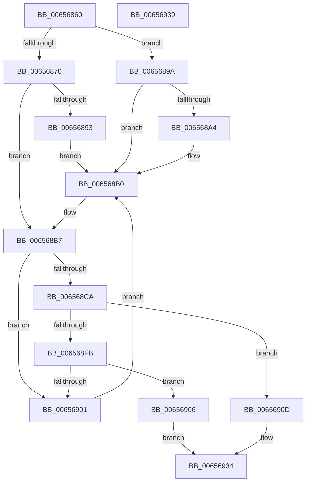

# ExpInitializePoolTrackerTable

- RVA: `0x00656860`–`0x0065693A` (길이 `218` bytes)
- VA: `0x0000000140656860`
- 실행 섹션: `.text`
- PDB 이름 있음: `예`; PDB Function 태그: `아니요`
- unwind 정보 RVA: `0x0005C788`
- 디코드: `51`개 명령, `218/218` bytes 표시
- 미해석 바이트: `0` (있으면 어셈블리에 `.byte`로 보존)

> 이 문서는 커널 이미지의 기계어와 PDB 기호를 분석해 생성했습니다. 4번과 5번은 함수 원형과 자료형을 바이너리 사용 방식에서 추정한 C 해석이며 원본 소스 복구 결과는 아닙니다.

## 1. Dependencies

- 직접 호출 지점: **2**; 고유 호출 대상: **2**
- 직접 호출자로 확인된 함수: **1**
- RIP 상대 이미지 참조: **5**

### Outgoing calls
- `0x006568E0` → [ExAllocateHeapPages](../44/ExAllocateHeapPages_function_00446BB4.md) (function, `0x00446BB4`)
- `0x0065692D` → [memset](../6C/memset_function_006C6C40.md) (function, `0x006C6C40`)

### Direct callers
- [ExInitializePoolTracker](../../init/C5/ExInitializePoolTracker_function_00C52F10.md) at `0x00C52FBD`

### Static image references
- `0x00656864` → RVA `0x00EFED50` (`.data`; read)
- `0x00656870` → RVA `0x00E30088` (`.data`; read)
- `0x0065687C` → RVA `0x00EFED50` (`.data`; write)
- `0x006568EF` → RVA `0x00EFED60` (`.data`; write)
- `0x00656911` → RVA `0x00EFED58` (`.data`; write)

## 2. Other-region calls and transfers

- 다른 실행 섹션으로 향하는 call: **0**
- 별도 외부 분기/꼬리 이동을 확인하지 못했습니다.

## 3. Assembly (complete function range)

```asm
00656860  48 83 EC 28                     sub rsp, 0x28
00656864  48 8B 05 E5 84 8A 00            mov rax, qword ptr [rip + 0x8a84e5]
0065686B  48 85 C0                        test rax, rax
0065686E  75 2A                           jne 0x14065689a
00656870  48 8B 05 11 98 7D 00            mov rax, qword ptr [rip + 0x7d9811]
00656877  BA 00 10 00 00                  mov edx, 0x1000
0065687C  48 89 15 CD 84 8A 00            mov qword ptr [rip + 0x8a84cd], rdx
00656883  48 8B 08                        mov rcx, qword ptr [rax]
00656886  48 81 B9 50 48 00 00 00 00 01 00  cmp qword ptr [rcx + 0x4850], 0x10000
00656891  77 24                           ja 0x1406568b7
00656893  BA 00 02 00 00                  mov edx, 0x200
00656898  EB 16                           jmp 0x1406568b0
0065689A  BA 40 00 00 00                  mov edx, 0x40
0065689F  48 3B C2                        cmp rax, rdx
006568A2  72 0C                           jb 0x1406568b0
006568A4  48 0F BD C8                     bsr rcx, rax
006568A8  BA 01 00 00 00                  mov edx, 1
006568AD  48 D3 E2                        shl rdx, cl
006568B0  48 89 15 99 84 8A 00            mov qword ptr [rip + 0x8a8499], rdx
006568B7  48 8D 42 01                     lea rax, [rdx + 1]
006568BB  48 B9 33 33 33 33 33 33 33 03   movabs rcx, 0x333333333333333
006568C5  48 3B C1                        cmp rax, rcx
006568C8  77 37                           ja 0x140656901
006568CA  48 8D 14 92                     lea rdx, [rdx + rdx*4]
006568CE  48 C1 E2 04                     shl rdx, 4
006568D2  48 81 C2 4F 10 00 00            add rdx, 0x104f
006568D9  48 81 E2 00 F0 FF FF            and rdx, 0xfffffffffffff000
006568E0  E8 CF 02 DF FF                  call 0x140446bb4
006568E5  48 8B 15 64 84 8A 00            mov rdx, qword ptr [rip + 0x8a8464]
006568EC  48 8B C8                        mov rcx, rax
006568EF  48 89 05 6A 84 8A 00            mov qword ptr [rip + 0x8a846a], rax
006568F6  48 85 C0                        test rax, rax
006568F9  75 12                           jne 0x14065690d
006568FB  48 83 FA 01                     cmp rdx, 1
006568FF  74 05                           je 0x140656906
00656901  48 D1 EA                        shr rdx, 1
00656904  EB AA                           jmp 0x1406568b0
00656906  B8 9A 00 00 C0                  mov eax, 0xc000009a
0065690B  EB 27                           jmp 0x140656934
0065690D  48 8D 42 FF                     lea rax, [rdx - 1]
00656911  48 89 05 40 84 8A 00            mov qword ptr [rip + 0x8a8440], rax
00656918  48 8D 42 01                     lea rax, [rdx + 1]
0065691C  4C 8D 04 80                     lea r8, [rax + rax*4]
00656920  48 89 05 29 84 8A 00            mov qword ptr [rip + 0x8a8429], rax
00656927  49 C1 E0 04                     shl r8, 4
0065692B  33 D2                           xor edx, edx
0065692D  E8 0E 03 07 00                  call 0x1406c6c40
00656932  33 C0                           xor eax, eax
00656934  48 83 C4 28                     add rsp, 0x28
00656938  C3                              ret
00656939  CC                              int3
```

## 4. C-style interpretation (structured pseudocode)

```c
__int64 __fastcall ExpInitializePoolTrackerTable(void)
{
    __int64 result;
    __int64 v_rsp;

    v_rsp = (v_rsp) - (40);
    if (*(unsigned __int64 *)(v_rip + 9077989) != 0) goto loc_0065689A;
    *(unsigned __int64 *)(v_rip + 9077965) = (unsigned int)(0x1000ULL);
    if ((*(unsigned __int64 *)(*(unsigned __int64 *)(*(unsigned __int64 *)(v_rip + 8230929)) + 18512)) > 0x10000ULL) goto loc_006568B7;
    goto loc_006568B0;
loc_0065689A:
    if ((*(unsigned __int64 *)(v_rip + 8230929)) >= 64) {
        a2 = 1;
        a2 = (a2) << ((unsigned __int8)(*(unsigned __int64 *)(*(unsigned __int64 *)(v_rip + 8230929))));
    }
    *(unsigned __int64 *)(v_rip + 9077913) = a2;
loc_006568B7:
    if ((a2 + 1) > (*(unsigned __int64 *)(*(unsigned __int64 *)(v_rip + 8230929)))) goto loc_00656901;
    a2 = (a2 + a2 * 4) << (4);
    a2 = (a2) + (0x104FULL);
    a2 = (a2) & (0xFFFFFFFFFFFFF000ULL);
    result = ExAllocateHeapPages(*(unsigned __int64 *)(*(unsigned __int64 *)(v_rip + 8230929)), a2, a3, a4);
    *(unsigned __int64 *)(v_rip + 9077866) = result;
    if (result != 0) goto loc_0065690D;
    if ((*(unsigned __int64 *)(v_rip + 9077860)) == 1) goto loc_00656906;
loc_00656901:
    a2 = (*(unsigned __int64 *)(v_rip + 9077860)) >> (1);
    goto loc_006568B0;
loc_00656906:
    goto loc_00656934;
loc_0065690D:
    *(unsigned __int64 *)(v_rip + 9077824) = a2 - 1;
    *(unsigned __int64 *)(v_rip + 9077801) = a2 + 1;
    a3 = (a2 + 1 + a2 + 1 * 4) << (4);
    a2 = 0;
    result = memset(result, a2, a3, a4);
    result = 0;
loc_00656934:
    v_rsp = (v_rsp) + (40);
    return result;
}
```

## 5. (Beta) C Style

```c
void ExpInitializePoolTrackerTable(void)
{
    int64_t result;
    int64_t local_rsp;

    local_rsp = (local_rsp) - (40);
    if (*(uint64_t *)(v_rip + 0x8A84E5) != 0) goto loc_0065689A;
    *(uint64_t *)(v_rip + 0x8A84CD) = (uint32_t)(0x1000ULL);
    if ((*(uint64_t *)(*(uint64_t *)(*(uint64_t *)(v_rip + 0x7D9811)) + 0x4850)) > 0x10000ULL) goto loc_006568B7;
    goto loc_006568B0;
loc_0065689A:
    if ((*(uint64_t *)(v_rip + 0x7D9811)) >= 64) {
        a2 = 1;
        a2 = (a2) << ((uint8_t)(*(uint64_t *)(*(uint64_t *)(v_rip + 0x7D9811))));
    }
    *(uint64_t *)(v_rip + 0x8A8499) = a2;
loc_006568B7:
    if ((a2 + 1) > (*(uint64_t *)(*(uint64_t *)(v_rip + 0x7D9811)))) goto loc_00656901;
    a2 = (a2 + a2 * 4) << (4);
    a2 = (a2) + (0x104FULL);
    a2 = (a2) & (0xFFFFFFFFFFFFF000ULL);
    result = ExAllocateHeapPages(*(uint64_t *)(*(uint64_t *)(v_rip + 0x7D9811)), a2, a3, a4);
    *(uint64_t *)(v_rip + 0x8A846A) = result;
    if (result != 0) goto loc_0065690D;
    if ((*(uint64_t *)(v_rip + 0x8A8464)) == 1) goto loc_00656906;
loc_00656901:
    a2 = (*(uint64_t *)(v_rip + 0x8A8464)) >> (1);
    goto loc_006568B0;
loc_00656906:
    goto loc_00656934;
loc_0065690D:
    *(uint64_t *)(v_rip + 0x8A8440) = a2 - 1;
    *(uint64_t *)(v_rip + 0x8A8429) = a2 + 1;
    a3 = (a2 + 1 + a2 + 1 * 4) << (4);
    a2 = 0;
    result = memset(result, a2, a3, a4);
    result = 0;
loc_00656934:
    local_rsp = (local_rsp) + (40);
    return result;
}
```

## 6. Execution-region graph

[열기: 2D/3D 그래프와 함수 탐색 컨트롤 패널](../../../control-panel.html?section=text&rva=0x00656860&view=graph)

- 2D 그래프는 위에서 아래로 흐르고, 3D 그래프는 빈 공간을 드래그해 회전합니다. Shift+드래그는 이동, 휠은 확대·축소, 함수 노드 선택은 대상 보고서 이동입니다.

### Static fallback


