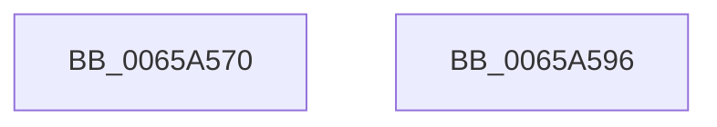

# ExpInitializeWorkSubQueueEnumeratorContext

- RVA: `0x0065A570`–`0x0065A597` (길이 `39` bytes)
- VA: `0x000000014065A570`
- 실행 섹션: `.text`
- PDB 이름 있음: `예`; PDB Function 태그: `아니요`
- unwind 정보 RVA: `0x000DB714`
- 디코드: `12`개 명령, `39/39` bytes 표시
- 미해석 바이트: `0` (있으면 어셈블리에 `.byte`로 보존)

> 이 문서는 커널 이미지의 기계어와 PDB 기호를 분석해 생성했습니다. 4번과 5번은 함수 원형과 자료형을 바이너리 사용 방식에서 추정한 C 해석이며 원본 소스 복구 결과는 아닙니다.

## 1. Dependencies

- 직접 호출 지점: **0**; 고유 호출 대상: **0**
- 직접 호출자로 확인된 함수: **1**
- RIP 상대 이미지 참조: **0**

### Outgoing calls
- 직접 디코드된 call 명령이 없습니다.

### Direct callers
- [ExStartStopWorkQueueProvider](../../page/7C/ExStartStopWorkQueueProvider_function_007CF59C.md) at `0x007CF699`

### Static image references
- 디코드된 RIP-relative 메모리 참조가 없습니다.

## 2. Other-region calls and transfers

- 다른 실행 섹션으로 향하는 call: **0**
- 별도 외부 분기/꼬리 이동을 확인하지 못했습니다.

## 3. Assembly (complete function range)

```asm
0065A570  8B 44 24 28                     mov eax, dword ptr [rsp + 0x28]
0065A574  45 33 D2                        xor r10d, r10d
0065A577  44 89 51 0C                     mov dword ptr [rcx + 0xc], r10d
0065A57B  4C 89 51 28                     mov qword ptr [rcx + 0x28], r10
0065A57F  48 89 11                        mov qword ptr [rcx], rdx
0065A582  44 89 41 08                     mov dword ptr [rcx + 8], r8d
0065A586  4C 89 49 10                     mov qword ptr [rcx + 0x10], r9
0065A58A  4C 89 49 18                     mov qword ptr [rcx + 0x18], r9
0065A58E  44 89 51 20                     mov dword ptr [rcx + 0x20], r10d
0065A592  89 41 24                        mov dword ptr [rcx + 0x24], eax
0065A595  C3                              ret
0065A596  CC                              int3
```

## 4. C-style interpretation (structured pseudocode)

```c
__int64 __fastcall ExpInitializeWorkSubQueueEnumeratorContext(__int64 a1, __int64 a2, int a3, __int64 a4, unsigned int a5)
{
    __int64 v_r10;

    v_r10 = 0;
    *(unsigned int *)(a1 + 12) = 0;
    *(unsigned __int64 *)(a1 + 40) = 0;
    *(unsigned __int64 *)(a1) = a2;
    *(unsigned int *)(a1 + 8) = a3;
    *(unsigned __int64 *)(a1 + 16) = a4;
    *(unsigned __int64 *)(a1 + 24) = a4;
    *(unsigned int *)(a1 + 32) = 0;
    *(unsigned int *)(a1 + 36) = (unsigned int)((unsigned int)(a5));
    return (unsigned int)(a5);
}
```

## 5. (Beta) C Style

```c
int64_t ExpInitializeWorkSubQueueEnumeratorContext(void *Arg1, int64_t Arg2, int32_t Arg3, int64_t Arg4, uint32_t Arg5)
{
    uint8_t *arg1 = (uint8_t *)Arg1;

    int64_t local_r10;

    local_r10 = 0;
    *(uint32_t *)(arg1 + 0xC) = 0;
    *(uint64_t *)(arg1 + 0x28) = 0;
    *(uint64_t *)(arg1) = Arg2;
    *(uint32_t *)(arg1 + 0x8) = Arg3;
    *(uint64_t *)(arg1 + 0x10) = Arg4;
    *(uint64_t *)(arg1 + 0x18) = Arg4;
    *(uint32_t *)(arg1 + 0x20) = 0;
    *(uint32_t *)(arg1 + 0x24) = (uint32_t)((uint32_t)(Arg5));
    return (uint32_t)(Arg5);
}
```

### 관측된 메모리 오프셋

구조체 형식이 확인되지 않은 접근은 인자 기준의 오프셋으로만 기록했습니다.

| 기준 인자 | 오프셋 표현 | 폭 (bit) | 접근 |
|---|---:|---:|---|
| `Arg1` | `+ 0x0` | `64` | `W` |
| `Arg1` | `+ 0x8` | `32` | `W` |
| `Arg1` | `+ 0xC` | `32` | `W` |
| `Arg1` | `+ 0x10` | `64` | `W` |
| `Arg1` | `+ 0x18` | `64` | `W` |
| `Arg1` | `+ 0x20` | `32` | `W` |
| `Arg1` | `+ 0x24` | `32` | `W` |
| `Arg1` | `+ 0x28` | `64` | `W` |

## 6. Execution-region graph

[열기: 2D/3D 그래프와 함수 탐색 컨트롤 패널](../../../control-panel.html?section=text&rva=0x0065A570&view=graph)

- 2D 그래프는 위에서 아래로 흐르고, 3D 그래프는 빈 공간을 드래그해 회전합니다. Shift+드래그는 이동, 휠은 확대·축소, 함수 노드 선택은 대상 보고서 이동입니다.

### Static fallback


