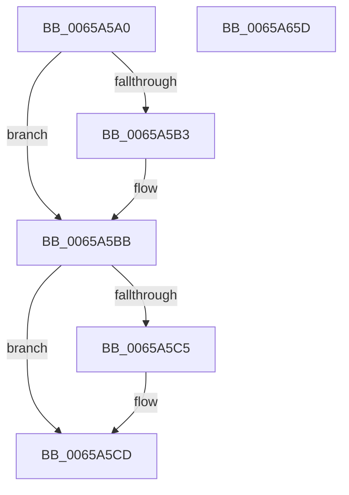

# ExpLegacyWorkerInitialization

- RVA: `0x0065A5A0`–`0x0065A65E` (길이 `190` bytes)
- VA: `0x000000014065A5A0`
- 실행 섹션: `.text`
- PDB 이름 있음: `예`; PDB Function 태그: `아니요`
- unwind 정보 RVA: `0x0005C788`
- 디코드: `42`개 명령, `190/190` bytes 표시
- 미해석 바이트: `0` (있으면 어셈블리에 `.byte`로 보존)

> 이 문서는 커널 이미지의 기계어와 PDB 기호를 분석해 생성했습니다. 4번과 5번은 함수 원형과 자료형을 바이너리 사용 방식에서 추정한 C 해석이며 원본 소스 복구 결과는 아닙니다.

## 1. Dependencies

- 직접 호출 지점: **2**; 고유 호출 대상: **1**
- 직접 호출자로 확인된 함수: **1**
- RIP 상대 이미지 참조: **12**

### Outgoing calls
- `0x0065A61F` → [ExpPartitionGetQueue](../43/ExpPartitionGetQueue_function_004335C0.md) (function, `0x004335C0`)
- `0x0065A64C` → [ExpPartitionGetQueue](../43/ExpPartitionGetQueue_function_004335C0.md) (function, `0x004335C0`)

### Direct callers
- [ExpWorkerInitialization](../../init/C5/ExpWorkerInitialization_function_00C539A4.md) at `0x00C53B97`

### Static image references
- `0x0065A5A4` → RVA `0x00EFAA08` (`.data`; read)
- `0x0065A5B5` → RVA `0x00EFAA08` (`.data`; write)
- `0x0065A5BB` → RVA `0x00EFA95C` (`.data`; read)
- `0x0065A5C7` → RVA `0x00EFA95C` (`.data`; write)
- `0x0065A5D2` → RVA `0x00FDAEC0` (`PAGEDATA`; read)
- `0x0065A5DC` → RVA `0x00FC521C` (`ALMOSTRO`; read)
- `0x0065A5ED` → RVA `0x00FC6EA0` (`ALMOSTRO`; read)
- `0x0065A5F4` → RVA `0x00FCF6C0` (`CACHEALI`; read)
- `0x0065A5FB` → RVA `0x00EFAAA8` (`.data`; write)
- `0x0065A607` → RVA `0x00EFA960` (`.data`; write)
- `0x0065A641` → RVA `0x00EFAAB8` (`.data`; write)
- `0x0065A651` → RVA `0x00EFAAB0` (`.data`; write)

## 2. Other-region calls and transfers

- 다른 실행 섹션으로 향하는 call: **0**
- 별도 외부 분기/꼬리 이동을 확인하지 못했습니다.

## 3. Assembly (complete function range)

```asm
0065A5A0  48 83 EC 28                     sub rsp, 0x28
0065A5A4  8B 0D 5E 04 8A 00               mov ecx, dword ptr [rip + 0x8a045e]
0065A5AA  B8 64 00 00 00                  mov eax, 0x64
0065A5AF  3B C8                           cmp ecx, eax
0065A5B1  76 08                           jbe 0x14065a5bb
0065A5B3  8B C8                           mov ecx, eax
0065A5B5  89 05 4D 04 8A 00               mov dword ptr [rip + 0x8a044d], eax
0065A5BB  8B 15 9B 03 8A 00               mov edx, dword ptr [rip + 0x8a039b]
0065A5C1  3B D0                           cmp edx, eax
0065A5C3  76 08                           jbe 0x14065a5cd
0065A5C5  8B D0                           mov edx, eax
0065A5C7  89 05 8F 03 8A 00               mov dword ptr [rip + 0x8a038f], eax
0065A5CD  B8 05 00 00 00                  mov eax, 5
0065A5D2  4C 8D 1D E7 08 98 00            lea r11, [rip + 0x9808e7]
0065A5D9  45 33 D2                        xor r10d, r10d
0065A5DC  44 38 15 39 AC 96 00            cmp byte ptr [rip + 0x96ac39], r10b
0065A5E3  44 8D 40 05                     lea r8d, [rax + 5]
0065A5E7  41 0F 45 C0                     cmovne eax, r8d
0065A5EB  03 C1                           add eax, ecx
0065A5ED  48 8B 0D AC C8 96 00            mov rcx, qword ptr [rip + 0x96c8ac]
0065A5F4  4C 39 1D C5 50 97 00            cmp qword ptr [rip + 0x9750c5], r11
0065A5FB  89 05 A7 04 8A 00               mov dword ptr [rip + 0x8a04a7], eax
0065A601  8D 42 07                        lea eax, [rdx + 7]
0065A604  41 8B D2                        mov edx, r10d
0065A607  89 05 53 03 8A 00               mov dword ptr [rip + 0x8a0353], eax
0065A60D  48 0F 45 15 AB 50 97 00         cmovne rdx, qword ptr [rip + 0x9750ab]
0065A615  45 33 C9                        xor r9d, r9d
0065A618  48 8B 49 10                     mov rcx, qword ptr [rcx + 0x10]
0065A61C  45 33 C0                        xor r8d, r8d
0065A61F  E8 9C 8F DD FF                  call 0x1404335c0
0065A624  4C 39 1D 95 50 97 00            cmp qword ptr [rip + 0x975095], r11
0065A62B  45 8D 41 01                     lea r8d, [r9 + 1]
0065A62F  48 8B 0D 6A C8 96 00            mov rcx, qword ptr [rip + 0x96c86a]
0065A636  4C 0F 45 15 82 50 97 00         cmovne r10, qword ptr [rip + 0x975082]
0065A63E  49 8B D2                        mov rdx, r10
0065A641  48 89 05 70 04 8A 00            mov qword ptr [rip + 0x8a0470], rax
0065A648  48 8B 49 10                     mov rcx, qword ptr [rcx + 0x10]
0065A64C  E8 6F 8F DD FF                  call 0x1404335c0
0065A651  48 89 05 58 04 8A 00            mov qword ptr [rip + 0x8a0458], rax
0065A658  48 83 C4 28                     add rsp, 0x28
0065A65C  C3                              ret
0065A65D  CC                              int3
```

## 4. C-style interpretation (structured pseudocode)

```c
__int64 __fastcall ExpLegacyWorkerInitialization(__int64 a1, __int64 a2, __int64 a3, int a4)
{
    __int64 result;
    __int64 v_r10;
    __int64 v_rsp;

    v_rsp = (v_rsp) - (40);
    if (((unsigned int)((unsigned int)(*(unsigned int *)(v_rip + 9045086)))) >= = 100) {
        a1 = 100;
        *(unsigned int *)(v_rip + 9045069) = 100;
    }
    if (((unsigned int)((unsigned int)(*(unsigned int *)(v_rip + 9044891)))) >= = 100) {
        a2 = 100;
        *(unsigned int *)(v_rip + 9044879) = 100;
    }
    v_r10 = 0;
    result = 5;
    if ((*(unsigned __int8 *)(v_rip + 9874489)) != 0) { result = (unsigned int)(5 + 5); }
    result = (unsigned int)((result) + ((unsigned int)(a1)));
    *(unsigned int *)(v_rip + 9045159) = (unsigned int)(result);
    *(unsigned int *)(v_rip + 9044819) = (unsigned int)(a2 + 7);
    a2 = 0;
    if ((*(unsigned __int64 *)(v_rip + 9916613)) != (v_rip + 9963751)) { a2 = *(unsigned __int64 *)(v_rip + 9916587); }
    a4 = 0;
    a3 = 0;
    result = ExpPartitionGetQueue(*(unsigned __int64 *)(*(unsigned __int64 *)(v_rip + 9881772) + 16), a2, a3, a4);
    if ((*(unsigned __int64 *)(v_rip + 9916565)) != (v_rip + 9963751)) { v_r10 = *(unsigned __int64 *)(v_rip + 9916546); }
    *(unsigned __int64 *)(v_rip + 9045104) = result;
    result = ExpPartitionGetQueue(*(unsigned __int64 *)(*(unsigned __int64 *)(v_rip + 9881706) + 16), v_r10, a4 + 1, a4);
    *(unsigned __int64 *)(v_rip + 9045080) = result;
    v_rsp = (v_rsp) + (40);
    return result;
}
```

## 5. (Beta) C Style

```c
int64_t ExpLegacyWorkerInitialization(int64_t Arg1, int64_t Arg2, int64_t Arg3, int32_t Arg4)
{
    int64_t result;
    int64_t local_r10;
    int64_t local_rsp;

    local_rsp = (local_rsp) - (40);
    if (((uint32_t)((uint32_t)(*(uint32_t *)(v_rip + 0x8A045E)))) >= = 100) {
        Arg1 = 100;
        *(uint32_t *)(v_rip + 0x8A044D) = 100;
    }
    if (((uint32_t)((uint32_t)(*(uint32_t *)(v_rip + 0x8A039B)))) >= = 100) {
        Arg2 = 100;
        *(uint32_t *)(v_rip + 0x8A038F) = 100;
    }
    local_r10 = 0;
    result = 5;
    if ((*(uint8_t *)(v_rip + 0x96AC39)) != 0) { result = (uint32_t)(5 + 5); }
    result = (uint32_t)((result) + ((uint32_t)(Arg1)));
    *(uint32_t *)(v_rip + 0x8A04A7) = (uint32_t)(result);
    *(uint32_t *)(v_rip + 0x8A0353) = (uint32_t)(Arg2 + 7);
    Arg2 = 0;
    if ((*(uint64_t *)(v_rip + 0x9750C5)) != (v_rip + 9963751)) { Arg2 = *(uint64_t *)(v_rip + 0x9750AB); }
    Arg4 = 0;
    Arg3 = 0;
    result = ExpPartitionGetQueue(*(uint64_t *)(*(uint64_t *)(v_rip + 0x96C8AC) + 0x10), Arg2, Arg3, Arg4);
    if ((*(uint64_t *)(v_rip + 0x975095)) != (v_rip + 9963751)) { local_r10 = *(uint64_t *)(v_rip + 0x975082); }
    *(uint64_t *)(v_rip + 0x8A0470) = result;
    result = ExpPartitionGetQueue(*(uint64_t *)(*(uint64_t *)(v_rip + 0x96C86A) + 0x10), local_r10, Arg4 + 1, Arg4);
    *(uint64_t *)(v_rip + 0x8A0458) = result;
    local_rsp = (local_rsp) + (40);
    return result;
}
```

## 6. Execution-region graph

[열기: 2D/3D 그래프와 함수 탐색 컨트롤 패널](../../../control-panel.html?section=text&rva=0x0065A5A0&view=graph)

- 2D 그래프는 위에서 아래로 흐르고, 3D 그래프는 빈 공간을 드래그해 회전합니다. Shift+드래그는 이동, 휠은 확대·축소, 함수 노드 선택은 대상 보고서 이동입니다.

### Static fallback


