# ExpLimitDpcInsertEntry

- RVA: `0x00656940`–`0x00656BE3` (길이 `675` bytes)
- VA: `0x0000000140656940`
- 실행 섹션: `.text`
- PDB 이름 있음: `예`; PDB Function 태그: `아니요`
- unwind 정보 RVA: `0x0005FEF8`
- 디코드: `183`개 명령, `675/675` bytes 표시
- 미해석 바이트: `0` (있으면 어셈블리에 `.byte`로 보존)

> 이 문서는 커널 이미지의 기계어와 PDB 기호를 분석해 생성했습니다. 4번과 5번은 함수 원형과 자료형을 바이너리 사용 방식에서 추정한 C 해석이며 원본 소스 복구 결과는 아닙니다.

## 1. Dependencies

- 직접 호출 지점: **2**; 고유 호출 대상: **1**
- 직접 호출자로 확인된 함수: **1**
- RIP 상대 이미지 참조: **5**

### Outgoing calls
- `0x00656A57` → [ExpTrackRaiseLimitNotification](ExpTrackRaiseLimitNotification_function_00657264.md) (function, `0x00657264`)
- `0x00656BAF` → [ExpTrackRaiseLimitNotification](ExpTrackRaiseLimitNotification_function_00657264.md) (function, `0x00657264`)

### Direct callers
- [ExpLimitInsertDpc](ExpLimitInsertDpc_function_00656BF0.md) at `0x00656C5E`

### Static image references
- `0x00656963` → RVA `0x00EFED58` (`.data`; read)
- `0x0065696D` → RVA `0x00EFAD20` (`.data`; read)
- `0x006569BD` → RVA `0x00EFED40` (`.data`; read)
- `0x006569CE` → RVA `0x00EFED48` (`.data`; read)
- `0x00656B26` → RVA `0x00FC6A80` (`ALMOSTRO`; read)

## 2. Other-region calls and transfers

- 다른 실행 섹션으로 향하는 call: **0**
- 별도 외부 분기/꼬리 이동을 확인하지 못했습니다.

## 3. Assembly (complete function range)

```asm
00656940  48 8B C4                        mov rax, rsp
00656943  48 89 58 08                     mov qword ptr [rax + 8], rbx
00656947  48 89 68 10                     mov qword ptr [rax + 0x10], rbp
0065694B  48 89 70 18                     mov qword ptr [rax + 0x18], rsi
0065694F  48 89 78 20                     mov qword ptr [rax + 0x20], rdi
00656953  41 54                           push r12
00656955  41 56                           push r14
00656957  41 57                           push r15
00656959  48 83 EC 20                     sub rsp, 0x20
0065695D  48 8B 31                        mov rsi, qword ptr [rcx]
00656960  45 33 E4                        xor r12d, r12d
00656963  4C 8B 0D EE 83 8A 00            mov r9, qword ptr [rip + 0x8a83ee]
0065696A  4C 8B F1                        mov r14, rcx
0065696D  4C 8B 1D AC 43 8A 00            mov r11, qword ptr [rip + 0x8a43ac]
00656974  8B 46 08                        mov eax, dword ptr [rsi + 8]
00656977  48 69 D0 5F 9E 00 00            imul rdx, rax, 0x9e5f
0065697E  4C 8B C2                        mov r8, rdx
00656981  49 C1 E8 20                     shr r8, 0x20
00656985  44 33 C2                        xor r8d, edx
00656988  45 23 C1                        and r8d, r9d
0065698B  45 8B D0                        mov r10d, r8d
0065698E  45 33 FF                        xor r15d, r15d
00656991  41 8B C0                        mov eax, r8d
00656994  48 8D 0C 80                     lea rcx, [rax + rax*4]
00656998  48 C1 E1 04                     shl rcx, 4
0065699C  42 8B 14 19                     mov edx, dword ptr [rcx + r11]
006569A0  48 3B 56 08                     cmp rdx, qword ptr [rsi + 8]
006569A4  0F 84 C0 00 00 00               je 0x140656a6a
006569AA  85 D2                           test edx, edx
006569AC  74 0F                           je 0x1406569bd
006569AE  41 8D 40 01                     lea eax, [r8 + 1]
006569B2  41 23 C1                        and eax, r9d
006569B5  44 8B C0                        mov r8d, eax
006569B8  41 3B C2                        cmp eax, r10d
006569BB  75 D4                           jne 0x140656991
006569BD  4C 39 25 7C 83 8A 00            cmp qword ptr [rip + 0x8a837c], r12
006569C4  0F 84 BB 00 00 00               je 0x140656a85
006569CA  33 D2                           xor edx, edx
006569CC  8B C2                           mov eax, edx
006569CE  48 3B 05 73 83 8A 00            cmp rax, qword ptr [rip + 0x8a8373]
006569D5  0F 83 AA 00 00 00               jae 0x140656a85
006569DB  48 8B 05 5E 83 8A 00            mov rax, qword ptr [rip + 0x8a835e]
006569E2  48 8D 1C 92                     lea rbx, [rdx + rdx*4]
006569E6  48 03 DB                        add rbx, rbx
006569E9  8B 0C D8                        mov ecx, dword ptr [rax + rbx*8]
006569EC  85 C9                           test ecx, ecx
006569EE  0F 84 91 00 00 00               je 0x140656a85
006569F4  48 8B 05 45 83 8A 00            mov rax, qword ptr [rip + 0x8a8345]
006569FB  8B 0C D8                        mov ecx, dword ptr [rax + rbx*8]
006569FE  3B 4E 08                        cmp ecx, dword ptr [rsi + 8]
00656A01  74 04                           je 0x140656a07
00656A03  FF C2                           inc edx
00656A05  EB C5                           jmp 0x1406569cc
00656A07  48 8B 05 32 83 8A 00            mov rax, qword ptr [rip + 0x8a8332]
00656A0E  33 FF                           xor edi, edi
00656A10  48 89 74 D8 48                  mov qword ptr [rax + rbx*8 + 0x48], rsi
00656A15  48 8D 0C 7F                     lea rcx, [rdi + rdi*2]
00656A19  49 8B 44 CE 08                  mov rax, qword ptr [r14 + rcx*8 + 8]
00656A1E  48 89 44 CE 10                  mov qword ptr [rsi + rcx*8 + 0x10], rax
00656A23  49 8B 54 CE 10                  mov rdx, qword ptr [r14 + rcx*8 + 0x10]
00656A28  48 8B 05 11 83 8A 00            mov rax, qword ptr [rip + 0x8a8311]
00656A2F  48 89 54 CE 18                  mov qword ptr [rsi + rcx*8 + 0x18], rdx
00656A34  48 85 FF                        test rdi, rdi
00656A37  75 07                           jne 0x140656a40
00656A39  48 8B 44 D8 20                  mov rax, qword ptr [rax + rbx*8 + 0x20]
00656A3E  EB 05                           jmp 0x140656a45
00656A40  48 8B 44 D8 08                  mov rax, qword ptr [rax + rbx*8 + 8]
00656A45  48 89 44 CE 20                  mov qword ptr [rsi + rcx*8 + 0x20], rax
00656A4A  48 85 D2                        test rdx, rdx
00656A4D  74 0D                           je 0x140656a5c
00656A4F  48 3B D0                        cmp rdx, rax
00656A52  73 08                           jae 0x140656a5c
00656A54  48 8B CE                        mov rcx, rsi
00656A57  E8 08 08 00 00                  call 0x140657264
00656A5C  48 FF C7                        inc rdi
00656A5F  48 83 FF 02                     cmp rdi, 2
00656A63  7C B0                           jl 0x140656a15
00656A65  E9 59 01 00 00                  jmp 0x140656bc3
00656A6A  48 C1 F9 04                     sar rcx, 4
00656A6E  48 B8 CD CC CC CC CC CC CC CC   movabs rax, 0xcccccccccccccccd
00656A78  4C 8B F9                        mov r15, rcx
00656A7B  41 BC 01 00 00 00               mov r12d, 1
00656A81  4C 0F AF F8                     imul r15, rax
00656A85  33 ED                           xor ebp, ebp
00656A87  49 8D 5E 08                     lea rbx, [r14 + 8]
00656A8B  48 8B FE                        mov rdi, rsi
00656A8E  49 2B FE                        sub rdi, r14
00656A91  48 83 7C 1F 08 00               cmp qword ptr [rdi + rbx + 8], 0
00656A97  75 24                           jne 0x140656abd
00656A99  48 8B 54 1F 10                  mov rdx, qword ptr [rdi + rbx + 0x10]
00656A9E  48 8B 03                        mov rax, qword ptr [rbx]
00656AA1  48 85 D2                        test rdx, rdx
00656AA4  75 0F                           jne 0x140656ab5
00656AA6  48 85 C0                        test rax, rax
00656AA9  75 06                           jne 0x140656ab1
00656AAB  48 39 43 08                     cmp qword ptr [rbx + 8], rax
00656AAF  74 04                           je 0x140656ab5
00656AB1  33 D2                           xor edx, edx
00656AB3  EB 26                           jmp 0x140656adb
00656AB5  48 8B C8                        mov rcx, rax
00656AB8  48 85 D2                        test rdx, rdx
00656ABB  74 16                           je 0x140656ad3
00656ABD  48 8B 03                        mov rax, qword ptr [rbx]
00656AC0  48 8B C8                        mov rcx, rax
00656AC3  48 85 C0                        test rax, rax
00656AC6  75 0B                           jne 0x140656ad3
00656AC8  48 39 43 08                     cmp qword ptr [rbx + 8], rax
00656ACC  75 05                           jne 0x140656ad3
00656ACE  8D 50 01                        lea edx, [rax + 1]
00656AD1  EB 08                           jmp 0x140656adb
00656AD3  BA 02 00 00 00                  mov edx, 2
00656AD8  48 8B C1                        mov rax, rcx
00656ADB  48 89 44 1F 08                  mov qword ptr [rdi + rbx + 8], rax
00656AE0  48 8B 43 08                     mov rax, qword ptr [rbx + 8]
00656AE4  48 89 44 1F 10                  mov qword ptr [rdi + rbx + 0x10], rax
00656AE9  45 85 E4                        test r12d, r12d
00656AEC  0F 84 C2 00 00 00               je 0x140656bb4
00656AF2  83 FA 02                        cmp edx, 2
00656AF5  0F 84 A0 00 00 00               je 0x140656b9b
00656AFB  48 8D 04 6D 00 00 00 00         lea rax, [rbp*2]
00656B03  41 BE 20 00 00 00               mov r14d, 0x20
00656B09  48 03 C5                        add rax, rbp
00656B0C  4C 8D 04 C6                     lea r8, [rsi + rax*8]
00656B10  85 D2                           test edx, edx
00656B12  75 0A                           jne 0x140656b1e
00656B14  49 C7 40 20 00 00 00 00         mov qword ptr [r8 + 0x20], 0
00656B1C  EB 08                           jmp 0x140656b26
00656B1E  49 C7 40 20 01 00 00 00         mov qword ptr [r8 + 0x20], 1
00656B26  8B 05 54 FF 96 00               mov eax, dword ptr [rip + 0x96ff54]
00656B2C  45 33 C9                        xor r9d, r9d
00656B2F  85 C0                           test eax, eax
00656B31  74 63                           je 0x140656b96
00656B33  41 8B C7                        mov eax, r15d
00656B36  4C 8D 1C 80                     lea r11, [rax + rax*4]
00656B3A  49 C1 E3 04                     shl r11, 4
00656B3E  48 8D 0D DB 41 8A 00            lea rcx, [rip + 0x8a41db]
00656B45  4A 8B 0C C9                     mov rcx, qword ptr [rcx + r9*8]
00656B49  49 03 CB                        add rcx, r11
00656B4C  8B 01                           mov eax, dword ptr [rcx]
00656B4E  85 C0                           test eax, eax
00656B50  74 36                           je 0x140656b88
00656B52  48 83 79 48 00                  cmp qword ptr [rcx + 0x48], 0
00656B57  75 08                           jne 0x140656b61
00656B59  33 C0                           xor eax, eax
00656B5B  F0 48 0F B1 71 48               lock cmpxchg qword ptr [rcx + 0x48], rsi
00656B61  85 ED                           test ebp, ebp
00656B63  75 06                           jne 0x140656b6b
00656B65  48 8B 41 20                     mov rax, qword ptr [rcx + 0x20]
00656B69  EB 04                           jmp 0x140656b6f
00656B6B  48 8B 41 08                     mov rax, qword ptr [rcx + 8]
00656B6F  85 D2                           test edx, edx
00656B71  75 0C                           jne 0x140656b7f
00656B73  48 89 44 E9 38                  mov qword ptr [rcx + rbp*8 + 0x38], rax
00656B78  F0 4B 01 04 06                  lock add qword ptr [r14 + r8], rax
00656B7D  EB 09                           jmp 0x140656b88
00656B7F  48 C7 44 E9 38 01 00 00 00      mov qword ptr [rcx + rbp*8 + 0x38], 1
00656B88  8B 05 F2 FE 96 00               mov eax, dword ptr [rip + 0x96fef2]
00656B8E  41 FF C1                        inc r9d
00656B91  44 3B C8                        cmp r9d, eax
00656B94  72 A8                           jb 0x140656b3e
00656B96  83 FA 01                        cmp edx, 1
00656B99  74 19                           je 0x140656bb4
00656B9B  48 8B 44 1F 10                  mov rax, qword ptr [rdi + rbx + 0x10]
00656BA0  48 85 C0                        test rax, rax
00656BA3  74 0F                           je 0x140656bb4
00656BA5  48 3B 44 1F 18                  cmp rax, qword ptr [rdi + rbx + 0x18]
00656BAA  73 08                           jae 0x140656bb4
00656BAC  48 8B CE                        mov rcx, rsi
00656BAF  E8 B0 06 00 00                  call 0x140657264
00656BB4  FF C5                           inc ebp
00656BB6  48 83 C3 18                     add rbx, 0x18
00656BBA  83 FD 02                        cmp ebp, 2
00656BBD  0F 8C CE FE FF FF               jl 0x140656a91
00656BC3  48 8B 5C 24 40                  mov rbx, qword ptr [rsp + 0x40]
00656BC8  48 8B 6C 24 48                  mov rbp, qword ptr [rsp + 0x48]
00656BCD  48 8B 74 24 50                  mov rsi, qword ptr [rsp + 0x50]
00656BD2  48 8B 7C 24 58                  mov rdi, qword ptr [rsp + 0x58]
00656BD7  48 83 C4 20                     add rsp, 0x20
00656BDB  41 5F                           pop r15
00656BDD  41 5E                           pop r14
00656BDF  41 5C                           pop r12
00656BE1  C3                              ret
00656BE2  CC                              int3
```

## 4. C-style interpretation (structured pseudocode)

```c
__int64 __fastcall ExpLimitDpcInsertEntry(__int64 a1)
{
    __int64 result;
    __int64 v_r11;
    __int64 v_r12;
    __int64 v_r15;
    __int64 v_rbp;
    __int64 v_rbx;
    __int64 v_rdi;
    __int64 v_rsp;
    unsigned __int64 v_stack_p10;
    unsigned __int64 v_stack_p18;
    unsigned __int64 v_stack_p20;
    unsigned __int64 v_stack_p8;

    *(unsigned __int64 *)(v_rsp + 8) = v_rbx;
    *(unsigned __int64 *)(v_rsp + 16) = v_rbp;
    *(unsigned __int64 *)(v_rsp + 24) = v_rsi;
    *(unsigned __int64 *)(v_rsp + 32) = v_rdi;
    v_rsp = (v_rsp) - (32);
    v_r12 = 0;
    a2 = (a2) * ((unsigned int)(*(unsigned int *)(*(unsigned __int64 *)(a1) + 8)));
    a3 = (a2) >> (32);
    a3 = (unsigned int)((a3) ^ ((unsigned int)(a2)));
    a3 = (unsigned int)((a3) & ((unsigned int)(*(unsigned __int64 *)(v_rip + 9077742))));
    v_r15 = 0;
loc_00656991:
    a1 = ((unsigned int)((unsigned int)(a3)) + (unsigned int)((unsigned int)(a3)) * 4) << (4);
    if (((unsigned int)(*(unsigned int *)(a1 + *(unsigned __int64 *)(v_rip + 9061292) * 1))) == (*(unsigned __int64 *)(*(unsigned __int64 *)(a1) + 8))) goto loc_00656A6A;
    if ((unsigned int)((unsigned int)(*(unsigned int *)(a1 + *(unsigned __int64 *)(v_rip + 9061292) * 1))) == 0) goto loc_006569BD;
    result = (unsigned int)((a3 + 1) & ((unsigned int)(*(unsigned __int64 *)(v_rip + 9077742))));
    if (((unsigned int)(result)) != ((unsigned int)((unsigned int)((unsigned int)(a3))))) goto loc_00656991;
loc_006569BD:
    if ((*(unsigned __int64 *)(v_rip + 9077628)) == 0) goto loc_00656A85;
    a2 = 0;
loc_006569CC:
    if (0 >= (*(unsigned __int64 *)(v_rip + 9077619))) goto loc_00656A85;
    v_rbx = (a2 + a2 * 4) + (a2 + a2 * 4);
    if ((unsigned int)((unsigned int)(*(unsigned int *)(*(unsigned __int64 *)(v_rip + 9077598) + v_rbx * 8))) == 0) goto loc_00656A85;
    if (((unsigned int)((unsigned int)(*(unsigned int *)(*(unsigned __int64 *)(v_rip + 9077573) + v_rbx * 8)))) == (*(unsigned int *)(*(unsigned __int64 *)(a1) + 8))) goto loc_00656A07;
    a2 = (unsigned int)((a2) + 1);
    goto loc_006569CC;
loc_00656A07:
    v_rdi = 0;
    *(unsigned __int64 *)(*(unsigned __int64 *)(v_rip + 9077554) + v_rbx * 8 + 72) = *(unsigned __int64 *)(a1);
loc_00656A15:
    *(unsigned __int64 *)(*(unsigned __int64 *)(a1) + v_rdi + v_rdi * 2 * 8 + 16) = *(unsigned __int64 *)(a1 + v_rdi + v_rdi * 2 * 8 + 8);
    *(unsigned __int64 *)(*(unsigned __int64 *)(a1) + v_rdi + v_rdi * 2 * 8 + 24) = *(unsigned __int64 *)(a1 + v_rdi + v_rdi * 2 * 8 + 16);
    if (0 != 0) goto loc_00656A40;
    goto loc_00656A45;
loc_00656A40:
loc_00656A45:
    *(unsigned __int64 *)(*(unsigned __int64 *)(a1) + v_rdi + v_rdi * 2 * 8 + 32) = *(unsigned __int64 *)(*(unsigned __int64 *)(*(unsigned __int64 *)(v_rip + 9077521) + v_rbx * 8 + 32) + v_rbx * 8 + 8);
    if (*(unsigned __int64 *)(a1 + v_rdi + v_rdi * 2 * 8 + 16) == 0) goto loc_00656A5C;
    result = *(unsigned __int64 *)(*(unsigned __int64 *)(*(unsigned __int64 *)(v_rip + 9077521) + v_rbx * 8 + 32) + v_rbx * 8 + 8);
    if ((*(unsigned __int64 *)(a1 + v_rdi + v_rdi * 2 * 8 + 16)) < (*(unsigned __int64 *)(*(unsigned __int64 *)(*(unsigned __int64 *)(v_rip + 9077521) + v_rbx * 8 + 32) + v_rbx * 8 + 8))) {
        a1 = *(unsigned __int64 *)(a1);
        result = ExpTrackRaiseLimitNotification(a1, *(unsigned __int64 *)(a1 + v_rdi + v_rdi * 2 * 8 + 16), (unsigned int)((unsigned int)(result)), *(unsigned __int64 *)(v_rip + 9077742));
    }
    v_rdi = (v_rdi) + 1;
    if (v_rdi < 2) goto loc_00656A15;
    goto loc_00656BC3;
loc_00656A6A:
    a1 = (a1) >> (4);
    v_r15 = (a1) * (result);
loc_00656A85:
    v_rbp = 0;
    v_rdi = (*(unsigned __int64 *)(a1)) - (a1);
loc_00656A91:
    if ((*(unsigned __int64 *)(v_rdi + a1 + 8 * 1 + 8)) != 0) goto loc_00656ABD;
    if (*(unsigned __int64 *)(v_rdi + a1 + 8 * 1 + 16) != 0) goto loc_00656AB5;
    if (*(unsigned __int64 *)(a1 + 8) != 0) goto loc_00656AB1;
    if ((*(unsigned __int64 *)(a1 + 8 + 8)) == (*(unsigned __int64 *)(a1 + 8))) goto loc_00656AB5;
loc_00656AB1:
    a2 = 0;
    goto loc_00656ADB;
loc_00656AB5:
    if (0 == 0) goto loc_00656AD3;
loc_00656ABD:
    if (*(unsigned __int64 *)(a1 + 8) != 0) goto loc_00656AD3;
    if ((*(unsigned __int64 *)(a1 + 8 + 8)) != (*(unsigned __int64 *)(a1 + 8))) goto loc_00656AD3;
    goto loc_00656ADB;
loc_00656AD3:
loc_00656ADB:
    *(unsigned __int64 *)(v_rdi + a1 + 8 * 1 + 8) = *(unsigned __int64 *)(a1 + 8);
    *(unsigned __int64 *)(v_rdi + a1 + 8 * 1 + 16) = *(unsigned __int64 *)(a1 + 8 + 8);
    if (1 == 0) goto loc_00656BB4;
    if (2 == 2) goto loc_00656B9B;
    result = (v_rbp * 2) + (0);
    if (2 != 0) goto loc_00656B1E;
    *(unsigned __int64 *)(*(unsigned __int64 *)(a1) + result * 8 + 32) = 0;
    goto loc_00656B26;
loc_00656B1E:
    *(unsigned __int64 *)(*(unsigned __int64 *)(a1) + result * 8 + 32) = 1;
loc_00656B26:
    a4 = 0;
    if ((unsigned int)((unsigned int)(*(unsigned int *)(v_rip + 9895764))) == 0) goto loc_00656B96;
    v_r11 = ((unsigned int)((unsigned int)(v_r15)) + (unsigned int)((unsigned int)(v_r15)) * 4) << (4);
loc_00656B3E:
    a1 = (*(unsigned __int64 *)(v_rip + 9060827 + a4 * 8)) + (v_r11);
    if ((unsigned int)((unsigned int)(*(unsigned int *)(a1))) == 0) goto loc_00656B88;
    result = (unsigned int)(*(unsigned int *)(a1));
    if ((*(unsigned __int64 *)(a1 + 72)) == 0) {
        result = 0;
    }
    if (0 != 0) goto loc_00656B6B;
    goto loc_00656B6F;
loc_00656B6B:
loc_00656B6F:
    if (2 != 0) goto loc_00656B7F;
    *(unsigned __int64 *)(a1 + v_rbp * 8 + 56) = *(unsigned __int64 *)(a1 + 8);
    goto loc_00656B88;
loc_00656B7F:
    *(unsigned __int64 *)(a1 + v_rbp * 8 + 56) = 1;
loc_00656B88:
    a4 = (unsigned int)((a4) + 1);
    if (((unsigned int)(a4)) < ((unsigned int)((unsigned int)(*(unsigned int *)(v_rip + 9895666))))) goto loc_00656B3E;
loc_00656B96:
    if (2 == 1) goto loc_00656BB4;
loc_00656B9B:
    if (*(unsigned __int64 *)(v_rdi + a1 + 8 * 1 + 16) == 0) goto loc_00656BB4;
    result = *(unsigned __int64 *)(v_rdi + a1 + 8 * 1 + 16);
    if ((*(unsigned __int64 *)(v_rdi + a1 + 8 * 1 + 16)) < (*(unsigned __int64 *)(v_rdi + a1 + 8 * 1 + 24))) {
        a1 = *(unsigned __int64 *)(a1);
        result = ExpTrackRaiseLimitNotification(a1, 2, *(unsigned __int64 *)(a1) + result * 8, a4);
    }
    v_rbp = (unsigned int)((v_rbp) + 1);
    v_rbx = (a1 + 8) + (24);
    if (((unsigned int)(v_rbp)) < 2) goto loc_00656A91;
loc_00656BC3:
    v_rsp = (v_rsp) + (32);
    return result;
}
```

## 5. (Beta) C Style

```c
int64_t ExpLimitDpcInsertEntry(void *Arg1)
{
    uint8_t *arg1 = (uint8_t *)Arg1;

    int64_t result;
    int64_t local_r11;
    int64_t local_r12;
    int64_t local_r15;
    int64_t local_rbp;
    int64_t local_rbx;
    int64_t local_rdi;
    int64_t local_rsp;
    uint64_t v_stack_p10;
    uint64_t v_stack_p18;
    uint64_t v_stack_p20;
    uint64_t v_stack_p8;

    *(uint64_t *)(local_rsp + 0x8) = local_rbx;
    *(uint64_t *)(local_rsp + 0x10) = local_rbp;
    *(uint64_t *)(local_rsp + 0x18) = local_rsi;
    *(uint64_t *)(local_rsp + 0x20) = local_rdi;
    local_rsp = (local_rsp) - (32);
    local_r12 = 0;
    a2 = (a2) * ((uint32_t)(*(uint32_t *)(*(uint64_t *)(arg1) + 0x8)));
    a3 = (a2) >> (32);
    a3 = (uint32_t)((a3) ^ ((uint32_t)(a2)));
    a3 = (uint32_t)((a3) & ((uint32_t)(*(uint64_t *)(v_rip + 0x8A83EE))));
    local_r15 = 0;
loc_00656991:
    Arg1 = ((uint32_t)((uint32_t)(a3)) + (uint32_t)((uint32_t)(a3)) * 4) << (4);
    if (((uint32_t)(*(uint32_t *)(arg1 + *(uint64_t *)(v_rip + 0x8A43AC) * 1))) == (*(uint64_t *)(*(uint64_t *)(arg1) + 0x8))) goto loc_00656A6A;
    if ((uint32_t)((uint32_t)(*(uint32_t *)(arg1 + *(uint64_t *)(v_rip + 0x8A43AC) * 1))) == 0) goto loc_006569BD;
    result = (uint32_t)((a3 + 1) & ((uint32_t)(*(uint64_t *)(v_rip + 0x8A83EE))));
    if (((uint32_t)(result)) != ((uint32_t)((uint32_t)((uint32_t)(a3))))) goto loc_00656991;
loc_006569BD:
    if ((*(uint64_t *)(v_rip + 0x8A837C)) == 0) goto loc_00656A85;
    a2 = 0;
loc_006569CC:
    if (0 >= (*(uint64_t *)(v_rip + 0x8A8373))) goto loc_00656A85;
    local_rbx = (a2 + a2 * 4) + (a2 + a2 * 4);
    if ((uint32_t)((uint32_t)(*(uint32_t *)(*(uint64_t *)(v_rip + 0x8A835E) + local_rbx * 8))) == 0) goto loc_00656A85;
    if (((uint32_t)((uint32_t)(*(uint32_t *)(*(uint64_t *)(v_rip + 0x8A8345) + local_rbx * 8)))) == (*(uint32_t *)(*(uint64_t *)(arg1) + 0x8))) goto loc_00656A07;
    a2 = (uint32_t)((a2) + 1);
    goto loc_006569CC;
loc_00656A07:
    local_rdi = 0;
    *(uint64_t *)(*(uint64_t *)(v_rip + 0x8A8332) + local_rbx * 8 + 0x48) = *(uint64_t *)(arg1);
loc_00656A15:
    *(uint64_t *)(*(uint64_t *)(arg1) + local_rdi + local_rdi * 2 * 8 + 0x10) = *(uint64_t *)(arg1 + local_rdi + local_rdi * 2 * 8 + 0x8);
    *(uint64_t *)(*(uint64_t *)(arg1) + local_rdi + local_rdi * 2 * 8 + 0x18) = *(uint64_t *)(arg1 + local_rdi + local_rdi * 2 * 8 + 0x10);
    if (0 != 0) goto loc_00656A40;
    goto loc_00656A45;
loc_00656A40:
loc_00656A45:
    *(uint64_t *)(*(uint64_t *)(arg1) + local_rdi + local_rdi * 2 * 8 + 0x20) = *(uint64_t *)(*(uint64_t *)(*(uint64_t *)(v_rip + 0x8A8311) + local_rbx * 8 + 0x20) + local_rbx * 8 + 0x8);
    if (*(uint64_t *)(arg1 + local_rdi + local_rdi * 2 * 8 + 0x10) == 0) goto loc_00656A5C;
    result = *(uint64_t *)(*(uint64_t *)(*(uint64_t *)(v_rip + 0x8A8311) + local_rbx * 8 + 0x20) + local_rbx * 8 + 0x8);
    if ((*(uint64_t *)(arg1 + local_rdi + local_rdi * 2 * 8 + 0x10)) < (*(uint64_t *)(*(uint64_t *)(*(uint64_t *)(v_rip + 0x8A8311) + local_rbx * 8 + 0x20) + local_rbx * 8 + 0x8))) {
        Arg1 = *(uint64_t *)(arg1);
        result = ExpTrackRaiseLimitNotification(Arg1, *(uint64_t *)(arg1 + local_rdi + local_rdi * 2 * 8 + 0x10), (uint32_t)((uint32_t)(result)), *(uint64_t *)(v_rip + 0x8A83EE));
    }
    local_rdi = (local_rdi) + 1;
    if (local_rdi < 2) goto loc_00656A15;
    goto loc_00656BC3;
loc_00656A6A:
    Arg1 = (Arg1) >> (4);
    local_r15 = (Arg1) * (result);
loc_00656A85:
    local_rbp = 0;
    local_rdi = (*(uint64_t *)(arg1)) - (Arg1);
loc_00656A91:
    if ((*(uint64_t *)(local_rdi + arg1 + 0x8 * 1 + 0x8)) != 0) goto loc_00656ABD;
    if (*(uint64_t *)(local_rdi + arg1 + 0x8 * 1 + 0x10) != 0) goto loc_00656AB5;
    if (*(uint64_t *)(arg1 + 0x8) != 0) goto loc_00656AB1;
    if ((*(uint64_t *)(arg1 + 0x8 + 0x8)) == (*(uint64_t *)(arg1 + 0x8))) goto loc_00656AB5;
loc_00656AB1:
    a2 = 0;
    goto loc_00656ADB;
loc_00656AB5:
    if (0 == 0) goto loc_00656AD3;
loc_00656ABD:
    if (*(uint64_t *)(arg1 + 0x8) != 0) goto loc_00656AD3;
    if ((*(uint64_t *)(arg1 + 0x8 + 0x8)) != (*(uint64_t *)(arg1 + 0x8))) goto loc_00656AD3;
    goto loc_00656ADB;
loc_00656AD3:
loc_00656ADB:
    *(uint64_t *)(local_rdi + arg1 + 0x8 * 1 + 0x8) = *(uint64_t *)(arg1 + 0x8);
    *(uint64_t *)(local_rdi + arg1 + 0x8 * 1 + 0x10) = *(uint64_t *)(arg1 + 0x8 + 0x8);
    if (1 == 0) goto loc_00656BB4;
    if (2 == 2) goto loc_00656B9B;
    result = (local_rbp * 2) + (0);
    if (2 != 0) goto loc_00656B1E;
    *(uint64_t *)(*(uint64_t *)(arg1) + result * 8 + 0x20) = 0;
    goto loc_00656B26;
loc_00656B1E:
    *(uint64_t *)(*(uint64_t *)(arg1) + result * 8 + 0x20) = 1;
loc_00656B26:
    a4 = 0;
    if ((uint32_t)((uint32_t)(*(uint32_t *)(v_rip + 0x96FF54))) == 0) goto loc_00656B96;
    local_r11 = ((uint32_t)((uint32_t)(local_r15)) + (uint32_t)((uint32_t)(local_r15)) * 4) << (4);
loc_00656B3E:
    Arg1 = (*(uint64_t *)(v_rip + 0x8A41DB + a4 * 8)) + (local_r11);
    if ((uint32_t)((uint32_t)(*(uint32_t *)(arg1))) == 0) goto loc_00656B88;
    result = (uint32_t)(*(uint32_t *)(arg1));
    if ((*(uint64_t *)(arg1 + 0x48)) == 0) {
        result = 0;
    }
    if (0 != 0) goto loc_00656B6B;
    goto loc_00656B6F;
loc_00656B6B:
loc_00656B6F:
    if (2 != 0) goto loc_00656B7F;
    *(uint64_t *)(arg1 + local_rbp * 8 + 0x38) = *(uint64_t *)(arg1 + 0x8);
    goto loc_00656B88;
loc_00656B7F:
    *(uint64_t *)(arg1 + local_rbp * 8 + 0x38) = 1;
loc_00656B88:
    a4 = (uint32_t)((a4) + 1);
    if (((uint32_t)(a4)) < ((uint32_t)((uint32_t)(*(uint32_t *)(v_rip + 0x96FEF2))))) goto loc_00656B3E;
loc_00656B96:
    if (2 == 1) goto loc_00656BB4;
loc_00656B9B:
    if (*(uint64_t *)(local_rdi + arg1 + 0x8 * 1 + 0x10) == 0) goto loc_00656BB4;
    result = *(uint64_t *)(local_rdi + arg1 + 0x8 * 1 + 0x10);
    if ((*(uint64_t *)(local_rdi + arg1 + 0x8 * 1 + 0x10)) < (*(uint64_t *)(local_rdi + arg1 + 0x8 * 1 + 0x18))) {
        Arg1 = *(uint64_t *)(arg1);
        result = ExpTrackRaiseLimitNotification(Arg1, 2, *(uint64_t *)(arg1) + result * 8, a4);
    }
    local_rbp = (uint32_t)((local_rbp) + 1);
    local_rbx = (Arg1 + 8) + (24);
    if (((uint32_t)(local_rbp)) < 2) goto loc_00656A91;
loc_00656BC3:
    local_rsp = (local_rsp) + (32);
    return result;
}
```

### 관측된 메모리 오프셋

구조체 형식이 확인되지 않은 접근은 인자 기준의 오프셋으로만 기록했습니다.

| 기준 인자 | 오프셋 표현 | 폭 (bit) | 접근 |
|---|---:|---:|---|
| `Arg1` | `+ 0x0` | `64` | `R` |
| `Arg1` | `+ 0x8` | `64` | `R` |
| `Arg1` | `+ 0x8 + rcx*8` | `64` | `R` |
| `Arg1` | `+ 0x10 + rcx*8` | `64` | `R` |

## 6. Execution-region graph

[열기: 2D/3D 그래프와 함수 탐색 컨트롤 패널](../../../control-panel.html?section=text&rva=0x00656940&view=graph)

- 2D 그래프는 위에서 아래로 흐르고, 3D 그래프는 빈 공간을 드래그해 회전합니다. Shift+드래그는 이동, 휠은 확대·축소, 함수 노드 선택은 대상 보고서 이동입니다.

### Static fallback

```mermaid
flowchart TD
  bb_00656940[BB_00656940]
  bb_00656991[BB_00656991]
  bb_006569AA[BB_006569AA]
  bb_006569AE[BB_006569AE]
  bb_006569BD[BB_006569BD]
  bb_006569CA[BB_006569CA]
  bb_006569CC[BB_006569CC]
  bb_006569DB[BB_006569DB]
  bb_006569F4[BB_006569F4]
  bb_00656A03[BB_00656A03]
  bb_00656A07[BB_00656A07]
  bb_00656A15[BB_00656A15]
  bb_00656A39[BB_00656A39]
  bb_00656A40[BB_00656A40]
  bb_00656A45[BB_00656A45]
  bb_00656A4F[BB_00656A4F]
  bb_00656A54[BB_00656A54]
  bb_00656A5C[BB_00656A5C]
  bb_00656A65[BB_00656A65]
  bb_00656A6A[BB_00656A6A]
  bb_00656A85[BB_00656A85]
  bb_00656A91[BB_00656A91]
  bb_00656A99[BB_00656A99]
  bb_00656AA6[BB_00656AA6]
  bb_00656AAB[BB_00656AAB]
  bb_00656AB1[BB_00656AB1]
  bb_00656AB5[BB_00656AB5]
  bb_00656ABD[BB_00656ABD]
  bb_00656AC8[BB_00656AC8]
  bb_00656ACE[BB_00656ACE]
  bb_00656AD3[BB_00656AD3]
  bb_00656ADB[BB_00656ADB]
  bb_00656AF2[BB_00656AF2]
  bb_00656AFB[BB_00656AFB]
  bb_00656B14[BB_00656B14]
  bb_00656B1E[BB_00656B1E]
  bb_00656B26[BB_00656B26]
  bb_00656B33[BB_00656B33]
  bb_00656B3E[BB_00656B3E]
  bb_00656B52[BB_00656B52]
  bb_00656B59[BB_00656B59]
  bb_00656B61[BB_00656B61]
  bb_00656B65[BB_00656B65]
  bb_00656B6B[BB_00656B6B]
  bb_00656B6F[BB_00656B6F]
  bb_00656B73[BB_00656B73]
  bb_00656B7F[BB_00656B7F]
  bb_00656B88[BB_00656B88]
  bb_00656B96[BB_00656B96]
  bb_00656B9B[BB_00656B9B]
  bb_00656BA5[BB_00656BA5]
  bb_00656BAC[BB_00656BAC]
  bb_00656BB4[BB_00656BB4]
  bb_00656BC3[BB_00656BC3]
  bb_00656BE2[BB_00656BE2]
  bb_00656940 -->|flow| bb_00656991
  bb_00656991 -->|branch| bb_00656A6A
  bb_00656991 -->|fallthrough| bb_006569AA
  bb_006569AA -->|branch| bb_006569BD
  bb_006569AA -->|fallthrough| bb_006569AE
  bb_006569AE -->|branch| bb_00656991
  bb_006569AE -->|fallthrough| bb_006569BD
  bb_006569BD -->|branch| bb_00656A85
  bb_006569BD -->|fallthrough| bb_006569CA
  bb_006569CA -->|flow| bb_006569CC
  bb_006569CC -->|branch| bb_00656A85
  bb_006569CC -->|fallthrough| bb_006569DB
  bb_006569DB -->|branch| bb_00656A85
  bb_006569DB -->|fallthrough| bb_006569F4
  bb_006569F4 -->|branch| bb_00656A07
  bb_006569F4 -->|fallthrough| bb_00656A03
  bb_00656A03 -->|branch| bb_006569CC
  bb_00656A07 -->|flow| bb_00656A15
  bb_00656A15 -->|branch| bb_00656A40
  bb_00656A15 -->|fallthrough| bb_00656A39
  bb_00656A39 -->|branch| bb_00656A45
  bb_00656A40 -->|flow| bb_00656A45
  bb_00656A45 -->|branch| bb_00656A5C
  bb_00656A45 -->|fallthrough| bb_00656A4F
  bb_00656A4F -->|branch| bb_00656A5C
  bb_00656A4F -->|fallthrough| bb_00656A54
  bb_00656A54 -->|flow| bb_00656A5C
  bb_00656A5C -->|branch| bb_00656A15
  bb_00656A5C -->|fallthrough| bb_00656A65
  bb_00656A65 -->|branch| bb_00656BC3
  bb_00656A6A -->|flow| bb_00656A85
  bb_00656A85 -->|flow| bb_00656A91
  bb_00656A91 -->|branch| bb_00656ABD
  bb_00656A91 -->|fallthrough| bb_00656A99
  bb_00656A99 -->|branch| bb_00656AB5
  bb_00656A99 -->|fallthrough| bb_00656AA6
  bb_00656AA6 -->|branch| bb_00656AB1
  bb_00656AA6 -->|fallthrough| bb_00656AAB
  bb_00656AAB -->|branch| bb_00656AB5
  bb_00656AAB -->|fallthrough| bb_00656AB1
  bb_00656AB1 -->|branch| bb_00656ADB
  bb_00656AB5 -->|branch| bb_00656AD3
  bb_00656AB5 -->|fallthrough| bb_00656ABD
  bb_00656ABD -->|branch| bb_00656AD3
  bb_00656ABD -->|fallthrough| bb_00656AC8
  bb_00656AC8 -->|branch| bb_00656AD3
  bb_00656AC8 -->|fallthrough| bb_00656ACE
  bb_00656ACE -->|branch| bb_00656ADB
  bb_00656AD3 -->|flow| bb_00656ADB
  bb_00656ADB -->|branch| bb_00656BB4
  bb_00656ADB -->|fallthrough| bb_00656AF2
  bb_00656AF2 -->|branch| bb_00656B9B
  bb_00656AF2 -->|fallthrough| bb_00656AFB
  bb_00656AFB -->|branch| bb_00656B1E
  bb_00656AFB -->|fallthrough| bb_00656B14
  bb_00656B14 -->|branch| bb_00656B26
  bb_00656B1E -->|flow| bb_00656B26
  bb_00656B26 -->|branch| bb_00656B96
  bb_00656B26 -->|fallthrough| bb_00656B33
  bb_00656B33 -->|flow| bb_00656B3E
  bb_00656B3E -->|branch| bb_00656B88
  bb_00656B3E -->|fallthrough| bb_00656B52
  bb_00656B52 -->|branch| bb_00656B61
  bb_00656B52 -->|fallthrough| bb_00656B59
  bb_00656B59 -->|flow| bb_00656B61
  bb_00656B61 -->|branch| bb_00656B6B
  bb_00656B61 -->|fallthrough| bb_00656B65
  bb_00656B65 -->|branch| bb_00656B6F
  bb_00656B6B -->|flow| bb_00656B6F
  bb_00656B6F -->|branch| bb_00656B7F
  bb_00656B6F -->|fallthrough| bb_00656B73
  bb_00656B73 -->|branch| bb_00656B88
  bb_00656B7F -->|flow| bb_00656B88
  bb_00656B88 -->|branch| bb_00656B3E
  bb_00656B88 -->|fallthrough| bb_00656B96
  bb_00656B96 -->|branch| bb_00656BB4
  bb_00656B96 -->|fallthrough| bb_00656B9B
  bb_00656B9B -->|branch| bb_00656BB4
  bb_00656B9B -->|fallthrough| bb_00656BA5
  bb_00656BA5 -->|branch| bb_00656BB4
  bb_00656BA5 -->|fallthrough| bb_00656BAC
  bb_00656BAC -->|flow| bb_00656BB4
  bb_00656BB4 -->|branch| bb_00656A91
  bb_00656BB4 -->|fallthrough| bb_00656BC3
```


