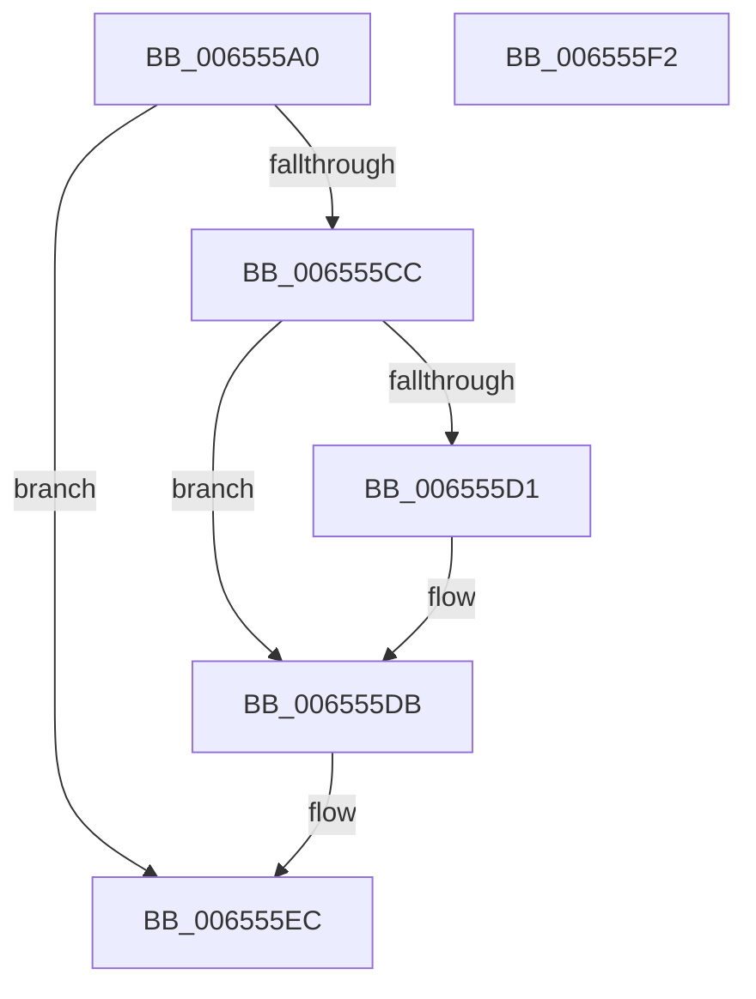

# ExpNextYearDpcRoutine

- RVA: `0x006555A0`–`0x006555F3` (길이 `83` bytes)
- VA: `0x00000001406555A0`
- 실행 섹션: `.text`
- PDB 이름 있음: `예`; PDB Function 태그: `아니요`
- unwind 정보 RVA: `0x0005CF00`
- 디코드: `22`개 명령, `83/83` bytes 표시
- 미해석 바이트: `0` (있으면 어셈블리에 `.byte`로 보존)

> 이 문서는 커널 이미지의 기계어와 PDB 기호를 분석해 생성했습니다. 4번과 5번은 함수 원형과 자료형을 바이너리 사용 방식에서 추정한 C 해석이며 원본 소스 복구 결과는 아닙니다.

## 1. Dependencies

- 직접 호출 지점: **3**; 고유 호출 대상: **3**
- 직접 호출자로 확인된 함수: **0**
- RIP 상대 이미지 참조: **0**

### Outgoing calls
- `0x006555AC` → [PsGetServerSiloGlobals](../22/PsGetServerSiloGlobals_function_002250A0.md) (function, `0x002250A0`)
- `0x006555D6` → [ObfReferenceObjectWithTag](../21/ObfReferenceObjectWithTag_function_00210710.md) (function, `0x00210710`)
- `0x006555E7` → [ExQueueWorkItem](../2F/ExQueueWorkItem_function_002F9520.md) (function, `0x002F9520`)

### Direct callers
- 이 함수 시작 RVA로 연결되는 직접 call은 확인되지 않았습니다. 간접 호출은 완전히 역산할 수 없습니다.

### Static image references
- 디코드된 RIP-relative 메모리 참조가 없습니다.

## 2. Other-region calls and transfers

- 다른 실행 섹션으로 향하는 call: **0**
- 별도 외부 분기/꼬리 이동을 확인하지 못했습니다.

## 3. Assembly (complete function range)

```asm
006555A0  40 53                           push rbx
006555A2  48 83 EC 20                     sub rsp, 0x20
006555A6  48 8B CA                        mov rcx, rdx
006555A9  4C 8B C2                        mov r8, rdx
006555AC  E8 EF FA BC FF                  call 0x1402250a0
006555B1  48 8B 98 C8 04 00 00            mov rbx, qword ptr [rax + 0x4c8]
006555B8  B8 01 00 00 00                  mov eax, 1
006555BD  F0 0F C1 83 A0 03 00 00         lock xadd dword ptr [rbx + 0x3a0], eax
006555C5  FF C0                           inc eax
006555C7  83 F8 01                        cmp eax, 1
006555CA  75 20                           jne 0x1406555ec
006555CC  48 85 D2                        test rdx, rdx
006555CF  74 0A                           je 0x1406555db
006555D1  BA 45 78 70 53                  mov edx, 0x53707845
006555D6  E8 35 B1 BB FF                  call 0x140210710
006555DB  48 8D 8B 80 03 00 00            lea rcx, [rbx + 0x380]
006555E2  BA 01 00 00 00                  mov edx, 1
006555E7  E8 34 3F CA FF                  call 0x1402f9520
006555EC  48 83 C4 20                     add rsp, 0x20
006555F0  5B                              pop rbx
006555F1  C3                              ret
006555F2  CC                              int3
```

## 4. C-style interpretation (structured pseudocode)

```c
__int64 __fastcall ExpNextYearDpcRoutine(__int64 a1, __int64 a2)
{
    __int64 result;
    __int64 v_rsp;

    v_rsp = (v_rsp) - (32);
    result = PsGetServerSiloGlobals(a2, a2, a2, a4);
    result = (unsigned int)((1) + 1);
    if (((unsigned int)(result)) != 1) goto loc_006555EC;
    if (a2 != 0) {
        a2 = 0x53707845ULL;
        result = ObfReferenceObjectWithTag(a2, a2, a2, a4);
    }
    result = ExQueueWorkItem(*(unsigned __int64 *)(result + 1224) + 896, 1, a2, a4);
loc_006555EC:
    v_rsp = (v_rsp) + (32);
    return result;
}
```

## 5. (Beta) C Style

```c
int64_t ExpNextYearDpcRoutine(int64_t Arg1, int64_t Arg2)
{
    int64_t result;
    int64_t local_rsp;

    local_rsp = (local_rsp) - (32);
    result = PsGetServerSiloGlobals(Arg2, Arg2, Arg2, a4);
    result = (uint32_t)((1) + 1);
    if (((uint32_t)(result)) != 1) goto loc_006555EC;
    if (Arg2 != 0) {
        Arg2 = 0x53707845ULL;
        result = ObfReferenceObjectWithTag(Arg2, Arg2, Arg2, a4);
    }
    result = ExQueueWorkItem(*(uint64_t *)(result + 0x4C8) + 896, 1, Arg2, a4);
loc_006555EC:
    local_rsp = (local_rsp) + (32);
    return result;
}
```

## 6. Execution-region graph

[열기: 2D/3D 그래프와 함수 탐색 컨트롤 패널](../../../control-panel.html?section=text&rva=0x006555A0&view=graph)

- 2D 그래프는 위에서 아래로 흐르고, 3D 그래프는 빈 공간을 드래그해 회전합니다. Shift+드래그는 이동, 휠은 확대·축소, 함수 노드 선택은 대상 보고서 이동입니다.

### Static fallback


