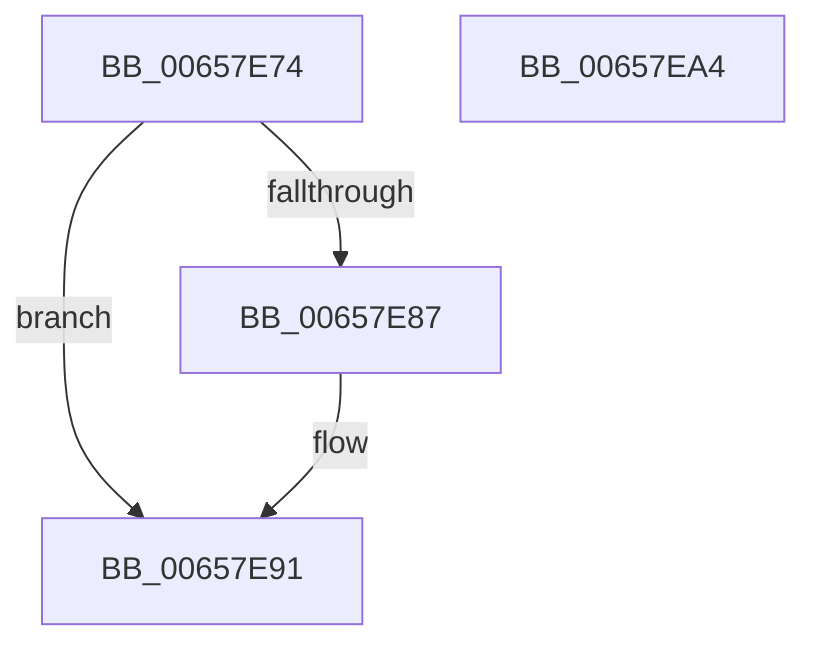

# ExpNlsDeleteSiloState

- RVA: `0x00657E74`–`0x00657EA5` (길이 `49` bytes)
- VA: `0x0000000140657E74`
- 실행 섹션: `.text`
- PDB 이름 있음: `예`; PDB Function 태그: `아니요`
- unwind 정보 RVA: `0x0005CF00`
- 디코드: `15`개 명령, `49/49` bytes 표시
- 미해석 바이트: `0` (있으면 어셈블리에 `.byte`로 보존)

> 이 문서는 커널 이미지의 기계어와 PDB 기호를 분석해 생성했습니다. 4번과 5번은 함수 원형과 자료형을 바이너리 사용 방식에서 추정한 C 해석이며 원본 소스 복구 결과는 아닙니다.

## 1. Dependencies

- 직접 호출 지점: **2**; 고유 호출 대상: **2**
- 직접 호출자로 확인된 함수: **1**
- RIP 상대 이미지 참조: **0**

### Outgoing calls
- `0x00657E8C` → [ObfDereferenceObjectWithTag](../2F/ObfDereferenceObjectWithTag_function_002F78E0.md) (function, `0x002F78E0`)
- `0x00657E99` → [ExFreePoolWithTag](../../poolcode/B8/ExFreePoolWithTag_function_00B82870.md) (function, `0x00B82870`)

### Direct callers
- [PspDeleteExternalServerSiloState](../../page/77/PspDeleteExternalServerSiloState_function_0077FB88.md) at `0x0077FC1E`

### Static image references
- 디코드된 RIP-relative 메모리 참조가 없습니다.

## 2. Other-region calls and transfers

- 다른 실행 섹션으로 향하는 call: **1**
  - `0x00657E99` → [ExFreePoolWithTag](../../poolcode/B8/ExFreePoolWithTag_function_00B82870.md) (`.text` → `POOLCODE`)
- 별도 외부 분기/꼬리 이동을 확인하지 못했습니다.

## 3. Assembly (complete function range)

```asm
00657E74  40 53                           push rbx
00657E76  48 83 EC 20                     sub rsp, 0x20
00657E7A  48 8B D9                        mov rbx, rcx
00657E7D  48 8B 49 08                     mov rcx, qword ptr [rcx + 8]
00657E81  48 83 F9 01                     cmp rcx, 1
00657E85  76 0A                           jbe 0x140657e91
00657E87  BA 44 66 6C 74                  mov edx, 0x746c6644
00657E8C  E8 4F FA C9 FF                  call 0x1402f78e0
00657E91  BA 4E 6C 73 58                  mov edx, 0x58736c4e
00657E96  48 8B CB                        mov rcx, rbx
00657E99  E8 D2 A9 52 00                  call 0x140b82870
00657E9E  48 83 C4 20                     add rsp, 0x20
00657EA2  5B                              pop rbx
00657EA3  C3                              ret
00657EA4  CC                              int3
```

## 4. C-style interpretation (structured pseudocode)

```c
__int64 __fastcall ExpNlsDeleteSiloState(__int64 a1)
{
    __int64 result;
    __int64 v_rsp;

    v_rsp = (v_rsp) - (32);
    if ((*(unsigned __int64 *)(a1 + 8)) >= = 1) {
        a2 = 0x746C6644ULL;
        result = ObfDereferenceObjectWithTag(*(unsigned __int64 *)(a1 + 8), a2, a3, a4);
    }
    result = ExFreePoolWithTag(a1, (unsigned int)(0x58736C4EULL), a3, a4);
    v_rsp = (v_rsp) + (32);
    return result;
}
```

## 5. (Beta) C Style

```c
int64_t ExpNlsDeleteSiloState(void *Arg1)
{
    uint8_t *arg1 = (uint8_t *)Arg1;

    int64_t result;
    int64_t local_rsp;

    local_rsp = (local_rsp) - (32);
    if ((*(uint64_t *)(arg1 + 0x8)) >= = 1) {
        a2 = 0x746C6644ULL;
        result = ObfDereferenceObjectWithTag(*(uint64_t *)(arg1 + 0x8), a2, a3, a4);
    }
    result = ExFreePoolWithTag(Arg1, (uint32_t)(0x58736C4EULL), a3, a4);
    local_rsp = (local_rsp) + (32);
    return result;
}
```

### 관측된 메모리 오프셋

구조체 형식이 확인되지 않은 접근은 인자 기준의 오프셋으로만 기록했습니다.

| 기준 인자 | 오프셋 표현 | 폭 (bit) | 접근 |
|---|---:|---:|---|
| `Arg1` | `+ 0x8` | `64` | `R` |

## 6. Execution-region graph

[열기: 2D/3D 그래프와 함수 탐색 컨트롤 패널](../../../control-panel.html?section=text&rva=0x00657E74&view=graph)

- 2D 그래프는 위에서 아래로 흐르고, 3D 그래프는 빈 공간을 드래그해 회전합니다. Shift+드래그는 이동, 휠은 확대·축소, 함수 노드 선택은 대상 보고서 이동입니다.

### Static fallback


