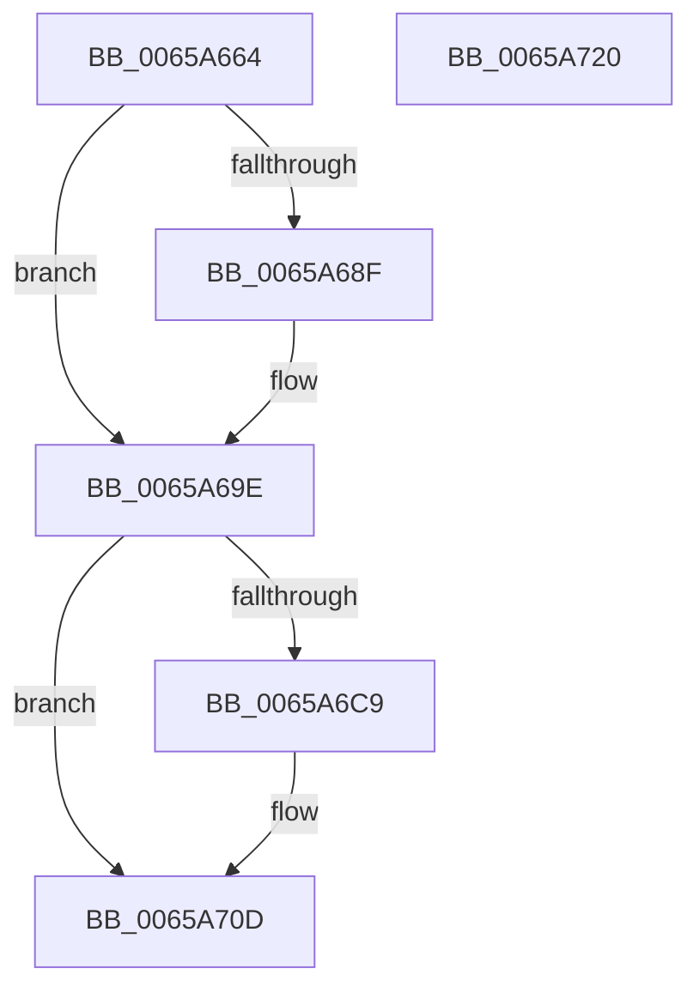

# ExpNodeHotAddProcessor

- RVA: `0x0065A664`–`0x0065A721` (길이 `189` bytes)
- VA: `0x000000014065A664`
- 실행 섹션: `.text`
- PDB 이름 있음: `예`; PDB Function 태그: `아니요`
- unwind 정보 RVA: `0x000701D4`
- 디코드: `50`개 명령, `189/189` bytes 표시
- 미해석 바이트: `0` (있으면 어셈블리에 `.byte`로 보존)

> 이 문서는 커널 이미지의 기계어와 PDB 기호를 분석해 생성했습니다. 4번과 5번은 함수 원형과 자료형을 바이너리 사용 방식에서 추정한 C 해석이며 원본 소스 복구 결과는 아닙니다.

## 1. Dependencies

- 직접 호출 지점: **6**; 고유 호출 대상: **6**
- 직접 호출자로 확인된 함수: **1**
- RIP 상대 이미지 참조: **1**

### Outgoing calls
- `0x0065A699` → [ExQueueWorkItem](../2F/ExQueueWorkItem_function_002F9520.md) (function, `0x002F9520`)
- `0x0065A6BC` → [ExAllocatePool2](../../poolcode/B8/ExAllocatePool2_function_00B820F0.md) (function, `0x00B820F0`)
- `0x0065A6DE` → [memset](../6C/memset_function_006C6C40.md) (function, `0x006C6C40`)
- `0x0065A6EE` → [KeQueryNodeActiveAffinityEx](../25/KeQueryNodeActiveAffinityEx_function_00256740.md) (function, `0x00256740`)
- `0x0065A6FE` → [ExpNodeUpdateProcessorSubQueueIndex](ExpNodeUpdateProcessorSubQueueIndex_function_0065A728.md) (function, `0x0065A728`)
- `0x0065A708` → [ExFreePoolWithTag](../../poolcode/B8/ExFreePoolWithTag_function_00B82870.md) (function, `0x00B82870`)

### Direct callers
- [ExInitializeProcessor](ExInitializeProcessor_function_00655844.md) at `0x006558EC`

### Static image references
- `0x0065A69E` → RVA `0x00FC5018` (`ALMOSTRO`; read)

## 2. Other-region calls and transfers

- 다른 실행 섹션으로 향하는 call: **2**
  - `0x0065A6BC` → [ExAllocatePool2](../../poolcode/B8/ExAllocatePool2_function_00B820F0.md) (`.text` → `POOLCODE`)
  - `0x0065A708` → [ExFreePoolWithTag](../../poolcode/B8/ExFreePoolWithTag_function_00B82870.md) (`.text` → `POOLCODE`)
- 별도 외부 분기/꼬리 이동을 확인하지 못했습니다.

## 3. Assembly (complete function range)

```asm
0065A664  48 89 5C 24 10                  mov qword ptr [rsp + 0x10], rbx
0065A669  48 89 6C 24 18                  mov qword ptr [rsp + 0x18], rbp
0065A66E  56                              push rsi
0065A66F  57                              push rdi
0065A670  41 56                           push r14
0065A672  48 83 EC 20                     sub rsp, 0x20
0065A676  83 64 24 40 00                  and dword ptr [rsp + 0x40], 0
0065A67B  48 8B D9                        mov rbx, rcx
0065A67E  33 C0                           xor eax, eax
0065A680  44 8D 70 01                     lea r14d, [rax + 1]
0065A684  F0 48 0F B1 99 50 03 00 00      lock cmpxchg qword ptr [rcx + 0x350], rbx
0065A68D  75 0F                           jne 0x14065a69e
0065A68F  48 81 C1 38 03 00 00            add rcx, 0x338
0065A696  41 8B D6                        mov edx, r14d
0065A699  E8 82 EE C9 FF                  call 0x1402f9520
0065A69E  0F B7 35 73 A9 96 00            movzx esi, word ptr [rip + 0x96a973]
0065A6A5  B9 00 01 00 00                  mov ecx, 0x100
0065A6AA  41 B8 45 78 57 6C               mov r8d, 0x6c577845
0065A6B0  48 8D 2C F5 00 00 00 00         lea rbp, [rsi*8]
0065A6B8  48 8D 55 08                     lea rdx, [rbp + 8]
0065A6BC  E8 2F 7A 52 00                  call 0x140b820f0
0065A6C1  48 8B F8                        mov rdi, rax
0065A6C4  48 85 C0                        test rax, rax
0065A6C7  74 44                           je 0x14065a70d
0065A6C9  83 60 04 00                     and dword ptr [rax + 4], 0
0065A6CD  48 8D 48 08                     lea rcx, [rax + 8]
0065A6D1  4C 8B C5                        mov r8, rbp
0065A6D4  66 44 89 30                     mov word ptr [rax], r14w
0065A6D8  33 D2                           xor edx, edx
0065A6DA  66 89 70 02                     mov word ptr [rax + 2], si
0065A6DE  E8 5D C5 06 00                  call 0x1406c6c40
0065A6E3  0F B7 0B                        movzx ecx, word ptr [rbx]
0065A6E6  4C 8D 44 24 40                  lea r8, [rsp + 0x40]
0065A6EB  48 8B D7                        mov rdx, rdi
0065A6EE  E8 4D C0 BF FF                  call 0x140256740
0065A6F3  44 8B 44 24 40                  mov r8d, dword ptr [rsp + 0x40]
0065A6F8  48 8B D7                        mov rdx, rdi
0065A6FB  48 8B CB                        mov rcx, rbx
0065A6FE  E8 25 00 00 00                  call 0x14065a728
0065A703  33 D2                           xor edx, edx
0065A705  48 8B CF                        mov rcx, rdi
0065A708  E8 63 81 52 00                  call 0x140b82870
0065A70D  48 8B 5C 24 48                  mov rbx, qword ptr [rsp + 0x48]
0065A712  48 8B 6C 24 50                  mov rbp, qword ptr [rsp + 0x50]
0065A717  48 83 C4 20                     add rsp, 0x20
0065A71B  41 5E                           pop r14
0065A71D  5F                              pop rdi
0065A71E  5E                              pop rsi
0065A71F  C3                              ret
0065A720  CC                              int3
```

## 4. C-style interpretation (structured pseudocode)

```c
__int64 __fastcall ExpNodeHotAddProcessor(__int64 a1)
{
    __int64 result;
    __int64 v_rsp;
    unsigned __int64 v_stack_p10;
    unsigned __int64 v_stack_p18;
    unsigned int v_stack_p8;

    v_stack_p10 = v_rbx;
    v_stack_p18 = v_rbp;
    v_rsp = (v_rsp) - (32);
    result = 0;
    if (!(condition_is_not_equal)) {
        a1 = (a1) + (824);
        a2 = (unsigned int)(result + 1);
        result = ExQueueWorkItem(a1, a2, a3, a4);
    }
    result = ExAllocatePool2(256, *(unsigned __int16 *)(v_rip + 9873779) * 8 + 8, (unsigned int)(0x6C577845ULL), a4);
    if (result != 0) {
        a1 = result + 8;
        a3 = *(unsigned __int16 *)(v_rip + 9873779) * 8;
        *(unsigned __int16 *)(result) = (unsigned __int16)(result + 1);
        a2 = 0;
        *(unsigned __int16 *)(result + 2) = (unsigned __int16)(*(unsigned __int16 *)(v_rip + 9873779));
        result = memset(a1, a2, a3, a4);
        a1 = *(unsigned __int16 *)(a1);
        a3 = v_stack_p8;
        a2 = result;
        result = KeQueryNodeActiveAffinityEx(a1, a2, a3, a4);
        a3 = v_stack_p8;
        a2 = result;
        a1 = a1;
        result = ExpNodeUpdateProcessorSubQueueIndex(a1, a2, a3, a4);
        a2 = 0;
        a1 = result;
        result = ExFreePoolWithTag(a1, a2, a3, a4);
    }
    v_rsp = (v_rsp) + (32);
    return result;
}
```

## 5. (Beta) C Style

```c
int64_t ExpNodeHotAddProcessor(void *Arg1)
{
    uint8_t *arg1 = (uint8_t *)Arg1;

    int64_t result;
    int64_t local_rsp;
    uint64_t v_stack_p10;
    uint64_t v_stack_p18;
    uint32_t v_stack_p8;

    v_stack_p10 = local_rbx;
    v_stack_p18 = local_rbp;
    local_rsp = (local_rsp) - (32);
    result = 0;
    if (!(condition_is_not_equal)) {
        Arg1 = (Arg1) + (824);
        a2 = (uint32_t)(result + 1);
        result = ExQueueWorkItem(Arg1, a2, a3, a4);
    }
    result = ExAllocatePool2(256, *(uint16_t *)(v_rip + 0x96A973) * 8 + 8, (uint32_t)(0x6C577845ULL), a4);
    if (result != 0) {
        Arg1 = result + 8;
        a3 = *(uint16_t *)(v_rip + 0x96A973) * 8;
        *(uint16_t *)(result) = (uint16_t)(result + 1);
        a2 = 0;
        *(uint16_t *)(result + 0x2) = (uint16_t)(*(uint16_t *)(v_rip + 0x96A973));
        result = memset(Arg1, a2, a3, a4);
        Arg1 = *(uint16_t *)(arg1);
        a3 = v_stack_p8;
        a2 = result;
        result = KeQueryNodeActiveAffinityEx(Arg1, a2, a3, a4);
        a3 = v_stack_p8;
        a2 = result;
        Arg1 = Arg1;
        result = ExpNodeUpdateProcessorSubQueueIndex(Arg1, a2, a3, a4);
        a2 = 0;
        Arg1 = result;
        result = ExFreePoolWithTag(Arg1, a2, a3, a4);
    }
    local_rsp = (local_rsp) + (32);
    return result;
}
```

### 관측된 메모리 오프셋

구조체 형식이 확인되지 않은 접근은 인자 기준의 오프셋으로만 기록했습니다.

| 기준 인자 | 오프셋 표현 | 폭 (bit) | 접근 |
|---|---:|---:|---|
| `Arg1` | `+ 0x0` | `16` | `R` |
| `Arg1` | `+ 0x350` | `64` | `R` |

## 6. Execution-region graph

[열기: 2D/3D 그래프와 함수 탐색 컨트롤 패널](../../../control-panel.html?section=text&rva=0x0065A664&view=graph)

- 2D 그래프는 위에서 아래로 흐르고, 3D 그래프는 빈 공간을 드래그해 회전합니다. Shift+드래그는 이동, 휠은 확대·축소, 함수 노드 선택은 대상 보고서 이동입니다.

### Static fallback


