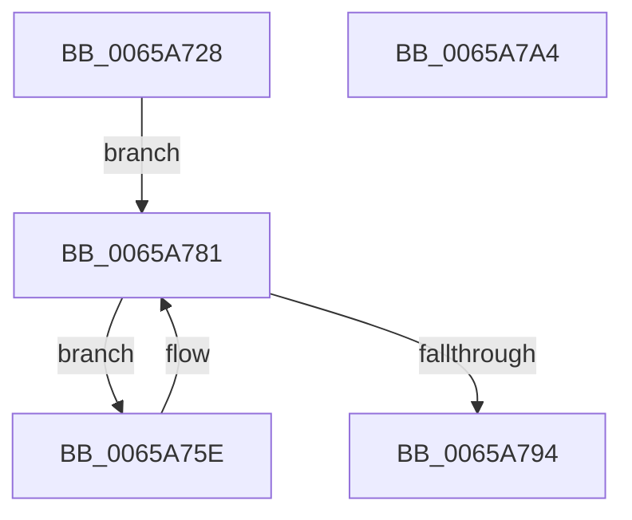

# ExpNodeUpdateProcessorSubQueueIndex

- RVA: `0x0065A728`–`0x0065A7A5` (길이 `125` bytes)
- VA: `0x000000014065A728`
- 실행 섹션: `.text`
- PDB 이름 있음: `예`; PDB Function 태그: `아니요`
- unwind 정보 RVA: `0x000D5570`
- 디코드: `35`개 명령, `125/125` bytes 표시
- 미해석 바이트: `0` (있으면 어셈블리에 `.byte`로 보존)

> 이 문서는 커널 이미지의 기계어와 PDB 기호를 분석해 생성했습니다. 4번과 5번은 함수 원형과 자료형을 바이너리 사용 방식에서 추정한 C 해석이며 원본 소스 복구 결과는 아닙니다.

## 1. Dependencies

- 직접 호출 지점: **2**; 고유 호출 대상: **2**
- 직접 호출자로 확인된 함수: **2**
- RIP 상대 이미지 참조: **0**

### Outgoing calls
- `0x0065A762` → [KeGetPrcb](../2D/KeGetPrcb_function_002D85D0.md) (function, `0x002D85D0`)
- `0x0065A78B` → [KeEnumerateNextProcessor](../41/KeEnumerateNextProcessor_function_00415480.md) (function, `0x00415480`)

### Direct callers
- [ExpNodeHotAddProcessor](ExpNodeHotAddProcessor_function_0065A664.md) at `0x0065A6FE`
- [ExpNodeInitialize](../../page/7C/ExpNodeInitialize_function_007CF8A0.md) at `0x007CF986`

### Static image references
- 디코드된 RIP-relative 메모리 참조가 없습니다.

## 2. Other-region calls and transfers

- 다른 실행 섹션으로 향하는 call: **0**
- 별도 외부 분기/꼬리 이동을 확인하지 못했습니다.

## 3. Assembly (complete function range)

```asm
0065A728  48 8B C4                        mov rax, rsp
0065A72B  48 89 58 08                     mov qword ptr [rax + 8], rbx
0065A72F  48 89 70 18                     mov qword ptr [rax + 0x18], rsi
0065A733  57                              push rdi
0065A734  48 83 EC 40                     sub rsp, 0x40
0065A738  33 F6                           xor esi, esi
0065A73A  41 8B D8                        mov ebx, r8d
0065A73D  89 70 EA                        mov dword ptr [rax - 0x16], esi
0065A740  48 8B F9                        mov rdi, rcx
0065A743  66 89 70 EE                     mov word ptr [rax - 0x12], si
0065A747  66 89 70 E8                     mov word ptr [rax - 0x18], si
0065A74B  89 70 10                        mov dword ptr [rax + 0x10], esi
0065A74E  48 8B 42 08                     mov rax, qword ptr [rdx + 8]
0065A752  48 89 44 24 28                  mov qword ptr [rsp + 0x28], rax
0065A757  48 89 54 24 20                  mov qword ptr [rsp + 0x20], rdx
0065A75C  EB 23                           jmp 0x14065a781
0065A75E  8B 4C 24 58                     mov ecx, dword ptr [rsp + 0x58]
0065A762  E8 69 DE C7 FF                  call 0x1402d85d0
0065A767  48 8B C8                        mov rcx, rax
0065A76A  33 D2                           xor edx, edx
0065A76C  8B 80 28 B9 00 00               mov eax, dword ptr [rax + 0xb928]
0065A772  0F AF 87 58 03 00 00            imul eax, dword ptr [rdi + 0x358]
0065A779  F7 F3                           div ebx
0065A77B  89 81 28 83 00 00               mov dword ptr [rcx + 0x8328], eax
0065A781  48 8D 54 24 20                  lea rdx, [rsp + 0x20]
0065A786  48 8D 4C 24 58                  lea rcx, [rsp + 0x58]
0065A78B  E8 F0 AC DB FF                  call 0x140415480
0065A790  85 C0                           test eax, eax
0065A792  74 CA                           je 0x14065a75e
0065A794  48 8B 5C 24 50                  mov rbx, qword ptr [rsp + 0x50]
0065A799  48 8B 74 24 60                  mov rsi, qword ptr [rsp + 0x60]
0065A79E  48 83 C4 40                     add rsp, 0x40
0065A7A2  5F                              pop rdi
0065A7A3  C3                              ret
0065A7A4  CC                              int3
```

## 4. C-style interpretation (structured pseudocode)

```c
__int64 __fastcall ExpNodeUpdateProcessorSubQueueIndex(__int64 a1, __int64 a2, int a3)
{
    __int64 result;
    __int64 v_rsi;
    __int64 v_rsp;
    unsigned __int64 v_stack_m20;
    unsigned __int64 v_stack_m28;
    unsigned int v_stack_p10;
    unsigned __int64 v_stack_p18;
    unsigned __int64 v_stack_p8;

    *(unsigned __int64 *)(v_rsp + 8) = v_rbx;
    *(unsigned __int64 *)(v_rsp + 24) = v_rsi;
    v_rsp = (v_rsp) - (64);
    v_rsi = 0;
    *(unsigned int *)(v_rsp - 22) = 0;
    *(unsigned __int16 *)(v_rsp - 18) = 0;
    *(unsigned __int16 *)(v_rsp - 24) = 0;
    *(unsigned int *)(v_rsp + 16) = 0;
    v_stack_m20 = *(unsigned __int64 *)(a2 + 8);
    v_stack_m28 = a2;
    goto loc_0065A781;
loc_0065A75E:
    result = KeGetPrcb((unsigned int)(v_stack_p10), a2, a3, a4);
    a2 = 0;
    result = (unsigned int)(((unsigned int)(*(unsigned int *)(result + 47400))) * (*(unsigned int *)(a1 + 856)));
    *(unsigned int *)(result + 33576) = (unsigned int)(result);
loc_0065A781:
    result = KeEnumerateNextProcessor(v_stack_p10, v_stack_m28, a3, a4);
    if ((unsigned int)(result) == 0) goto loc_0065A75E;
    v_rsp = (v_rsp) + (64);
    return result;
}
```

## 5. (Beta) C Style

```c
int64_t ExpNodeUpdateProcessorSubQueueIndex(void *Arg1, void *Arg2, int32_t Arg3)
{
    uint8_t *arg1 = (uint8_t *)Arg1;
    uint8_t *arg2 = (uint8_t *)Arg2;

    int64_t result;
    int64_t local_rsi;
    int64_t local_rsp;
    uint64_t v_stack_m20;
    uint64_t v_stack_m28;
    uint32_t v_stack_p10;
    uint64_t v_stack_p18;
    uint64_t v_stack_p8;

    *(uint64_t *)(local_rsp + 0x8) = local_rbx;
    *(uint64_t *)(local_rsp + 0x18) = local_rsi;
    local_rsp = (local_rsp) - (64);
    local_rsi = 0;
    *(uint32_t *)(local_rsp - 0x16) = 0;
    *(uint16_t *)(local_rsp - 0x12) = 0;
    *(uint16_t *)(local_rsp - 0x18) = 0;
    *(uint32_t *)(local_rsp + 0x10) = 0;
    v_stack_m20 = *(uint64_t *)(arg2 + 0x8);
    v_stack_m28 = Arg2;
    goto loc_0065A781;
loc_0065A75E:
    result = KeGetPrcb((uint32_t)(v_stack_p10), Arg2, Arg3, a4);
    Arg2 = 0;
    result = (uint32_t)(((uint32_t)(*(uint32_t *)(result + 0xB928))) * (*(uint32_t *)(arg1 + 0x358)));
    *(uint32_t *)(result + 0x8328) = (uint32_t)(result);
loc_0065A781:
    result = KeEnumerateNextProcessor(v_stack_p10, v_stack_m28, Arg3, a4);
    if ((uint32_t)(result) == 0) goto loc_0065A75E;
    local_rsp = (local_rsp) + (64);
    return result;
}
```

### 관측된 메모리 오프셋

구조체 형식이 확인되지 않은 접근은 인자 기준의 오프셋으로만 기록했습니다.

| 기준 인자 | 오프셋 표현 | 폭 (bit) | 접근 |
|---|---:|---:|---|
| `Arg1` | `+ 0x358` | `32` | `R` |
| `Arg2` | `+ 0x8` | `64` | `R` |

## 6. Execution-region graph

[열기: 2D/3D 그래프와 함수 탐색 컨트롤 패널](../../../control-panel.html?section=text&rva=0x0065A728&view=graph)

- 2D 그래프는 위에서 아래로 흐르고, 3D 그래프는 빈 공간을 드래그해 회전합니다. Shift+드래그는 이동, 휠은 확대·축소, 함수 노드 선택은 대상 보고서 이동입니다.

### Static fallback


