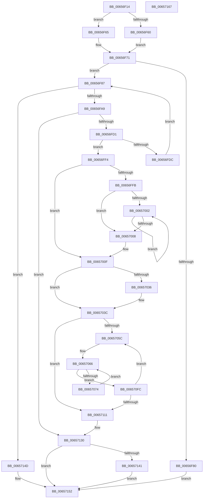

# ExpPlGrowTableIfNeeded

- RVA: `0x00656F14`–`0x00657168` (길이 `596` bytes)
- VA: `0x0000000140656F14`
- 실행 섹션: `.text`
- PDB 이름 있음: `예`; PDB Function 태그: `아니요`
- unwind 정보 RVA: `0x00099F28`
- 디코드: `165`개 명령, `596/596` bytes 표시
- 미해석 바이트: `0` (있으면 어셈블리에 `.byte`로 보존)

> 이 문서는 커널 이미지의 기계어와 PDB 기호를 분석해 생성했습니다. 4번과 5번은 함수 원형과 자료형을 바이너리 사용 방식에서 추정한 C 해석이며 원본 소스 복구 결과는 아닙니다.

## 1. Dependencies

- 직접 호출 지점: **8**; 고유 호출 대상: **4**
- 직접 호출자로 확인된 함수: **1**
- RIP 상대 이미지 참조: **6**

### Outgoing calls
- `0x00656F44` → [KeAcquireInStackQueuedSpinLock](../27/KeAcquireInStackQueuedSpinLock_function_002757A0.md) (function, `0x002757A0`)
- `0x00656F76` → [KeReleaseInStackQueuedSpinLock](../34/KeReleaseInStackQueuedSpinLock_function_00342CE0.md) (function, `0x00342CE0`)
- `0x00656F98` → [ExAllocatePool2](../../poolcode/B8/ExAllocatePool2_function_00B820F0.md) (function, `0x00B820F0`)
- `0x00656FB5` → [KeAcquireInStackQueuedSpinLock](../27/KeAcquireInStackQueuedSpinLock_function_002757A0.md) (function, `0x002757A0`)
- `0x00656FE1` → [KeReleaseInStackQueuedSpinLock](../34/KeReleaseInStackQueuedSpinLock_function_00342CE0.md) (function, `0x00342CE0`)
- `0x00656FEB` → [ExFreePoolWithTag](../../poolcode/B8/ExFreePoolWithTag_function_00B82870.md) (function, `0x00B82870`)
- `0x00657137` → [KeReleaseInStackQueuedSpinLock](../34/KeReleaseInStackQueuedSpinLock_function_00342CE0.md) (function, `0x00342CE0`)
- `0x00657146` → [ExFreePoolWithTag](../../poolcode/B8/ExFreePoolWithTag_function_00B82870.md) (function, `0x00B82870`)

### Direct callers
- [ExpTrackTableInsertLimit](ExpTrackTableInsertLimit_function_006572D0.md) at `0x0065730A`

### Static image references
- `0x00656F30` → RVA `0x00EFAD00` (`.data`; read)
- `0x00656F49` → RVA `0x00E29084` (`.data`; read)
- `0x00656F58` → RVA `0x00E29080` (`.data`; read)
- `0x0065705C` → RVA `0x00E29088` (`.data`; read)
- `0x00657120` → RVA `0x00E29088` (`.data`; write)
- `0x00657127` → RVA `0x00E29084` (`.data`; write)

## 2. Other-region calls and transfers

- 다른 실행 섹션으로 향하는 call: **3**
  - `0x00656F98` → [ExAllocatePool2](../../poolcode/B8/ExAllocatePool2_function_00B820F0.md) (`.text` → `POOLCODE`)
  - `0x00656FEB` → [ExFreePoolWithTag](../../poolcode/B8/ExFreePoolWithTag_function_00B82870.md) (`.text` → `POOLCODE`)
  - `0x00657146` → [ExFreePoolWithTag](../../poolcode/B8/ExFreePoolWithTag_function_00B82870.md) (`.text` → `POOLCODE`)
- 별도 외부 분기/꼬리 이동을 확인하지 못했습니다.

## 3. Assembly (complete function range)

```asm
00656F14  4C 8B DC                        mov r11, rsp
00656F17  49 89 5B 10                     mov qword ptr [r11 + 0x10], rbx
00656F1B  49 89 6B 18                     mov qword ptr [r11 + 0x18], rbp
00656F1F  56                              push rsi
00656F20  57                              push rdi
00656F21  41 56                           push r14
00656F23  48 83 EC 40                     sub rsp, 0x40
00656F27  0F 57 C0                        xorps xmm0, xmm0
00656F2A  49 8D 53 C8                     lea rdx, [r11 - 0x38]
00656F2E  33 C0                           xor eax, eax
00656F30  48 8D 0D C9 3D 8A 00            lea rcx, [rip + 0x8a3dc9]
00656F37  0F 11 44 24 20                  movups xmmword ptr [rsp + 0x20], xmm0
00656F3C  33 ED                           xor ebp, ebp
00656F3E  49 89 43 D8                     mov qword ptr [r11 - 0x28], rax
00656F42  8B DD                           mov ebx, ebp
00656F44  E8 57 E8 C1 FF                  call 0x1402757a0
00656F49  8B 05 35 21 7D 00               mov eax, dword ptr [rip + 0x7d2135]
00656F4F  44 8D 75 04                     lea r14d, [rbp + 4]
00656F53  C1 E8 05                        shr eax, 5
00656F56  03 C0                           add eax, eax
00656F58  39 05 22 21 7D 00               cmp dword ptr [rip + 0x7d2122], eax
00656F5E  73 05                           jae 0x140656f65
00656F60  40 8A FD                        mov dil, bpl
00656F63  EB 0C                           jmp 0x140656f71
00656F65  41 3B C6                        cmp eax, r14d
00656F68  8B D8                           mov ebx, eax
00656F6A  40 B7 01                        mov dil, 1
00656F6D  41 0F 42 DE                     cmovb ebx, r14d
00656F71  48 8D 4C 24 20                  lea rcx, [rsp + 0x20]
00656F76  E8 65 BD CE FF                  call 0x140342ce0
00656F7B  40 84 FF                        test dil, dil
00656F7E  75 07                           jne 0x140656f87
00656F80  8B FD                           mov edi, ebp
00656F82  E9 CB 01 00 00                  jmp 0x140657152
00656F87  8B D3                           mov edx, ebx
00656F89  B9 40 00 00 00                  mov ecx, 0x40
00656F8E  48 C1 E2 03                     shl rdx, 3
00656F92  41 B8 50 6F 6F 6C               mov r8d, 0x6c6f6f50
00656F98  E8 53 B1 52 00                  call 0x140b820f0
00656F9D  48 8B F0                        mov rsi, rax
00656FA0  48 85 C0                        test rax, rax
00656FA3  0F 84 A4 01 00 00               je 0x14065714d
00656FA9  48 8D 54 24 20                  lea rdx, [rsp + 0x20]
00656FAE  48 8D 0D 4B 3D 8A 00            lea rcx, [rip + 0x8a3d4b]
00656FB5  E8 E6 E7 C1 FF                  call 0x1402757a0
00656FBA  8B 3D C4 20 7D 00               mov edi, dword ptr [rip + 0x7d20c4]
00656FC0  C1 EF 05                        shr edi, 5
00656FC3  03 FF                           add edi, edi
00656FC5  39 3D B5 20 7D 00               cmp dword ptr [rip + 0x7d20b5], edi
00656FCB  0F 82 5F 01 00 00               jb 0x140657130
00656FD1  41 3B FE                        cmp edi, r14d
00656FD4  41 0F 42 FE                     cmovb edi, r14d
00656FD8  3B DF                           cmp ebx, edi
00656FDA  73 18                           jae 0x140656ff4
00656FDC  48 8D 4C 24 20                  lea rcx, [rsp + 0x20]
00656FE1  E8 FA BC CE FF                  call 0x140342ce0
00656FE6  33 D2                           xor edx, edx
00656FE8  48 8B CE                        mov rcx, rsi
00656FEB  E8 80 B8 52 00                  call 0x140b82870
00656FF0  8B DF                           mov ebx, edi
00656FF2  EB 93                           jmp 0x140656f87
00656FF4  8D 43 FF                        lea eax, [rbx - 1]
00656FF7  85 C3                           test ebx, eax
00656FF9  74 14                           je 0x14065700f
00656FFB  83 C9 FF                        or ecx, 0xffffffff
00656FFE  85 DB                           test ebx, ebx
00657000  74 06                           je 0x140657008
00657002  FF C1                           inc ecx
00657004  D1 EB                           shr ebx, 1
00657006  75 FA                           jne 0x140657002
00657008  BB 01 00 00 00                  mov ebx, 1
0065700D  D3 E3                           shl ebx, cl
0065700F  B8 00 00 00 04                  mov eax, 0x4000000
00657014  3B D8                           cmp ebx, eax
00657016  0F 47 D8                        cmova ebx, eax
00657019  48 8D 05 60 20 7D 00            lea rax, [rip + 0x7d2060]
00657020  48 83 C8 01                     or rax, 1
00657024  8B CB                           mov ecx, ebx
00657026  48 8D 14 DE                     lea rdx, [rsi + rbx*8]
0065702A  48 3B F2                        cmp rsi, rdx
0065702D  48 0F 47 CD                     cmova rcx, rbp
00657031  48 85 C9                        test rcx, rcx
00657034  74 06                           je 0x14065703c
00657036  48 8B FE                        mov rdi, rsi
00657039  F3 48 AB                        rep stosq qword ptr [rdi], rax
0065703C  8B 15 42 20 7D 00               mov edx, dword ptr [rip + 0x7d2042]
00657042  49 83 C8 FF                     or r8, 0xffffffffffffffff
00657046  8B CA                           mov ecx, edx
00657048  8B FD                           mov edi, ebp
0065704A  83 E1 1F                        and ecx, 0x1f
0065704D  49 D3 E0                        shl r8, cl
00657050  F7 C2 E0 FF FF FF               test edx, 0xffffffe0
00657056  0F 86 B5 00 00 00               jbe 0x140657111
0065705C  4C 8B 1D 25 20 7D 00            mov r11, qword ptr [rip + 0x7d2025]
00657063  44 8B D7                        mov r10d, edi
00657066  4F 8B 0C D3                     mov r9, qword ptr [r11 + r10*8]
0065706A  41 F6 C1 01                     test r9b, 1
0065706E  0F 85 88 00 00 00               jne 0x1406570fc
00657074  49 8B 01                        mov rax, qword ptr [r9]
00657077  4B 89 04 D3                     mov qword ptr [r11 + r10*8], rax
0065707B  49 8B 41 08                     mov rax, qword ptr [r9 + 8]
0065707F  49 23 C0                        and rax, r8
00657082  48 89 44 24 60                  mov qword ptr [rsp + 0x60], rax
00657087  0F B6 C0                        movzx eax, al
0065708A  48 05 CB 5D B1 00               add rax, 0xb15dcb
00657090  48 6B C8 25                     imul rcx, rax, 0x25
00657094  0F B6 44 24 61                  movzx eax, byte ptr [rsp + 0x61]
00657099  48 03 C8                        add rcx, rax
0065709C  0F B6 44 24 62                  movzx eax, byte ptr [rsp + 0x62]
006570A1  48 6B D1 25                     imul rdx, rcx, 0x25
006570A5  48 03 D0                        add rdx, rax
006570A8  0F B6 44 24 63                  movzx eax, byte ptr [rsp + 0x63]
006570AD  48 6B CA 25                     imul rcx, rdx, 0x25
006570B1  48 03 C8                        add rcx, rax
006570B4  0F B6 44 24 64                  movzx eax, byte ptr [rsp + 0x64]
006570B9  48 6B D1 25                     imul rdx, rcx, 0x25
006570BD  48 03 D0                        add rdx, rax
006570C0  0F B6 44 24 65                  movzx eax, byte ptr [rsp + 0x65]
006570C5  48 6B CA 25                     imul rcx, rdx, 0x25
006570C9  48 03 C8                        add rcx, rax
006570CC  0F B6 44 24 66                  movzx eax, byte ptr [rsp + 0x66]
006570D1  48 6B D1 25                     imul rdx, rcx, 0x25
006570D5  48 03 D0                        add rdx, rax
006570D8  0F B6 44 24 67                  movzx eax, byte ptr [rsp + 0x67]
006570DD  48 6B CA 25                     imul rcx, rdx, 0x25
006570E1  8D 53 FF                        lea edx, [rbx - 1]
006570E4  48 03 C1                        add rax, rcx
006570E7  8B C0                           mov eax, eax
006570E9  48 23 D0                        and rdx, rax
006570EC  48 8B 04 D6                     mov rax, qword ptr [rsi + rdx*8]
006570F0  49 89 01                        mov qword ptr [r9], rax
006570F3  4C 89 0C D6                     mov qword ptr [rsi + rdx*8], r9
006570F7  E9 6A FF FF FF                  jmp 0x140657066
006570FC  8B 15 82 1F 7D 00               mov edx, dword ptr [rip + 0x7d1f82]
00657102  FF C7                           inc edi
00657104  8B C2                           mov eax, edx
00657106  C1 E8 05                        shr eax, 5
00657109  3B F8                           cmp edi, eax
0065710B  0F 82 4B FF FF FF               jb 0x14065705c
00657111  48 8B 05 70 1F 7D 00            mov rax, qword ptr [rip + 0x7d1f70]
00657118  83 E2 1F                        and edx, 0x1f
0065711B  C1 E3 05                        shl ebx, 5
0065711E  0B D3                           or edx, ebx
00657120  48 89 35 61 1F 7D 00            mov qword ptr [rip + 0x7d1f61], rsi
00657127  89 15 57 1F 7D 00               mov dword ptr [rip + 0x7d1f57], edx
0065712D  48 8B F0                        mov rsi, rax
00657130  48 8D 4C 24 20                  lea rcx, [rsp + 0x20]
00657135  8B FD                           mov edi, ebp
00657137  E8 A4 BB CE FF                  call 0x140342ce0
0065713C  48 85 F6                        test rsi, rsi
0065713F  74 11                           je 0x140657152
00657141  33 D2                           xor edx, edx
00657143  48 8B CE                        mov rcx, rsi
00657146  E8 25 B7 52 00                  call 0x140b82870
0065714B  EB 05                           jmp 0x140657152
0065714D  BF 17 00 00 C0                  mov edi, 0xc0000017
00657152  48 8B 5C 24 68                  mov rbx, qword ptr [rsp + 0x68]
00657157  8B C7                           mov eax, edi
00657159  48 8B 6C 24 70                  mov rbp, qword ptr [rsp + 0x70]
0065715E  48 83 C4 40                     add rsp, 0x40
00657162  41 5E                           pop r14
00657164  5F                              pop rdi
00657165  5E                              pop rsi
00657166  C3                              ret
00657167  CC                              int3
```

## 4. C-style interpretation (structured pseudocode)

```c
__int64 __fastcall ExpPlGrowTableIfNeeded(void)
{
    __int64 result;
    __int64 v_rbp;
    __int64 v_rbx;
    __int64 v_rdi;
    __int64 v_rsp;
    unsigned __int64 v_stack_m38;
    unsigned __int64 v_stack_p10;
    unsigned __int64 v_stack_p18;
    unsigned __int64 v_stack_p8;
    unsigned __int8 v_stack_p9;
    unsigned __int8 v_stack_pA;
    unsigned __int8 v_stack_pB;
    unsigned __int8 v_stack_pC;
    unsigned __int8 v_stack_pD;
    unsigned __int8 v_stack_pE;
    unsigned __int8 v_stack_pF;

    *(unsigned __int64 *)(v_rsp + 16) = v_rbx;
    *(unsigned __int64 *)(v_rsp + 24) = v_rbp;
    v_rsp = (v_rsp) - (64);
    result = 0;
    v_stack_m38 = v_xmm0;
    v_rbp = 0;
    *(unsigned __int64 *)(v_rsp - 40) = 0;
    result = KeAcquireInStackQueuedSpinLock(v_rip + 9059785, v_rsp - 56, a3, a4);
    result = (unsigned int)(((unsigned int)(*(unsigned int *)(v_rip + 8200501))) >> (5));
    result = (unsigned int)((result) + ((unsigned int)(result)));
    if ((*(unsigned int *)(v_rip + 8200482)) >= ((unsigned int)(result))) goto loc_00656F65;
    goto loc_00656F71;
loc_00656F65:
    v_rbx = (unsigned int)((unsigned int)(result));
    if (((unsigned int)(result)) < ((unsigned int)(v_rbp + 4))) { v_rbx = (unsigned int)(v_rbp + 4); }
loc_00656F71:
    result = KeReleaseInStackQueuedSpinLock(v_stack_m38, v_rsp - 56, a3, a4);
    if (1 != 0) goto loc_00656F87;
    goto loc_00657152;
loc_00656F87:
    a2 = ((unsigned int)((unsigned int)(v_rbx))) << (3);
    result = ExAllocatePool2(64, a2, (unsigned int)(0x6C6F6F50ULL), a4);
    if (result == 0) goto loc_0065714D;
    result = KeAcquireInStackQueuedSpinLock(v_rip + 9059659, v_stack_m38, (unsigned int)(0x6C6F6F50ULL), a4);
    v_rdi = (unsigned int)(((unsigned int)(*(unsigned int *)(v_rip + 8200388))) >> (5));
    v_rdi = (unsigned int)((v_rdi) + ((unsigned int)(v_rdi)));
    if ((*(unsigned int *)(v_rip + 8200373)) < ((unsigned int)(v_rdi))) goto loc_00657130;
    if (((unsigned int)(v_rdi)) < ((unsigned int)(v_rbp + 4))) { v_rdi = (unsigned int)(v_rbp + 4); }
    if (((unsigned int)(v_rbx)) >= ((unsigned int)(v_rdi))) goto loc_00656FF4;
    result = KeReleaseInStackQueuedSpinLock(v_stack_m38, v_stack_m38, (unsigned int)(0x6C6F6F50ULL), a4);
    a2 = 0;
    result = ExFreePoolWithTag(result, a2, (unsigned int)(0x6C6F6F50ULL), a4);
    goto loc_00656F87;
loc_00656FF4:
    if ((((unsigned int)((unsigned int)((unsigned int)(v_rdi)))) & ((unsigned int)((unsigned int)((unsigned int)(v_rdi)) - 1))) == 0) goto loc_0065700F;
    a1 = (unsigned int)((result) | (0xFFFFFFFFULL));
    if ((unsigned int)((unsigned int)((unsigned int)(v_rdi))) == 0) goto loc_00657008;
loc_00657002:
    a1 = (unsigned int)((a1) + 1);
    v_rbx = (unsigned int)(((unsigned int)((unsigned int)(v_rdi))) >> (1));
    if (condition_is_not_equal) goto loc_00657002;
loc_00657008:
    v_rbx = (unsigned int)((1) << ((unsigned __int8)(a1)));
loc_0065700F:
    if (((unsigned int)(v_rbx)) > ((unsigned int)((unsigned int)(0x4000000ULL)))) { v_rbx = (unsigned int)((unsigned int)(0x4000000ULL)); }
    result = (v_rip + 8200288) | (1);
    a1 = (unsigned int)((unsigned int)(v_rbx));
    if (result > (result + v_rbx * 8)) { a1 = 0; }
    if (a1 != 0) {
        v_rdi = result;
    }
    a3 = ((unsigned int)(0x6C6F6F50ULL)) | (-1);
    a1 = (unsigned int)(((unsigned int)((unsigned int)((unsigned int)(*(unsigned int *)(v_rip + 8200258))))) & (31));
    a3 = (a3) << ((unsigned __int8)(a1));
    if (condition_is_below_or_equal) goto loc_00657111;
loc_0065705C:
loc_00657066:
    if ((((unsigned __int8)(*(unsigned __int64 *)(*(unsigned __int64 *)(v_rip + 8200229) + 0 * 8))) & (1)) != 0) goto loc_006570FC;
    *(unsigned __int64 *)(*(unsigned __int64 *)(v_rip + 8200229) + 0 * 8) = *(unsigned __int64 *)(*(unsigned __int64 *)(*(unsigned __int64 *)(v_rip + 8200229) + 0 * 8));
    result = (*(unsigned __int64 *)(*(unsigned __int64 *)(*(unsigned __int64 *)(v_rip + 8200229) + 0 * 8) + 8)) & (a3);
    v_stack_p8 = result;
    result = ((unsigned __int8)(result)) + (0xB15DCBULL);
    a1 = (a1) * (result);
    a1 = (a1) + (v_stack_p9);
    a2 = ((unsigned int)(*(unsigned int *)(v_rip + 8200258))) * (a1);
    a2 = (a2) + (v_stack_pA);
    a1 = (a1) * (a2);
    a1 = (a1) + (v_stack_pB);
    a2 = (a2) * (a1);
    a2 = (a2) + (v_stack_pC);
    a1 = (a1) * (a2);
    a1 = (a1) + (v_stack_pD);
    a2 = (a2) * (a1);
    a2 = (a2) + (v_stack_pE);
    a1 = (a1) * (a2);
    result = (v_stack_pF) + (a1);
    a2 = (v_rbx - 1) & ((unsigned int)((unsigned int)(result)));
    *(unsigned __int64 *)(*(unsigned __int64 *)(*(unsigned __int64 *)(v_rip + 8200229) + 0 * 8)) = *(unsigned __int64 *)(result + a2 * 8);
    *(unsigned __int64 *)(result + a2 * 8) = *(unsigned __int64 *)(*(unsigned __int64 *)(v_rip + 8200229) + 0 * 8);
    goto loc_00657066;
loc_006570FC:
    v_rdi = (unsigned int)((0) + 1);
    result = (unsigned int)(((unsigned int)((unsigned int)((unsigned int)(*(unsigned int *)(v_rip + 8200066))))) >> (5));
    if (((unsigned int)(v_rdi)) < ((unsigned int)(result))) goto loc_0065705C;
loc_00657111:
    a2 = (unsigned int)(((unsigned int)(*(unsigned int *)(v_rip + 8200066))) & (31));
    v_rbx = (unsigned int)((v_rbx) << (5));
    a2 = (unsigned int)((a2) | ((unsigned int)(v_rbx)));
    *(unsigned __int64 *)(v_rip + 8200033) = result;
    *(unsigned int *)(v_rip + 8200023) = (unsigned int)(a2);
loc_00657130:
    result = KeReleaseInStackQueuedSpinLock(v_stack_m38, a2, a3, *(unsigned __int64 *)(*(unsigned __int64 *)(v_rip + 8200229) + 0 * 8));
    if (*(unsigned __int64 *)(v_rip + 8200048) == 0) goto loc_00657152;
    a2 = 0;
    result = ExFreePoolWithTag(*(unsigned __int64 *)(v_rip + 8200048), a2, a3, *(unsigned __int64 *)(*(unsigned __int64 *)(v_rip + 8200229) + 0 * 8));
    goto loc_00657152;
loc_0065714D:
loc_00657152:
    v_rsp = (v_rsp) + (64);
    return (unsigned int)((unsigned int)((unsigned int)(0xC0000017ULL)));
}
```

## 5. (Beta) C Style

```c
void ExpPlGrowTableIfNeeded(void)
{
    int64_t result;
    int64_t local_rbp;
    int64_t local_rbx;
    int64_t local_rdi;
    int64_t local_rsp;
    uint64_t v_stack_m38;
    uint64_t v_stack_p10;
    uint64_t v_stack_p18;
    uint64_t v_stack_p8;
    uint8_t v_stack_p9;
    uint8_t v_stack_pA;
    uint8_t v_stack_pB;
    uint8_t v_stack_pC;
    uint8_t v_stack_pD;
    uint8_t v_stack_pE;
    uint8_t v_stack_pF;

    *(uint64_t *)(local_rsp + 0x10) = local_rbx;
    *(uint64_t *)(local_rsp + 0x18) = local_rbp;
    local_rsp = (local_rsp) - (64);
    result = 0;
    v_stack_m38 = v_xmm0;
    local_rbp = 0;
    *(uint64_t *)(local_rsp - 0x28) = 0;
    result = KeAcquireInStackQueuedSpinLock(v_rip + 9059785, local_rsp - 56, a3, a4);
    result = (uint32_t)(((uint32_t)(*(uint32_t *)(v_rip + 0x7D2135))) >> (5));
    result = (uint32_t)((result) + ((uint32_t)(result)));
    if ((*(uint32_t *)(v_rip + 0x7D2122)) >= ((uint32_t)(result))) goto loc_00656F65;
    goto loc_00656F71;
loc_00656F65:
    local_rbx = (uint32_t)((uint32_t)(result));
    if (((uint32_t)(result)) < ((uint32_t)(local_rbp + 4))) { local_rbx = (uint32_t)(local_rbp + 4); }
loc_00656F71:
    result = KeReleaseInStackQueuedSpinLock(v_stack_m38, local_rsp - 56, a3, a4);
    if (1 != 0) goto loc_00656F87;
    goto loc_00657152;
loc_00656F87:
    a2 = ((uint32_t)((uint32_t)(local_rbx))) << (3);
    result = ExAllocatePool2(64, a2, (uint32_t)(0x6C6F6F50ULL), a4);
    if (result == 0) goto loc_0065714D;
    result = KeAcquireInStackQueuedSpinLock(v_rip + 9059659, v_stack_m38, (uint32_t)(0x6C6F6F50ULL), a4);
    local_rdi = (uint32_t)(((uint32_t)(*(uint32_t *)(v_rip + 0x7D20C4))) >> (5));
    local_rdi = (uint32_t)((local_rdi) + ((uint32_t)(local_rdi)));
    if ((*(uint32_t *)(v_rip + 0x7D20B5)) < ((uint32_t)(local_rdi))) goto loc_00657130;
    if (((uint32_t)(local_rdi)) < ((uint32_t)(local_rbp + 4))) { local_rdi = (uint32_t)(local_rbp + 4); }
    if (((uint32_t)(local_rbx)) >= ((uint32_t)(local_rdi))) goto loc_00656FF4;
    result = KeReleaseInStackQueuedSpinLock(v_stack_m38, v_stack_m38, (uint32_t)(0x6C6F6F50ULL), a4);
    a2 = 0;
    result = ExFreePoolWithTag(result, a2, (uint32_t)(0x6C6F6F50ULL), a4);
    goto loc_00656F87;
loc_00656FF4:
    if ((((uint32_t)((uint32_t)((uint32_t)(local_rdi)))) & ((uint32_t)((uint32_t)((uint32_t)(local_rdi)) - 1))) == 0) goto loc_0065700F;
    a1 = (uint32_t)((result) | (0xFFFFFFFFULL));
    if ((uint32_t)((uint32_t)((uint32_t)(local_rdi))) == 0) goto loc_00657008;
loc_00657002:
    a1 = (uint32_t)((a1) + 1);
    local_rbx = (uint32_t)(((uint32_t)((uint32_t)(local_rdi))) >> (1));
    if (condition_is_not_equal) goto loc_00657002;
loc_00657008:
    local_rbx = (uint32_t)((1) << ((uint8_t)(a1)));
loc_0065700F:
    if (((uint32_t)(local_rbx)) > ((uint32_t)((uint32_t)(0x4000000ULL)))) { local_rbx = (uint32_t)((uint32_t)(0x4000000ULL)); }
    result = (v_rip + 8200288) | (1);
    a1 = (uint32_t)((uint32_t)(local_rbx));
    if (result > (result + local_rbx * 8)) { a1 = 0; }
    if (a1 != 0) {
        local_rdi = result;
    }
    a3 = ((uint32_t)(0x6C6F6F50ULL)) | (-1);
    a1 = (uint32_t)(((uint32_t)((uint32_t)((uint32_t)(*(uint32_t *)(v_rip + 0x7D2042))))) & (31));
    a3 = (a3) << ((uint8_t)(a1));
    if (condition_is_below_or_equal) goto loc_00657111;
loc_0065705C:
loc_00657066:
    if ((((uint8_t)(*(uint64_t *)(*(uint64_t *)(v_rip + 0x7D2025) + 0x0 * 8))) & (1)) != 0) goto loc_006570FC;
    *(uint64_t *)(*(uint64_t *)(v_rip + 0x7D2025) + 0x0 * 8) = *(uint64_t *)(*(uint64_t *)(*(uint64_t *)(v_rip + 0x7D2025) + 0x0 * 8));
    result = (*(uint64_t *)(*(uint64_t *)(*(uint64_t *)(v_rip + 0x7D2025) + 0x0 * 8) + 0x8)) & (a3);
    v_stack_p8 = result;
    result = ((uint8_t)(result)) + (0xB15DCBULL);
    a1 = (a1) * (result);
    a1 = (a1) + (v_stack_p9);
    a2 = ((uint32_t)(*(uint32_t *)(v_rip + 0x7D2042))) * (a1);
    a2 = (a2) + (v_stack_pA);
    a1 = (a1) * (a2);
    a1 = (a1) + (v_stack_pB);
    a2 = (a2) * (a1);
    a2 = (a2) + (v_stack_pC);
    a1 = (a1) * (a2);
    a1 = (a1) + (v_stack_pD);
    a2 = (a2) * (a1);
    a2 = (a2) + (v_stack_pE);
    a1 = (a1) * (a2);
    result = (v_stack_pF) + (a1);
    a2 = (local_rbx - 1) & ((uint32_t)((uint32_t)(result)));
    *(uint64_t *)(*(uint64_t *)(*(uint64_t *)(v_rip + 0x7D2025) + 0x0 * 8)) = *(uint64_t *)(result + a2 * 8);
    *(uint64_t *)(result + a2 * 8) = *(uint64_t *)(*(uint64_t *)(v_rip + 0x7D2025) + 0x0 * 8);
    goto loc_00657066;
loc_006570FC:
    local_rdi = (uint32_t)((0) + 1);
    result = (uint32_t)(((uint32_t)((uint32_t)((uint32_t)(*(uint32_t *)(v_rip + 0x7D1F82))))) >> (5));
    if (((uint32_t)(local_rdi)) < ((uint32_t)(result))) goto loc_0065705C;
loc_00657111:
    a2 = (uint32_t)(((uint32_t)(*(uint32_t *)(v_rip + 0x7D1F82))) & (31));
    local_rbx = (uint32_t)((local_rbx) << (5));
    a2 = (uint32_t)((a2) | ((uint32_t)(local_rbx)));
    *(uint64_t *)(v_rip + 0x7D1F61) = result;
    *(uint32_t *)(v_rip + 0x7D1F57) = (uint32_t)(a2);
loc_00657130:
    result = KeReleaseInStackQueuedSpinLock(v_stack_m38, a2, a3, *(uint64_t *)(*(uint64_t *)(v_rip + 0x7D2025) + 0x0 * 8));
    if (*(uint64_t *)(v_rip + 0x7D1F70) == 0) goto loc_00657152;
    a2 = 0;
    result = ExFreePoolWithTag(*(uint64_t *)(v_rip + 0x7D1F70), a2, a3, *(uint64_t *)(*(uint64_t *)(v_rip + 0x7D2025) + 0x0 * 8));
    goto loc_00657152;
loc_0065714D:
loc_00657152:
    local_rsp = (local_rsp) + (64);
    return (uint32_t)((uint32_t)((uint32_t)(0xC0000017ULL)));
}
```

## 6. Execution-region graph

[열기: 2D/3D 그래프와 함수 탐색 컨트롤 패널](../../../control-panel.html?section=text&rva=0x00656F14&view=graph)

- 2D 그래프는 위에서 아래로 흐르고, 3D 그래프는 빈 공간을 드래그해 회전합니다. Shift+드래그는 이동, 휠은 확대·축소, 함수 노드 선택은 대상 보고서 이동입니다.

### Static fallback


