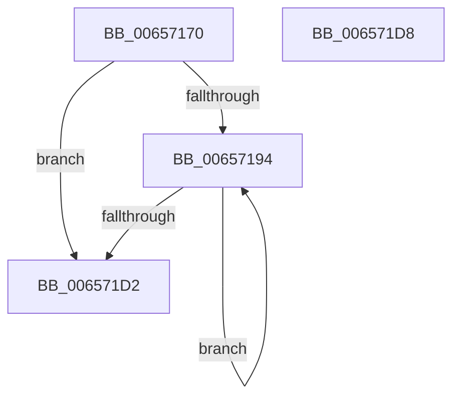

# ExpPlProcessNotifications

- RVA: `0x00657170`–`0x006571D9` (길이 `105` bytes)
- VA: `0x0000000140657170`
- 실행 섹션: `.text`
- PDB 이름 있음: `예`; PDB Function 태그: `아니요`
- unwind 정보 RVA: `0x000697A4`
- 디코드: `27`개 명령, `105/105` bytes 표시
- 미해석 바이트: `0` (있으면 어셈블리에 `.byte`로 보존)

> 이 문서는 커널 이미지의 기계어와 PDB 기호를 분석해 생성했습니다. 4번과 5번은 함수 원형과 자료형을 바이너리 사용 방식에서 추정한 C 해석이며 원본 소스 복구 결과는 아닙니다.

## 1. Dependencies

- 직접 호출 지점: **2**; 고유 호출 대상: **2**
- 직접 호출자로 확인된 함수: **0**
- RIP 상대 이미지 참조: **2**

### Outgoing calls
- `0x00657187` → [ExpInterlockedFlushSList](../6B/ExpInterlockedFlushSList_function_006BA5F0.md) (function, `0x006BA5F0`)
- `0x006571C8` → [ZwUpdateWnfStateData](../6B/ZwUpdateWnfStateData_function_006B0D10.md) (function, `0x006B0D10`)

### Direct callers
- 이 함수 시작 RVA로 연결되는 직접 call은 확인되지 않았습니다. 간접 호출은 완전히 역산할 수 없습니다.

### Static image references
- `0x00657176` → RVA `0x00E29120` (`.data`; read)
- `0x0065717D` → RVA `0x00E29130` (`.data`; write)

## 2. Other-region calls and transfers

- 다른 실행 섹션으로 향하는 call: **0**
- 별도 외부 분기/꼬리 이동을 확인하지 못했습니다.

## 3. Assembly (complete function range)

```asm
00657170  40 53                           push rbx
00657172  48 83 EC 40                     sub rsp, 0x40
00657176  48 8D 0D A3 1F 7D 00            lea rcx, [rip + 0x7d1fa3]
0065717D  C7 05 A9 1F 7D 00 00 00 00 00   mov dword ptr [rip + 0x7d1fa9], 0
00657187  E8 64 34 06 00                  call 0x1406ba5f0
0065718C  48 8B D8                        mov rbx, rax
0065718F  48 85 C0                        test rax, rax
00657192  74 3E                           je 0x1406571d2
00657194  83 64 24 30 00                  and dword ptr [rsp + 0x30], 0
00657199  48 8D 13                        lea rdx, [rbx]
0065719C  48 8B 1B                        mov rbx, qword ptr [rbx]
0065719F  45 33 C9                        xor r9d, r9d
006571A2  83 64 24 28 00                  and dword ptr [rsp + 0x28], 0
006571A7  48 83 64 24 20 00               and qword ptr [rsp + 0x20], 0
006571AD  C7 42 10 00 00 00 00            mov dword ptr [rdx + 0x10], 0
006571B4  8B 4A B8                        mov ecx, dword ptr [rdx - 0x48]
006571B7  45 8D 41 04                     lea r8d, [r9 + 4]
006571BB  89 4C 24 58                     mov dword ptr [rsp + 0x58], ecx
006571BF  48 8D 4A F0                     lea rcx, [rdx - 0x10]
006571C3  48 8D 54 24 58                  lea rdx, [rsp + 0x58]
006571C8  E8 43 9B 05 00                  call 0x1406b0d10
006571CD  48 85 DB                        test rbx, rbx
006571D0  75 C2                           jne 0x140657194
006571D2  48 83 C4 40                     add rsp, 0x40
006571D6  5B                              pop rbx
006571D7  C3                              ret
006571D8  CC                              int3
```

## 4. C-style interpretation (structured pseudocode)

```c
__int64 __fastcall ExpPlProcessNotifications(__int64 a1, __int64 a2, __int64 a3, int a4)
{
    __int64 result;
    __int64 v_rsp;
    unsigned int v_stack_m18;
    unsigned int v_stack_m20;
    unsigned __int64 v_stack_m28;
    unsigned int v_stack_p10;

    v_rsp = (v_rsp) - (64);
    *(unsigned int *)(v_rip + 8200105) = 0;
    result = ExpInterlockedFlushSList(v_rip + 8200099, a2, a3, a4);
    if (result == 0) goto loc_006571D2;
loc_00657194:
    a4 = 0;
    *(unsigned int *)(result + 16) = 0;
    v_stack_p10 = (unsigned int)((unsigned int)(*(unsigned int *)(result - 72)));
    result = ZwUpdateWnfStateData(result - 16, v_stack_p10, a4 + 4, a4);
    if (*(unsigned __int64 *)(result) != 0) goto loc_00657194;
loc_006571D2:
    v_rsp = (v_rsp) + (64);
    return result;
}
```

## 5. (Beta) C Style

```c
int64_t ExpPlProcessNotifications(int64_t Arg1, int64_t Arg2, int64_t Arg3, int32_t Arg4)
{
    int64_t result;
    int64_t local_rsp;
    uint32_t v_stack_m18;
    uint32_t v_stack_m20;
    uint64_t v_stack_m28;
    uint32_t v_stack_p10;

    local_rsp = (local_rsp) - (64);
    *(uint32_t *)(v_rip + 0x7D1FA9) = 0;
    result = ExpInterlockedFlushSList(v_rip + 8200099, Arg2, Arg3, Arg4);
    if (result == 0) goto loc_006571D2;
loc_00657194:
    Arg4 = 0;
    *(uint32_t *)(result + 0x10) = 0;
    v_stack_p10 = (uint32_t)((uint32_t)(*(uint32_t *)(result - 0x48)));
    result = ZwUpdateWnfStateData(result - 16, v_stack_p10, Arg4 + 4, Arg4);
    if (*(uint64_t *)(result) != 0) goto loc_00657194;
loc_006571D2:
    local_rsp = (local_rsp) + (64);
    return result;
}
```

## 6. Execution-region graph

[열기: 2D/3D 그래프와 함수 탐색 컨트롤 패널](../../../control-panel.html?section=text&rva=0x00657170&view=graph)

- 2D 그래프는 위에서 아래로 흐르고, 3D 그래프는 빈 공간을 드래그해 회전합니다. Shift+드래그는 이동, 휠은 확대·축소, 함수 노드 선택은 대상 보고서 이동입니다.

### Static fallback


