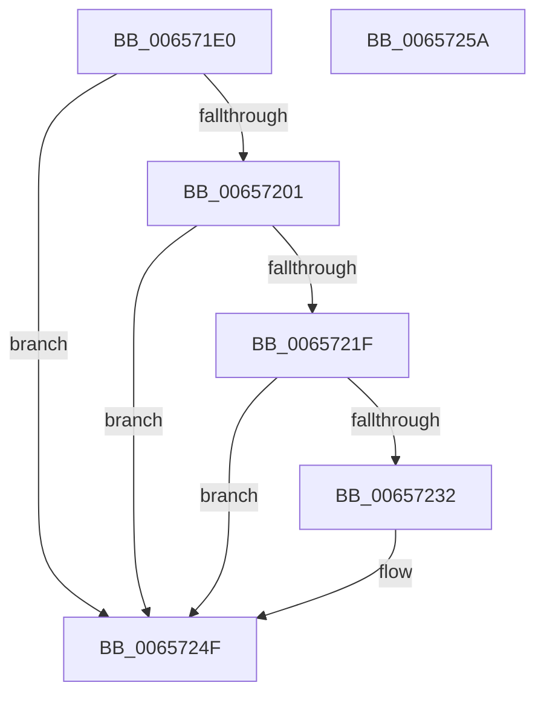

# ExpPlRunOnceInit

- RVA: `0x006571E0`–`0x0065725B` (길이 `123` bytes)
- VA: `0x00000001406571E0`
- 실행 섹션: `.text`
- PDB 이름 있음: `예`; PDB Function 태그: `아니요`
- unwind 정보 RVA: `0x0005CF00`
- 디코드: `34`개 명령, `123/123` bytes 표시
- 미해석 바이트: `0` (있으면 어셈블리에 `.byte`로 보존)

> 이 문서는 커널 이미지의 기계어와 PDB 기호를 분석해 생성했습니다. 4번과 5번은 함수 원형과 자료형을 바이너리 사용 방식에서 추정한 C 해석이며 원본 소스 복구 결과는 아닙니다.

## 1. Dependencies

- 직접 호출 지점: **4**; 고유 호출 대상: **4**
- 직접 호출자로 확인된 함수: **0**
- RIP 상대 이미지 참조: **3**

### Outgoing calls
- `0x006571F6` → [RtlCreateAcl](../../page/91/RtlCreateAcl_function_00916F00.md) (function, `0x00916F00`)
- `0x00657216` → [RtlAddAccessAllowedAce](../../page/92/RtlAddAccessAllowedAce_function_009298C0.md) (function, `0x009298C0`)
- `0x00657229` → [RtlCreateSecurityDescriptor](../../page/9F/RtlCreateSecurityDescriptor_function_009F1DF0.md) (function, `0x009F1DF0`)
- `0x00657245` → [RtlSetDaclSecurityDescriptor](../../page/9E/RtlSetDaclSecurityDescriptor_function_009EC210.md) (function, `0x009EC210`)

### Direct callers
- 이 함수 시작 RVA로 연결되는 직접 call은 확인되지 않았습니다. 간접 호출은 완전히 역산할 수 없습니다.

### Static image references
- `0x006571EB` → RVA `0x00E290B8` (`.data`; read)
- `0x00657201` → RVA `0x00E67D48` (`.data`; read)
- `0x00657222` → RVA `0x00E29090` (`.data`; read)

## 2. Other-region calls and transfers

- 다른 실행 섹션으로 향하는 call: **4**
  - `0x006571F6` → [RtlCreateAcl](../../page/91/RtlCreateAcl_function_00916F00.md) (`.text` → `PAGE`)
  - `0x00657216` → [RtlAddAccessAllowedAce](../../page/92/RtlAddAccessAllowedAce_function_009298C0.md) (`.text` → `PAGE`)
  - `0x00657229` → [RtlCreateSecurityDescriptor](../../page/9F/RtlCreateSecurityDescriptor_function_009F1DF0.md) (`.text` → `PAGE`)
  - `0x00657245` → [RtlSetDaclSecurityDescriptor](../../page/9E/RtlSetDaclSecurityDescriptor_function_009EC210.md) (`.text` → `PAGE`)
- 별도 외부 분기/꼬리 이동을 확인하지 못했습니다.

## 3. Assembly (complete function range)

```asm
006571E0  40 53                           push rbx
006571E2  48 83 EC 20                     sub rsp, 0x20
006571E6  BA 59 00 00 00                  mov edx, 0x59
006571EB  48 8D 0D C6 1E 7D 00            lea rcx, [rip + 0x7d1ec6]
006571F2  44 8D 42 A9                     lea r8d, [rdx - 0x57]
006571F6  E8 05 FD 2B 00                  call 0x140916f00
006571FB  33 DB                           xor ebx, ebx
006571FD  85 C0                           test eax, eax
006571FF  78 4E                           js 0x14065724f
00657201  4C 8B 0D 40 0B 81 00            mov r9, qword ptr [rip + 0x810b40]
00657208  8D 53 02                        lea edx, [rbx + 2]
0065720B  44 8D 43 01                     lea r8d, [rbx + 1]
0065720F  48 8D 0D A2 1E 7D 00            lea rcx, [rip + 0x7d1ea2]
00657216  E8 A5 26 2D 00                  call 0x1409298c0
0065721B  85 C0                           test eax, eax
0065721D  78 30                           js 0x14065724f
0065721F  8D 53 01                        lea edx, [rbx + 1]
00657222  48 8D 0D 67 1E 7D 00            lea rcx, [rip + 0x7d1e67]
00657229  E8 C2 AB 39 00                  call 0x1409f1df0
0065722E  85 C0                           test eax, eax
00657230  78 1D                           js 0x14065724f
00657232  45 33 C9                        xor r9d, r9d
00657235  4C 8D 05 7C 1E 7D 00            lea r8, [rip + 0x7d1e7c]
0065723C  B2 01                           mov dl, 1
0065723E  48 8D 0D 4B 1E 7D 00            lea rcx, [rip + 0x7d1e4b]
00657245  E8 C6 4F 39 00                  call 0x1409ec210
0065724A  85 C0                           test eax, eax
0065724C  0F 49 C3                        cmovns eax, ebx
0065724F  F7 D0                           not eax
00657251  C1 E8 1F                        shr eax, 0x1f
00657254  48 83 C4 20                     add rsp, 0x20
00657258  5B                              pop rbx
00657259  C3                              ret
0065725A  CC                              int3
```

## 4. C-style interpretation (structured pseudocode)

```c
__int64 __fastcall ExpPlRunOnceInit(void)
{
    __int64 result;
    __int64 v_rbx;
    __int64 v_rsp;

    v_rsp = (v_rsp) - (32);
    result = RtlCreateAcl(v_rip + 8199878, 89, 89 - 87, a4);
    v_rbx = 0;
    if (sign_flag) goto loc_0065724F;
    result = RtlAddAccessAllowedAce(v_rip + 8199842, v_rbx + 2, v_rbx + 1, *(unsigned __int64 *)(v_rip + 8457024));
    if (sign_flag) goto loc_0065724F;
    result = RtlCreateSecurityDescriptor(v_rip + 8199783, v_rbx + 1, v_rbx + 1, *(unsigned __int64 *)(v_rip + 8457024));
    if (!(sign_flag)) {
        a4 = 0;
        a3 = v_rip + 8199804;
        a2 = 1;
        a1 = v_rip + 8199755;
        result = RtlSetDaclSecurityDescriptor(a1, a2, a3, a4);
        if (!sign_flag) { result = 0; }
    }
    result = (unsigned int)(~(result));
    result = (unsigned int)((result) >> (31));
    v_rsp = (v_rsp) + (32);
    return result;
}
```

## 5. (Beta) C Style

```c
void ExpPlRunOnceInit(void)
{
    int64_t result;
    int64_t local_rbx;
    int64_t local_rsp;

    local_rsp = (local_rsp) - (32);
    result = RtlCreateAcl(v_rip + 8199878, 89, 89 - 87, a4);
    local_rbx = 0;
    if (sign_flag) goto loc_0065724F;
    result = RtlAddAccessAllowedAce(v_rip + 8199842, local_rbx + 2, local_rbx + 1, *(uint64_t *)(v_rip + 0x810B40));
    if (sign_flag) goto loc_0065724F;
    result = RtlCreateSecurityDescriptor(v_rip + 8199783, local_rbx + 1, local_rbx + 1, *(uint64_t *)(v_rip + 0x810B40));
    if (!(sign_flag)) {
        a4 = 0;
        a3 = v_rip + 8199804;
        a2 = 1;
        a1 = v_rip + 8199755;
        result = RtlSetDaclSecurityDescriptor(a1, a2, a3, a4);
        if (!sign_flag) { result = 0; }
    }
    result = (uint32_t)(~(result));
    result = (uint32_t)((result) >> (31));
    local_rsp = (local_rsp) + (32);
    return result;
}
```

## 6. Execution-region graph

[열기: 2D/3D 그래프와 함수 탐색 컨트롤 패널](../../../control-panel.html?section=text&rva=0x006571E0&view=graph)

- 2D 그래프는 위에서 아래로 흐르고, 3D 그래프는 빈 공간을 드래그해 회전합니다. Shift+드래그는 이동, 휠은 확대·축소, 함수 노드 선택은 대상 보고서 이동입니다.

### Static fallback


