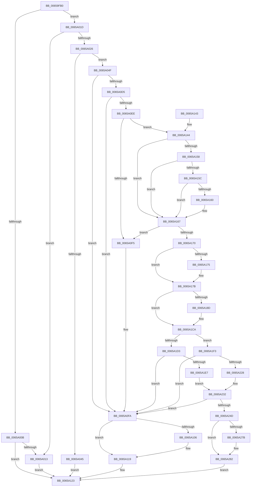

# ExpPrepareNewAtsDevice

- RVA: `0x00659FB0`–`0x0065A29D` (길이 `749` bytes)
- VA: `0x0000000140659FB0`
- 실행 섹션: `.text`
- PDB 이름 있음: `예`; PDB Function 태그: `아니요`
- unwind 정보 RVA: `0x000D540C`
- 디코드: `194`개 명령, `749/749` bytes 표시
- 미해석 바이트: `0` (있으면 어셈블리에 `.byte`로 보존)

> 이 문서는 커널 이미지의 기계어와 PDB 기호를 분석해 생성했습니다. 4번과 5번은 함수 원형과 자료형을 바이너리 사용 방식에서 추정한 C 해석이며 원본 소스 복구 결과는 아닙니다.

## 1. Dependencies

- 직접 호출 지점: **13**; 고유 호출 대상: **6**
- 직접 호출자로 확인된 함수: **1**
- RIP 상대 이미지 참조: **7**

### Outgoing calls
- `0x00659FFD` → [guard_dispatch_icall](../6B/guard_dispatch_icall_function_006BAAD0.md) (function, `0x006BAAD0`)
- `0x0065A038` → [ExAllocatePool2](../../poolcode/B8/ExAllocatePool2_function_00B820F0.md) (function, `0x00B820F0`)
- `0x0065A0CA` → [guard_dispatch_icall](../6B/guard_dispatch_icall_function_006BAAD0.md) (function, `0x006BAAD0`)
- `0x0065A0E1` → [guard_dispatch_icall](../6B/guard_dispatch_icall_function_006BAAD0.md) (function, `0x006BAAD0`)
- `0x0065A114` → [guard_dispatch_icall](../6B/guard_dispatch_icall_function_006BAAD0.md) (function, `0x006BAAD0`)
- `0x0065A11E` → [ExFreePoolWithTag](../../poolcode/B8/ExFreePoolWithTag_function_00B82870.md) (function, `0x00B82870`)
- `0x0065A1B0` → [wil_details_FeatureReporting_ReportUsageToService](../53/wil_details_FeatureReporting_ReportUsageToService_function_0053E6E4.md) (function, `0x0053E6E4`)
- `0x0065A1C5` → [wil_details_FeatureStateCache_TryEnableDeviceUsageFastPath](../53/wil_details_FeatureStateCache_TryEnableDeviceUsageFastPath_function_0053E774.md) (function, `0x0053E774`)
- `0x0065A1D8` → [ExpAtsConfigureSecureDevice](ExpAtsConfigureSecureDevice_function_00659E3C.md) (function, `0x00659E3C`)
- `0x0065A219` → [guard_dispatch_icall](../6B/guard_dispatch_icall_function_006BAAD0.md) (function, `0x006BAAD0`)
- `0x0065A23E` → [guard_dispatch_icall](../6B/guard_dispatch_icall_function_006BAAD0.md) (function, `0x006BAAD0`)
- `0x0065A255` → [guard_dispatch_icall](../6B/guard_dispatch_icall_function_006BAAD0.md) (function, `0x006BAAD0`)
- `0x0065A262` → [guard_dispatch_icall](../6B/guard_dispatch_icall_function_006BAAD0.md) (function, `0x006BAAD0`)

### Direct callers
- [ExInitializeDeviceAts](ExInitializeDeviceAts_function_00659B80.md) at `0x00659CCD`

### Static image references
- `0x0065A106` → RVA `0x00E06D28` (`.data`; read)
- `0x0065A17F` → RVA `0x00FC4C38` (`.data`; read)
- `0x0065A1A1` → RVA `0x000DF770` (`.rdata`; read)
- `0x0065A1EA` → RVA `0x0065AC50` (`ExAtsSvmSecureDevicePowerCallback`; read)
- `0x0065A22B` → RVA `0x0065AC10` (`ExAtsSvmDevicePowerCallback`; read)
- `0x0065A267` → RVA `0x00EFA8F0` (`.data`; read)
- `0x0065A28D` → RVA `0x00EFA8F0` (`.data`; write)

## 2. Other-region calls and transfers

- 다른 실행 섹션으로 향하는 call: **2**
  - `0x0065A038` → [ExAllocatePool2](../../poolcode/B8/ExAllocatePool2_function_00B820F0.md) (`.text` → `POOLCODE`)
  - `0x0065A11E` → [ExFreePoolWithTag](../../poolcode/B8/ExFreePoolWithTag_function_00B82870.md) (`.text` → `POOLCODE`)
- 별도 외부 분기/꼬리 이동을 확인하지 못했습니다.

## 3. Assembly (complete function range)

```asm
00659FB0  48 89 5C 24 08                  mov qword ptr [rsp + 8], rbx
00659FB5  48 89 74 24 10                  mov qword ptr [rsp + 0x10], rsi
00659FBA  48 89 7C 24 20                  mov qword ptr [rsp + 0x20], rdi
00659FBF  55                              push rbp
00659FC0  41 54                           push r12
00659FC2  41 55                           push r13
00659FC4  41 56                           push r14
00659FC6  41 57                           push r15
00659FC8  48 8B EC                        mov rbp, rsp
00659FCB  48 83 EC 40                     sub rsp, 0x40
00659FCF  4C 8B 65 50                     mov r12, qword ptr [rbp + 0x50]
00659FD3  49 8B F0                        mov rsi, r8
00659FD6  49 8B 40 40                     mov rax, qword ptr [r8 + 0x40]
00659FDA  33 DB                           xor ebx, ebx
00659FDC  4D 8B F9                        mov r15, r9
00659FDF  89 5D 50                        mov dword ptr [rbp + 0x50], ebx
00659FE2  44 8B F2                        mov r14d, edx
00659FE5  48 89 5D 40                     mov qword ptr [rbp + 0x40], rbx
00659FE9  4C 8B E9                        mov r13, rcx
00659FEC  49 89 1C 24                     mov qword ptr [r12], rbx
00659FF0  48 8B 4E 08                     mov rcx, qword ptr [rsi + 8]
00659FF4  4C 8D 4D 40                     lea r9, [rbp + 0x40]
00659FF8  45 33 C0                        xor r8d, r8d
00659FFB  33 D2                           xor edx, edx
00659FFD  E8 CE 0A 06 00                  call 0x1406baad0
0065A002  8B F8                           mov edi, eax
0065A004  3D 23 00 00 C0                  cmp eax, 0xc0000023
0065A009  74 12                           je 0x14065a01d
0065A00B  85 C0                           test eax, eax
0065A00D  0F 88 10 01 00 00               js 0x14065a123
0065A013  BF 01 00 00 C0                  mov edi, 0xc0000001
0065A018  E9 06 01 00 00                  jmp 0x14065a123
0065A01D  48 8B 55 40                     mov rdx, qword ptr [rbp + 0x40]
0065A021  48 85 D2                        test rdx, rdx
0065A024  74 ED                           je 0x14065a013
0065A026  48 81 C2 C0 00 00 00            add rdx, 0xc0
0065A02D  B9 40 00 00 00                  mov ecx, 0x40
0065A032  41 B8 45 78 44 65               mov r8d, 0x65447845
0065A038  E8 B3 80 52 00                  call 0x140b820f0
0065A03D  48 8B D8                        mov rbx, rax
0065A040  48 85 C0                        test rax, rax
0065A043  75 0A                           jne 0x14065a04f
0065A045  BF 9A 00 00 C0                  mov edi, 0xc000009a
0065A04A  E9 D4 00 00 00                  jmp 0x14065a123
0065A04F  C7 40 20 01 00 00 00            mov dword ptr [rax + 0x20], 1
0065A056  4C 8D 80 C0 00 00 00            lea r8, [rax + 0xc0]
0065A05D  4C 89 68 18                     mov qword ptr [rax + 0x18], r13
0065A061  41 80 E6 01                     and r14b, 1
0065A065  0F 28 06                        movaps xmm0, xmmword ptr [rsi]
0065A068  45 33 C9                        xor r9d, r9d
0065A06B  0F 11 40 28                     movups xmmword ptr [rax + 0x28], xmm0
0065A06F  0F 28 4E 10                     movaps xmm1, xmmword ptr [rsi + 0x10]
0065A073  0F 11 48 38                     movups xmmword ptr [rax + 0x38], xmm1
0065A077  0F 28 46 20                     movaps xmm0, xmmword ptr [rsi + 0x20]
0065A07B  0F 11 40 48                     movups xmmword ptr [rax + 0x48], xmm0
0065A07F  0F 28 4E 30                     movaps xmm1, xmmword ptr [rsi + 0x30]
0065A083  0F 11 48 58                     movups xmmword ptr [rax + 0x58], xmm1
0065A087  0F 28 46 40                     movaps xmm0, xmmword ptr [rsi + 0x40]
0065A08B  0F 11 40 68                     movups xmmword ptr [rax + 0x68], xmm0
0065A08F  48 8B 4B 30                     mov rcx, qword ptr [rbx + 0x30]
0065A093  41 0F 10 07                     movups xmm0, xmmword ptr [r15]
0065A097  0F 11 40 78                     movups xmmword ptr [rax + 0x78], xmm0
0065A09B  41 0F 10 4F 10                  movups xmm1, xmmword ptr [r15 + 0x10]
0065A0A0  0F 11 88 88 00 00 00            movups xmmword ptr [rax + 0x88], xmm1
0065A0A7  41 0F 10 47 20                  movups xmm0, xmmword ptr [r15 + 0x20]
0065A0AC  C6 40 10 01                     mov byte ptr [rax + 0x10], 1
0065A0B0  44 88 70 11                     mov byte ptr [rax + 0x11], r14b
0065A0B4  0F 11 80 98 00 00 00            movups xmmword ptr [rax + 0x98], xmm0
0065A0BB  4C 89 80 A8 00 00 00            mov qword ptr [rax + 0xa8], r8
0065A0C2  48 8B 40 68                     mov rax, qword ptr [rax + 0x68]
0065A0C6  48 8B 55 40                     mov rdx, qword ptr [rbp + 0x40]
0065A0CA  E8 01 0A 06 00                  call 0x1406baad0
0065A0CF  8B F8                           mov edi, eax
0065A0D1  85 C0                           test eax, eax
0065A0D3  78 25                           js 0x14065a0fa
0065A0D5  48 8B 43 48                     mov rax, qword ptr [rbx + 0x48]
0065A0D9  48 8D 55 50                     lea rdx, [rbp + 0x50]
0065A0DD  48 8B 4B 30                     mov rcx, qword ptr [rbx + 0x30]
0065A0E1  E8 EA 09 06 00                  call 0x1406baad0
0065A0E6  33 C9                           xor ecx, ecx
0065A0E8  8B F8                           mov edi, eax
0065A0EA  85 C0                           test eax, eax
0065A0EC  78 0C                           js 0x14065a0fa
0065A0EE  8B 45 50                        mov eax, dword ptr [rbp + 0x50]
0065A0F1  A8 01                           test al, 1
0065A0F3  75 4F                           jne 0x14065a144
0065A0F5  BF BB 00 00 C0                  mov edi, 0xc00000bb
0065A0FA  48 8B 8B B0 00 00 00            mov rcx, qword ptr [rbx + 0xb0]
0065A101  48 85 C9                        test rcx, rcx
0065A104  74 13                           je 0x14065a119
0065A106  48 8B 05 1B CC 7A 00            mov rax, qword ptr [rip + 0x7acc1b]
0065A10D  48 8B 80 A8 00 00 00            mov rax, qword ptr [rax + 0xa8]
0065A114  E8 B7 09 06 00                  call 0x1406baad0
0065A119  33 D2                           xor edx, edx
0065A11B  48 8B CB                        mov rcx, rbx
0065A11E  E8 4D 87 52 00                  call 0x140b82870
0065A123  4C 8D 5C 24 40                  lea r11, [rsp + 0x40]
0065A128  8B C7                           mov eax, edi
0065A12A  49 8B 5B 30                     mov rbx, qword ptr [r11 + 0x30]
0065A12E  49 8B 73 38                     mov rsi, qword ptr [r11 + 0x38]
0065A132  49 8B 7B 48                     mov rdi, qword ptr [r11 + 0x48]
0065A136  49 8B E3                        mov rsp, r11
0065A139  41 5F                           pop r15
0065A13B  41 5E                           pop r14
0065A13D  41 5D                           pop r13
0065A13F  41 5C                           pop r12
0065A141  5D                              pop rbp
0065A142  C3                              ret
0065A143  CC                              int3
0065A144  C1 E8 0C                        shr eax, 0xc
0065A147  83 E0 1F                        and eax, 0x1f
0065A14A  89 83 B8 00 00 00               mov dword ptr [rbx + 0xb8], eax
0065A150  8B 45 50                        mov eax, dword ptr [rbp + 0x50]
0065A153  45 84 F6                        test r14b, r14b
0065A156  75 0F                           jne 0x14065a167
0065A158  A8 02                           test al, 2
0065A15A  74 0B                           je 0x14065a167
0065A15C  A8 04                           test al, 4
0065A15E  74 07                           je 0x14065a167
0065A160  C6 43 12 01                     mov byte ptr [rbx + 0x12], 1
0065A164  8B 45 50                        mov eax, dword ptr [rbp + 0x50]
0065A167  48 39 8B 98 00 00 00            cmp qword ptr [rbx + 0x98], rcx
0065A16E  74 85                           je 0x14065a0f5
0065A170  38 4B 12                        cmp byte ptr [rbx + 0x12], cl
0065A173  75 06                           jne 0x14065a17b
0065A175  83 E0 F9                        and eax, 0xfffffff9
0065A178  89 45 50                        mov dword ptr [rbp + 0x50], eax
0065A17B  48 89 4D F0                     mov qword ptr [rbp - 0x10], rcx
0065A17F  8B 0D B3 AA 96 00               mov ecx, dword ptr [rip + 0x96aab3]
0065A185  89 4D F0                        mov dword ptr [rbp - 0x10], ecx
0065A188  F6 C1 10                        test cl, 0x10
0065A18B  75 3D                           jne 0x14065a1ca
0065A18D  48 8B 45 F0                     mov rax, qword ptr [rbp - 0x10]
0065A191  83 C9 01                        or ecx, 1
0065A194  48 89 45 F0                     mov qword ptr [rbp - 0x10], rax
0065A198  41 B9 01 00 00 00               mov r9d, 1
0065A19E  89 4D F0                        mov dword ptr [rbp - 0x10], ecx
0065A1A1  48 8D 0D C8 55 A8 FF            lea rcx, [rip - 0x57aa38]
0065A1A8  48 8B 55 F0                     mov rdx, qword ptr [rbp - 0x10]
0065A1AC  45 8D 41 02                     lea r8d, [r9 + 2]
0065A1B0  E8 2F 45 EE FF                  call 0x14053e6e4
0065A1B5  48 8B 4D F0                     mov rcx, qword ptr [rbp - 0x10]
0065A1B9  4C 8D 05 B0 55 A8 FF            lea r8, [rip - 0x57aa50]
0065A1C0  BA 03 00 00 00                  mov edx, 3
0065A1C5  E8 AA 45 EE FF                  call 0x14053e774
0065A1CA  F7 45 50 00 00 80 00            test dword ptr [rbp + 0x50], 0x800000
0065A1D1  74 20                           je 0x14065a1f3
0065A1D3  B2 01                           mov dl, 1
0065A1D5  48 8B CB                        mov rcx, rbx
0065A1D8  E8 5F FC FF FF                  call 0x140659e3c
0065A1DD  8B F8                           mov edi, eax
0065A1DF  85 C0                           test eax, eax
0065A1E1  0F 88 13 FF FF FF               js 0x14065a0fa
0065A1E7  4C 8B CB                        mov r9, rbx
0065A1EA  4C 8D 05 5F 0A 00 00            lea r8, [rip + 0xa5f]
0065A1F1  EB 3F                           jmp 0x14065a232
0065A1F3  48 8B 05 2E CB 7A 00            mov rax, qword ptr [rip + 0x7acb2e]
0065A1FA  4C 8D B3 B0 00 00 00            lea r14, [rbx + 0xb0]
0065A201  48 8B 8B A8 00 00 00            mov rcx, qword ptr [rbx + 0xa8]
0065A208  4C 8D 45 50                     lea r8, [rbp + 0x50]
0065A20C  4D 8B CE                        mov r9, r14
0065A20F  49 8B D5                        mov rdx, r13
0065A212  48 8B 80 A0 00 00 00            mov rax, qword ptr [rax + 0xa0]
0065A219  E8 B2 08 06 00                  call 0x1406baad0
0065A21E  8B F8                           mov edi, eax
0065A220  85 C0                           test eax, eax
0065A222  0F 88 D2 FE FF FF               js 0x14065a0fa
0065A228  4D 8B 0E                        mov r9, qword ptr [r14]
0065A22B  4C 8D 05 DE 09 00 00            lea r8, [rip + 0x9de]
0065A232  48 8B 4B 30                     mov rcx, qword ptr [rbx + 0x30]
0065A236  48 8D 55 50                     lea rdx, [rbp + 0x50]
0065A23A  48 8B 43 50                     mov rax, qword ptr [rbx + 0x50]
0065A23E  E8 8D 08 06 00                  call 0x1406baad0
0065A243  8B F8                           mov edi, eax
0065A245  85 C0                           test eax, eax
0065A247  0F 88 AD FE FF FF               js 0x14065a0fa
0065A24D  49 8B 47 10                     mov rax, qword ptr [r15 + 0x10]
0065A251  49 8B 4F 08                     mov rcx, qword ptr [r15 + 8]
0065A255  E8 76 08 06 00                  call 0x1406baad0
0065A25A  48 8B 46 10                     mov rax, qword ptr [rsi + 0x10]
0065A25E  48 8B 4E 08                     mov rcx, qword ptr [rsi + 8]
0065A262  E8 69 08 06 00                  call 0x1406baad0
0065A267  48 8B 05 82 06 8A 00            mov rax, qword ptr [rip + 0x8a0682]
0065A26E  48 8D 0D 7B 06 8A 00            lea rcx, [rip + 0x8a067b]
0065A275  48 39 48 08                     cmp qword ptr [rax + 8], rcx
0065A279  74 07                           je 0x14065a282
0065A27B  B9 03 00 00 00                  mov ecx, 3
0065A280  CD 29                           int 0x29
0065A282  48 89 03                        mov qword ptr [rbx], rax
0065A285  48 89 4B 08                     mov qword ptr [rbx + 8], rcx
0065A289  48 89 58 08                     mov qword ptr [rax + 8], rbx
0065A28D  48 89 1D 5C 06 8A 00            mov qword ptr [rip + 0x8a065c], rbx
0065A294  49 89 1C 24                     mov qword ptr [r12], rbx
0065A298  E9 86 FE FF FF                  jmp 0x14065a123
```

## 4. C-style interpretation (structured pseudocode)

```c
__int64 __fastcall ExpPrepareNewAtsDevice(__int64 a1, int a2, __int64 a3, __int64 a4, unsigned int a5)
{
    __int64 result;
    __int64 v_r14;
    __int64 v_rbx;
    __int64 v_rsp;
    unsigned __int64 v_stack_m28;
    unsigned __int64 v_stack_m38;
    unsigned __int64 v_stack_p10;
    unsigned __int64 v_stack_p18;
    unsigned __int64 v_stack_p20;
    unsigned int v_stack_p28;
    unsigned __int64 v_stack_p8;

    v_stack_p8 = v_rbx;
    v_stack_p10 = v_rsi;
    v_stack_p20 = v_rdi;
    v_rsp = (v_rsp) - (64);
    v_rbx = 0;
    v_stack_p28 = 0;
    v_stack_p18 = 0;
    *(unsigned __int64 *)(a5) = 0;
    a3 = 0;
    a2 = 0;
    result = guard_dispatch_icall(*(unsigned __int64 *)(a3 + 8), a2, a3, v_stack_p18);
    if (((unsigned int)(result)) == 0xC0000023ULL) goto loc_0065A01D;
    if (sign_flag) goto loc_0065A123;
loc_0065A013:
    goto loc_0065A123;
loc_0065A01D:
    if (v_stack_p18 == 0) goto loc_0065A013;
    a2 = (v_stack_p18) + (192);
    result = ExAllocatePool2(64, a2, (unsigned int)(0x65447845ULL), v_stack_p18);
    if (result != 0) goto loc_0065A04F;
    goto loc_0065A123;
loc_0065A04F:
    *(unsigned int *)(result + 32) = 1;
    *(unsigned __int64 *)(result + 24) = a1;
    v_r14 = (unsigned __int8)(((unsigned int)(a2)) & (1));
    a4 = 0;
    *(unsigned __int64 *)(result + 40) = v_xmm0;
    *(unsigned __int64 *)(result + 56) = v_xmm1;
    *(unsigned __int64 *)(result + 72) = v_xmm0;
    *(unsigned __int64 *)(result + 88) = v_xmm1;
    *(unsigned __int64 *)(result + 104) = v_xmm0;
    *(unsigned __int64 *)(result + 120) = v_xmm0;
    *(unsigned __int64 *)(result + 136) = v_xmm1;
    *(unsigned __int8 *)(result + 16) = 1;
    *(unsigned __int8 *)(result + 17) = (unsigned __int8)(v_r14);
    *(unsigned __int64 *)(result + 152) = v_xmm0;
    *(unsigned __int64 *)(result + 168) = result + 192;
    result = guard_dispatch_icall(*(unsigned __int64 *)(result + 48), v_stack_p18, result + 192, a4);
    if (sign_flag) goto loc_0065A0FA;
    result = guard_dispatch_icall(*(unsigned __int64 *)(result + 48), a5, result + 192, a4);
    a1 = 0;
    if (sign_flag) goto loc_0065A0FA;
    if ((((unsigned __int8)((unsigned int)(a5))) & (1)) != 0) goto loc_0065A144;
loc_0065A0F5:
loc_0065A0FA:
    result = (unsigned int)(a5);
    if (*(unsigned __int64 *)(result + 176) != 0) {
        result = *(unsigned __int64 *)(v_rip + 8047643);
        result = *(unsigned __int64 *)(result + 168);
        result = guard_dispatch_icall(*(unsigned __int64 *)(result + 176), a5, result + 192, a4);
    }
    a2 = 0;
    result = ExFreePoolWithTag(result, a2, result + 192, a4);
loc_0065A123:
    return (unsigned int)((unsigned int)((unsigned int)(0xC00000BBULL)));
loc_0065A144:
    result = (unsigned int)(((unsigned int)((unsigned int)((unsigned int)(0xC00000BBULL)))) >> (12));
    result = (unsigned int)((result) & (31));
    *(unsigned int *)(*(unsigned __int64 *)(v_stack_m28 + 48) + 184) = (unsigned int)(result);
    if ((unsigned __int8)(v_r14) != 0) goto loc_0065A167;
    if ((((unsigned __int8)((unsigned int)(a5))) & (2)) == 0) goto loc_0065A167;
    result = (unsigned int)(a5);
    if ((((unsigned __int8)((unsigned int)(a5))) & (4)) != 0) {
        *(unsigned __int8 *)(*(unsigned __int64 *)(v_stack_m28 + 48) + 18) = 1;
        result = a5;
    }
    if ((*(unsigned __int64 *)(*(unsigned __int64 *)(v_stack_m28 + 48) + 152)) == result) goto loc_0065A0F5;
    if ((*(unsigned __int8 *)(*(unsigned __int64 *)(v_stack_m28 + 48) + 18)) == ((unsigned __int8)(result))) {
        result = (unsigned int)((result) & (0xFFFFFFF9ULL));
        v_stack_p28 = (unsigned int)(result);
    }
    v_stack_m38 = result;
    v_stack_m38 = (unsigned int)((unsigned int)(*(unsigned int *)(v_rip + 9874099)));
    if ((((unsigned __int8)((unsigned int)(*(unsigned int *)(v_rip + 9874099)))) & (16)) == 0) {
        result = v_stack_m38;
        a1 = (unsigned int)(((unsigned int)(*(unsigned int *)(v_rip + 9874099))) | (1));
        v_stack_m38 = result;
        a4 = 1;
        v_stack_m38 = (unsigned int)(a1);
        a1 = v_rip - 5745208;
        a2 = v_stack_m38;
        a3 = a4 + 2;
        result = wil_details_FeatureReporting_ReportUsageToService(a1, a2, a3, a4);
        a1 = v_stack_m38;
        a3 = v_rip - 5745232;
        a2 = 3;
        result = wil_details_FeatureStateCache_TryEnableDeviceUsageFastPath(a1, a2, a3, a4);
    }
    if (((a5) & (0x800000ULL)) == 0) goto loc_0065A1F3;
    result = ExpAtsConfigureSecureDevice(*(unsigned __int64 *)(v_stack_m28 + 48), 1, a3, a4);
    if (sign_flag) goto loc_0065A0FA;
    goto loc_0065A232;
loc_0065A1F3:
    result = guard_dispatch_icall(*(unsigned __int64 *)(*(unsigned __int64 *)(v_stack_m28 + 48) + 168), a1, a5, *(unsigned __int64 *)(v_stack_m28 + 48) + 176);
    if (sign_flag) goto loc_0065A0FA;
loc_0065A232:
    result = guard_dispatch_icall(*(unsigned __int64 *)(*(unsigned __int64 *)(v_stack_m28 + 48) + 48), a5, v_rip + 2526, *(unsigned __int64 *)(*(unsigned __int64 *)(v_stack_m28 + 48) + 176));
    if (sign_flag) goto loc_0065A0FA;
    result = guard_dispatch_icall(*(unsigned __int64 *)(a4 + 8), a5, v_rip + 2526, *(unsigned __int64 *)(*(unsigned __int64 *)(v_stack_m28 + 48) + 176));
    result = guard_dispatch_icall(*(unsigned __int64 *)(*(unsigned __int64 *)(v_stack_m28 + 56) + 8), a5, v_rip + 2526, *(unsigned __int64 *)(*(unsigned __int64 *)(v_stack_m28 + 48) + 176));
    if ((*(unsigned __int64 *)(*(unsigned __int64 *)(v_rip + 9045634) + 8)) != (v_rip + 9045627)) {
        a1 = 3;
    }
    *(unsigned __int64 *)(*(unsigned __int64 *)(v_stack_m28 + 48)) = *(unsigned __int64 *)(v_rip + 9045634);
    *(unsigned __int64 *)(*(unsigned __int64 *)(v_stack_m28 + 48) + 8) = a1;
    *(unsigned __int64 *)(*(unsigned __int64 *)(v_rip + 9045634) + 8) = *(unsigned __int64 *)(v_stack_m28 + 48);
    *(unsigned __int64 *)(v_rip + 9045596) = *(unsigned __int64 *)(v_stack_m28 + 48);
    *(unsigned __int64 *)(a5) = *(unsigned __int64 *)(v_stack_m28 + 48);
    goto loc_0065A123;
}
```

## 5. (Beta) C Style

```c
int64_t ExpPrepareNewAtsDevice(int64_t Arg1, int32_t Arg2, void *Arg3, void *Arg4, void *Arg5)
{
    uint8_t *arg3 = (uint8_t *)Arg3;
    uint8_t *arg4 = (uint8_t *)Arg4;
    uint8_t *arg5 = (uint8_t *)Arg5;

    int64_t result;
    int64_t local_r14;
    int64_t local_rbx;
    int64_t local_rsp;
    uint64_t v_stack_m28;
    uint64_t v_stack_m38;
    uint64_t v_stack_p10;
    uint64_t v_stack_p18;
    uint64_t v_stack_p20;
    uint32_t v_stack_p28;
    uint64_t v_stack_p8;

    v_stack_p8 = local_rbx;
    v_stack_p10 = local_rsi;
    v_stack_p20 = local_rdi;
    local_rsp = (local_rsp) - (64);
    local_rbx = 0;
    v_stack_p28 = 0;
    v_stack_p18 = 0;
    *(uint64_t *)(arg5) = 0;
    Arg3 = 0;
    Arg2 = 0;
    result = guard_dispatch_icall(*(uint64_t *)(arg3 + 0x8), Arg2, Arg3, v_stack_p18);
    if (((uint32_t)(result)) == 0xC0000023ULL) goto loc_0065A01D;
    if (sign_flag) goto loc_0065A123;
loc_0065A013:
    goto loc_0065A123;
loc_0065A01D:
    if (v_stack_p18 == 0) goto loc_0065A013;
    Arg2 = (v_stack_p18) + (192);
    result = ExAllocatePool2(64, Arg2, (uint32_t)(0x65447845ULL), v_stack_p18);
    if (result != 0) goto loc_0065A04F;
    goto loc_0065A123;
loc_0065A04F:
    *(uint32_t *)(result + 0x20) = 1;
    *(uint64_t *)(result + 0x18) = Arg1;
    local_r14 = (uint8_t)(((uint32_t)(Arg2)) & (1));
    Arg4 = 0;
    *(uint64_t *)(result + 0x28) = v_xmm0;
    *(uint64_t *)(result + 0x38) = v_xmm1;
    *(uint64_t *)(result + 0x48) = v_xmm0;
    *(uint64_t *)(result + 0x58) = v_xmm1;
    *(uint64_t *)(result + 0x68) = v_xmm0;
    *(uint64_t *)(result + 0x78) = v_xmm0;
    *(uint64_t *)(result + 0x88) = v_xmm1;
    *(uint8_t *)(result + 0x10) = 1;
    *(uint8_t *)(result + 0x11) = (uint8_t)(local_r14);
    *(uint64_t *)(result + 0x98) = v_xmm0;
    *(uint64_t *)(result + 0xA8) = result + 192;
    result = guard_dispatch_icall(*(uint64_t *)(result + 0x30), v_stack_p18, result + 192, Arg4);
    if (sign_flag) goto loc_0065A0FA;
    result = guard_dispatch_icall(*(uint64_t *)(result + 0x30), Arg5, result + 192, Arg4);
    Arg1 = 0;
    if (sign_flag) goto loc_0065A0FA;
    if ((((uint8_t)((uint32_t)(Arg5))) & (1)) != 0) goto loc_0065A144;
loc_0065A0F5:
loc_0065A0FA:
    result = (uint32_t)(Arg5);
    if (*(uint64_t *)(result + 0xB0) != 0) {
        result = *(uint64_t *)(v_rip + 0x7ACC1B);
        result = *(uint64_t *)(result + 0xA8);
        result = guard_dispatch_icall(*(uint64_t *)(result + 0xB0), Arg5, result + 192, Arg4);
    }
    Arg2 = 0;
    result = ExFreePoolWithTag(result, Arg2, result + 192, Arg4);
loc_0065A123:
    return (uint32_t)((uint32_t)((uint32_t)(0xC00000BBULL)));
loc_0065A144:
    result = (uint32_t)(((uint32_t)((uint32_t)((uint32_t)(0xC00000BBULL)))) >> (12));
    result = (uint32_t)((result) & (31));
    *(uint32_t *)(*(uint64_t *)(v_stack_m28 + 0x30) + 0xB8) = (uint32_t)(result);
    if ((uint8_t)(local_r14) != 0) goto loc_0065A167;
    if ((((uint8_t)((uint32_t)(Arg5))) & (2)) == 0) goto loc_0065A167;
    result = (uint32_t)(Arg5);
    if ((((uint8_t)((uint32_t)(Arg5))) & (4)) != 0) {
        *(uint8_t *)(*(uint64_t *)(v_stack_m28 + 0x30) + 0x12) = 1;
        result = Arg5;
    }
    if ((*(uint64_t *)(*(uint64_t *)(v_stack_m28 + 0x30) + 0x98)) == result) goto loc_0065A0F5;
    if ((*(uint8_t *)(*(uint64_t *)(v_stack_m28 + 0x30) + 0x12)) == ((uint8_t)(result))) {
        result = (uint32_t)((result) & (0xFFFFFFF9ULL));
        v_stack_p28 = (uint32_t)(result);
    }
    v_stack_m38 = result;
    v_stack_m38 = (uint32_t)((uint32_t)(*(uint32_t *)(v_rip + 0x96AAB3)));
    if ((((uint8_t)((uint32_t)(*(uint32_t *)(v_rip + 0x96AAB3)))) & (16)) == 0) {
        result = v_stack_m38;
        Arg1 = (uint32_t)(((uint32_t)(*(uint32_t *)(v_rip + 0x96AAB3))) | (1));
        v_stack_m38 = result;
        Arg4 = 1;
        v_stack_m38 = (uint32_t)(Arg1);
        Arg1 = v_rip - 5745208;
        Arg2 = v_stack_m38;
        Arg3 = Arg4 + 2;
        result = wil_details_FeatureReporting_ReportUsageToService(Arg1, Arg2, Arg3, Arg4);
        Arg1 = v_stack_m38;
        Arg3 = v_rip - 5745232;
        Arg2 = 3;
        result = wil_details_FeatureStateCache_TryEnableDeviceUsageFastPath(Arg1, Arg2, Arg3, Arg4);
    }
    if (((Arg5) & (0x800000ULL)) == 0) goto loc_0065A1F3;
    result = ExpAtsConfigureSecureDevice(*(uint64_t *)(v_stack_m28 + 0x30), 1, Arg3, Arg4);
    if (sign_flag) goto loc_0065A0FA;
    goto loc_0065A232;
loc_0065A1F3:
    result = guard_dispatch_icall(*(uint64_t *)(*(uint64_t *)(v_stack_m28 + 0x30) + 0xA8), Arg1, Arg5, *(uint64_t *)(v_stack_m28 + 0x30) + 176);
    if (sign_flag) goto loc_0065A0FA;
loc_0065A232:
    result = guard_dispatch_icall(*(uint64_t *)(*(uint64_t *)(v_stack_m28 + 0x30) + 0x30), Arg5, v_rip + 2526, *(uint64_t *)(*(uint64_t *)(v_stack_m28 + 0x30) + 0xB0));
    if (sign_flag) goto loc_0065A0FA;
    result = guard_dispatch_icall(*(uint64_t *)(arg4 + 0x8), Arg5, v_rip + 2526, *(uint64_t *)(*(uint64_t *)(v_stack_m28 + 0x30) + 0xB0));
    result = guard_dispatch_icall(*(uint64_t *)(*(uint64_t *)(v_stack_m28 + 0x38) + 0x8), Arg5, v_rip + 2526, *(uint64_t *)(*(uint64_t *)(v_stack_m28 + 0x30) + 0xB0));
    if ((*(uint64_t *)(*(uint64_t *)(v_rip + 0x8A0682) + 0x8)) != (v_rip + 9045627)) {
        Arg1 = 3;
    }
    *(uint64_t *)(*(uint64_t *)(v_stack_m28 + 0x30)) = *(uint64_t *)(v_rip + 0x8A0682);
    *(uint64_t *)(*(uint64_t *)(v_stack_m28 + 0x30) + 0x8) = Arg1;
    *(uint64_t *)(*(uint64_t *)(v_rip + 0x8A0682) + 0x8) = *(uint64_t *)(v_stack_m28 + 0x30);
    *(uint64_t *)(v_rip + 0x8A065C) = *(uint64_t *)(v_stack_m28 + 0x30);
    *(uint64_t *)(arg5) = *(uint64_t *)(v_stack_m28 + 0x30);
    goto loc_0065A123;
}
```

### 관측된 메모리 오프셋

구조체 형식이 확인되지 않은 접근은 인자 기준의 오프셋으로만 기록했습니다.

| 기준 인자 | 오프셋 표현 | 폭 (bit) | 접근 |
|---|---:|---:|---|
| `Arg3` | `+ 0x0` | `128` | `R` |
| `Arg3` | `+ 0x8` | `64` | `R` |
| `Arg3` | `+ 0x10` | `64` | `R` |
| `Arg3` | `+ 0x10` | `128` | `R` |
| `Arg3` | `+ 0x20` | `128` | `R` |
| `Arg3` | `+ 0x30` | `128` | `R` |
| `Arg3` | `+ 0x40` | `64` | `R` |
| `Arg3` | `+ 0x40` | `128` | `R` |
| `Arg4` | `+ 0x0` | `128` | `R` |
| `Arg4` | `+ 0x8` | `64` | `R` |
| `Arg4` | `+ 0x10` | `64` | `R` |
| `Arg4` | `+ 0x10` | `128` | `R` |
| `Arg4` | `+ 0x20` | `128` | `R` |
| `Arg5` | `+ 0x0` | `64` | `W` |

## 6. Execution-region graph

[열기: 2D/3D 그래프와 함수 탐색 컨트롤 패널](../../../control-panel.html?section=text&rva=0x00659FB0&view=graph)

- 2D 그래프는 위에서 아래로 흐르고, 3D 그래프는 빈 공간을 드래그해 회전합니다. Shift+드래그는 이동, 휠은 확대·축소, 함수 노드 선택은 대상 보고서 이동입니다.

### Static fallback


