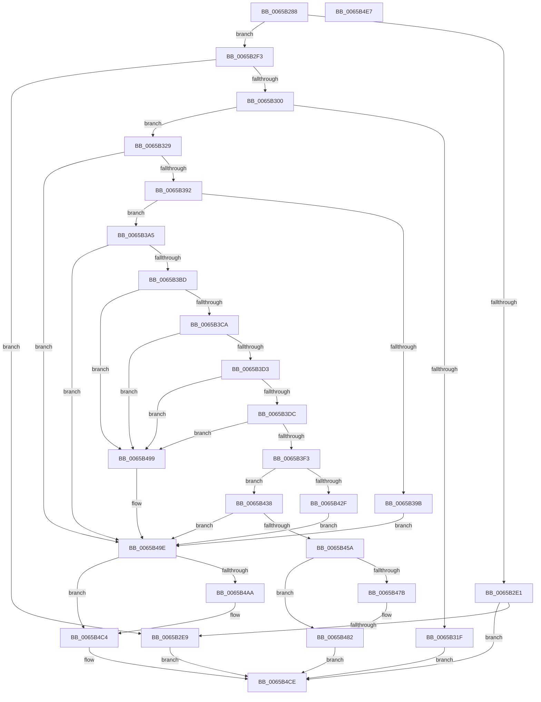

# ExpPrepareNewSvmDevice

- RVA: `0x0065B288`–`0x0065B4E8` (길이 `608` bytes)
- VA: `0x000000014065B288`
- 실행 섹션: `.text`
- PDB 이름 있음: `예`; PDB Function 태그: `아니요`
- unwind 정보 RVA: `0x000D232C`
- 디코드: `152`개 명령, `608/608` bytes 표시
- 미해석 바이트: `0` (있으면 어셈블리에 `.byte`로 보존)

> 이 문서는 커널 이미지의 기계어와 PDB 기호를 분석해 생성했습니다. 4번과 5번은 함수 원형과 자료형을 바이너리 사용 방식에서 추정한 C 해석이며 원본 소스 복구 결과는 아닙니다.

## 1. Dependencies

- 직접 호출 지점: **9**; 고유 호출 대상: **3**
- 직접 호출자로 확인된 함수: **1**
- RIP 상대 이미지 참조: **6**

### Outgoing calls
- `0x0065B2D3` → [guard_dispatch_icall](../6B/guard_dispatch_icall_function_006BAAD0.md) (function, `0x006BAAD0`)
- `0x0065B312` → [ExAllocatePool2](../../poolcode/B8/ExAllocatePool2_function_00B820F0.md) (function, `0x00B820F0`)
- `0x0065B383` → [guard_dispatch_icall](../6B/guard_dispatch_icall_function_006BAAD0.md) (function, `0x006BAAD0`)
- `0x0065B3AE` → [guard_dispatch_icall](../6B/guard_dispatch_icall_function_006BAAD0.md) (function, `0x006BAAD0`)
- `0x0065B424` → [guard_dispatch_icall](../6B/guard_dispatch_icall_function_006BAAD0.md) (function, `0x006BAAD0`)
- `0x0065B44F` → [guard_dispatch_icall](../6B/guard_dispatch_icall_function_006BAAD0.md) (function, `0x006BAAD0`)
- `0x0065B462` → [guard_dispatch_icall](../6B/guard_dispatch_icall_function_006BAAD0.md) (function, `0x006BAAD0`)
- `0x0065B4B8` → [guard_dispatch_icall](../6B/guard_dispatch_icall_function_006BAAD0.md) (function, `0x006BAAD0`)
- `0x0065B4C9` → [ExFreePoolWithTag](../../poolcode/B8/ExFreePoolWithTag_function_00B82870.md) (function, `0x00B82870`)

### Direct callers
- [ExpShareAddressSpaceWithDevice](ExpShareAddressSpaceWithDevice_function_0065B528.md) at `0x0065B7EC`

### Static image references
- `0x0065B3E7` → RVA `0x00EFA8C0` (`.data`; read)
- `0x0065B3F3` → RVA `0x00E685D4` (`.data`; read/write)
- `0x0065B3FB` → RVA `0x00E06D28` (`.data`; read)
- `0x0065B43C` → RVA `0x0065AC10` (`ExAtsSvmDevicePowerCallback`; read)
- `0x0065B467` → RVA `0x00EFA8F0` (`.data`; read)
- `0x0065B48D` → RVA `0x00EFA8F0` (`.data`; write)

## 2. Other-region calls and transfers

- 다른 실행 섹션으로 향하는 call: **2**
  - `0x0065B312` → [ExAllocatePool2](../../poolcode/B8/ExAllocatePool2_function_00B820F0.md) (`.text` → `POOLCODE`)
  - `0x0065B4C9` → [ExFreePoolWithTag](../../poolcode/B8/ExFreePoolWithTag_function_00B82870.md) (`.text` → `POOLCODE`)
- 별도 외부 분기/꼬리 이동을 확인하지 못했습니다.

## 3. Assembly (complete function range)

```asm
0065B288  4C 8B DC                        mov r11, rsp
0065B28B  49 89 5B 08                     mov qword ptr [r11 + 8], rbx
0065B28F  49 89 6B 10                     mov qword ptr [r11 + 0x10], rbp
0065B293  45 88 4B 20                     mov byte ptr [r11 + 0x20], r9b
0065B297  56                              push rsi
0065B298  57                              push rdi
0065B299  41 54                           push r12
0065B29B  41 56                           push r14
0065B29D  41 57                           push r15
0065B29F  48 83 EC 30                     sub rsp, 0x30
0065B2A3  4C 8B BC 24 80 00 00 00         mov r15, qword ptr [rsp + 0x80]
0065B2AB  4D 8D 4B 28                     lea r9, [r11 + 0x28]
0065B2AF  49 8B 40 40                     mov rax, qword ptr [r8 + 0x40]
0065B2B3  49 8B F0                        mov rsi, r8
0065B2B6  83 64 24 78 00                  and dword ptr [rsp + 0x78], 0
0065B2BB  48 8B EA                        mov rbp, rdx
0065B2BE  49 83 63 28 00                  and qword ptr [r11 + 0x28], 0
0065B2C3  4C 8B E1                        mov r12, rcx
0065B2C6  49 83 27 00                     and qword ptr [r15], 0
0065B2CA  45 33 C0                        xor r8d, r8d
0065B2CD  48 8B 4E 08                     mov rcx, qword ptr [rsi + 8]
0065B2D1  33 D2                           xor edx, edx
0065B2D3  E8 F8 F7 05 00                  call 0x1406baad0
0065B2D8  8B D8                           mov ebx, eax
0065B2DA  3D 23 00 00 C0                  cmp eax, 0xc0000023
0065B2DF  74 12                           je 0x14065b2f3
0065B2E1  85 C0                           test eax, eax
0065B2E3  0F 88 E5 01 00 00               js 0x14065b4ce
0065B2E9  BB 01 00 00 C0                  mov ebx, 0xc0000001
0065B2EE  E9 DB 01 00 00                  jmp 0x14065b4ce
0065B2F3  48 8B 94 24 80 00 00 00         mov rdx, qword ptr [rsp + 0x80]
0065B2FB  48 85 D2                        test rdx, rdx
0065B2FE  74 E9                           je 0x14065b2e9
0065B300  48 81 C2 C0 00 00 00            add rdx, 0xc0
0065B307  B9 40 00 00 00                  mov ecx, 0x40
0065B30C  41 B8 45 78 44 65               mov r8d, 0x65447845
0065B312  E8 D9 6D 52 00                  call 0x140b820f0
0065B317  48 8B F8                        mov rdi, rax
0065B31A  48 85 C0                        test rax, rax
0065B31D  75 0A                           jne 0x14065b329
0065B31F  BB 9A 00 00 C0                  mov ebx, 0xc000009a
0065B324  E9 A5 01 00 00                  jmp 0x14065b4ce
0065B329  4C 89 60 18                     mov qword ptr [rax + 0x18], r12
0065B32D  4C 8D 80 C0 00 00 00            lea r8, [rax + 0xc0]
0065B334  41 BE 01 00 00 00               mov r14d, 1
0065B33A  45 33 C9                        xor r9d, r9d
0065B33D  44 89 70 20                     mov dword ptr [rax + 0x20], r14d
0065B341  44 89 70 24                     mov dword ptr [rax + 0x24], r14d
0065B345  0F 28 06                        movaps xmm0, xmmword ptr [rsi]
0065B348  0F 11 40 28                     movups xmmword ptr [rax + 0x28], xmm0
0065B34C  0F 28 4E 10                     movaps xmm1, xmmword ptr [rsi + 0x10]
0065B350  0F 11 48 38                     movups xmmword ptr [rax + 0x38], xmm1
0065B354  0F 28 46 20                     movaps xmm0, xmmword ptr [rsi + 0x20]
0065B358  0F 11 40 48                     movups xmmword ptr [rax + 0x48], xmm0
0065B35C  0F 28 4E 30                     movaps xmm1, xmmword ptr [rsi + 0x30]
0065B360  0F 11 48 58                     movups xmmword ptr [rax + 0x58], xmm1
0065B364  0F 28 46 40                     movaps xmm0, xmmword ptr [rsi + 0x40]
0065B368  0F 11 40 68                     movups xmmword ptr [rax + 0x68], xmm0
0065B36C  48 8B 4F 30                     mov rcx, qword ptr [rdi + 0x30]
0065B370  4C 89 80 A8 00 00 00            mov qword ptr [rax + 0xa8], r8
0065B377  48 8B 40 68                     mov rax, qword ptr [rax + 0x68]
0065B37B  48 8B 94 24 80 00 00 00         mov rdx, qword ptr [rsp + 0x80]
0065B383  E8 48 F7 05 00                  call 0x1406baad0
0065B388  8B D8                           mov ebx, eax
0065B38A  85 C0                           test eax, eax
0065B38C  0F 88 0C 01 00 00               js 0x14065b49e
0065B392  48 8B 47 48                     mov rax, qword ptr [rdi + 0x48]
0065B396  48 85 C0                        test rax, rax
0065B399  75 0A                           jne 0x14065b3a5
0065B39B  BB BB 00 00 C0                  mov ebx, 0xc00000bb
0065B3A0  E9 F9 00 00 00                  jmp 0x14065b49e
0065B3A5  48 8B 4F 30                     mov rcx, qword ptr [rdi + 0x30]
0065B3A9  48 8D 54 24 78                  lea rdx, [rsp + 0x78]
0065B3AE  E8 1D F7 05 00                  call 0x1406baad0
0065B3B3  8B D8                           mov ebx, eax
0065B3B5  85 C0                           test eax, eax
0065B3B7  0F 88 E1 00 00 00               js 0x14065b49e
0065B3BD  8B 4C 24 78                     mov ecx, dword ptr [rsp + 0x78]
0065B3C1  41 84 CE                        test r14b, cl
0065B3C4  0F 84 CF 00 00 00               je 0x14065b499
0065B3CA  F6 C1 02                        test cl, 2
0065B3CD  0F 84 C6 00 00 00               je 0x14065b499
0065B3D3  F6 C1 04                        test cl, 4
0065B3D6  0F 84 BD 00 00 00               je 0x14065b499
0065B3DC  C1 E9 03                        shr ecx, 3
0065B3DF  41 8B C6                        mov eax, r14d
0065B3E2  83 E1 1F                        and ecx, 0x1f
0065B3E5  D3 E0                           shl eax, cl
0065B3E7  3B 05 D3 F4 89 00               cmp eax, dword ptr [rip + 0x89f4d3]
0065B3ED  0F 82 A6 00 00 00               jb 0x14065b499
0065B3F3  F0 44 01 35 D9 D1 80 00         lock add dword ptr [rip + 0x80d1d9], r14d
0065B3FB  48 8B 05 26 B9 7A 00            mov rax, qword ptr [rip + 0x7ab926]
0065B402  4C 8D B7 B0 00 00 00            lea r14, [rdi + 0xb0]
0065B409  48 8B 97 A8 00 00 00            mov rdx, qword ptr [rdi + 0xa8]
0065B410  4C 8D 4C 24 78                  lea r9, [rsp + 0x78]
0065B415  4D 8B C4                        mov r8, r12
0065B418  4C 89 74 24 20                  mov qword ptr [rsp + 0x20], r14
0065B41D  48 8B CD                        mov rcx, rbp
0065B420  48 8B 40 18                     mov rax, qword ptr [rax + 0x18]
0065B424  E8 A7 F6 05 00                  call 0x1406baad0
0065B429  8B D8                           mov ebx, eax
0065B42B  85 C0                           test eax, eax
0065B42D  79 09                           jns 0x14065b438
0065B42F  F0 FF 0D 9E D1 80 00            lock dec dword ptr [rip + 0x80d19e]
0065B436  EB 66                           jmp 0x14065b49e
0065B438  48 8B 47 50                     mov rax, qword ptr [rdi + 0x50]
0065B43C  4C 8D 05 CD F7 FF FF            lea r8, [rip - 0x833]
0065B443  4D 8B 0E                        mov r9, qword ptr [r14]
0065B446  48 8D 54 24 78                  lea rdx, [rsp + 0x78]
0065B44B  48 8B 4F 30                     mov rcx, qword ptr [rdi + 0x30]
0065B44F  E8 7C F6 05 00                  call 0x1406baad0
0065B454  8B D8                           mov ebx, eax
0065B456  85 C0                           test eax, eax
0065B458  78 44                           js 0x14065b49e
0065B45A  48 8B 46 10                     mov rax, qword ptr [rsi + 0x10]
0065B45E  48 8B 4E 08                     mov rcx, qword ptr [rsi + 8]
0065B462  E8 69 F6 05 00                  call 0x1406baad0
0065B467  48 8B 05 82 F4 89 00            mov rax, qword ptr [rip + 0x89f482]
0065B46E  48 8D 0D 7B F4 89 00            lea rcx, [rip + 0x89f47b]
0065B475  48 39 48 08                     cmp qword ptr [rax + 8], rcx
0065B479  74 07                           je 0x14065b482
0065B47B  B9 03 00 00 00                  mov ecx, 3
0065B480  CD 29                           int 0x29
0065B482  48 89 07                        mov qword ptr [rdi], rax
0065B485  48 89 4F 08                     mov qword ptr [rdi + 8], rcx
0065B489  48 89 78 08                     mov qword ptr [rax + 8], rdi
0065B48D  48 89 3D 5C F4 89 00            mov qword ptr [rip + 0x89f45c], rdi
0065B494  49 89 3F                        mov qword ptr [r15], rdi
0065B497  EB 35                           jmp 0x14065b4ce
0065B499  BB EF 00 00 C0                  mov ebx, 0xc00000ef
0065B49E  48 8B 97 B0 00 00 00            mov rdx, qword ptr [rdi + 0xb0]
0065B4A5  48 85 D2                        test rdx, rdx
0065B4A8  74 1A                           je 0x14065b4c4
0065B4AA  48 8B 05 77 B8 7A 00            mov rax, qword ptr [rip + 0x7ab877]
0065B4B1  48 8B CD                        mov rcx, rbp
0065B4B4  48 8B 40 38                     mov rax, qword ptr [rax + 0x38]
0065B4B8  E8 13 F6 05 00                  call 0x1406baad0
0065B4BD  F0 FF 0D 10 D1 80 00            lock dec dword ptr [rip + 0x80d110]
0065B4C4  33 D2                           xor edx, edx
0065B4C6  48 8B CF                        mov rcx, rdi
0065B4C9  E8 A2 73 52 00                  call 0x140b82870
0065B4CE  48 8B 6C 24 68                  mov rbp, qword ptr [rsp + 0x68]
0065B4D3  8B C3                           mov eax, ebx
0065B4D5  48 8B 5C 24 60                  mov rbx, qword ptr [rsp + 0x60]
0065B4DA  48 83 C4 30                     add rsp, 0x30
0065B4DE  41 5F                           pop r15
0065B4E0  41 5E                           pop r14
0065B4E2  41 5C                           pop r12
0065B4E4  5F                              pop rdi
0065B4E5  5E                              pop rsi
0065B4E6  C3                              ret
0065B4E7  CC                              int3
```

## 4. C-style interpretation (structured pseudocode)

```c
__int64 __fastcall ExpPrepareNewSvmDevice(__int64 a1, __int64 a2, __int64 a3, unsigned __int8 a4, __int64 a5)
{
    __int64 result;
    __int64 v_rsp;
    unsigned __int64 v_stack_m38;
    unsigned __int64 v_stack_p10;
    unsigned int v_stack_p20;
    unsigned __int64 v_stack_p8;

    *(unsigned __int64 *)(v_rsp + 8) = v_rbx;
    *(unsigned __int64 *)(v_rsp + 16) = v_rbp;
    *(unsigned __int8 *)(v_rsp + 32) = a4;
    v_rsp = (v_rsp) - (48);
    a3 = 0;
    a2 = 0;
    result = guard_dispatch_icall(*(unsigned __int64 *)(a3 + 8), a2, a3, v_rsp + 40);
    if (((unsigned int)(result)) == 0xC0000023ULL) goto loc_0065B2F3;
    if (sign_flag) goto loc_0065B4CE;
loc_0065B2E9:
    goto loc_0065B4CE;
loc_0065B2F3:
    if (a5 == 0) goto loc_0065B2E9;
    a2 = (a5) + (192);
    result = ExAllocatePool2(64, a2, (unsigned int)(0x65447845ULL), v_rsp + 40);
    if (result != 0) goto loc_0065B329;
    goto loc_0065B4CE;
loc_0065B329:
    *(unsigned __int64 *)(result + 24) = a1;
    a4 = 0;
    *(unsigned int *)(result + 32) = 1;
    *(unsigned int *)(result + 36) = 1;
    *(unsigned __int64 *)(result + 40) = v_xmm0;
    *(unsigned __int64 *)(result + 56) = v_xmm1;
    *(unsigned __int64 *)(result + 72) = v_xmm0;
    *(unsigned __int64 *)(result + 88) = v_xmm1;
    *(unsigned __int64 *)(result + 104) = v_xmm0;
    *(unsigned __int64 *)(result + 168) = result + 192;
    result = guard_dispatch_icall(*(unsigned __int64 *)(result + 48), a5, result + 192, a4);
    if (sign_flag) goto loc_0065B49E;
    if (*(unsigned __int64 *)(result + 72) != 0) goto loc_0065B3A5;
    goto loc_0065B49E;
loc_0065B3A5:
    result = guard_dispatch_icall(*(unsigned __int64 *)(result + 48), v_stack_p20, result + 192, a4);
    if (sign_flag) goto loc_0065B49E;
    if (((1) & ((unsigned __int8)((unsigned int)(v_stack_p20)))) == 0) goto loc_0065B499;
    if ((((unsigned __int8)((unsigned int)(v_stack_p20))) & (2)) == 0) goto loc_0065B499;
    if ((((unsigned __int8)((unsigned int)(v_stack_p20))) & (4)) == 0) goto loc_0065B499;
    a1 = (unsigned int)(((unsigned int)(v_stack_p20)) >> (3));
    a1 = (unsigned int)((a1) & (31));
    result = (unsigned int)((1) << ((unsigned __int8)(a1)));
    if (((unsigned int)(result)) < (*(unsigned int *)(v_rip + 9041107))) goto loc_0065B499;
    v_stack_m38 = result + 176;
    result = guard_dispatch_icall(a2, *(unsigned __int64 *)(result + 168), a1, v_stack_p20);
    if (!sign_flag) goto loc_0065B438;
    goto loc_0065B49E;
loc_0065B438:
    result = guard_dispatch_icall(*(unsigned __int64 *)(result + 48), v_stack_p20, v_rip - 2099, *(unsigned __int64 *)(result + 176));
    if (sign_flag) goto loc_0065B49E;
    result = guard_dispatch_icall(*(unsigned __int64 *)(a3 + 8), v_stack_p20, v_rip - 2099, *(unsigned __int64 *)(result + 176));
    if ((*(unsigned __int64 *)(*(unsigned __int64 *)(v_rip + 9041026) + 8)) != (v_rip + 9041019)) {
        a1 = 3;
    }
    *(unsigned __int64 *)(result) = *(unsigned __int64 *)(v_rip + 9041026);
    *(unsigned __int64 *)(result + 8) = a1;
    *(unsigned __int64 *)(*(unsigned __int64 *)(v_rip + 9041026) + 8) = result;
    *(unsigned __int64 *)(v_rip + 9040988) = result;
    *(unsigned __int64 *)(a5) = result;
    goto loc_0065B4CE;
loc_0065B499:
loc_0065B49E:
    result = *(unsigned __int64 *)(v_rip + 9041026);
    if (*(unsigned __int64 *)(result + 176) != 0) {
        result = *(unsigned __int64 *)(v_rip + 8042615);
        a1 = a2;
        result = *(unsigned __int64 *)(result + 56);
        result = guard_dispatch_icall(a1, *(unsigned __int64 *)(result + 176), v_rip - 2099, *(unsigned __int64 *)(result + 176));
    }
    a2 = 0;
    result = ExFreePoolWithTag(result, a2, v_rip - 2099, *(unsigned __int64 *)(result + 176));
loc_0065B4CE:
    v_rsp = (v_rsp) + (48);
    return (unsigned int)((unsigned int)((unsigned int)(0xC00000EFULL)));
}
```

## 5. (Beta) C Style

```c
int64_t ExpPrepareNewSvmDevice(int64_t Arg1, int64_t Arg2, void *Arg3, uint8_t Arg4, void *Arg5)
{
    uint8_t *arg3 = (uint8_t *)Arg3;
    uint8_t *arg5 = (uint8_t *)Arg5;

    int64_t result;
    int64_t local_rsp;
    uint64_t v_stack_m38;
    uint64_t v_stack_p10;
    uint32_t v_stack_p20;
    uint64_t v_stack_p8;

    *(uint64_t *)(local_rsp + 0x8) = local_rbx;
    *(uint64_t *)(local_rsp + 0x10) = local_rbp;
    *(uint8_t *)(local_rsp + 0x20) = Arg4;
    local_rsp = (local_rsp) - (48);
    Arg3 = 0;
    Arg2 = 0;
    result = guard_dispatch_icall(*(uint64_t *)(arg3 + 0x8), Arg2, Arg3, local_rsp + 40);
    if (((uint32_t)(result)) == 0xC0000023ULL) goto loc_0065B2F3;
    if (sign_flag) goto loc_0065B4CE;
loc_0065B2E9:
    goto loc_0065B4CE;
loc_0065B2F3:
    if (Arg5 == NULL) goto loc_0065B2E9;
    Arg2 = (Arg5) + (192);
    result = ExAllocatePool2(64, Arg2, (uint32_t)(0x65447845ULL), local_rsp + 40);
    if (result != 0) goto loc_0065B329;
    goto loc_0065B4CE;
loc_0065B329:
    *(uint64_t *)(result + 0x18) = Arg1;
    Arg4 = 0;
    *(uint32_t *)(result + 0x20) = 1;
    *(uint32_t *)(result + 0x24) = 1;
    *(uint64_t *)(result + 0x28) = v_xmm0;
    *(uint64_t *)(result + 0x38) = v_xmm1;
    *(uint64_t *)(result + 0x48) = v_xmm0;
    *(uint64_t *)(result + 0x58) = v_xmm1;
    *(uint64_t *)(result + 0x68) = v_xmm0;
    *(uint64_t *)(result + 0xA8) = result + 192;
    result = guard_dispatch_icall(*(uint64_t *)(result + 0x30), Arg5, result + 192, Arg4);
    if (sign_flag) goto loc_0065B49E;
    if (*(uint64_t *)(result + 0x48) != 0) goto loc_0065B3A5;
    goto loc_0065B49E;
loc_0065B3A5:
    result = guard_dispatch_icall(*(uint64_t *)(result + 0x30), v_stack_p20, result + 192, Arg4);
    if (sign_flag) goto loc_0065B49E;
    if (((1) & ((uint8_t)((uint32_t)(v_stack_p20)))) == 0) goto loc_0065B499;
    if ((((uint8_t)((uint32_t)(v_stack_p20))) & (2)) == 0) goto loc_0065B499;
    if ((((uint8_t)((uint32_t)(v_stack_p20))) & (4)) == 0) goto loc_0065B499;
    Arg1 = (uint32_t)(((uint32_t)(v_stack_p20)) >> (3));
    Arg1 = (uint32_t)((Arg1) & (31));
    result = (uint32_t)((1) << ((uint8_t)(Arg1)));
    if (((uint32_t)(result)) < (*(uint32_t *)(v_rip + 0x89F4D3))) goto loc_0065B499;
    v_stack_m38 = result + 176;
    result = guard_dispatch_icall(Arg2, *(uint64_t *)(result + 0xA8), Arg1, v_stack_p20);
    if (!sign_flag) goto loc_0065B438;
    goto loc_0065B49E;
loc_0065B438:
    result = guard_dispatch_icall(*(uint64_t *)(result + 0x30), v_stack_p20, v_rip - 2099, *(uint64_t *)(result + 0xB0));
    if (sign_flag) goto loc_0065B49E;
    result = guard_dispatch_icall(*(uint64_t *)(arg3 + 0x8), v_stack_p20, v_rip - 2099, *(uint64_t *)(result + 0xB0));
    if ((*(uint64_t *)(*(uint64_t *)(v_rip + 0x89F482) + 0x8)) != (v_rip + 9041019)) {
        Arg1 = 3;
    }
    *(uint64_t *)(result) = *(uint64_t *)(v_rip + 0x89F482);
    *(uint64_t *)(result + 0x8) = Arg1;
    *(uint64_t *)(*(uint64_t *)(v_rip + 0x89F482) + 0x8) = result;
    *(uint64_t *)(v_rip + 0x89F45C) = result;
    *(uint64_t *)(arg5) = result;
    goto loc_0065B4CE;
loc_0065B499:
loc_0065B49E:
    result = *(uint64_t *)(v_rip + 0x89F482);
    if (*(uint64_t *)(result + 0xB0) != 0) {
        result = *(uint64_t *)(v_rip + 0x7AB877);
        Arg1 = Arg2;
        result = *(uint64_t *)(result + 0x38);
        result = guard_dispatch_icall(Arg1, *(uint64_t *)(result + 0xB0), v_rip - 2099, *(uint64_t *)(result + 0xB0));
    }
    Arg2 = 0;
    result = ExFreePoolWithTag(result, Arg2, v_rip - 2099, *(uint64_t *)(result + 0xB0));
loc_0065B4CE:
    local_rsp = (local_rsp) + (48);
    return (uint32_t)((uint32_t)((uint32_t)(0xC00000EFULL)));
}
```

### 관측된 메모리 오프셋

구조체 형식이 확인되지 않은 접근은 인자 기준의 오프셋으로만 기록했습니다.

| 기준 인자 | 오프셋 표현 | 폭 (bit) | 접근 |
|---|---:|---:|---|
| `Arg3` | `+ 0x0` | `128` | `R` |
| `Arg3` | `+ 0x8` | `64` | `R` |
| `Arg3` | `+ 0x10` | `64` | `R` |
| `Arg3` | `+ 0x10` | `128` | `R` |
| `Arg3` | `+ 0x20` | `128` | `R` |
| `Arg3` | `+ 0x30` | `128` | `R` |
| `Arg3` | `+ 0x40` | `64` | `R` |
| `Arg3` | `+ 0x40` | `128` | `R` |
| `Arg5` | `+ 0x0` | `64` | `R/W` |
| `Arg5` | `+ 0x0` | `64` | `W` |

## 6. Execution-region graph

[열기: 2D/3D 그래프와 함수 탐색 컨트롤 패널](../../../control-panel.html?section=text&rva=0x0065B288&view=graph)

- 2D 그래프는 위에서 아래로 흐르고, 3D 그래프는 빈 공간을 드래그해 회전합니다. Shift+드래그는 이동, 휠은 확대·축소, 함수 노드 선택은 대상 보고서 이동입니다.

### Static fallback


