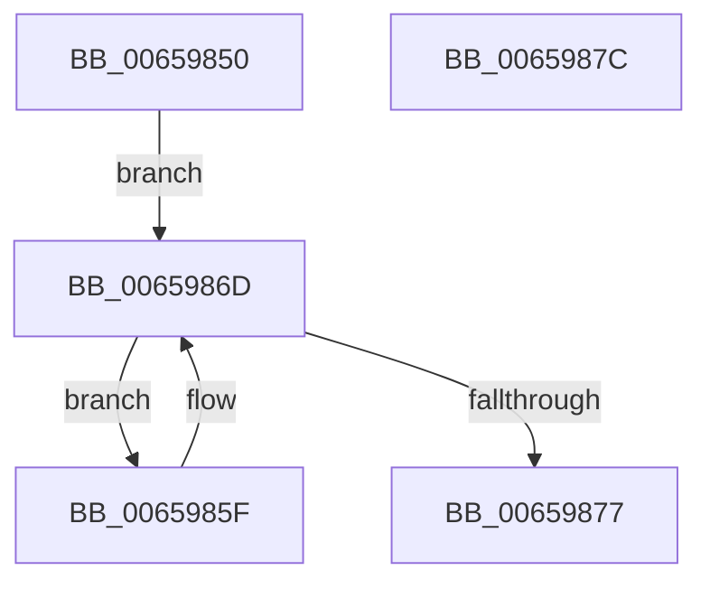

# ExpPrmWaitForForZeroActiveCount

- RVA: `0x00659850`–`0x0065987D` (길이 `45` bytes)
- VA: `0x0000000140659850`
- 실행 섹션: `.text`
- PDB 이름 있음: `예`; PDB Function 태그: `아니요`
- unwind 정보 RVA: `0x0005C788`
- 디코드: `13`개 명령, `45/45` bytes 표시
- 미해석 바이트: `0` (있으면 어셈블리에 `.byte`로 보존)

> 이 문서는 커널 이미지의 기계어와 PDB 기호를 분석해 생성했습니다. 4번과 5번은 함수 원형과 자료형을 바이너리 사용 방식에서 추정한 C 해석이며 원본 소스 복구 결과는 아닙니다.

## 1. Dependencies

- 직접 호출 지점: **1**; 고유 호출 대상: **1**
- 직접 호출자로 확인된 함수: **2**
- RIP 상대 이미지 참조: **1**

### Outgoing calls
- `0x00659868` → [KeDelayExecutionThread](../20/KeDelayExecutionThread_function_00209550.md) (function, `0x00209550`)

### Direct callers
- [ExpPrmNotifyInterfaceChange](../../page/7C/ExpPrmNotifyInterfaceChange_function_007CEDE0.md) at `0x007CEE87`
- [ExpPrmTargetDeviceChangeCallback](../../page/7C/ExpPrmTargetDeviceChangeCallback_function_007CEED0.md) at `0x007CEF06`
- [ExpPrmTargetDeviceChangeCallback](../../page/7C/ExpPrmTargetDeviceChangeCallback_function_007CEED0.md) at `0x007CEF61`

### Static image references
- `0x0065986D` → RVA `0x00EFAAC4` (`.data`; read)

## 2. Other-region calls and transfers

- 다른 실행 섹션으로 향하는 call: **0**
- 별도 외부 분기/꼬리 이동을 확인하지 못했습니다.

## 3. Assembly (complete function range)

```asm
00659850  48 83 EC 28                     sub rsp, 0x28
00659854  48 C7 44 24 30 F0 D8 FF FF      mov qword ptr [rsp + 0x30], 0xffffffffffffd8f0
0065985D  EB 0E                           jmp 0x14065986d
0065985F  4C 8D 44 24 30                  lea r8, [rsp + 0x30]
00659864  33 D2                           xor edx, edx
00659866  33 C9                           xor ecx, ecx
00659868  E8 E3 FC BA FF                  call 0x140209550
0065986D  8B 05 51 12 8A 00               mov eax, dword ptr [rip + 0x8a1251]
00659873  85 C0                           test eax, eax
00659875  75 E8                           jne 0x14065985f
00659877  48 83 C4 28                     add rsp, 0x28
0065987B  C3                              ret
0065987C  CC                              int3
```

## 4. C-style interpretation (structured pseudocode)

```c
__int64 __fastcall ExpPrmWaitForForZeroActiveCount(int a1, int a2)
{
    __int64 result;
    __int64 v_rsp;
    unsigned __int64 v_stack_p8;

    v_rsp = (v_rsp) - (40);
    v_stack_p8 = 0xFFFFFFFFFFFFD8F0ULL;
    goto loc_0065986D;
loc_0065985F:
    a2 = 0;
    a1 = 0;
    result = KeDelayExecutionThread(a1, a2, v_stack_p8, a4);
loc_0065986D:
    if ((unsigned int)((unsigned int)(*(unsigned int *)(v_rip + 9048657))) != 0) goto loc_0065985F;
    v_rsp = (v_rsp) + (40);
    return (unsigned int)(*(unsigned int *)(v_rip + 9048657));
}
```

## 5. (Beta) C Style

```c
int64_t ExpPrmWaitForForZeroActiveCount(int32_t Arg1, int32_t Arg2)
{
    int64_t result;
    int64_t local_rsp;
    uint64_t v_stack_p8;

    local_rsp = (local_rsp) - (40);
    v_stack_p8 = 0xFFFFFFFFFFFFD8F0ULL;
    goto loc_0065986D;
loc_0065985F:
    Arg2 = 0;
    Arg1 = 0;
    result = KeDelayExecutionThread(Arg1, Arg2, v_stack_p8, a4);
loc_0065986D:
    if ((uint32_t)((uint32_t)(*(uint32_t *)(v_rip + 0x8A1251))) != 0) goto loc_0065985F;
    local_rsp = (local_rsp) + (40);
    return (uint32_t)(*(uint32_t *)(v_rip + 0x8A1251));
}
```

## 6. Execution-region graph

[열기: 2D/3D 그래프와 함수 탐색 컨트롤 패널](../../../control-panel.html?section=text&rva=0x00659850&view=graph)

- 2D 그래프는 위에서 아래로 흐르고, 3D 그래프는 빈 공간을 드래그해 회전합니다. Shift+드래그는 이동, 휠은 확대·축소, 함수 노드 선택은 대상 보고서 이동입니다.

### Static fallback


