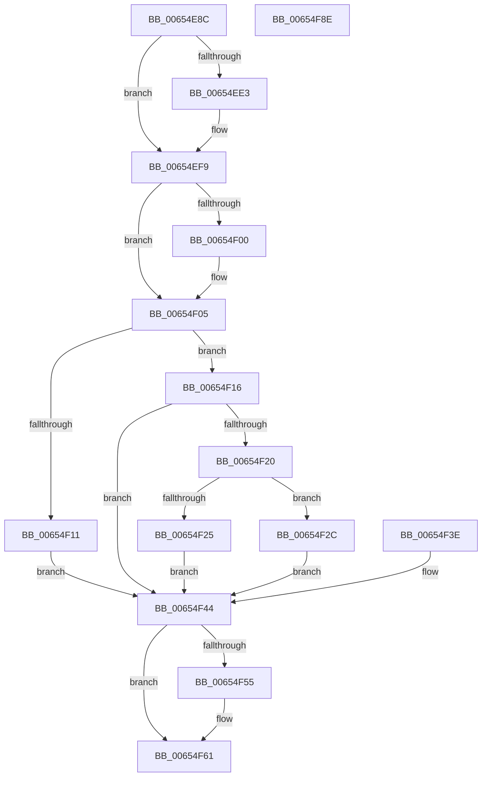

# ExpQueryBootLoaderMetadata

- RVA: `0x00654E8C`–`0x00654F8F` (길이 `259` bytes)
- VA: `0x0000000140654E8C`
- 실행 섹션: `.text`
- PDB 이름 있음: `예`; PDB Function 태그: `아니요`
- unwind 정보 RVA: `0x000D485C`
- 디코드: `69`개 명령, `259/259` bytes 표시
- 미해석 바이트: `0` (있으면 어셈블리에 `.byte`로 보존)

> 이 문서는 커널 이미지의 기계어와 PDB 기호를 분석해 생성했습니다. 4번과 5번은 함수 원형과 자료형을 바이너리 사용 방식에서 추정한 C 해석이며 원본 소스 복구 결과는 아닙니다.

## 1. Dependencies

- 직접 호출 지점: **6**; 고유 호출 대상: **6**
- 직접 호출자로 확인된 함수: **1**
- RIP 상대 이미지 참조: **3**

### Outgoing calls
- `0x00654ECF` → [KeAbPreAcquire](../21/KeAbPreAcquire_function_00210230.md) (function, `0x00210230`)
- `0x00654EF4` → [ExfAcquirePushLockExclusiveEx](../20/ExfAcquirePushLockExclusiveEx_function_0020FC90.md) (function, `0x0020FC90`)
- `0x00654F36` → [memcpy](../6C/memcpy_function_006C6840.md) (function, `0x006C6840`)
- `0x00654F5C` → [ExfTryToWakePushLock](../26/ExfTryToWakePushLock_function_00265DD0.md) (function, `0x00265DD0`)
- `0x00654F68` → [KeAbPostRelease](../2E/KeAbPostRelease_function_002E1600.md) (function, `0x002E1600`)
- `0x00654F6D` → [KeLeaveCriticalRegion](../25/KeLeaveCriticalRegion_function_0025D8B0.md) (function, `0x0025D8B0`)

### Direct callers
- [ExpQuerySystemInformation](../../page/A5/ExpQuerySystemInformation_function_00A57858.md) at `0x00A5A06D`

### Static image references
- `0x00654EC8` → RVA `0x00EFF018` (`.data`; read)
- `0x00654ED7` → RVA `0x00EFF018` (`.data`; read/write)
- `0x00654F05` → RVA `0x00E68560` (`.data`; read)

## 2. Other-region calls and transfers

- 다른 실행 섹션으로 향하는 call: **0**
- 별도 외부 분기/꼬리 이동을 확인하지 못했습니다.

## 3. Assembly (complete function range)

```asm
00654E8C  48 89 5C 24 08                  mov qword ptr [rsp + 8], rbx
00654E91  48 89 7C 24 10                  mov qword ptr [rsp + 0x10], rdi
00654E96  4C 89 64 24 18                  mov qword ptr [rsp + 0x18], r12
00654E9B  41 55                           push r13
00654E9D  41 56                           push r14
00654E9F  41 57                           push r15
00654EA1  48 83 EC 20                     sub rsp, 0x20
00654EA5  4D 8B F8                        mov r15, r8
00654EA8  44 8B EA                        mov r13d, edx
00654EAB  4C 8B E1                        mov r12, rcx
00654EAE  65 48 8B 04 25 88 01 00 00      mov rax, qword ptr gs:[0x188]
00654EB7  48 83 CB FF                     or rbx, 0xffffffffffffffff
00654EBB  66 01 98 E4 01 00 00            add word ptr [rax + 0x1e4], bx
00654EC2  90                              nop
00654EC3  45 33 C0                        xor r8d, r8d
00654EC6  33 D2                           xor edx, edx
00654EC8  48 8D 0D 49 A1 8A 00            lea rcx, [rip + 0x8aa149]
00654ECF  E8 5C B3 BB FF                  call 0x140210230
00654ED4  4C 8B F0                        mov r14, rax
00654ED7  F0 48 0F BA 2D 37 A1 8A 00 00   lock bts qword ptr [rip + 0x8aa137], 0
00654EE1  73 16                           jae 0x140654ef9
00654EE3  4C 8D 05 2E A1 8A 00            lea r8, [rip + 0x8aa12e]
00654EEA  48 8B D0                        mov rdx, rax
00654EED  48 8D 0D 24 A1 8A 00            lea rcx, [rip + 0x8aa124]
00654EF4  E8 97 AD BB FF                  call 0x14020fc90
00654EF9  33 FF                           xor edi, edi
00654EFB  4D 85 F6                        test r14, r14
00654EFE  74 05                           je 0x140654f05
00654F00  41 C6 46 0A 01                  mov byte ptr [r14 + 0xa], 1
00654F05  48 8B 15 54 36 81 00            mov rdx, qword ptr [rip + 0x813654]
00654F0C  48 85 D2                        test rdx, rdx
00654F0F  75 05                           jne 0x140654f16
00654F11  41 89 3F                        mov dword ptr [r15], edi
00654F14  EB 2E                           jmp 0x140654f44
00654F16  8B 02                           mov eax, dword ptr [rdx]
00654F18  41 89 07                        mov dword ptr [r15], eax
00654F1B  4D 85 E4                        test r12, r12
00654F1E  74 24                           je 0x140654f44
00654F20  44 3B E8                        cmp r13d, eax
00654F23  73 07                           jae 0x140654f2c
00654F25  BF 04 00 00 C0                  mov edi, 0xc0000004
00654F2A  EB 18                           jmp 0x140654f44
00654F2C  4C 8B C0                        mov r8, rax
00654F2F  48 83 C2 04                     add rdx, 4
00654F33  49 8B CC                        mov rcx, r12
00654F36  E8 05 19 07 00                  call 0x1406c6840
00654F3B  90                              nop
00654F3C  EB 06                           jmp 0x140654f44
00654F3E  8B F8                           mov edi, eax
00654F40  48 83 CB FF                     or rbx, 0xffffffffffffffff
00654F44  F0 48 0F C1 1D CB A0 8A 00      lock xadd qword ptr [rip + 0x8aa0cb], rbx
00654F4D  80 E3 06                        and bl, 6
00654F50  80 FB 02                        cmp bl, 2
00654F53  75 0C                           jne 0x140654f61
00654F55  48 8D 0D BC A0 8A 00            lea rcx, [rip + 0x8aa0bc]
00654F5C  E8 6F 0E C1 FF                  call 0x140265dd0
00654F61  48 8D 0D B0 A0 8A 00            lea rcx, [rip + 0x8aa0b0]
00654F68  E8 93 C6 C8 FF                  call 0x1402e1600
00654F6D  E8 3E 89 C0 FF                  call 0x14025d8b0
00654F72  8B C7                           mov eax, edi
00654F74  48 8B 5C 24 40                  mov rbx, qword ptr [rsp + 0x40]
00654F79  48 8B 7C 24 48                  mov rdi, qword ptr [rsp + 0x48]
00654F7E  4C 8B 64 24 50                  mov r12, qword ptr [rsp + 0x50]
00654F83  48 83 C4 20                     add rsp, 0x20
00654F87  41 5F                           pop r15
00654F89  41 5E                           pop r14
00654F8B  41 5D                           pop r13
00654F8D  C3                              ret
00654F8E  CC                              int3
```

## 4. C-style interpretation (structured pseudocode)

```c
__int64 __fastcall ExpQueryBootLoaderMetadata(__int64 a1, int a2, __int64 a3)
{
    __int64 result;
    __int64 v_rbx;
    __int64 v_rdi;
    __int64 v_rsp;
    unsigned __int64 v_stack_p10;
    unsigned __int64 v_stack_p18;
    unsigned __int64 v_stack_p8;

    v_stack_p8 = v_rbx;
    v_stack_p10 = v_rdi;
    v_stack_p18 = v_r12;
    v_rsp = (v_rsp) - (32);
    v_rbx = (v_rbx) | (-1);
    a3 = 0;
    a2 = 0;
    result = KeAbPreAcquire(v_rip + 9085257, a2, a3, a4);
    if (!(condition_is_above_or_equal)) {
        a3 = v_rip + 9085230;
        a2 = result;
        a1 = v_rip + 9085220;
        result = ExfAcquirePushLockExclusiveEx(a1, a2, a3, a4);
    }
    v_rdi = 0;
    if (result != 0) {
        *(unsigned __int8 *)(result + 10) = 1;
    }
    if (*(unsigned __int64 *)(v_rip + 8468052) != 0) goto loc_00654F16;
    *(unsigned int *)(a3) = 0;
    goto loc_00654F44;
loc_00654F16:
    *(unsigned int *)(a3) = (unsigned int)((unsigned int)(*(unsigned int *)(*(unsigned __int64 *)(v_rip + 8468052))));
    if (a1 == 0) goto loc_00654F44;
    if (((unsigned int)((unsigned int)(a2))) >= ((unsigned int)((unsigned int)(*(unsigned int *)(*(unsigned __int64 *)(v_rip + 8468052)))))) goto loc_00654F2C;
    goto loc_00654F44;
loc_00654F2C:
    a2 = (*(unsigned __int64 *)(v_rip + 8468052)) + (4);
    result = memcpy(a1, a2, (unsigned int)(*(unsigned int *)(*(unsigned __int64 *)(v_rip + 8468052))), a4);
    goto loc_00654F44;
loc_00654F44:
    v_rbx = (unsigned __int8)((v_rbx) & (6));
    if (((unsigned __int8)(v_rbx)) == 2) {
        a1 = v_rip + 9085116;
        result = ExfTryToWakePushLock(a1, a2, (unsigned int)(*(unsigned int *)(*(unsigned __int64 *)(v_rip + 8468052))), a4);
    }
    result = KeAbPostRelease(v_rip + 9085104, a2, (unsigned int)(*(unsigned int *)(*(unsigned __int64 *)(v_rip + 8468052))), a4);
    result = KeLeaveCriticalRegion(v_rip + 9085104, a2, (unsigned int)(*(unsigned int *)(*(unsigned __int64 *)(v_rip + 8468052))), a4);
    v_rsp = (v_rsp) + (32);
    return (unsigned int)((unsigned int)((unsigned int)(0xC0000004ULL)));
}
```

## 5. (Beta) C Style

```c
int64_t ExpQueryBootLoaderMetadata(int64_t Arg1, int32_t Arg2, void *Arg3)
{
    uint8_t *arg3 = (uint8_t *)Arg3;

    int64_t result;
    int64_t local_rbx;
    int64_t local_rdi;
    int64_t local_rsp;
    uint64_t v_stack_p10;
    uint64_t v_stack_p18;
    uint64_t v_stack_p8;

    v_stack_p8 = local_rbx;
    v_stack_p10 = local_rdi;
    v_stack_p18 = local_r12;
    local_rsp = (local_rsp) - (32);
    local_rbx = (local_rbx) | (-1);
    Arg3 = 0;
    Arg2 = 0;
    result = KeAbPreAcquire(v_rip + 9085257, Arg2, Arg3, a4);
    if (!(condition_is_above_or_equal)) {
        Arg3 = v_rip + 9085230;
        Arg2 = result;
        Arg1 = v_rip + 9085220;
        result = ExfAcquirePushLockExclusiveEx(Arg1, Arg2, Arg3, a4);
    }
    local_rdi = 0;
    if (result != 0) {
        *(uint8_t *)(result + 0xA) = 1;
    }
    if (*(uint64_t *)(v_rip + 0x813654) != 0) goto loc_00654F16;
    *(uint32_t *)(arg3) = 0;
    goto loc_00654F44;
loc_00654F16:
    *(uint32_t *)(arg3) = (uint32_t)((uint32_t)(*(uint32_t *)(*(uint64_t *)(v_rip + 0x813654))));
    if (Arg1 == 0) goto loc_00654F44;
    if (((uint32_t)((uint32_t)(Arg2))) >= ((uint32_t)((uint32_t)(*(uint32_t *)(*(uint64_t *)(v_rip + 0x813654)))))) goto loc_00654F2C;
    goto loc_00654F44;
loc_00654F2C:
    Arg2 = (*(uint64_t *)(v_rip + 0x813654)) + (4);
    result = memcpy(Arg1, Arg2, (uint32_t)(*(uint32_t *)(*(uint64_t *)(v_rip + 0x813654))), a4);
    goto loc_00654F44;
loc_00654F44:
    local_rbx = (uint8_t)((local_rbx) & (6));
    if (((uint8_t)(local_rbx)) == 2) {
        Arg1 = v_rip + 9085116;
        result = ExfTryToWakePushLock(Arg1, Arg2, (uint32_t)(*(uint32_t *)(*(uint64_t *)(v_rip + 0x813654))), a4);
    }
    result = KeAbPostRelease(v_rip + 9085104, Arg2, (uint32_t)(*(uint32_t *)(*(uint64_t *)(v_rip + 0x813654))), a4);
    result = KeLeaveCriticalRegion(v_rip + 9085104, Arg2, (uint32_t)(*(uint32_t *)(*(uint64_t *)(v_rip + 0x813654))), a4);
    local_rsp = (local_rsp) + (32);
    return (uint32_t)((uint32_t)((uint32_t)(0xC0000004ULL)));
}
```

### 관측된 메모리 오프셋

구조체 형식이 확인되지 않은 접근은 인자 기준의 오프셋으로만 기록했습니다.

| 기준 인자 | 오프셋 표현 | 폭 (bit) | 접근 |
|---|---:|---:|---|
| `Arg3` | `+ 0x0` | `32` | `W` |

## 6. Execution-region graph

[열기: 2D/3D 그래프와 함수 탐색 컨트롤 패널](../../../control-panel.html?section=text&rva=0x00654E8C&view=graph)

- 2D 그래프는 위에서 아래로 흐르고, 3D 그래프는 빈 공간을 드래그해 회전합니다. Shift+드래그는 이동, 휠은 확대·축소, 함수 노드 선택은 대상 보고서 이동입니다.

### Static fallback


